# Orchestron

Here’s the strange, delightful thing about music software: most of it assumes the instrument already exists. Then it gives you knobs. "Orchestron" flips that around.

You don’t load a synthesizer.
You invent one.

Orchestron is a visual instrument workshop built on the power of Csound — not a preset browser, not a plugin rack, not a timeline with tracks stacked like office paperwork. You design sound from signal flow upward. Oscillators, envelopes, filters, physical models, control signals — connect them, and the instrument comes alive while you hear it.

Read the complete user documentation in [user_documentation.md](documentation/user_documentation.md).

Sequencers offer meter, per-pad pattern length and named subdivisions, including triplets. Beat groups show how twelve steps fit into one 4/4 bar; advanced playback speed stays independent. [Timing guide (EN/DE/FR/ES)](documentation/performance/sequencer_timing.md).

Explore the [interactive architecture animation](documentation/orchestron_architecture_animated.html) to follow a patch from the editor to native Csound and browser playback. Download the HTML and open it in a browser; it works offline.

Double-click the clip arranger to create an empty four-beat clip, then use its inline **+** to add content. Move content into gaps, copy it between compatible tracks, and resize patterns directly in expanded tracks with live size and duration feedback. Trailing rests can be shortened at their right edge; clip trimming preserves hidden content and pending edits. See the [clip arranger guide](documentation/performance/clip_arranger_preview.md).

## Built With Codex

This application was built using the Codex App with `GPT-5.3-Codex`, `GPT-5.4`, `GPT-5.5`, `GPT-5.6-Sol` and `GPT-6-Astra` using **Extra High** reasoning effort. I started development and expected to hit a limit at some point where things fell apart, but that never happened up to now, given me a good intuition on how powerful today's coding agents have become...

## What you can create

The Perform rack uses the full available width and automatically sizes instrument
cards to fit their controllers. Add **Controller Group** names to organize related
settings inside thin labeled borders. Minimoog Monophonic, Granular Synthesis and
Ambient Wavetable Cloud include groups organized by synthesis function. [Controller and rack guide](documentation/performance/performance_controllers.md).

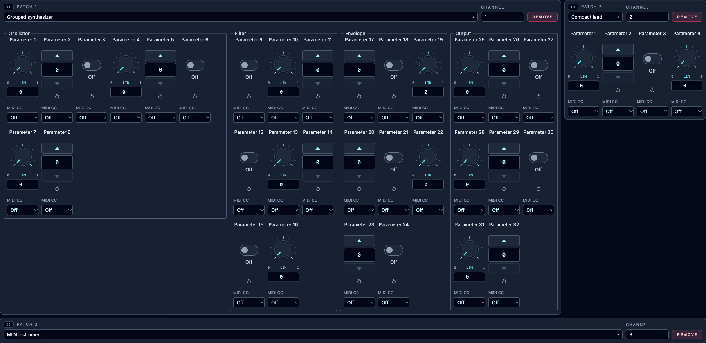

[Granular Synthesis](examples/instruments/granular_synthesis/README.md) is a
sample-free stereo instrument with 30 performance controls for pitched clouds,
sparse particles, metallic textures and sync-like tones. Its guide includes
five sound recipes and audio previews.

Hear seven contrasting instances in [Grain of Salt](examples/performances/grain_of_salt/README.md),
a five-minute melodic electronic song with a recurring hook and a spacious middle section.

[Trance Gate](documentation/instrument_design/trance_gate.md) combines direct CC24
gating with a CC29-triggered triangle LFO that sweeps between two frequencies and
returns smoothly on release, with adjustable sweep time and threshold.
Its Stereo control adds triangle-driven balance during LFO sweeps and a held
random position on each manual gate opening.

The [Analog Drumkit](examples/instruments/analog_drumkit/README.md) provides 17
sample-free percussion voices for breakbeats, with General MIDI note assignments,
shared kick snappiness and hi-hat tuning, snare tuning, and individual controls
for its side stick, clap, electric snare, six toms, crash, ride and tambourine.

Build a sound from the inside out. In **Instrument Design**, connect Csound building blocks, called opcodes, into a patch: an oscillator makes a tone, an envelope shapes its attack and decay, a filter changes its colour, and modulation brings it into motion. Follow the connections to see how each part contributes to the result.

Start with a playable instrument, a drumset, an audio effect, an audio output patch, or an empty canvas. Turn a promising experiment into a reusable template, keep several instruments open in tabs, and return to unfinished ideas later.

- **Synths and textures:** combine oscillators, filters, envelopes, physical models, and effects for basses, leads, bells, pads, and evolving soundscapes.
- **Sample-based sounds:** upload audio or SoundFonts, and use the table editor to build waveforms and shape how samples are played.
- **Additive resynthesis:** upload a `hetro` analysis file into [`adsyn`](documentation/instrument_design/opcode_catalog_and_documentation.md#additive-resynthesis-with-adsyn), then control amplitude, pitch and playback speed.
- **Drumsets:** give different notes their own synthesis voices with [If / Switch branches](documentation/instrument_design/control_flow.md), then sequence them together.
- **Effects:** design stereo processors to use as inserts, shared effects, or part of your Master chain.

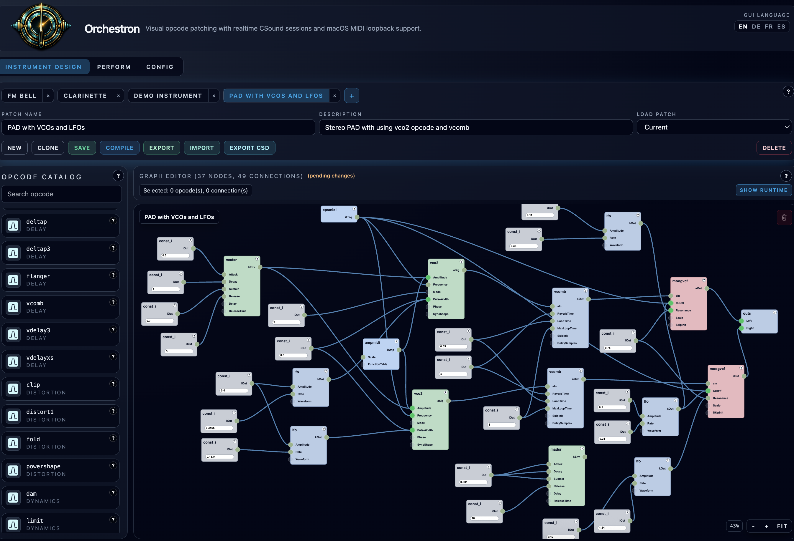

*An instrument takes shape as a graph: this pad combines oscillators, envelopes, filters, and delay.*

Use [`midi_legato`](documentation/instrument_design/midi_legato.md) for monophonic instruments whose touching notes share a breath or envelope. Pitch changes immediately, velocity follows smoothly, and gaps start a new phrase.

Play the [Expressive Tenor Saxophone](examples/instruments/tenor_saxophone/README.md)
for a sample-free reed model with connected phrasing, fuller upper harmonics and
velocity-sensitive reed response. Soft velocities give breathy notes, harder playing
adds growl, and velocities 115–127 bring out an overblown squeal. The example guide
includes level-matched previews of the original and balanced acoustic revision.

Shape sounds with the [ZDF filters and `zfilter2`](documentation/instrument_design/opcode_catalog_and_documentation.md#zdf-and-custom-iir-filters): modulate cutoff and resonance at audio rate, use simultaneous filter outputs, or supply custom IIR coefficients.

The [Goa Trance FM Lead](documentation/instrument_design/goa_trance_fm_lead.md)
retains its original filters and sound at stable settings, with note-dependent
resonance guards that prevent its high-register filter runaway.

Use [`compress2`, `pareq`, and `hsboscil`](documentation/instrument_design/opcode_catalog_and_documentation.md#compression-equalization-and-cyclic-tonality) for sidechain compression, parametric EQ, and tones with independently controlled pitch and brightness.

Build prepared-piano sounds with [`prepiano`](documentation/instrument_design/opcode_catalog_and_documentation.md#prepared-piano): stereo modeled strings, hammer controls, and optional GEN tables for rattles and rubbers. The [playable piano example](examples/instruments/Piano_prepiano.orch.instrument.json) uses MIDI pitch and velocity with ten performance controls, pitch-tracked treble excitation and no preparations.

Play [HSB Mono](documentation/instrument_design/hsb_mono.md) for cyclic tonality,
octave brightness and pitch slides across gaps of roughly 20 ms, with performance
knobs and live MIDI control of all three settings.

[Minimoog Monophonic](examples/instruments/minimoog_monophonic/README.md) combines
three oscillators, noise, a ladder filter and separate loudness/filter contours
with 40 performance controls, monophonic legato and adjustable glide timing.

The [Parametric Equalizer](documentation/instrument_design/parametric_equalizer.md)
provides seven stereo bands from 63 Hz to 16 kHz, with linear −20 to +20 dB
performance controls and neutral 0 dB defaults.

Build composite waveforms with the [GEN19 table editor](documentation/instrument_design/gen_table_editor.md#gen19-sinusoidal-partials-with-dc-offset), setting each partial’s frequency ratio, strength, phase and DC offset.

Hover over an instrument's description in Instrument Design to read the full text in a tooltip.

Edit [constant values](documentation/instrument_design/graph_editor.md#constant-nodes) directly on the node, including multi-digit numbers and decimals, while keeping the field focused.

Bright-green input sockets reveal active stored values and formulas. Double-click any editable input—even without a cable—to inspect its value and source, edit it, or **Reset input** to the remaining connections or catalog default. See the [input value and formula guide](documentation/instrument_design/input_formula_assistant.md).

Use [draft auditioning](documentation/instrument_design/runtime_panel_and_compilation.md#audition-a-draft) to hear an unfinished patch on its own or in the context of a performance before saving it. The [Instrument Design guide](documentation/instrument_design/instrument_design.md) walks through the editor, formulas, tables, and patch library.

## Build patterns and arrangements

Use up to **16 sequencers of each type**—melodic, score, drummer and controller—in one performance. Save/load, native bundles and autosave recovery preserve all of them, including their channels, patterns and arrangements.

Assign **MIDI CC 1–50** to individual [performance controls](documentation/performance/performance_controllers.md#receive-midi-cc-in-a-performance) in the rack. Hardware MIDI, manual controller lanes and controller sequencers move their knobs, integer values and toggles on the channel selected at the top of the instrument’s rack slot. Assignments belong to the performance; new notes adopt the mapped values, and both CSD export modes preserve authored changes.

An opt-in [clip arranger preview](documentation/performance/clip_arranger_preview.md) adds compact tracks, nested reusable content, fixed clip windows and contextual editing with the existing sequencers. Shift-click or Shift+Left/Right selects adjacent content, including across loop repetitions within one clip. Grouping the middle two occurrences of `A A A A` produces `A [A A] A` in the same clip, preserving timing, linked patterns and repetition transposition. Insert existing content and drag ordinary selections between compatible containers; spanning selections become editable after grouping. Right-click **Duplicate** to append linked content after the clip’s last musical item, using trailing silence first; looped clips append once after the final repetition. **Ungroup** appears only for containers. Double-click empty space inside a clip to open **Add content** at that quarter-beat position. Remove selected patterns or containers at any nesting level with the toolbar or Delete/Backspace. Group/Supergroup and scoped structural saves preserve shared content, growing windows only when space permits. The group/supergroup inspector uses the same structural save and growth rules as the timeline. Save/Discard/Cancel resolves intersecting musical drafts while retaining unrelated work. Local/all-occurrence saves keep shared patterns explicit. Save/load and autosave retain 25 compact undo steps, including histories from earlier preview saves. Play edit supports exact fractional rests and large groups, including performances at the definition limit. Transport buttons wrap at narrow widths and enlarged text sizes; track headers leave room for the timeline. Play edit uses the existing sequencer playback highlighting while auditioning a draft, including the arpeggiator when input notes arrive. Tape transport controls offer Play, Pause, Stop and beat seeking, with a **Loop** button for the selected clip or, when none is selected, the whole song. Click empty timeline space to deselect a clip. Loading selects a clip even with looping off. An explicit Song end and Fit song to clips control make trailing silence visible and editable; the keyboard and manual controllers remain below the arranger.

The clip arranger can [generate instrument automation](documentation/performance/instrument_automation.md) from the rack’s assigned performance-controller CCs. Bound lanes follow the instrument’s MIDI channel, support song-length curves with up to ten points, and expose curve editing directly inside clips with explicit Save/Discard. Step Mode retains its existing grid.

Clip patterns, groups and supergroups also offer [nondestructive transposition](documentation/performance/clip_arranger_preview.md#transpose-clips-without-changing-notes): shared per-repetition progressions, independent parent and placement offsets, diatonic steps and chromatic semitones. Arranger badges show effective offsets and open transposition controls directly in the lane. Timeline previews show the resulting pitches while the original notes stay editable.

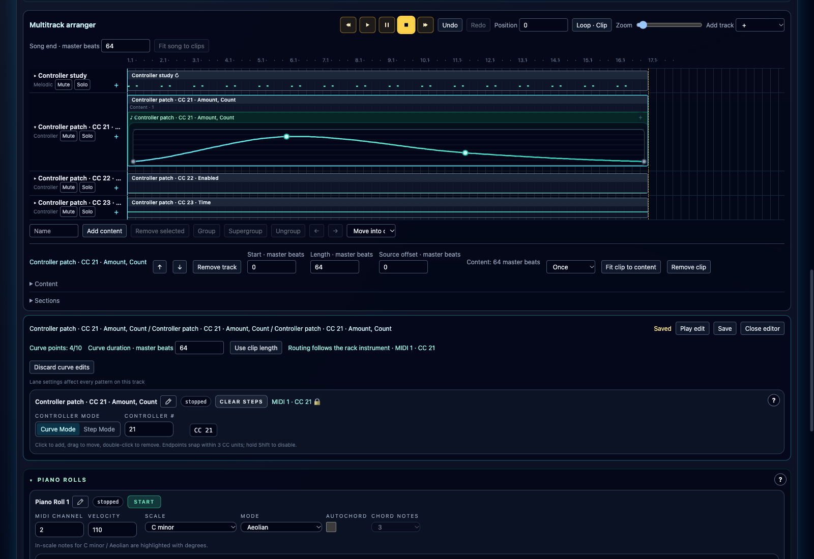

Draw long, polyphonic passages in the **[Score Sequencer](documentation/performance/score_sequencers.md)**. Each of eight pads holds independent note durations and velocities on a scrollable, scale-highlighted score with a fixed piano keyboard. Hold a key to audition it, or double-click to append a quarter note after the last note and collect a melody before shaping its rhythm. Previewing starts the instrument engine when needed; pattern length stays fixed, with a message when an appended note will not fit. The top-right **?** opens multilingual help. In the new multitrack clip editor, add a pattern inside a Score-track clip and double-click it to open this same editor; save it as a local variation or update all linked occurrences. The grid ends at Pattern length, and notes can be drawn or resized exactly to that boundary. Add chords, edit with snapping and undo, and grow a score to cover a whole performance. Shortening preserves hidden notes for later expansion. Manual pad changes launch at the next local bar, with End of score available; each score stays one whole arranger occurrence.

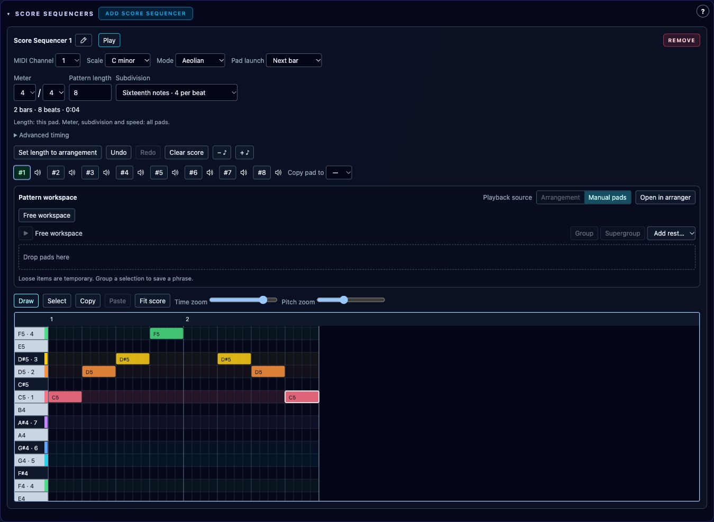

Performances made entirely from Score Sequencers retain the multitrack arranger,
with a separate lane for every score device. Each score header has the same
right-aligned rose **Remove** button as the other sequencers.

Create melodies, bass lines, drum patterns, and movement in the same performance. Melodic sequencers offer scales, modes, individual notes, and chords; drummer sequencers let you shape each hit's velocity. Move individual notes, chords, and drum hits early or late with per-step timing controls, preserving the pattern's meter and length. Draw controller curves or use **Step Mode** to send exact MIDI CC values at individual steps, with silent gaps and a configurable reset value on start/stop, and use beat-synchronized arpeggiators to drive existing MIDI instruments with editable rhythms, ties, ratchets and eight musical variation pads. Arpeggiators can follow their own arranger lanes or run independently in Live mode, with the same green Start and orange Stop controls as the other devices. Their Input Channel → Target Channel controls sit together in the top row, making the MIDI route visible immediately.

Arpeggiator steps show large note previews and scale-degree borders using the piano keyboard’s colours. Chord borders show separate colour segments; Scale Off keeps borders neutral. Hover over a step to read its full note preview and scale degrees.

Pattern pads **#1–#8** hold reusable variations; melodic and drummer pads turn green when they contain a note or hit with nonzero velocity and appear as **1–8** in arranger lanes and palettes. Red groups and violet supergroups use the same colours in sequencers and arranger lanes; rests stay dark. Assemble phrases in the upper-right workspace of melodic, score, drummer and controller sequencers and arpeggiators: drag pads, Cmd/Ctrl-click to group selections, right-click to split groups, and Apply shared phrase edits explicitly. Play loops the whole workspace and outlines the currently playing pad, phrase or rest. Deleting an unused phrase expands its temporary workspace references, preserving the assembly. Assemble song order in the multitrack arranger with pads, groups, supergroups and rests. Hold a speaker icon for 250 ms to preview a phrase: during arranger playback it enters at the next cycle boundary; while stopped it plays without moving the song cursor. Release resumes the previous playback. Live arpeggiator previews follow the configured rhythm cycle or master bar and use incoming or held notes. The highlighted Play or Stop button shows the arranger’s state. Right-click pads and phrases to save custom colours shared by their occurrences. Each sequencer can use its own meter, grid, and beat ratio around a shared tempo. Explore patterns of different lengths, odd meters, and rhythms that move against one another.

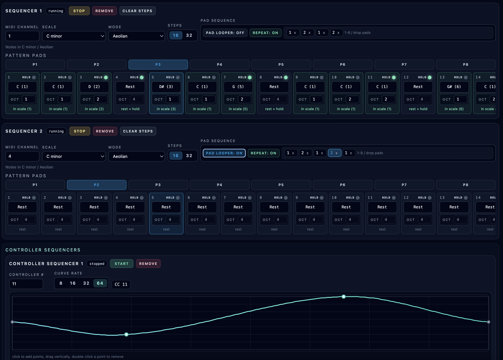

*Melodic patterns and controller curves bring notes and movement into the same performance.*

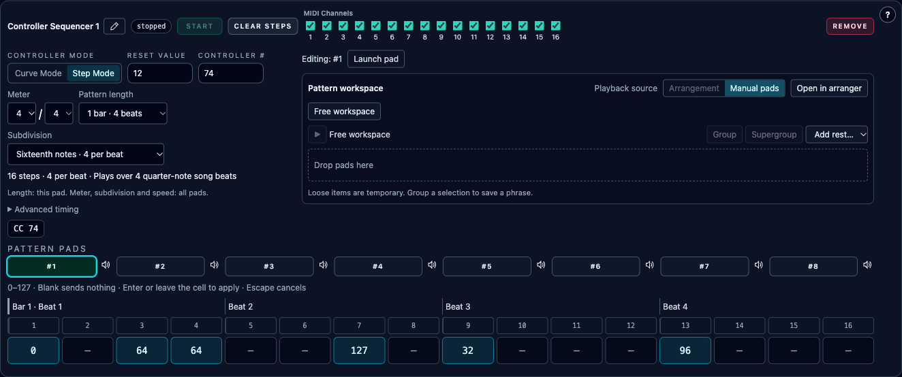

*Switch between Curve Mode and Step Mode while retaining both patterns on every pad.*

[Controller curves](documentation/performance/controller_sequencers.md#curve-editor-interactions)
have independent start and end values for automation spanning multiple pads. Drag
an endpoint within 3 CC units of the other to snap, with an amber alignment guide;
hold Shift to disable snapping. Numeric entry stays exact.

Lay out those patterns in the **multitrack arranger** to build an introduction, repeat a phrase, bring drums in, or leave space for a change of mood. Melodic, drummer, and controller tracks share one timeline, with looping and navigation controls for working on a passage. Play runs from the current cursor to the song end, including trailing rests. **Loop song**, immediately left of Rewind, repeats the whole song when enabled and is saved with the performance. Marked loop ranges repeat independently of this toggle. Repeating lanes stay within those song bounds. Choose **Arrangement** or **Manual pads** with the Playback source toggle in each sequencer. New devices start with Manual pads; placing their first item in an arranger lane selects Arrangement. Later source choices are saved with the performance. Start individual devices to develop a pattern with backing parts: Arrangement devices join the selected song passage, while Manual pads plays the pad selected for editing. While Manual pads runs, click another pad to queue it for the end of the current pattern (Score Sequencers default to the next local bar): orange marks the queued pad and blue-green marks the playing pad. Manual pads keep playing through song loops, endings, and arranger Play/Stop. Compact track headers expand with a triangle to reveal a wrapping drag-and-drop palette that hides rest-only pattern pads. Drop at an element edge to insert, or beyond the lane’s end to add a gap automatically. Move items left or right into adjacent rests, including across their original position, to redistribute silence without shifting other items. Right-click to group, ungroup, create variations, or remove material. Mute or solo individual lanes—even when they share an instrument—without losing their place in the song. These temporary lane controls do not change the mixer or saved performance.

Select song sections across all lanes by dragging the arranger’s top beat ruler, or select some lanes by dragging a rectangle in empty timeline space (Shift-drag over existing elements). Right-click to copy, overwrite, or insert a section while shifting later material. **Cmd/Ctrl+Shift+D** repeats the selection immediately after itself and inserts time across all lanes: two sections A–B become A–A–B. Context menus also offer insertion on selected lanes only. **Alt/Option-drag** copies a range; add **Shift** to insert time across all lanes. The arranger’s Undo/Redo buttons share a 25-action history for timeline edits, groups, variations, colours and automatic source selection on first placement. Hold either button to select a history entry. History is saved with the performance; selection and clipboard survive view switches within the session. Copies reuse existing pads and phrases; use Create variation for independent changes. See [song-section editing](documentation/performance/multitrack_arranger.md#copy-and-insert-song-sections).

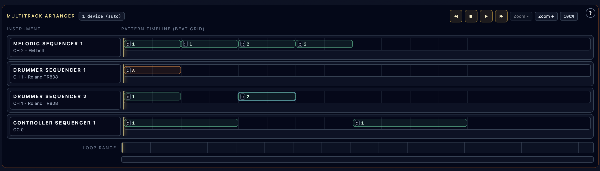

*Arrange note patterns, drum parts, and automation side by side.*

Composer **Play** starts stopped instruments automatically; composer **Stop** stops them again. Instruments that were already running before Play stay running until you stop them manually.

Program drum rolls with **1–8 ratchets per hit** and an optional velocity ramp. Right-click a drum cell or press **Shift+F10** to set its repeat count and final velocity; **×N** badges show rolls in the grid. Early/late timing moves the whole roll, and native bundles and both CSD exports preserve it. See [drummer ratchets](documentation/performance/drummer_sequencers.md#ratchets-and-velocity-ramps).

Strum melodic chords **Low → High** or **High → Low**, with a tempo-synced **Spread of 0–100%** of one step. At 100%, the last note starts at the next step; each note keeps its duration and can overlap later steps. Right-click a note or chord, press **Shift+F10**, or use its **⋮** button to open Timing and Strum together. See [strummed chords](documentation/performance/sequencer_tracks_and_steps.md#strummed-chords).

Author the same settings with [`edit strum list|set|reset` or YAML/JSON score fields](integrations/skills/orchestron-performance-creator/references/step_strum.md) through the performance creator CLI.

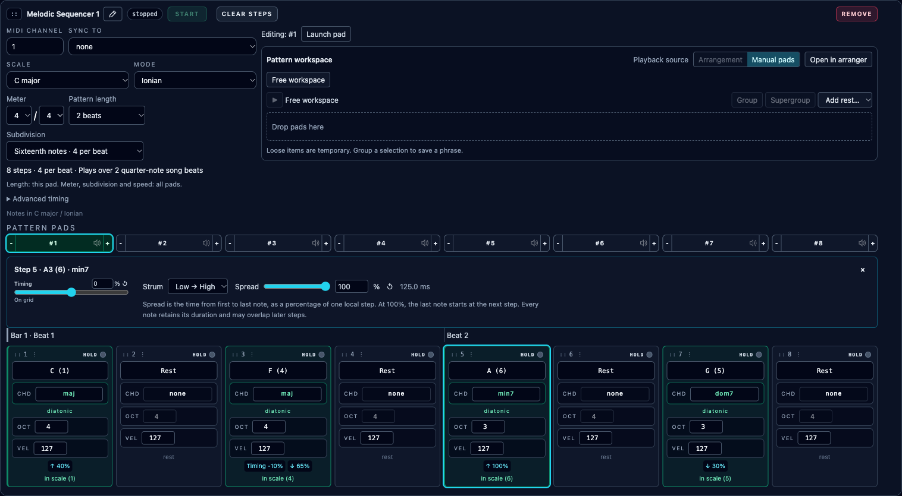

Explore the guides to [sequencer editing](documentation/performance/sequencer_tracks_and_steps.md), [pattern pads](documentation/performance/pattern_pads_and_pad_looper.md), [arpeggiators](documentation/performance/arpeggiators.md), and the [multitrack arranger](documentation/performance/multitrack_arranger.md).

## Perform and shape the mix

Performance descriptions show three lines with automatic wrapping. Scroll vertically through longer descriptions or hover over the field to read the full text.

Load instruments into the Perform rack, assign MIDI channels, and play from the on-screen keyboards or an external MIDI source. Scale highlighting follows the currently playing melodic or score clip, including Play edit auditions, while you improvise. When no melodic source is playing, the keyboard keeps its own editable scale and mode. See [piano-roll scale following](documentation/performance/piano_rolls.md#scalemode-following-behavior-during-live-playback). Enable **Autochord** on a piano roll to play 3-, 4-, or 5-note chords by stacking every other highlighted note above the pressed key. In mixed scales it uses their common notes; keys outside the highlighted set remain single notes. Manual MIDI controls and controller sequencers can each send to your chosen MIDI channels, with all 16 selected by default (OMNI). Manual controllers use [compact cards](documentation/performance/midi_controllers.md) that sit side by side and wrap as needed, including below the clip arranger. Assignable MIDI controls let you adjust sounds as you play; instruments can also expose their own [performance controls](documentation/performance/performance_controllers.md) for settings such as envelope times or distortion. Choose Float knobs, Integer controls with step buttons and direct entry, or Bool on/off toggles for each setting.

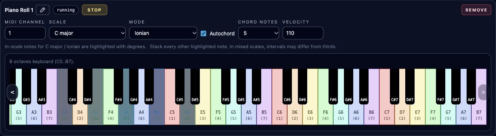

*Play a melody with harmonic guidance and reach for MIDI controls beneath the keyboard.*

Mix instruments and effect returns with volume faders, pan or balance, mute, solo, and meters. Each instrument strip shows its rack patch number and MIDI channel above the instrument name; continuous instruments show **Continuous** instead of a channel. Add an insert to one instrument, send several instruments to a shared effect, and shape the combined sound through Master. Every performance has a fixed internal Master with its own controls and inserts, without adding an instrument to your library. A routing matrix and diagram help you follow where the audio goes.

Compare effects during playback with **Bypass** on each continuous insert. Switching uses a smooth 20 ms transition and preserves the rest of the chain. Save/load and native bundles retain each insert’s state; MIDI and SCORE CSD exports omit bypassed effect processing and its exclusive assets. See [insert bypass](documentation/performance/audio_mixer_and_routing.md#compare-inserts-with-bypass).

Removing a rack instrument also removes its dedicated inserts and connections; removing one insert reconnects the remaining simple chain. **Routing diagnostics → Check routing** catches missing insert assignments and displays validation errors beside the check button. Feedback errors show a closed routing path with instrument names, instance IDs, MIDI channels, audio ports and processing stages. **Show offending connections** highlights the affected mixer strips, inserts, sends and routes, and filters the diagram to the loop. Serial inserts, including Master inserts, are distinguished from parallel direct and processed output paths in routing checks and CSD export warnings. See the [routing diagnostics example](documentation/performance/audio_mixer_and_routing.md#troubleshoot-routing-and-silence).

For optional instrument, composition and performance creation with a coding agent, see the [Agent Tooling Appendix](documentation/appendix/appendix.md) and its creator skills and command-line utilities.

Performance Creator chooses sequencers by musical role and builds songs from reusable clip definitions, compact repetitions, scoped transposition and instrument-bound automation. Its [song workflow](integrations/skills/orchestron-performance-creator/references/song_workflow.md) supports exact timing, section edits, undo, contextual audition and native/MIDI/SCORE export, with structured results after each command. Custom Drummer patterns retain individual MIDI keys, hits and velocities; legacy pad and composition-score commands remain available.

Bundle all four skills as a Codex plugin with `make -C integrations`. See the [plugin build and installation guide](integrations/README.md#build-the-plugin-zip) for the ZIP, prerequisites, and update workflow.

Transcribe a sung or hummed melody with the independent [Sung Melody Transcription skill](documentation/appendix/sung_melody_transcription_skill.md): supply a recording, optionally with claps, and review a piano WAV, MIDI, note JSON and a complete edit log. Tempo, meter, phrase length and ending can be supplied. This plugin skill uses RMVPE and FluidSynth; piano previews run independently of Orchestron performance creation.

Explore melodic ideas with [Composition Creator](documentation/appendix/composition_creator_skill.md): listen to candidate phrases, select favourites, leave feedback and lock passages you want to preserve. Expand each candidate's creation history to see the recorded arvo calls, inputs, combined sources and protected passages through earlier versions. Develop accepted ideas into a song, then hand its machine-readable score to Performance Creator for instruments, routing and saving. The local audition page supports EN/DE/FR/ES and works without a running Orchestron backend.

Keep a motif's opening and compare four purposeful endings: settled, suspended,
higher-reaching and spacious. After choosing an ending, hear the same melody over
two harmonic settings. An original two-bar study provides a playable starting point;
each round waits for your selection. See the [guided comparison workflow](documentation/appendix/composition_creator_skill.md#compare-endings-and-harmonic-settings).

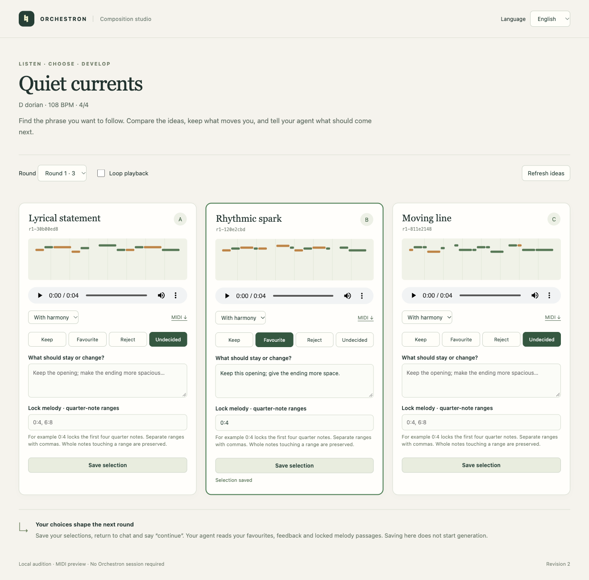

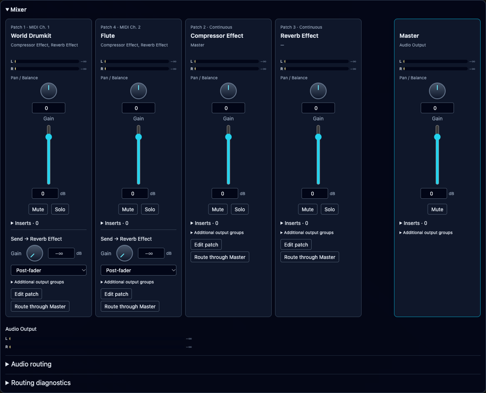

*The live “Ratchet drums demo” performance: Patch numbers and MIDI channels identify World Drumkit and Flute; the compressor and reverb show Continuous, with Master pinned at the right. Playback is stopped.*

Notes, controller curves and steps, tempo, and arrangement edits can be applied while playback continues. Mixer controls stay available during performance; stop the instruments before changing rack assignments or audio connections. The rack separates note-triggered and continuous instruments with a thin line. While stopped, drag a card’s `::` handle to reorder instruments within its group; the mixer and compact rack follow the saved order. Collapsible panels let you focus on the part of the setup you are using.

See [Audio Mixer and Routing](documentation/performance/audio_mixer_and_routing.md) and [Editing During Playback](documentation/performance/live_status_and_safety_controls.md#editing-during-playback) for the full workflow.

## Learn and share

The interface and integrated help are available in **English, German, French, and Spanish**. Open a tool's **?** button for guidance in context, or explore an opcode's reference while building a patch.

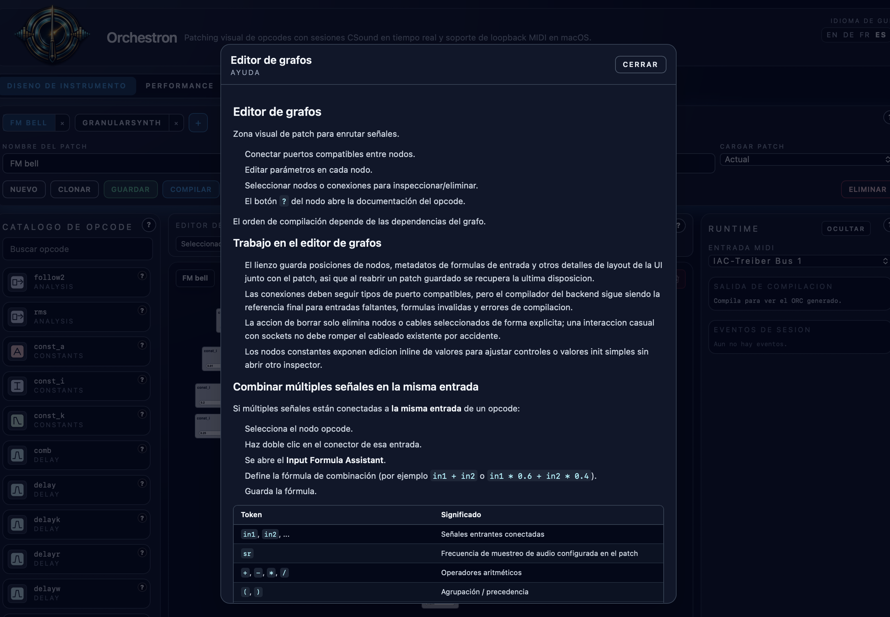

*Help stays close to the task, with explanations of the editor and its controls in your chosen language.*

Save instruments and performances to your library, or export native bundles to back them up and share them with another Orchestron user. Sample assets travel with ZIP bundles. Native imports validate the bundle before confirmation and save the selected instruments, performance, and new audio assets together; cancelling leaves the library and audio storage unchanged. You can also export an instrument as a Csound `.csd` file, or export an arranged performance as a Csound render package using MIDI or an embedded score. Score exports group events by master measure, with measure/timestamp comments and blank lines between groups. Each performance render package includes instructions for producing an audio file.

Both performance CSD modes optimize offline rendering of the saved mix while preserving musical controller automation and effect tails. Render requests omit Undo/Redo history to leave room for music; saved performances and native bundles retain it. SCORE exports share original Catmull–Rom controller patterns, including parameters sampled when notes start, and remove redundant writes. Instrument comments are preserved. The **CSD export accuracy** dialog offers **1–10 CC units**, default **1**, for curves that require fallback approximation; original curves retain their sampled values regardless of this setting. Step patterns and resets remain exact. See [offline export](documentation/performance/performance_import_export.md#offline-render-export-export-csd-midi--export-csd-score) for the dialog, exact-event export and compatibility details.

Read about [instrument exchange](documentation/instrument_design/instrument_import_export.md), [performance exports](documentation/performance/performance_import_export.md), and [language and help settings](documentation/configuration/gui_language_and_integrated_help.md).

## Get started

### Install and open Orchestron

Follow the guide for your environment: [macOS](INSTALL.macos.md), [Linux](INSTALL.linux.md), [Windows](INSTALL.windows.md), or [Docker](INSTALL.docker.md). Once Orchestron is running locally, open [Orchestron in your browser](http://localhost:8000/).

macOS and Linux installs can compile the sequencer for faster playback processing;
Docker includes it prebuilt. A Python fallback remains available. See the platform
guide for compiler setup and [playback implementation selection](BACKEND.md#compiled-sequencer-playback).

### Make your first sound

1. Open **Instrument Design**, choose **New**, and select **Playable instrument**.
2. Give the patch a name and click **Save**.
3. Switch to **Perform**, click **Add Instrument**, and select your saved patch. Note its MIDI channel.
4. Add a piano-roll keyboard and set it to the same MIDI channel.
5. Press the piano roll's **Start** button, then click the keys to play. This starts the instruments without starting the arranger.
6. Use **Save Performance** to keep the setup.

You can also [import example instruments](examples/instruments/) or [load an example performance](examples/performances/). The [examples guide](examples/README.md) explains both routes.

The [Ambient Techno instruments](documentation/instrument_design/ambient_techno.md)
pair a rounded sub-bass with a moving wavetable cloud. Per-instance controls set
the base sound; separate MIDI CCs add live timbre, motion, width and shimmer.

The [Standard Effects](documentation/performance/standard_effects.md) section at the end of the Performance chapter collects the supplied effect guides.

[Tube Overdrive](documentation/instrument_design/tube_overdrive.md) adds warm stereo
saturation as a continuous mixer insert, with per-instance Drive, Tone and Output
controls. Restart the rack to apply changed settings.

[Stereo Delay](documentation/instrument_design/stereo_delay.md) adds repeating
echoes with manual Tempo and Beats controls, Feedback and adjustable left/right
alternation. Its continuous insert preserves the original stereo signal.

[Stereo Chorus](documentation/performance/performance_controllers.md#stereo-chorus-depth)
provides twelve modulated delay taps with adjustable LFO rate and depth. Its Amount
control supports 1–100 ms modulation; larger values also lengthen the wet delays.

[Stereo Flanger](documentation/instrument_design/stereo_flanger.md) adds sweeping
comb filtering with Rate, Delay, Depth, Feedback, Stereo Phase and Mix controls.
Its continuous stereo insert supports signed feedback and a wet-only send return.

[Autopanner](documentation/instrument_design/autopanner.md) sweeps stereo balance
with manual Tempo, Beats per cycle and Depth controls. It preserves separate
channels, passes audio unchanged at zero Depth, and requires a rack restart
after changing settings.

[Stereo Widener, Bit Crusher, and Harmonizer](documentation/instrument_design/continuous_effects.md) provide continuous stereo processing with per-instance performance controls. [Granular Capture](documentation/instrument_design/granular_capture.md) adds MIDI-controlled stutter, freeze and granular playback driven by controller step patterns.

[Stereo Moog Filter](documentation/instrument_design/stereo_moog_filter.md) provides
resonant stereo low-pass filtering with per-instance Cutoff and Resonance settings.
CC20 and CC21 scale those settings together for both channels during playback.

The [acoustic steel-string guitar pair](examples/instruments/steel_string_guitar/README.md)
includes a lead with semitone-stepped legato and a polyphonic instrument for chords,
with a waveguide string model, velocity-sensitive plucking and finger/plectrum,
tone, and sustain controls.

The new [physical steel-string guitar](examples/instruments/steel_string_waveguide/README.md)
adds two string polarizations, twelve body resonances, pluck-position and palm-mute controls.
Its reference-informed tuning preserves bass fundamentals and softens finger plucks,
with dry listening previews and matched-level comparisons.

### Connect and tune

The on-screen keyboards, sequencers, and MIDI controls work without external MIDI hardware. To connect a keyboard or DAW, follow [MIDI Setup and Inputs](documentation/configuration/midi_setup_and_inputs.md). On macOS, software-to-software MIDI can use the **IAC Driver** with the [host MIDI helper](host-midi-helper/README.md).

Choose **Auto / Live / Listening** in Config to balance responsiveness and smooth playback. Auto switches to Live for piano keyboards, manual MIDI controls and external MIDI input, then returns to Listening after a configurable inactivity timeout (10 seconds by default). Held notes, sustain and controller gestures keep Live active; sequencer automation does not. Switching preserves queued audio, so select Live in advance when the first note must respond promptly. See the [browser audio latency guide](documentation/configuration/browser_clock_latency.md#playback-mode) and [Config screenshot](screenshots/config_browser_playback_modes.png) for modes, tuning and dropout diagnostics.
