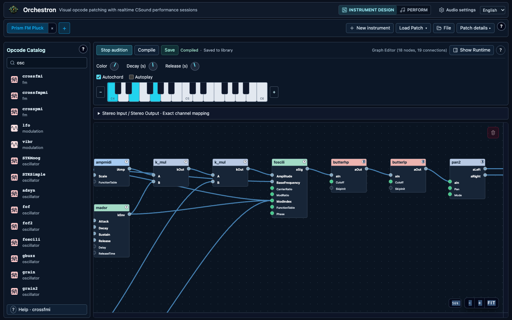
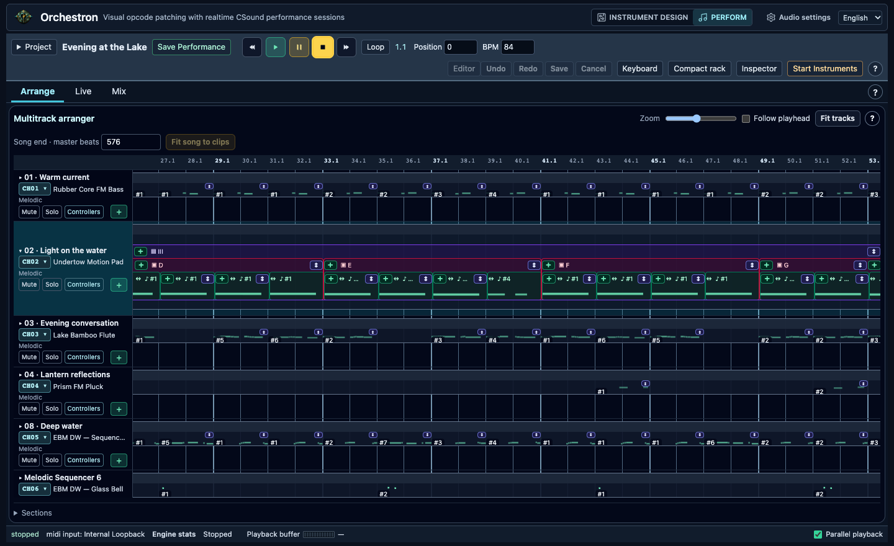
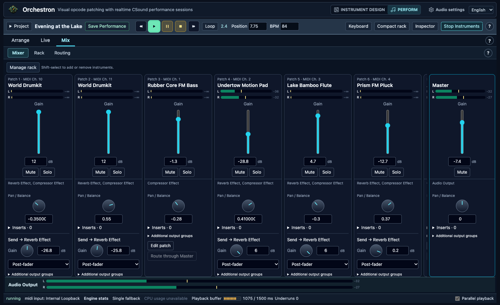
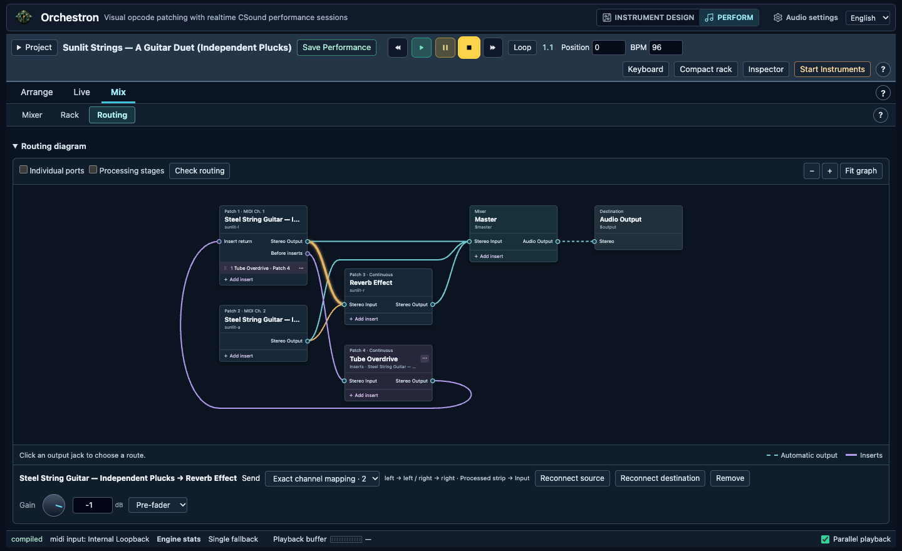

# Orchestron

Here’s the strange, delightful thing about music software: most of it assumes the instrument already exists. Then it gives you knobs. "Orchestron" flips that around.

You don’t load a synthesizer.
You invent one.

Orchestron is a visual instrument workshop built on the power of Csound — not a preset browser, not a plugin rack, not a timeline with tracks stacked like office paperwork. You design sound from signal flow upward. Oscillators, envelopes, filters, physical models, control signals — connect them, and the instrument comes alive while you hear it.

Read the complete user documentation in [user_documentation.md](documentation/user_documentation.md).

[Try it with Docker](#install-and-open-orchestron) · [Play *Evening at the Lake* in the Csound Web IDE](https://ide.csound.com/editor/cY2vOMFTGj823JGQSe3u)

## Inside Orchestron

### Instrument Design

The plucked notes in *Evening at the Lake* come from this 18-node patch. Follow the green `foscili` oscillator through the high-pass and low-pass filters to the stereo panner. The three lit keys are a C major chord. Turn **Color** and play it again to hear the FM timbre change.



Open **Real DX7** to play a velocity-sensitive electric piano. Its **DX7** editor includes 32 presets for synth-pop, darkwave and new wave, alongside a Custom slot and SysEx import. Pick a sound, click an operator and audition its four-stage envelope on the next note. An Integer performance controller on the **Preset** input selects the sound for each new note. Use **0** for the editor voice or **1–32** for the factory presets. Set **Max release (s)** to **0** for the native tail or **1–120** to limit it. At the voice limit, a new note can take over a fading voice. [Sample instrument](examples/instruments/Real_DX7.orch.instrument.json) · [DX7 voice editor and preset bank](documentation/instrument_design/opcode_catalog_and_documentation.md#load-a-dx7-voice) In Perform, each rack instance can load 16 Yamaha SysEx cartridges. Bank and program changes apply to the next note, and both CSD exports include the original cartridges.

### Perform · Arranger

That pluck has a part called *Lantern reflections*. Read down the timeline to see where it answers the bamboo flute. The expanded *Light on the water* lane shows how a handful of pad patterns become a 144-bar arrangement. Open **Controllers** on a track to adjust its instrument with compact knobs, steppers and toggles below the timeline.



### Perform · Mixer

At the start of the song, the pad and Master meters are already moving while the percussion is still silent. Each strip has its own gain, stereo balance and sends. Bring up the flute’s reverb send to move it further into the room.



### Perform · Routing

In *Sunlit Strings*, two instances of the same physical guitar model play a duet. Trace the purple cable through the lead guitar’s Tube Overdrive insert. Both guitars send to one reverb. Select a cable to see its left/right mapping and adjust the send gain.



## Install and open Orchestron

[Download Docker](https://docs.docker.com/get-docker/) for your platform and start it. Run these two commands in a terminal. The first creates a volume for your library and performances. The second downloads the prebuilt image from GitHub Container Registry and starts Orchestron.

```sh
docker volume create orchestron_data
docker run --rm --pull=always -p 127.0.0.1:8000:8000 -v orchestron_data:/app/backend/data -e VISUALCSOUND_DEFAULT_RTMIDI_MODULE=null ghcr.io/thomassresearch/orchestron:latest
```

Open [Orchestron on localhost](http://localhost:8000/client/). In **Instrument Design**, choose **New → Playable instrument → Create**, click **Audition**, then press **C4** on the on-screen keyboard. Switch on **Autochord** and press C4 again to hear the triad.

To explore the arrangement pictured above, download the [Evening at the Lake performance](examples/performances/Evening_at_the_Lake.orch.json) with GitHub’s **Download raw file** button. Stop the audition, open **Perform → Project → Import**, select the file, import the performance and its patches, then press **Play**.

Press **Ctrl+C** in the terminal to stop Orchestron. Run the same `docker run` command to reopen your saved work. [First-song walkthrough](documentation/getting_started.md) · [macOS](INSTALL.macos.md) · [Linux](INSTALL.linux.md) · [Windows](INSTALL.windows.md)

## Built With Codex

This application was built using the Codex App with `GPT-5.3-Codex`, `GPT-5.4`, `GPT-5.5`, `GPT-5.6-Sol` and `GPT-6.x-Astra` using **Extra High** reasoning effort. I started development and expected to hit a limit at some point where things fell apart, but that never happened up to now, given me a good intuition on how powerful today's coding agents have become...

## How it works

### From opcode graph to signal path

Each patch compiles to a Csound instrument. Wire audio- and control-rate signals, combine inputs with a formula, or use a **Switch** on MIDI note number to give each drum its own synthesis branch. Expose a parameter as a performance knob and two copies of the same instrument can have different settings. At rack level, named stereo ports carry those signals through inserts, pre- or post-fader sends, shared returns and Master. If a cable closes a feedback loop, the routing view highlights the connections involved. [Graph editor](documentation/instrument_design/graph_editor.md) · [Mixer and routing](documentation/performance/audio_mixer_and_routing.md)

### Five ways to drive a rack

A **Melodic** sequencer programs steps, chords and strums. **Score** places notes at a resolution of 20,160 ticks per quarter note. **Drummer** adds velocity and ratchets per hit. **Controller** sends stepped MIDI CC values or interpolated curves. Feed chords into an **Arpeggiator** and it sends the resulting notes to another MIDI channel.

Tracks share a tempo and can use different meters and subdivisions. For three bass pulses against two drum hits, set the bass track’s playback speed to **3:2** and leave the drums at **1:1**. Nest patterns into groups and supergroups, repeat or transpose a phrase, then make a variation on just the last pass. Edit a linked pattern to change every use, then click the amber **Save** button in the arranger toolbar to keep your edits together. In **Live**, you can launch saved patterns while the arrangement plays. [Multitrack arranger](documentation/performance/multitrack_arranger.md) · [Sequencer timing](documentation/performance/sequencer_timing.md)

### How Rust workers render a guitar duet

Each guitar in *Sunlit Strings* has its own random sequence for pluck variation. If both drew from the same random stream, they would have to render together to draw the same values in the same order. The planner checks for shared state and partitions the performance graph at whole-instrument boundaries. Independent signal paths can then run in separate Csound processes. Their audio meets in a final process that runs the shared effects, Master and output.

Python coordinates the workers and schedules events. Inside each worker, a Rust loop delivers MIDI and control changes at the synthesis step, calls Csound’s `performKsmps()` and transfers audio through shared memory. Perform selects a single renderer when the graph or host cannot support a parallel split. [Guitar duet bundle](examples/performances/Sunlit_Strings_Independent_Plucks.orch.json) · [Graph partitioning](specifications/parallel-csound-rendering/whole-instrument-partitioning.md) · [Rust render loop](backend/experiments/rust_worker/README.md)

### Export the song as Csound

Open **Perform → Project** and export a standard Csound `.csd` you can read, edit and render outside Orchestron. **Export CSD (SCORE)** puts notes and controller events in the Csound score. **Export CSD (MIDI)** pairs the orchestra with a separate MIDI file. Both packages include the required assets and a command to render a 48 kHz, 32-bit float WAV with the effect tails intact. [CSD export guide](documentation/performance/performance_import_export.md#render-with-csound)

Hear what those exports sound like and open their Csound source in the Web IDE. [Evening at the Lake](https://ide.csound.com/editor/cY2vOMFTGj823JGQSe3u) · [Sunlit Strings — A Guitar Duet](https://ide.csound.com/editor/YI93mfrDDAFyDtk7ZyIn) · [Grain of Salt](https://ide.csound.com/editor/QDGRs0r2DmBLGqXYKFmk) · [More Orchestron songs by Thomassresearch](https://ide.csound.com/profile/Thomassresearch)
