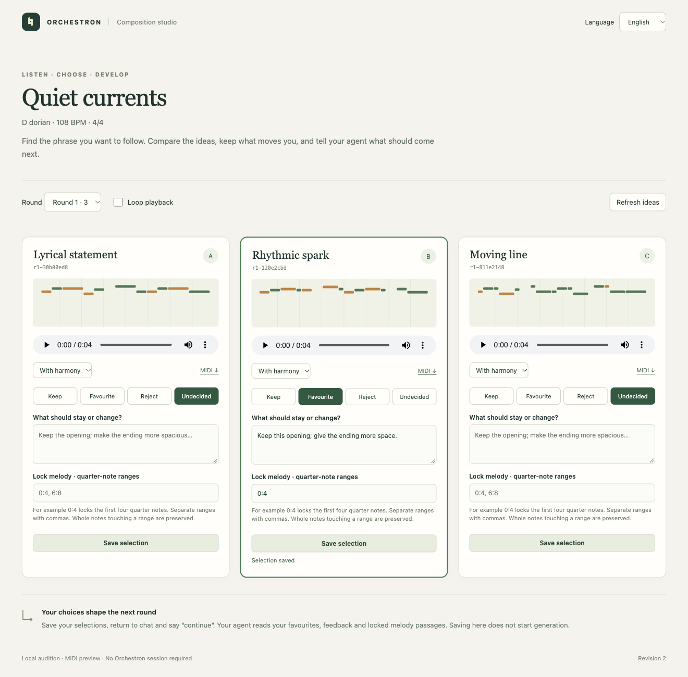
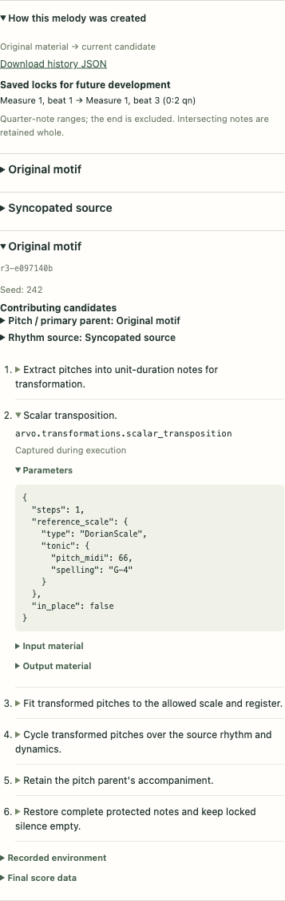

# Orchestron Composition Creator Skill

Use [Orchestron Composition Creator](https://github.com/thomassresearch/orchestron/blob/main/integrations/skills/orchestron-composition-creator/SKILL.md)
to explore melodies by listening, choosing and developing related ideas. It uses
music21 and an arvo compatibility copy, runs independently of the Orchestron
backend, and exports a machine-readable score for Performance Creator.



## Try It With an Agent

> Read `integrations/skills/orchestron-composition-creator/SKILL.md`. Propose three
> two-bar melodies in D dorian at 108 BPM, with a calm but slightly syncopated
> character. Include quiet harmony for comparison. Open the audition page and
> wait for my choice. Develop the melody I select, preserving any passages I lock.
> When I accept the phrases, export a score for Orchestron Performance Creator.

The agent creates a session and generates a small shortlist. Each candidate has
a contour display and a player. Compare **With harmony** and **Melody only**, loop
the phrase, or download its MIDI. All candidates use consistent preview sound and
gain. The default simple MIDI synthesizer needs no extra sound installation;
FluidSynth with a local SoundFont is optional. Preview timbre differs from the
instrument eventually chosen in Orchestron.

## Choose and Continue

Mark **Keep**, **Favourite**, **Reject** or **Undecided**, add feedback, and click
**Save selection**. To retain an opening, enter a melody lock such as `0:4` for the
first four quarter notes. Multiple ranges use commas. Complete notes touching a
locked range remain unchanged. Locks protect the melody; built-in development
also leaves its existing harmony intact.

Return to chat and say **“continue”**. The agent reads the saved selections and
creates related ideas. It can transpose or invert a motif, develop cyclic or
additive material, combine one accepted idea's pitches with another's rhythm,
or append a continuation. Feedback guides the agent; the command-line generator
does not interpret prose by itself. Saving in the page does not start generation.

Use **Refresh ideas** to see the next round. Earlier rounds, comments and choices
remain available. The page works in English, German, French and Spanish. Unsaved
changes are marked. A conflicting newer revision must be refreshed before saving.
The session is stored locally and can be resumed after closing the page.

## Follow a Melody's Creation

Open **How this melody was created** beneath a candidate's player. The panel
shows its original material, earlier versions and contributing candidates in
creation order. Expand an ancestor or a step to inspect arvo function names,
resolved arguments and input/output material. It also records pitch fitting,
rhythm combinations, accompaniment and continuation, so the history explains the
final melody rather than just the first transformation.



Parent roles identify where pitches and rhythm came from. Saved feedback and
reviews are captured when a child is created. **Locks applied during creation**
show the ranges used for that operation, with measure/beat positions and exact
quarter-note values. Retained notes, protected silence and discarded generated
notes are available in the details. **Saved locks for future development** are
the current candidate's review and can differ from those historical locks.

The panel loads on demand without interrupting playback or unsaved reviews.
**Download history JSON** saves the complete record. CLI users can read the same
record with `orchestron_compose trace SESSION CANDIDATE_ID`.

Built-in generation records its operations automatically. Custom authoring scripts
use the [trace recorder](https://github.com/thomassresearch/orchestron/blob/main/integrations/skills/orchestron-composition-creator/references/creation_history.md)
and import their records with `import-score --trace FILE`. Authored descriptions
are distinguished from captured function calls. Earlier candidates and unrecorded
imports show gaps explicitly; the tool does not reconstruct their missing history.

## Local Commands

From the repository root:

```bash
uv run --locked --project integrations/skills/orchestron-composition-creator \
  orchestron_compose init output/composition/quiet-currents \
  --title "Quiet currents" --key D --mode dorian --tempo 108 --bars 2
uv run --locked --project integrations/skills/orchestron-composition-creator \
  orchestron_compose generate output/composition/quiet-currents
uv run --locked --project integrations/skills/orchestron-composition-creator \
  orchestron_compose serve output/composition/quiet-currents
```

Open the printed loopback URL. Stop the server with Ctrl-C when finished; saved
choices remain on disk. The tools require Python 3.13 and `uv` on macOS or Linux.
Dependencies are downloaded on first use and locked for repeatability.

## Export and Realise the Song

Ask the agent to arrange accepted phrases in a specified order. Export includes
`composition.json`, `orchestron-score.json`, MIDI, MusicXML and playable WAV files.
The canonical score retains exact rational timing, note dynamics, phrase sections
and accepted-candidate provenance. The exporter finds exact supported grids and
creates editable voice tracks and pads; it reports unsupported timing or capacity
instead of silently changing the music. Initial scope is fixed tempo/meter and
standard MIDI pitches, with straight/triplet grids and supported subdivisions.
The canonical score also retains full recorded creation history and phrase
placements, including repetitions, when imported into another composition session.
Performance Creator's score format and native performance bundles are unchanged.

[Performance Creator](performance_creator_skill.md) then discovers instruments,
maps the score's channels, sets routing and mixer levels, applies the score,
validates and saves the performance. These score files are not native Orchestron
bundles and should not be passed to the application's Import dialog.
