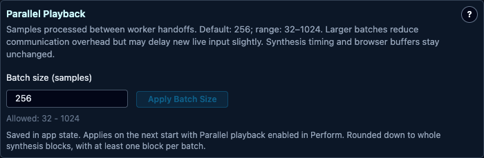
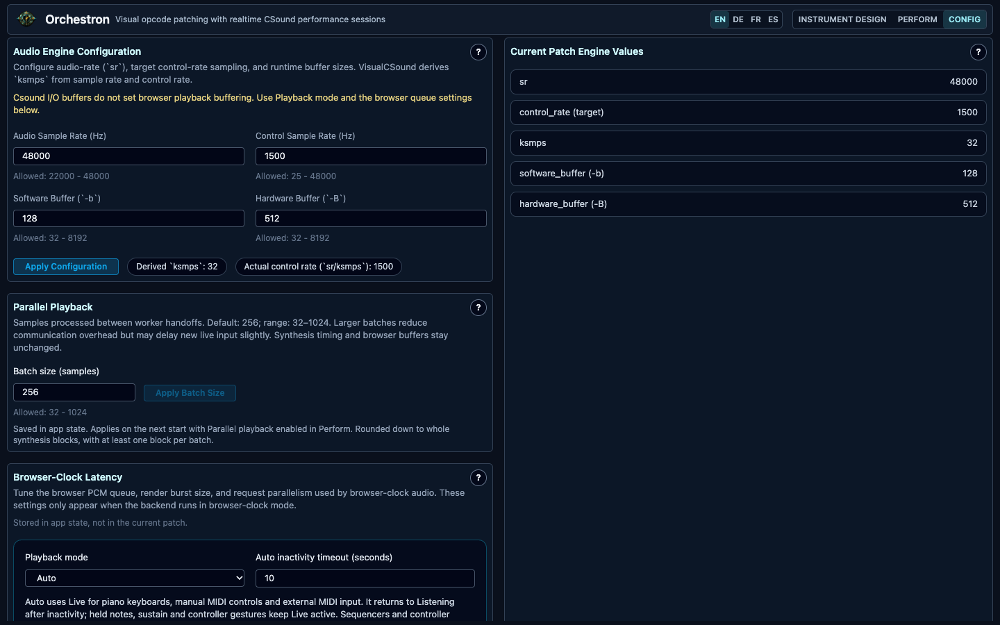
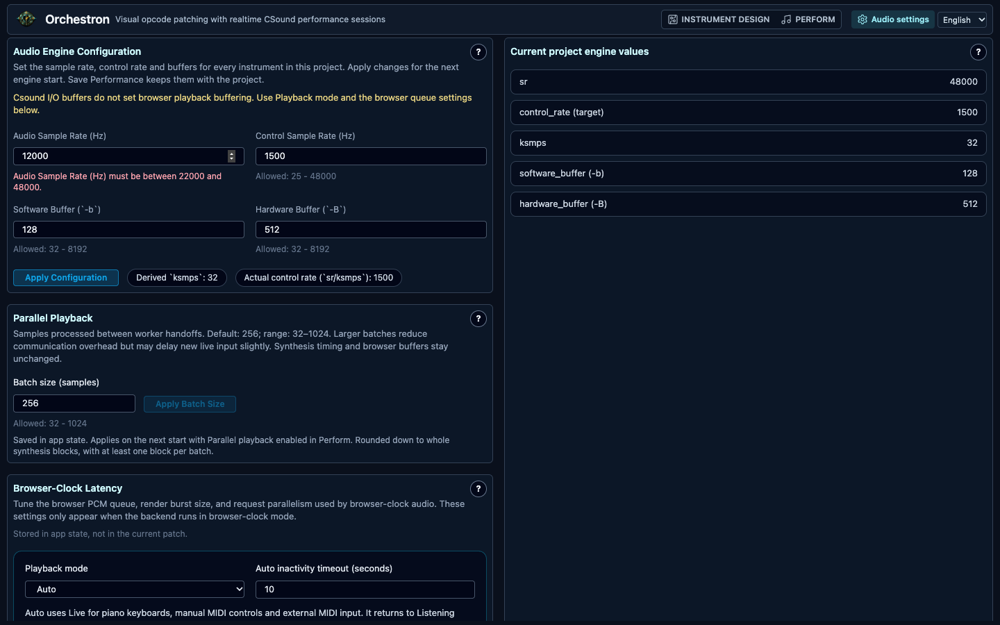

# Audio Engine Settings

**Navigation:** [Up](configuration.md) | [Previous](gui_language_and_integrated_help.md) | [Next](browser_clock_latency.md)

Open **Audio settings** with the gear in the header.

## Where These Settings Are Stored

Sample rate, target control rate and the Csound buffers apply to every instrument in the project. **Save Performance** stores the settings with the performance. Native performance exports include them, and workspace recovery restores applied settings after a reload.

New projects and older projects without saved engine settings use the defaults. Opening, importing or reordering instruments keeps the project's settings. Browser latency and parallel batch size are playback preferences saved in workspace recovery.

## Parallel Playback

**Parallel playback** starts enabled in the Perform status bar. To request single rendering,
clear the checkbox while instruments are stopped. The engine analyses instrument/effect dependencies and shared resources, then
uses available CPU and memory capacity to choose a parallel layout. No per-song catalog is required.
The choice does not change engine timing, browser buffering or CSD exports. See
[Engine Stats and Parallel Playback](../performance/live_status_and_safety_controls.md#engine-stats-and-parallel-playback).

Parallel playback normally exchanges **256 samples** between workers at a time. This reduces
communication overhead while all instruments share the project’s synthesis block size and
scheduled note/controller timing. A live action received after a batch has begun takes effect
at the next available batch; 256 samples span about **5.3 ms at 48 kHz**. This is separate from
the browser's playback queue and does not change exported CSDs.

In **Audio settings → Parallel Playback**, enter a **Batch size (samples)** from **32 to 1024**
and click **Apply Batch Size**. The default is **256**. Stop playback before applying;
the choice takes effect on the next start with **Parallel playback** enabled in Perform.
It is saved in app state across reloads, separately from the parallel playback checkbox,
which returns to its enabled default after reload. It is not stored in instruments, performances or CSD exports.

The engine rounds down to whole synthesis blocks, with at least one block per batch.
For example, with a 32-sample synthesis block, entering 255 uses 224 samples. Try 128 for
shorter batches or 32 to compare with one handoff per synthesis block. Larger batches reduce
handoffs but can delay newly arriving live actions; 1024 samples span about 21.3 ms at 48 kHz.

## Editable Settings

### Project Engine Section

### Audio Sample Rate (`sr`)

- Field label: `Audio Sample Rate (Hz)`
- Allowed range: **22000 .. 48000**
- Integer only

### Control Sample Rate (`control_rate` target)

- Field label: `Control Sample Rate (Hz)`
- Allowed range: **25 .. 48000**
- Integer only

This is the target control-rate value used to derive `ksmps`.

### Software Buffer (`-b`)

- Field label: `Software Buffer (-b)`
- Allowed range: **32 .. 8192**
- Integer only

### Hardware Buffer (`-B`)

- Field label: `Hardware Buffer (-B)`
- Allowed range: **32 .. 8192**
- Integer only

  

<em>Audio settings page audio engine settings in a valid state.</em>

## Derived Values Shown In The UI

The Audio settings page previews derived values before applying:

- Derived `ksmps`
- Actual control rate (`sr / ksmps`)

This helps you see the real runtime effect of your target control-rate choice.

## Current Project Engine Values

The right-side panel shows the normalized engine values applied to the project:

- `sr`
- `control_rate`
- `ksmps`
- `software_buffer`
- `hardware_buffer`

These values apply to both workspaces, including instrument auditions.

## Browser-Clock Latency Section

The Audio settings page shows an additional section for browser-owned audio latency tuning whenever a browser-clock session is active.

See [Browser-Clock Latency](browser_clock_latency.md) for the unified browser-clock workflow explanation and the full UI screenshot of this section.

Playback mode and inactivity timeout are shown above the expandable **Live buffering and recovery** fields:

- steady queue low water / high water (`ms`)
- startup queue low water / high water (`ms`)
- underrun recovery boost / maximum underrun boost (`ms`)
- maximum blocks per render request
- steady / startup / recovery parallel request limits
- immediate note render blocks
- immediate note render cooldown (`ms`)

These values control the browser PCM queue depth and render request behavior, which are the dominant latency/stability knobs on the unified browser-clock path.

The project engine sample rate and `ksmps` still determine synthesis timing. The Software/Hardware Buffer fields do not control browser playback buffering. Changing them does not enlarge the browser queue; use Browser-Clock Latency for that.

Choose **Auto / Live / Listening** in the Browser-Clock Latency section. Auto is the default, with a configurable 10-second inactivity timeout (1–300 seconds). It detects manual piano/controller and selected external MIDI input, while ignoring sequencer automation and controller initialization. Held notes, sustain and controller gestures prevent the timeout. Queued audio is preserved on every switch, so the first note after Listening may still be delayed. The current state appears in Audio settings and Runtime.

The advanced **Live buffering and recovery** controls retain your existing tuning. Listening adds minimum steady targets of 750/1500 ms and startup targets of 1000/1800 ms, retaining larger custom targets. See [Playback Mode](browser_clock_latency.md#playback-mode) for the complete behavior.

The dedicated [Browser-Clock Latency](browser_clock_latency.md) chapter shows the browser-clock tuning section in detail.

### Field-By-Field Meaning

#### Steady Low Water / Steady High Water

- These define the normal browser PCM queue target after startup is complete.
- Lower values reduce live-play latency.
- Higher values make clicks and underruns less likely.

#### Startup Low Water / Startup High Water

- These define the larger queue target used while the stream is still priming after connect or after an underrun recovery phase.
- They are usually kept above the steady values so the stream can stabilize before dropping into lower-latency playback.

#### Underrun Recovery Boost / Max Underrun Boost

- When the browser detects underruns, VisualCSound temporarily adds extra queue headroom.
- `Underrun Recovery Boost` controls how much extra buffer is added per underrun event.
- `Max Underrun Boost` limits how far that temporary recovery buffer can grow.

#### Max Blocks Per Request

- Caps the maximum backend render chunk size requested in one browser-clock render request.
- Smaller values reduce head-of-line delay for live notes.
- Larger values reduce request overhead but can make live interaction feel less immediate.

#### Steady / Startup / Recovery Parallel Requests

- These limits control how many render requests may remain in flight at once.
- More parallelism can keep the queue full more aggressively.
- Too much parallelism can also create larger bursts and less predictable latency.

#### Immediate Note Render Blocks / Immediate Note Render Cooldown

- A live `note_on` sends a small urgent render request in addition to the normal refill logic.
- `Immediate Note Render Blocks` sets the size of that urgent render burst.
- `Immediate Note Render Cooldown` throttles how often these urgent requests can be sent.
- These controls help manual piano playing feel more responsive, but values that are too aggressive can reintroduce clicks.

### Practical Adjustment Order

1. Choose Auto, Live or Listening; Auto defaults to a ten-second inactivity timeout.
2. If clicks remain, raise the steady or startup watermarks slightly.
3. If latency still feels too high, reduce `max blocks per request` carefully.
4. Only then tune immediate note render and parallel request limits.

## Validation Behavior

The page validates:

- integer format
- allowed range
- high-water fields must be greater than their matching low-water fields

`Apply Configuration` is disabled until all visible values are valid.

  

<em>Audio settings page validation messages with invalid values entered.</em>

## Apply Configuration

Stop the instruments and choose **Apply Configuration**. The next compilation, audition or engine start uses the project settings. Choose **Save Performance** to update the named project. Offline CSD exports use their dedicated 48 kHz, single-sample render settings.

`Apply Browser-Clock Settings` writes the browser-clock latency settings into app state and refreshes the active browser-clock controller if one is connected.

## Other Engine Fields Present But Not Edited In UI

The project engine configuration also contains values such as:

- `nchnls` (default `2`)
- `0dbfs` (default `1`)

These are part of the project settings, but the current Audio settings page focuses on the user-facing timing and buffer controls listed above.

## Tuning Tips

- Lower buffers reduce latency but increase glitch risk.
- Higher buffers improve stability but increase latency.
- Use the Runtime panel and live testing to find a stable setting for your machine and patch complexity.
- On the browser-clock path, start by adjusting browser-clock low/high water, render blocks, and parallel request limits before changing the project’s `-b/-B`.
- For live MIDI sessions, prefer `ksmps <= 32`. The runtime warns when a live session starts with a larger `ksmps` because MIDI execution is still quantized to the k-period.

**Navigation:** [Up](configuration.md) | [Previous](gui_language_and_integrated_help.md) | [Next](browser_clock_latency.md)
