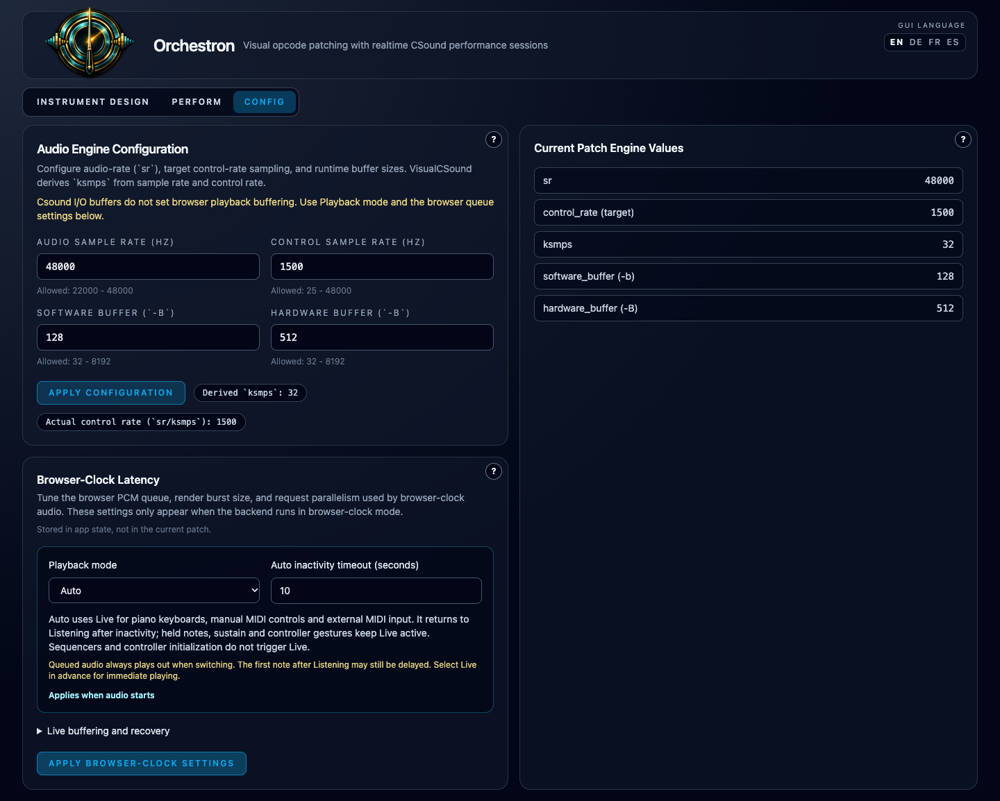

# Browser-Clock Latency

**Navigation:** [Up](configuration.md) | [Previous](audio_engine_settings.md) | [Next](persistence_and_defaults.md)

Orchestron plays sound through your browser on every supported platform. **Config → Browser-Clock Latency** controls the balance between responsive playing and enough buffered audio to withstand brief interruptions.

## Playback Mode

Choose **Auto**, **Live**, or **Listening**, then select **Apply Browser-Clock Settings**.
Auto is the default, including when restoring a workspace saved before these modes existed.
The mode and **Auto inactivity timeout (seconds)** are workspace preferences, stored in app state.
The timeout defaults to **10 seconds** and accepts integer values from **1 to 300 seconds**.
The current state appears in Config and in the Runtime panel; it is not saved with performances.

| Mode | Behavior |
| --- | --- |
| Auto | Uses Listening while idle. Starting a piano keyboard or manual MIDI controller, playing notes, moving a manual MIDI control, or receiving external notes/CCs selects Live. |
| Live | Always uses the configured Live queue targets and render limits, regardless of input activity. Select this before playing if the first note must be responsive. |
| Listening | Keeps a larger queue for listening to a performance, even when manual input arrives. |

Auto returns to Listening after the configured inactivity timeout. Held notes, sustain and active
controller drags keep Live selected. Stopping/removing a manual source removes its activity; when
no other source is active, Auto can return immediately. Merely leaving a keyboard/controller enabled
or an external device connected does not keep Live selected forever. The timeout starts again at
note/pedal release or the end of a controller gesture. External input is limited to the session's
selected MIDI input. Disconnecting that device, rebinding MIDI input or Panic clears its held state.

Sequencers, controller sequencers and the initial values sent automatically by manual MIDI controls
do not trigger Live. Only the original external/manual input triggers it when routed into an arpeggiator.

**Switching preserves all queued audio, pending renders and transport position.** The browser
lets the existing queue drain when changing to Live and replenishes it when changing to Listening.
The indicator shows **Switching to Live** while the larger queue is draining. This means the first
unexpected note after Listening may still have the previous latency. No samples are skipped to
make the switch appear instantaneous.

Open **Live buffering and recovery** to tune the existing advanced controls. Listening uses at least
**750/1500 ms** steady low/high water and **1000/1800 ms** startup low/high water, with up to **512
Csound blocks per request**. Larger custom queue targets are retained; other recovery and parallelism
settings remain in effect. These queue targets are independent of Csound's synthesis block size.
At 48 kHz, 32,768 frames represent about 683 ms and 65,536 frames about 1,365 ms. Queue settings
already accept up to 2,000 ms, with a six-second ring buffer providing capacity for recovery headroom.

Render requests remain capped at 512 blocks: that is about 341 ms at `ksmps=32`, but only 10.7 ms at
`ksmps=1` and 48 kHz. Listening changes buffering, not synthesis/control rate. Larger queues absorb
short stalls; they cannot compensate indefinitely if rendering is consistently slower than playback.
Use Audio Queue, Underruns and Render Ratio in the Runtime panel to distinguish these cases.

  

<em>Choose a playback mode in Browser-Clock Latency; expand Live buffering and recovery for advanced tuning.</em>

## Why These Settings Matter

The browser keeps a queue of audio ready for playback. A larger queue absorbs brief rendering or network delays but increases the time between pressing a key and hearing a note. Playback begins when the startup queue target is reached. The Runtime panel reports queued audio, pending audio, underruns and Render Ratio so you can judge whether the settings suit your performance.

Lower values usually feel more immediate, but they also leave less headroom for:

- brief rendering delays
- network delays between browser and server
- temporary browser interruptions
- heavier patches that take longer to render

Higher values add safety margin, but manual playing and note feedback feel less direct.

## Main Control Groups

### Queue Targets

- `Steady Low Water` / `Steady High Water` define the normal browser PCM queue window after startup has stabilized.
- `Startup Low Water` / `Startup High Water` define the larger queue window used while the stream is priming or recovering.

If you hear underruns after connect or after transport restarts, start by increasing the steady or startup queue targets slightly.

### Recovery Headroom

- `Underrun Recovery Boost` adds extra queue headroom after an underrun is detected.
- `Max Underrun Boost` limits how large that temporary recovery buffer may grow.

These controls help the browser recover cleanly from brief dropouts without forcing a permanently larger steady-state latency.

### Render Request Size And Parallelism

- `Max Blocks Per Request` limits how much audio the browser asks for in one render request.
- `Steady Parallel Requests`, `Startup Parallel Requests`, and `Recovery Parallel Requests` control how many render requests may stay in flight in each state.

Smaller requests can improve responsiveness, while larger or more parallel requests can make it easier to keep the queue full on slower systems.

### Live Note Responsiveness

- `Immediate Note Render Blocks` sends a small urgent render burst after a live note-on event.
- `Immediate Note Render Cooldown` limits how often those urgent note-triggered bursts may happen.

These are the most direct controls for making manual keyboard or MIDI playing feel snappier in browser-clock mode.

## Practical Tuning Order

1. Start with **Auto** (default), or choose **Listening** when live interaction is unnecessary.
2. If the stream crackles or underruns, check the Runtime diagnostics. Raise both low and high queue watermarks so refilling also starts earlier.
3. If latency still feels too high, lower the steady queue targets cautiously.
4. If live note response feels sluggish, reduce `Max Blocks Per Request` or adjust the immediate-note controls in small steps.
5. Apply the settings and test again with a realistic patch load.

Keep in mind that these settings are stored in app state for the current workspace. They are not saved into the patch itself.

They also work together with the engine settings from the patch:

- browser-clock settings tune queueing and request behavior
- patch engine `sr` and `ksmps` determine synthesis timing and the audio duration of a render request
- Csound I/O buffers `-b` and `-B` do not control browser queue depth or the browser device buffer on this headless path

**Navigation:** [Up](configuration.md) | [Previous](audio_engine_settings.md) | [Next](persistence_and_defaults.md)
