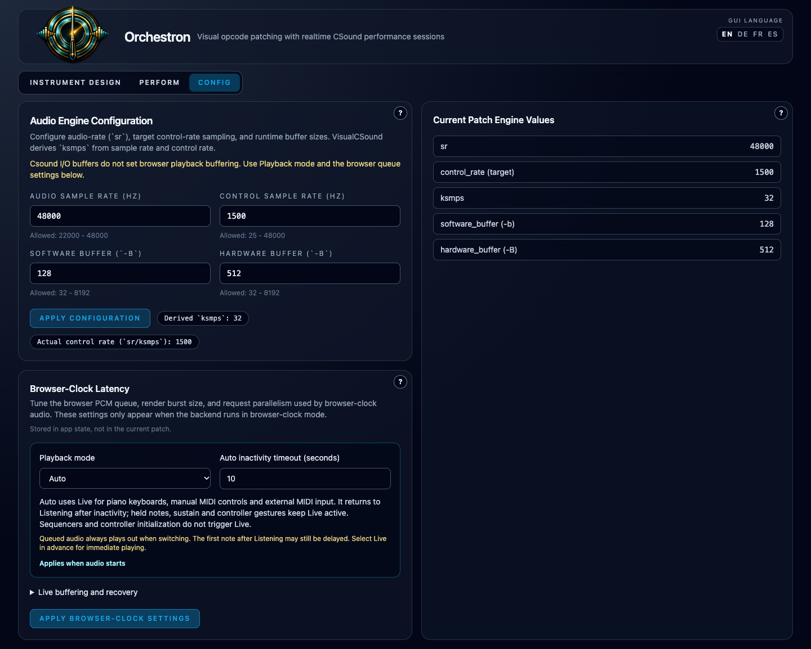

# Browser-Clock Latency

**Navigation:** [Up](configuration.md) | [Prev](midi_setup_and_inputs.md) | [Next](persistence_and_defaults.md)

Orchestron now uses backend audio mode `browser_clock` on every supported platform. The browser becomes the playback clock and requests PCM render chunks from the backend, so the most important latency and stability controls live in the Config page's `Browser-Clock Latency` section.

## Playback Mode

Choose **Auto**, **Live**, or **Listening**, then select **Apply Browser-Clock Settings**.
Auto is the default, including when restoring a workspace saved before these modes existed.
The mode and **Auto inactivity timeout (seconds)** are workspace preferences, stored in app state.
The timeout defaults to **10 seconds** and accepts integer values from **1 to 300 seconds**.
The current state appears in Config and in the Runtime panel; it is not saved with performances.

| Mode | Behavior |
| --- | --- |
| Auto | Uses Listening while idle. Starting a piano keyboard or manual MIDI controller, playing notes, moving a manual MIDI control, or receiving external notes/CCs selects Live. |
| Live | Always uses the configured Live queue targets and render limits, regardless of input activity. Select this before playing if the first note must be responsive. |
| Listening | Keeps a larger queue for listening to a performance, even when manual input arrives. |

Auto returns to Listening after the configured inactivity timeout. Held notes, sustain and active
controller drags keep Live selected. Stopping/removing a manual source removes its activity; when
no other source is active, Auto can return immediately. Merely leaving a keyboard/controller enabled
or an external device connected does not keep Live selected forever. The timeout starts again at
note/pedal release or the end of a controller gesture. External input is limited to the session's
selected MIDI input. Disconnecting that device, rebinding MIDI input or Panic clears its held state.

Sequencers, controller sequencers and the initial values sent automatically by manual MIDI controls
do not trigger Live. Only the original external/manual input triggers it when routed into an arpeggiator.

**Switching preserves all queued audio, pending renders and transport position.** The worker
lets the existing queue drain when changing to Live and replenishes it when changing to Listening.
The indicator shows **Switching to Live** while the larger queue is draining. This means the first
unexpected note after Listening may still have the previous latency. No samples are skipped to
make the switch appear instantaneous. The AudioContext remains running with its interactive latency hint.

Open **Live buffering and recovery** to tune the existing advanced controls. Listening uses at least
**750/1500 ms** steady low/high water and **1000/1800 ms** startup low/high water, with up to **512
Csound blocks per request**. Larger custom queue targets are retained; other recovery and parallelism
settings remain in effect. These queue targets are independent of Csound's synthesis block size.
At 48 kHz, 32,768 frames represent about 683 ms and 65,536 frames about 1,365 ms. Queue settings
already accept up to 2,000 ms, with a six-second ring buffer providing capacity for recovery headroom.

Render requests remain capped at 512 blocks: that is about 341 ms at `ksmps=32`, but only 10.7 ms at
`ksmps=1` and 48 kHz. Listening changes buffering, not synthesis/control rate. Larger queues absorb
short stalls; they cannot compensate indefinitely if rendering is consistently slower than playback.
Use Audio Queue, Underruns and Render Ratio in the Runtime panel to distinguish these cases.

## When This Section Appears

The `Browser-Clock Latency` section is shown when the backend is running in `browser_clock` mode, for example:

- `docker compose up --build`
- environment variable `VISUALCSOUND_AUDIO_OUTPUT_MODE=browser_clock`

This is the standard runtime path for macOS, Linux, Windows, and Docker. In practice, that means this section describes the normal live-audio path of the app, not a Docker-only special case.

## Why These Settings Matter

On the browser-clock path, audio is not pushed to a local DAC on the backend host. Instead:

- the backend renders PCM blocks on demand
- a dedicated browser audio worker keeps the target queue of decoded PCM and requests more audio
- the AudioWorklet consumes that queue independently of React rendering

That makes the browser-clock queue settings the main tradeoff between low live-play latency and glitch resistance.

The queue producer no longer runs on the React/main thread. Main-thread stalls can delay visual updates,
but they do not stop the worker from requesting or buffering PCM. Playback starts only after the startup
high-water target is reached. The Runtime panel reports current queued and pending-render milliseconds,
underrun/overrun counts, and the latest backend render-time/audio-time ratio.

The backend suppresses Csound performance-time logging by default in headless browser-clock sessions. This
prevents stdout or Docker logging I/O from delaying `performKsmps()`. To diagnose Csound's own runtime messages,
start the backend with `VISUALCSOUND_CSOUND_PERFORMANCE_LOGGING=true`; this is intended as a temporary diagnostic
setting rather than a latency control.

Lower values usually feel more immediate, but they also leave less headroom for:

- backend scheduling jitter
- network / websocket round-trip jitter between browser and backend
- browser tab throttling or temporary main-thread stalls
- heavier patches that take longer to render

Higher values add safety margin, but manual playing and note feedback feel less direct.

## Main Control Groups

### Queue Targets

- `Steady Low Water` / `Steady High Water` define the normal browser PCM queue window after startup has stabilized.
- `Startup Low Water` / `Startup High Water` define the larger queue window used while the stream is priming or recovering.

If you hear underruns after connect or after transport restarts, start by increasing the steady or startup queue targets slightly.

### Recovery Headroom

- `Underrun Recovery Boost` adds extra queue headroom after an underrun is detected.
- `Max Underrun Boost` limits how large that temporary recovery buffer may grow.

These controls help the browser recover cleanly from brief dropouts without forcing a permanently larger steady-state latency.

### Render Request Size And Parallelism

- `Max Blocks Per Request` limits how much audio the browser asks for in one render request.
- `Steady Parallel Requests`, `Startup Parallel Requests`, and `Recovery Parallel Requests` control how many render requests may stay in flight in each state.

Smaller requests can improve responsiveness, while larger or more parallel requests can make it easier to keep the queue full on slower systems.

### Live Note Responsiveness

- `Immediate Note Render Blocks` sends a small urgent render burst after a live note-on event.
- `Immediate Note Render Cooldown` limits how often those urgent note-triggered bursts may happen.

These are the most direct controls for making manual keyboard or MIDI playing feel snappier in browser-clock mode.

### Manual MIDI Safety Limits

Browser-clock manual MIDI is bounded on the backend even when events are routed through an arpeggiator. Deployments can tune the maximum accepted future timestamp with `VISUALCSOUND_BROWSER_CLOCK_MANUAL_MIDI_MAX_FUTURE_MS`, the accepted manual MIDI rate with `VISUALCSOUND_BROWSER_CLOCK_MANUAL_MIDI_RATE_PER_SECOND` and `VISUALCSOUND_BROWSER_CLOCK_MANUAL_MIDI_BURST`, and the per-session arpeggiator pending input cap with `VISUALCSOUND_ARPEGGIATOR_PENDING_INPUT_MAX_EVENTS`.

### Session Resource Limits

Runtime sessions allocate backend Csound worker resources, so session creation and live session-event observers are also bounded. `VISUALCSOUND_SESSION_MAX_ACTIVE` limits total active sessions, `VISUALCSOUND_SESSION_MAX_ACTIVE_PER_CLIENT` limits sessions owned by one client address, `VISUALCSOUND_SESSION_CREATE_RATE_PER_MINUTE` and `VISUALCSOUND_SESSION_CREATE_RATE_BURST` limit repeated creation attempts, and `VISUALCSOUND_SESSION_IDLE_TIMEOUT_SECONDS` deletes stopped idle sessions so capacity is returned automatically. Session event WebSocket observers are capped with `VISUALCSOUND_SESSION_EVENT_WS_MAX_SUBSCRIPTIONS_TOTAL` and `VISUALCSOUND_SESSION_EVENT_WS_MAX_SUBSCRIPTIONS_PER_SESSION`, while connection attempts are rate-limited with `VISUALCSOUND_SESSION_EVENT_WS_CONNECT_RATE_PER_MINUTE` and `VISUALCSOUND_SESSION_EVENT_WS_CONNECT_RATE_BURST`.

## Practical Tuning Order

1. Start with **Auto** (default), or choose **Listening** when live interaction is unnecessary.
2. If the stream crackles or underruns, check the Runtime diagnostics. Raise both low and high queue watermarks so refilling also starts earlier.
3. If latency still feels too high, lower the steady queue targets cautiously.
4. If live note response feels sluggish, reduce `Max Blocks Per Request` or adjust the immediate-note controls in small steps.
5. Apply the settings and test again with a realistic patch load.

Keep in mind that these settings are stored in app state for the current workspace. They are not saved into the patch itself.

They also work together with the engine settings from the patch:

- browser-clock settings tune queueing and request behavior
- patch engine `sr` and `ksmps` determine synthesis timing and the audio duration of a render request
- Csound I/O buffers `-b` and `-B` do not control browser queue depth or the browser device buffer on this headless path

## Screenshot

  

<em>The Config page's Browser-Clock Latency section, used when Orchestron runs headless in `browser_clock` mode and the browser owns audio playback.</em>

**Navigation:** [Up](configuration.md) | [Prev](midi_setup_and_inputs.md) | [Next](persistence_and_defaults.md)
