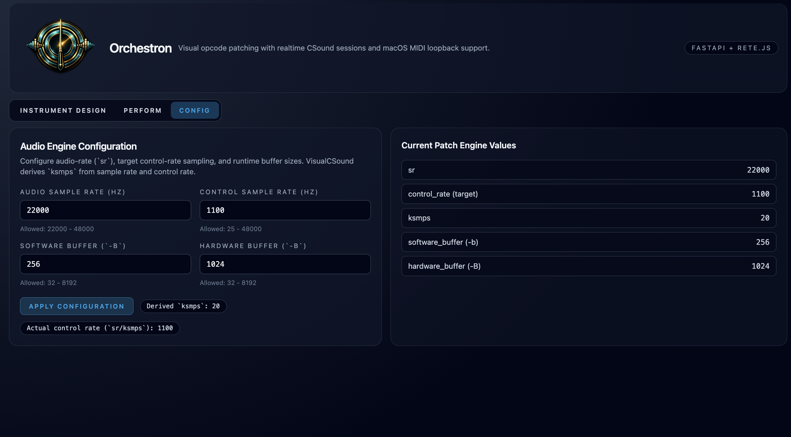

# Configuration

**Navigation:** [Up](../user_documentation.md) | [Previous](../instrument_design/trance_gate.md) | [Next](gui_language_and_integrated_help.md)

Use Config to adjust synthesis and browser playback, and consult this chapter when you want to change language, improve responsiveness or understand what survives a reload. Start with the defaults unless you have a specific problem to solve.

## Chapter Contents

<!-- manual-contents:start -->
- [GUI Language and Integrated Help](gui_language_and_integrated_help.md)
- [Audio Engine Settings (Config Page)](audio_engine_settings.md)
- [Browser-Clock Latency](browser_clock_latency.md)
- [Saving, Workspace Recovery and Defaults](persistence_and_defaults.md)
<!-- manual-contents:end -->

## Choose the right setting

- **Instrument engine settings** control synthesis for the patch, including sample rate and block size.
- **Browser playback settings** control buffering and the balance between responsive playing and resilient listening.
- **Workspace preferences** include language and settings restored with your working context.

If you want to connect a keyboard or another MIDI application, follow [MIDI Setup and Inputs](midi_setup_and_inputs.md) in Performance. Internal piano rolls and sequencers work without an external MIDI device.

**Navigation:** [Up](../user_documentation.md) | [Previous](../instrument_design/trance_gate.md) | [Next](gui_language_and_integrated_help.md)
