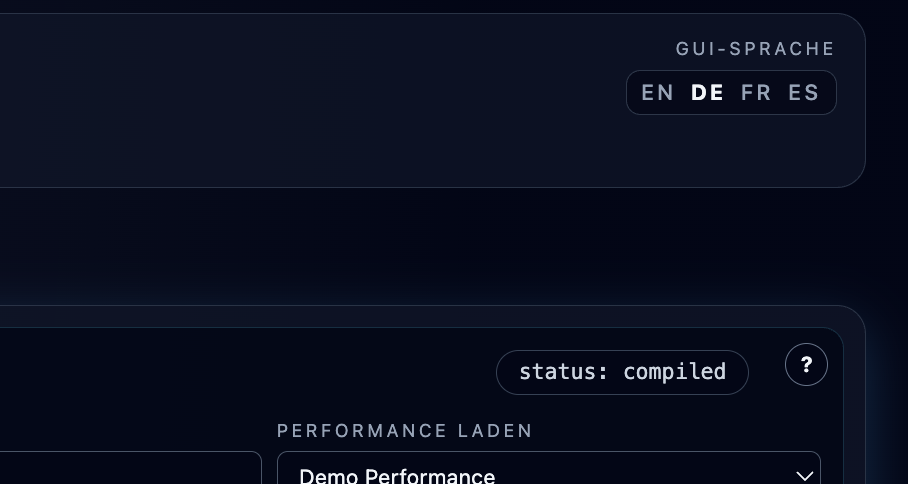
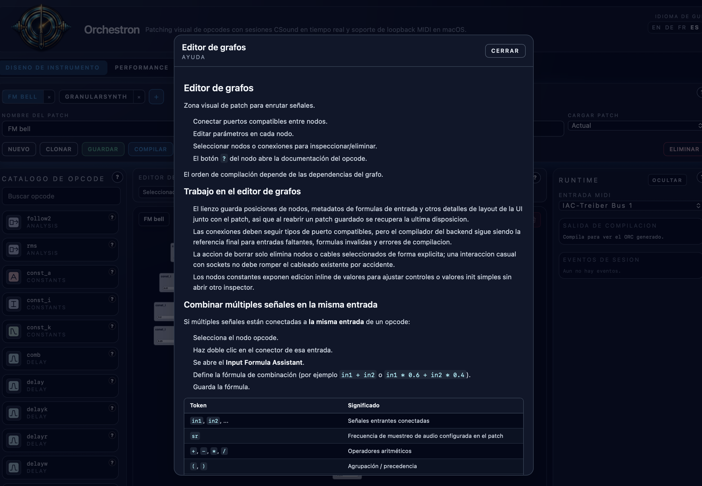
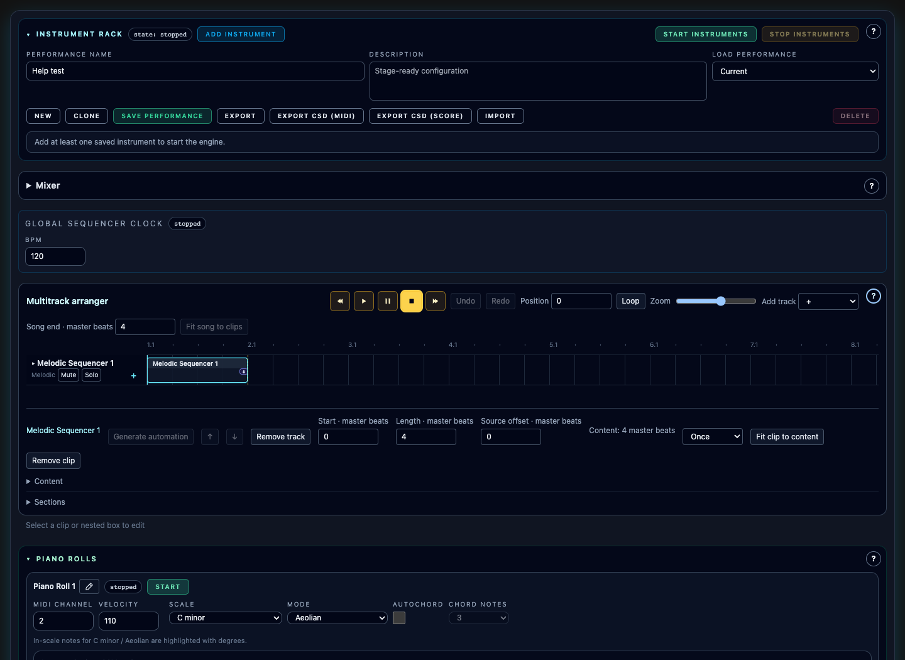
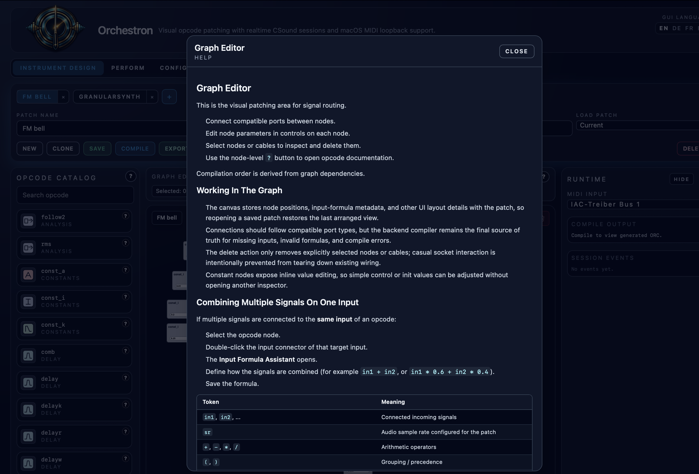

# GUI Language and Integrated Help

**Navigation:** [Up](configuration.md) | [Previous](configuration.md) | [Next](audio_engine_settings.md)

Orchestron includes multilingual UI labels and integrated documentation so you can stay inside the app while learning and working.

## GUI Language Selector

The language selector is in the top-right area of the main app header.

Supported languages:

- English
- German
- French
- Spanish

The selector is presented as quick language links (short labels) for fast switching.

  

<em>Top-right header language selector links.</em>

## What Changes When You Switch Language

Language switching affects user-facing text such as:

- Page labels (`Instrument Design`, `Perform`, `Config`)
- Toolbar/button labels
- Context help pages (integrated help modals)
- Opcode documentation modal content (localized generated markdown)
- Many labels inside advanced editors (including the GEN editor)

  

<em>Integrated help and UI localization in multiple supported languages.</em>

## Integrated Help (`?` Buttons)

Orchestron provides context help buttons (`?`) across the UI.

Examples include:

- Instrument patch toolbar
- Opcode catalog
- Graph editor header/area
- Runtime panel
- Sequencer sections (rack, Mixer, tracks, Score Sequencers, both multitrack arrangers, piano rolls, MIDI controllers)
- Config page sections

Clicking a context `?` opens a markdown help modal tailored to that UI area.

Mixer help covers levels, routing, sends, inserts, bypass and feedback diagnostics. Its button remains available while collapsed. The new Multitrack Arranger opens clip-specific guidance for fixed windows, reusable content, drafts, save scopes and playback; pad-based performances retain their compatibility-arranger help. Both use the same localized dialog as the rack, live keyboard and live MIDI controllers.

The Score Sequencer uses this same top-right button in its panel and clip pattern
editor, including while collapsed. Its help explains keyboard auditioning,
double-click quarter-note insertion, drawing, editing and playback in all four
GUI languages.

On the Instrument Design, Perform, and Config pages, these help modals focus on the current tool, device, transport section, or engine setting panel instead of repeating generic UI conventions.

  

<em>Context help modal integrated into the workflow.</em>

## Opcode Documentation (`?` On Opcode Node)

Placed opcode nodes provide a node-level `?` button that opens opcode documentation.

The modal includes:

- Localized description
- Inputs and outputs (with detailed port descriptions)
- Syntax/template summary
- Tags
- `Open Csound Reference` link to the official Csound documentation page for that opcode

## Modal Behavior

Both help modals and opcode documentation modals support:

- Close button
- Click outside modal to close
- `Esc` key to close

## Best Practice

Use context help for workflow guidance and opcode docs for technical/operator details.

This combination is faster than switching repeatedly between the app and external documentation while designing patches.

**Navigation:** [Up](configuration.md) | [Previous](configuration.md) | [Next](audio_engine_settings.md)
