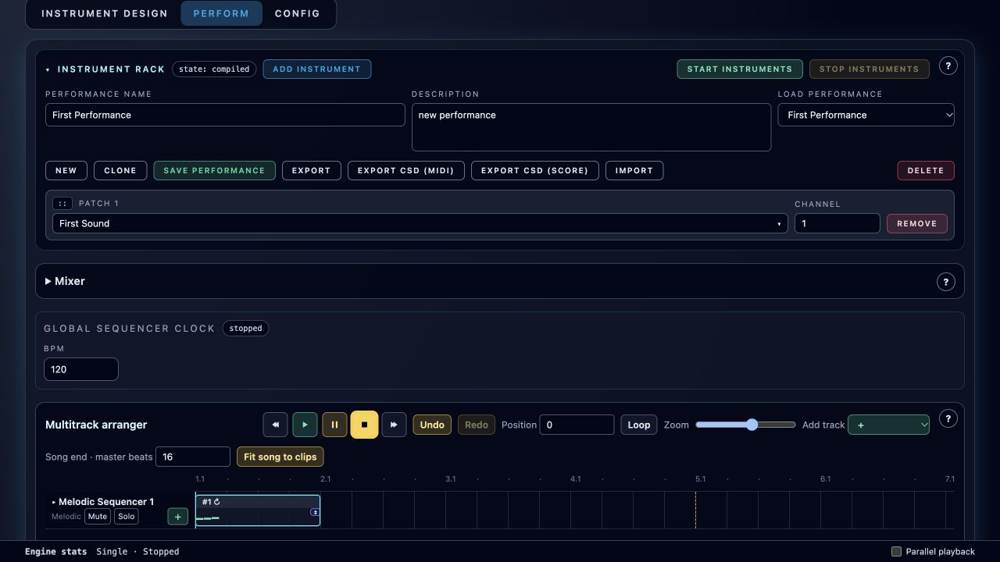

# Getting Started

**Navigation:** [Up](user_documentation.md) | [Previous](user_documentation.md) | [Next](instrument_design/instrument_design.md)

This walkthrough creates a playable instrument and a short song using only the browser. Start with Orchestron open, your speakers or headphones at a modest level, and the GUI language set to English if you want labels to match this manual. An empty library is fine.

## Create your first instrument

1. Open **Instrument Design** and choose **New**.
2. Choose **Playable instrument**, then **Create**. This built-in starter contains an oscillator, an envelope and a stereo output; it does not require a saved template.
3. Enter **First Sound** as the patch name. Keep the default Melody instrument type.
4. Choose **Compile**. A successful compile shows that the graph is valid; it does not save or start it.

See [the patch toolbar](instrument_design/patch_toolbar_and_tabs.md) if you want to import an existing sound instead.

## Hear and save it

1. Open **Audition** in the graph header.
2. Choose **Isolated**, leave the test MIDI note at **60**, and choose **Prepare audition**. When preparation finishes, choose **Stop and audition**. The preview sends the test note automatically.
3. Choose **Close audition · transport stays stopped** when finished. Audition restores the previous setup with transport stopped.
4. Choose **Save** to add First Sound to your instrument library.

The [draft audition guide](instrument_design/runtime_panel_and_compilation.md#audition-a-draft) explains each preview control and how to audition a changed instrument in a performance.

## Build a short performance

1. Open **Perform**, choose **New**, and enter **First Performance** as the performance name.
2. Choose **Add Instrument**. With only one saved instrument, First Sound is selected automatically; otherwise select it in the patch picker. Set its MIDI channel to **1**.
3. Open **Mixer**. Check that First Sound reaches **Master**, with both strips unmuted. The built-in starter receives this route automatically.
4. Under **Add track** in the arranger, select **Melodic**. Orchestron creates a four-beat clip and opens its first pattern editor.
5. Check that the track sends to MIDI channel **1**. Leave the default 4/4 meter, sixteenth-note subdivision and octave **4**. In the first three step positions, replace **Rest** with **C**, **D**, and **G**; leave the remaining steps as rests.
6. Choose **Play edit** to hear the draft, then **Stop edit**, **Save**, and **Close editor**.
7. Choose **Play** in the arranger. It starts stopped instruments automatically and plays the saved pattern inside its clip.
8. Choose **Stop** to finish. Instruments that Play started are stopped again; an engine that was already running stays running.

<em>The saved starter performance. Mixer is collapsed to leave room for the arranger.</em>

Read [melodic step editing](performance/sequencer_tracks_and_steps.md) for note entry and [the arranger](performance/multitrack_arranger.md) for clip editing. Pattern length and the clip's window are separate: resizing a clip does not erase notes.

## Save and reopen

1. Save any open pattern or structure draft. **Play edit** alone does not commit changes.
2. Choose **Save Performance**.
3. Choose **New**, then select **First Performance** under **Load Performance**. Confirm that First Sound and the melodic clip return, and choose arranger **Play** again.
4. Use **Export** for a portable, editable backup of the performance and its instruments.

Reload recovery is useful, but use explicit saves for work you intend to keep. See [Saving, Workspace Recovery and Defaults](configuration/persistence_and_defaults.md).

## If you hear no sound

- Check your device volume and browser audio permissions; interact with the page if the browser has not enabled audio yet.
- Confirm that the instrument compiled and was saved as a normal instrument, not a template.
- Check that the track or piano roll sends to the rack instrument's MIDI channel.
- Check the instrument strip and Master routing, levels and mute controls.
- Check that your clip contains a saved pattern and that the playhead passes through it.
- Open the Runtime or Perform status display for an error or audio-queue warning. See [Live Status and Troubleshooting](performance/live_status_and_safety_controls.md).

**Navigation:** [Up](user_documentation.md) | [Previous](user_documentation.md) | [Next](instrument_design/instrument_design.md)
