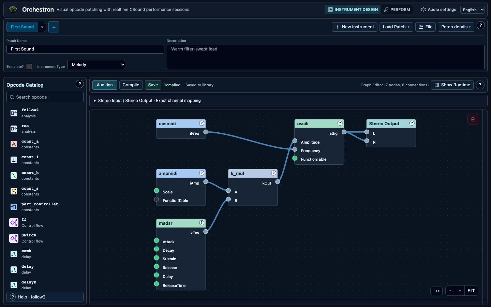
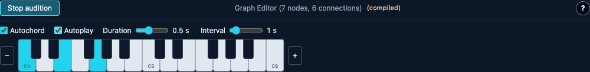
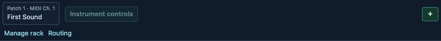
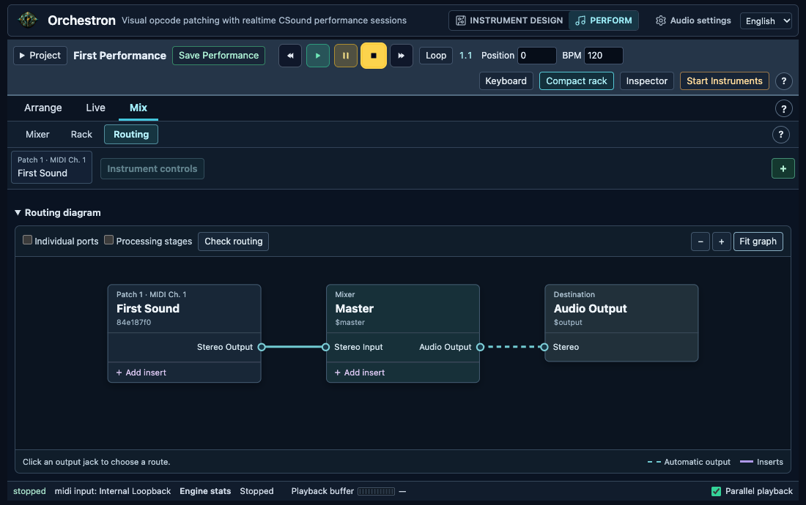
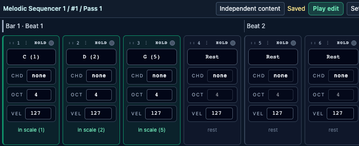

# Getting Started

**Navigation:** [Up](user_documentation.md) | [Previous](user_documentation.md) | [Next](instrument_design/instrument_design.md)

This walkthrough creates a playable instrument and a short song using only the browser. Start with Orchestron open, your speakers or headphones at a modest level, and the GUI language set to English if you want labels to match this manual. An empty library is fine.

## Create your first instrument

1. Open **Instrument Design** and choose **New instrument**.
2. Choose **Playable instrument**, then **Create**. This built-in starter contains an oscillator, an envelope and a stereo output; it does not require a saved template.
3. Open **Patch details** and enter **First Sound** as the patch name. Keep the default Melody instrument type.
4. Choose **Compile**. A successful compile shows that the graph is valid; it does not save or start it.

See [the patch toolbar](instrument_design/patch_toolbar_and_tabs.md) if you want to import an existing sound instead.

## Hear and save it

1. Choose **Audition** above the graph. When the button changes to **Stop audition**, press and hold **C4** on the mini keyboard, then release it. Use **−** or **+** to move down or up an octave.
2. Turn on **Autochord** and play C4 again to hear C–E–G together. White keys play triads in C major. Black keys play single notes.
3. Turn on **Autoplay** to repeat the last note or chord. Tap a different key to change it. **Duration** sets how long the notes sound and **Interval** sets the time between attacks. Turn off Autoplay to go back to playing by hand.
4. Choose **Stop audition**, then **Save** to add First Sound to your library. If a performance was open, audition restores its playhead with transport stopped.

See [Audition a draft](instrument_design/runtime_panel_and_compilation.md#audition-a-draft) for effect previews and temporary sound controls.

<!-- pagebreak -->

## Build a short performance

1. Open **Perform**, choose **Project → New**, then reopen **Project** and enter **First Performance** as the performance name.
2. Close **Project**. In **Arrange**, open **Compact rack** in the top bar. With the instruments stopped, choose **＋** at the right of the rack. Expand **Melody** and select **First Sound**. Its rack entry shows **Patch 1 · MIDI Ch. 1** in the new performance.
3. Choose **Mix**, then **Routing** in the row below it. Follow the cable from First Sound’s **Stereo Output** to **Master**, then on to **Audio Output**. The playable starter gets this route automatically.
4. In the same row, choose **Mixer**. Find the First Sound and Master strips, leave both at **0 dB** and make sure **Mute** is off on each. See the [channel strips in Mix → Mixer](performance/audio_mixer_and_routing.md#mix-a-performance).

<!-- pagebreak -->

### Enter and play three notes

1. Return to **Arrange** and choose **Add track → Melodic** below the timeline. In the new lane’s channel menu select **CH01 · First Sound**. Double-click the first clip, **#1**, to open its pattern editor.
2. Leave the default meter and subdivision. In steps **1**, **2** and **3**, change the pitch from **Rest** to **C**, **D** and **G** respectively. Keep the other steps as rests.
3. Choose **Play edit** to preview the pattern, then **Stop edit**. Choose the arranger **Save** in the top bar to commit the notes.
4. Choose transport **Play** to hear the pattern on the timeline, then **Stop**. If the instrument engine is still running, choose **Stop Instruments** before starting or loading another project.

On a small screen, choose **Back to overview** to see the timeline. See [melodic step editing](performance/sequencer_tracks_and_steps.md) for note entry and [the arranger](performance/multitrack_arranger.md) for clip editing.

## Save and reopen

1. Save any open pattern or structure draft. **Play edit** alone does not commit changes.
2. Choose **Save Performance** in the top bar to store the named project.
3. Choose **Project → New**, then reopen **Project** and select **First Performance** under **Load Performance**. Confirm that First Sound and the melodic clip return, and choose arranger **Play** again.
4. Use **Project → Export** for a portable, editable backup of the performance and its instruments.

Reload recovery is useful, but use explicit saves for work you intend to keep. See [Saving, Workspace Recovery and Defaults](configuration/persistence_and_defaults.md).

## If you hear no sound

- Check your device volume, interact with the browser to enable audio, and read any message in the Perform status bar.
- In **Arrange**, check that the playhead crosses the saved notes and that the lane targets **CH01 · First Sound**.
- In **Mix → Routing**, follow First Sound to Master. In **Mix → Mixer**, check both mute buttons, gains and meters. See [Live Status and Troubleshooting](performance/live_status_and_safety_controls.md).

**Navigation:** [Up](user_documentation.md) | [Previous](user_documentation.md) | [Next](instrument_design/instrument_design.md)
