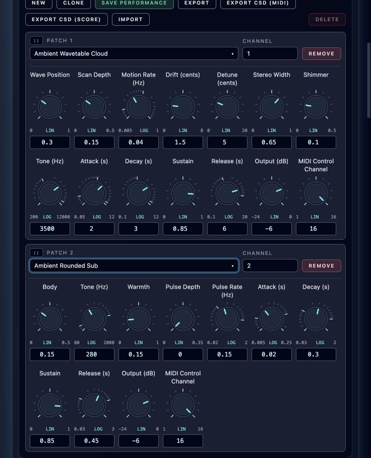

# Ambient Techno Instruments

**Navigation:** [Instrument Design](instrument_design.md) | [Performance Controls](../performance/performance_controllers.md)

**Ambient Rounded Sub** and **Ambient Wavetable Cloud** are dry, velocity-sensitive,
polyphonic instruments. Import their native JSON files, assign note channels in
Perform, and route **Stereo Output** through the mixer to **Master**.

- [Ambient Rounded Sub](../../examples/instruments/Ambient_Rounded_Sub.orch.instrument.json): sine/triangle bass, gentle saturation, low-pass tone and optional amplitude pulsing. Suggested MIDI notes **24–55**. Its two output channels are identical.
- [Ambient Wavetable Cloud](../../examples/instruments/Ambient_Wavetable_Cloud.orch.instrument.json): four morphing waveforms, three detuned voices, slow scanning and pitch drift, stereo width and an octave shimmer layer. Suggested MIDI notes **36–84**. Add shared rack delay/reverb for spacious ambience.

The cloud's shimmer is an octave oscillator layer. The instrument's sustained
textures come from its oscillators and modulation. Waveforms range from a sine
through warm and hollow spectra to bright upper harmonics. At high pitches the
tables reduce upper harmonics; the octave layer fades away near its upper limit.
The bass has stable pitch and no detuning. Neither instrument needs sample assets.

The [authoring guide](../../examples/instruments/ambient_techno/README.md) includes
rebuild, library-save and audition commands. Native instrument exports,
saved instance settings, and MIDI/SCORE CSD exports retain the controls.

## Performance and MIDI controls

Performance settings apply when a new note starts. Existing notes retain their
base settings; MIDI CCs reshape held notes and release tails with a **30 ms
half-time**. Envelope and Output controls are performance-only.

**MIDI Control Channel** defaults to **16**, independently of the rack's note
channel. The control-channel knob is rounded to the nearest whole channel.
Set MIDI controller tracks to that channel and use **Reset Value 0**.
A CC value of **0** preserves the performance setting. Higher values add intensity
(this refers to the value of each assigned CC, not MIDI controller number 0).
New notes never reset shared CC values. Instances using the same control channel
share automation; choose a different channel to control copies independently.

The rack above uses note channels 1 and 2 while both instruments listen for
their distinct timbre CCs on control channel 16.

The mappings below leave existing Granular Capture and Stereo Moog Filter
CC20–23 available.

### Rounded Sub

| Control | Performance range | Default | MIDI CC | At CC127 |
| --- | --- | --- | --- | --- |
| Body | 0–0.5 | 0.15 | 24 | Triangle blend 0.5 |
| Tone | 80–2,000 Hz | 280 Hz | 25 | Base ×4, maximum 4,000 Hz |
| Warmth | 0–1 | 0.15 | 26 | Saturation amount 1 |
| Pulse Depth | 0–0.35 | 0 | 27 | Amplitude modulation depth 0.35 |
| Pulse Rate | 0.02–2 Hz | 0.15 Hz | 28 | Base ×4, maximum 4 Hz |

Warmth blends in a normalized soft saturation curve; zero bypasses saturation.
Body adds a small triangle
component to the sine. Tone filters their combined sound. Pulse Depth modulates
amplitude without changing pitch; Pulse Rate is in Hz and does not follow tempo.

<!-- pagebreak -->

### Wavetable Cloud

| Control | Performance range | Default | MIDI CC | At CC127 |
| --- | --- | --- | --- | --- |
| Wave Position | 0–1 | 0.3 | 102 | Position 1 |
| Scan Depth | 0–0.5 | 0.15 | 103 | Excursion 0.5 |
| Motion Rate | 0.005–1 Hz | 0.04 Hz | 104 | Base ×4, maximum 2 Hz |
| Drift | 0–8 cents | 1.5 cents | 105 | Pitch drift 8 cents |
| Detune | 0–20 cents | 5 cents | 106 | Side-voice detuning ±20 cents |
| Stereo Width | 0–1 | 0.65 | 107 | Full width |
| Shimmer | 0–0.5 | 0.1 | 108 | Octave-layer mix 0.5 |
| Tone | 200–12,000 Hz | 3,500 Hz | 109 | Base ×4, maximum 16,000 Hz |

Wave Position selects the center of the waveform scan. Scan Depth moves around
that center, clamped to 0–1. Separate slow oscillators vary each voice's scan and
pitch, with different rate ratios to avoid a short repeating movement.
Motion Rate controls their overall speed in Hz. Drift changes pitch over time;
Detune sets the fixed spacing between voices. Stereo Width 0 centers all voices.
Shimmer balances the fundamental voices with two voices one octave above.

For normalized MIDI value `u = CC / 127`, amount controls use
`base + u × (maximum − base)`. Tone and rate use `base × 4^u`, capped as shown.
CC64 therefore approximately doubles a frequency/rate. An amount already set to
its maximum has no further upward travel.

## Envelope and output

| Control | Sub range; default | Cloud range; default |
| --- | --- | --- |
| Attack | 0.005–0.25 s; 0.02 s | 0.05–12 s; 2 s |
| Decay | 0.03–2 s; 0.3 s | 0.1–12 s; 3 s |
| Sustain | 0–1; 0.85 | 0–1; 0.85 |
| Release | 0.03–3 s; 0.45 s | 0.1–20 s; 6 s |
| Output | −24–0 dB; −6 dB | −24–0 dB; −6 dB |
| MIDI Control Channel | 1–16; 16 | 1–16; 16 |

Long cloud releases overlap subsequent chords. Set the mixer level for the
number of simultaneous notes and any external effects.

## Starting sounds

Start from defaults and keep all assigned CCs at zero for these recipes:

| Sound | Settings |
| --- | --- |
| Pure sub | Body 0, Warmth 0, Tone 2,000 Hz |
| Warm pulse | Body 0.35, Warmth 0.65, Pulse Depth 0.25, Pulse Rate 1.2 Hz |
| Dark drone | Wave Position 0.08, Tone 700 Hz, Shimmer 0, Motion Rate 0.015 Hz |
| Shimmer | Wave Position 0.75, Shimmer 0.4, Tone 10,000 Hz, Stereo Width 0.9 |
| Drifting cloud | Scan Depth 0.4, Motion Rate 0.12 Hz, Drift 6 cents, Detune 12 cents, Stereo Width 1 |
