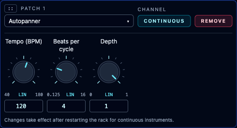
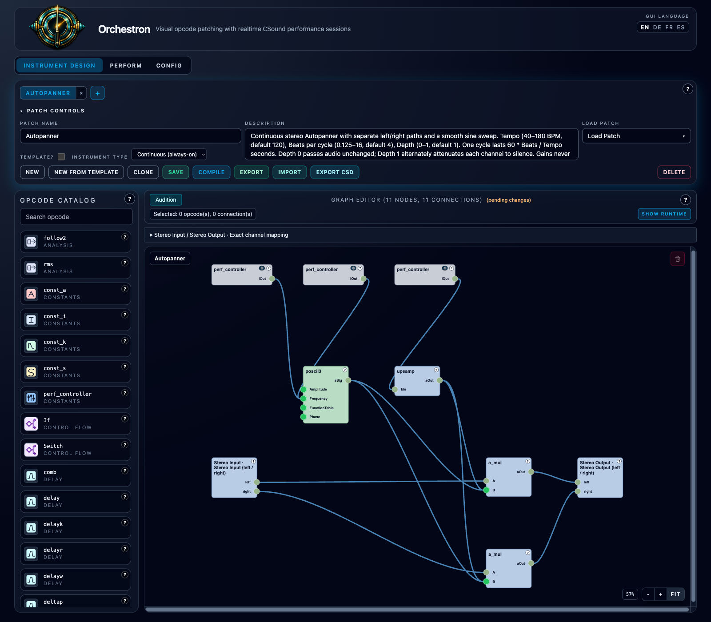

# Autopanner

**Navigation:** [Standard Effects](../performance/standard_effects.md) | [Prev](stereo_flanger.md) | [Next](parametric_equalizer.md) | [Mixer and routing](../performance/audio_mixer_and_routing.md)

[Download Autopanner](../../examples/instruments/Autopanner.orch.instrument.json)
and import it with **Instrument Design → Import**. This Continuous stereo effect
uses a smooth sine wave to move the balance between left and right. Each input
stays in its original channel; the effect never sums or cross-feeds them.

## Use as an insert

1. With instruments stopped, open **Perform → Mixer**.
2. On a source strip or Master, open **Inserts…**, select **Autopanner**, and click **Add**.
3. Enter your performance's tempo and the number of quarter-note beats per full cycle.
4. Start the instruments. **Restart the rack after changing any setting.**
5. Save Performance to retain that instance's values.

Use an insert for the full sweep. A parallel send leaves the original signal
audible alongside the panned return and reduces the apparent movement.
The grouped Stereo Input and Stereo Output both expose `left` and `right`.
The instrument needs routed audio, not MIDI notes.

## Controls

| Controller | Range | Default | Scale |
| --- | --- | --- | --- |
| Tempo (BPM) | 40–180 | 120 | Linear |
| Beats per cycle | 0.125–16 | 4 | Linear |
| Depth | 0–1 | 1 | Linear |

One complete cycle lasts `60 × Beats per cycle / Tempo` seconds. At 120 BPM,
four beats take two seconds; one beat takes half a second. Fractional beats are
supported. Beats count quarter notes regardless of the sequencer's meter.
The full range is approximately 0.0417–24 seconds per cycle.

**Tempo is manual.** The effect does not read performance tempo, follow arranger
position, or align to its bars. Starting the effect resets its phase to the
center, moving toward the right first. Arranger seeks do not reset this cycle.

**Depth 0** passes both channels through unchanged. **Depth 1** alternately
attenuates each channel to silence. At the center of a full-depth sweep, each
channel has gain 0.5 (about −6 dB). Each channel's gain stays between zero and one;
the effect adds no gain, latency, feedback or tail. A signal present only on the
left stays on the left and fades in and out; it is not transferred to the right.
For identical left/right input, the summed amplitude stays constant throughout
the sweep at a fixed Depth, although perceived loudness can vary.

<!-- pagebreak -->

## Editable graph and exports

With `sine = sin(2π × time × Tempo / (60 × Beats))`, the graph computes:

- `outputLeft = inputLeft × [1 − Depth × (1 + sine) / 2]`
- `outputRight = inputRight × [1 − Depth × (1 − sine) / 2]`

One audio-rate `poscil3` oscillator feeds separate audio multipliers. An `upsamp`
node promotes the fixed Depth setting for audio formulas. The graph uses existing
opcodes and ordinary grouped inlets/outlets. Stable controller IDs are `ap_tempo`,
`ap_beats` and `ap_depth`. Native bundles and both CSD export modes preserve the
graph and each instance's settings.

See the [example guide](../../examples/instruments/autopanner/README.md) for the
builder, matched previews and regression checks.
