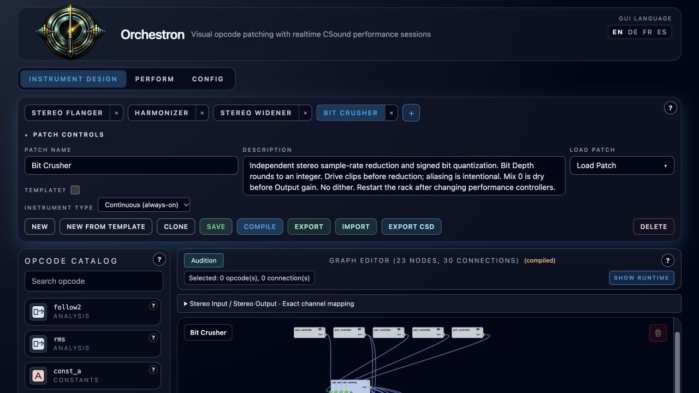

# Stereo Widener, Bit Crusher, and Harmonizer

**Navigation:** [Up](instrument_design.md) | [Performance controllers](../performance/performance_controllers.md) | [Mixer routing](../performance/audio_mixer_and_routing.md)

These three continuous instruments process incoming stereo audio without MIDI notes. Add an instrument to the rack and use its grouped Stereo Input and Stereo Output as a mixer insert. Each instance has its own performance settings; **restart the rack after changing a controller**. The examples include editable graphs and native instrument files.

## Stereo Widener

| Controller | Range | Default |
| --- | --- | --- |
| Width | 0–2 | 1.5 |
| Mono Widening | 0–1 | 0 |
| Delay (ms) | 1–30 | 12 |
| Output (dB) | −24–0 | −6 |

Width scales the side signal while preserving the center. Width 0 makes mono; Width 1 with Mono Widening 0 preserves the original stereo image before Output gain. Width above 1 exaggerates the stereo difference. Mono input stays mono until Mono Widening is raised.

Mono Widening adds the difference between the center signal and a delayed copy to the side signal. Try Mono Widening 0.5–1 with Width 1–2 on a mono synth or pad. Delay controls the coloration and apparent space. The added side cancels when summed to mono; the mono sum remains the original center signal multiplied by Output gain. High width can increase individual channel peaks, so leave headroom.

The graph computes `M=(L+R)/2`, `S=(L−R)/2`, then `S'=Width × (S + MonoWidening × (M−delayedM)/2)`. Its outputs are `M+S'` and `M−S'`, followed by Output gain.

## Bit Crusher

| Controller | Range | Default |
| --- | --- | --- |
| Bit Depth | 2–16 | 8 |
| Downsample Factor | 1–64, logarithmic | 4 |
| Drive (dB) | 0–24 | 0 |
| Mix | 0–1 | 1 |
| Output (dB) | −24–0 | −6 |

Each channel is driven and hard-clipped, reduced in sample rate, and quantized. Bit Depth rounds to the nearest integer. Downsample Factor 1 preserves the sample rate; 4 produces an effective 12 kHz rate at a 48 kHz engine rate. Fractional factors are supported. Aliasing and stepped waveforms are intentional parts of the sound.

Quantization uses signed codes from −1 to `1−1/Q`, with `Q=2^(BitDepth−1)`, rounding to the nearest code. Zero remains zero; no dither is added. At 2 bits, quiet inputs below ±0.25 quantize to silence; raise Drive to bring them above that threshold. The sample holder initializes to silence for its first sample. Drive affects the processed path only. Mix 0 gives the original input, and Mix 1 gives the processed signal; Output gain follows the blend. For a send return use Mix 1.

## Harmonizer

| Controller | Range | Default |
| --- | --- | --- |
| Voice 1 Interval (semitones) | −24–24 | +7 |
| Voice 2 Interval (semitones) | −24–24 | +12 |
| Voice 1 Level | 0–1 | 0.7 |
| Voice 2 Level | 0–1 | 0.5 |
| Mix | 0–1 | 0.5 |
| Output (dB) | −24–0 | −6 |

Two spectral pitch shifters add fixed harmony voices. Intervals round with `floor(interval+0.5)` and convert to frequency ratios using `2^(interval/12)`. The defaults add a fifth and an octave. Set either voice level to zero to mute it. If the level sum exceeds 1, both levels are divided by their sum before mixing with the dry signal.

Left and right channels are processed separately. The effect does not detect a key or scale and does not preserve vocal formants. Sustained notes and chords suit this algorithm; sharp transients can smear or ring. There is no feedback tail.

The graph uses a 1024-sample Hann analysis window and FFT, with a 256-sample hop, followed by `pvscale` and `pvsynth`. **Measured processing latency is 1536 samples (32 ms at 48 kHz)** on the validated Csound 6.18 runtime. The dry path uses the same delay, including at Mix 0. Use Mix 1 for a send return; a separate undelayed parallel dry route will still differ in timing. This measured delay supersedes the 1024-sample figure in the manual's illustrative example.

[Csound pvscale reference](https://csound.com/docs/manual/pvscale.html) · [Csound fold reference](https://csound.com/docs/manual/fold.html)

## Files and validation

Native exports are in `examples/instruments/`: `Stereo_Widener.orch.instrument.json`, `Bit_Crusher.orch.instrument.json`, and `Harmonizer.orch.instrument.json`.

See the [example README](../../examples/instruments/continuous_effects/README.md) for builders and validation commands. Auditions compare mono chords, stereo pitches, and transient noise at defaults and controller endpoints. Tests use independent fixtures. Audio and measurements are written under `output/continuous-effects/`.

See [Granular Capture](granular_capture.md) for live MIDI-controlled stutter, freeze and granular playback.
