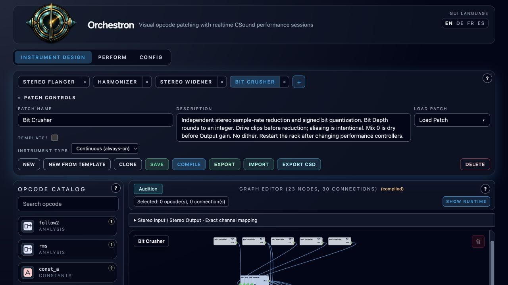

# Stereo Widener, Bit Crusher, and Harmonizer

**Navigation:** [Up](../performance/standard_effects.md) | [Previous](parametric_equalizer.md) | [Next](granular_capture.md)

These three continuous instruments process incoming stereo audio without MIDI notes. Add an instrument to the rack and use its grouped Stereo Input and Stereo Output as a mixer insert. Each instance has its own performance settings; controls marked **Live** update during playback, while **Requires restart** identifies I-rate or mixed connections. The examples include editable graphs and native instrument files.

## Stereo Widener

| Controller | Range | Default |
| --- | --- | --- |
| Width | 0–2 | 1.5 |
| Mono Widening | 0–1 | 0 |
| Delay (ms) | 1–30 | 12 |
| Output (dB) | −24–0 | −6 |

Width scales the side signal while preserving the center. Width 0 makes mono; Width 1 with Mono Widening 0 preserves the original stereo image before Output gain. Width above 1 exaggerates the stereo difference. Mono input stays mono until Mono Widening is raised.

Mono Widening adds the difference between the center signal and a delayed copy to the side signal. Try Mono Widening 0.5–1 with Width 1–2 on a mono synth or pad. Delay controls the coloration and apparent space. The added side cancels when summed to mono; the mono sum remains the original center signal multiplied by Output gain. High width can increase individual channel peaks, so leave headroom.

## Bit Crusher

| Controller | Range | Default |
| --- | --- | --- |
| Bit Depth | 2–16 | 8 |
| Downsample Factor | 1–64, logarithmic | 4 |
| Drive (dB) | 0–24 | 0 |
| Mix | 0–1 | 1 |
| Output (dB) | −24–0 | −6 |

Each channel is driven and hard-clipped, reduced in sample rate, and quantized. Bit Depth rounds to the nearest integer. Downsample Factor 1 preserves the sample rate; 4 produces an effective 12 kHz rate at a 48 kHz engine rate. Fractional factors are supported. Aliasing and stepped waveforms are intentional parts of the sound.

At 2 bits, quiet inputs below ±0.25 quantize to silence; raise Drive to bring them above that threshold. Drive affects the processed path only. Mix 0 gives the original input, and Mix 1 gives the processed signal; Output gain follows the blend. For a send return use Mix 1.

## Harmonizer

| Controller | Range | Default |
| --- | --- | --- |
| Voice 1 Interval (semitones) | −24–24 | +7 |
| Voice 2 Interval (semitones) | −24–24 | +12 |
| Voice 1 Level | 0–1 | 0.7 |
| Voice 2 Level | 0–1 | 0.5 |
| Mix | 0–1 | 0.5 |
| Output (dB) | −24–0 | −6 |

Two spectral pitch shifters add fixed harmony voices. Intervals round to whole semitones. The defaults add a fifth and an octave. Set either voice level to zero to mute it. If the level sum exceeds 1, both levels are divided by their sum before mixing with the dry signal.

Left and right channels are processed separately. The effect does not detect a key or scale and does not preserve vocal formants. Sustained notes and chords suit this algorithm; sharp transients can smear or ring. There is no feedback tail.

**Measured processing latency is 1536 samples (32 ms at 48 kHz)** on the validated Csound 6.18 runtime. The dry path uses the same delay, including at Mix 0. Use Mix 1 for a send return; a separate undelayed parallel dry route will still differ in timing.

[Csound pvscale reference](https://csound.com/docs/manual/pvscale.html) · [Csound fold reference](https://csound.com/docs/manual/fold.html)

## Vocoder

[Download Vocoder](../../examples/instruments/Vocoder.orch.instrument.json), import it in Instrument Design, and add it as a Continuous rack instrument. In custom routing, connect speech to `speech_left`/`speech_right`, a harmonically rich carrier to `sound_left`/`sound_right`, and the effect's `left`/`right` outputs to Master. Remove direct source-to-Master routes to hear only the effect.

Each speech channel shapes its corresponding carrier channel independently. Feed mono speech to both speech channels. The output is fully wet; no MIDI notes are needed to start the effect.

**Spectral Detail** ranges from 16 to 128 (default 80), rounded to whole cepstral coefficients. Lower values smooth the spectral envelope more. **Makeup Gain (dB)** ranges from 0 to 24 (default +3), raising both channels equally. **Output Gain (dB)** ranges from −24 to 0 (default −6) and trims the result. All three controls target K-rate inputs and belong to each rack instance. Makeup 0 restores the previous gain behavior.

The +3 dB default was checked with near-full-scale synthetic vowel and bright-carrier inputs. This is makeup gain, not a limiter: other signals or larger boosts can overload. Watch Vocoder and Master peaks and reduce Output Gain when needed. The two gain values add in decibels; +24 dB makeup and −24 dB output cancel each other.

The graph uses `pvsanal`, `pvsvoc` and `pvsynth`, with a 1024-sample Hann window and 256-sample hop. Processing adds latency; the exact latency has not yet been measured for this instrument. See the [Csound pvsvoc reference](https://csound.com/docs/manual/pvsvoc.html).

## Download the effects

- [Stereo Widener](../../examples/instruments/Stereo_Widener.orch.instrument.json)
- [Bit Crusher](../../examples/instruments/Bit_Crusher.orch.instrument.json)
- [Harmonizer](../../examples/instruments/Harmonizer.orch.instrument.json)

Import the desired file in Instrument Design. Graph formulas and measurement procedures are in the [technical reference](../../specifications/manual-reference/continuous_effects.md).

See [Granular Capture](granular_capture.md) for live MIDI-controlled stutter, freeze and granular playback.

**Navigation:** [Up](../performance/standard_effects.md) | [Previous](parametric_equalizer.md) | [Next](granular_capture.md)
