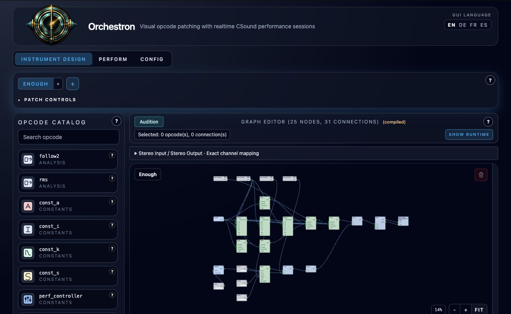
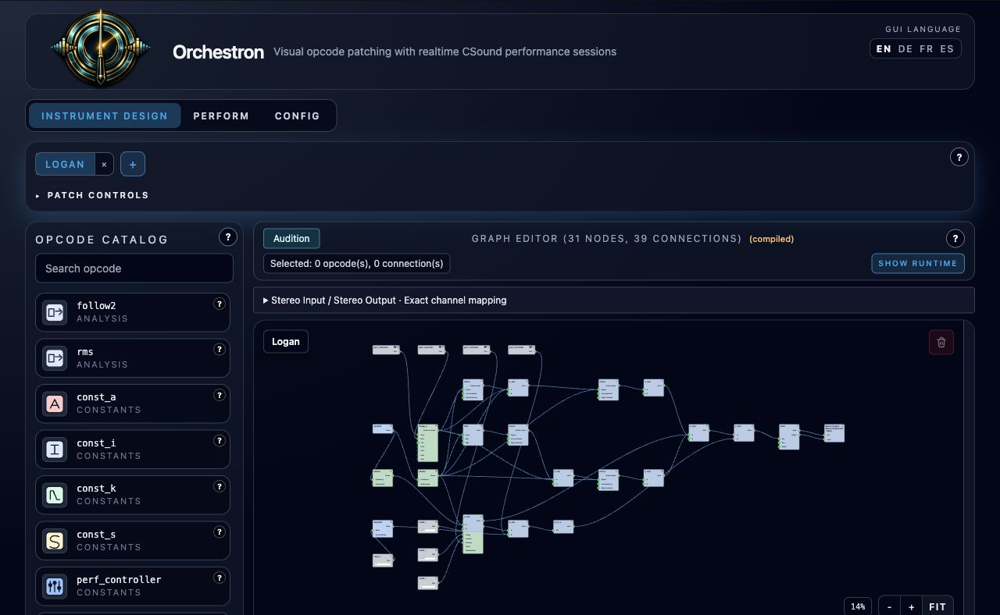

# Enough and Logan

**Navigation:** [Up](../supplied/instruments.md) | [Previous](hsb_mono.md) | [Next](goa_trance_fm_lead.md)

Enough and Logan are dry, polyphonic Melody instruments adapted from
[joel / ebmtranceboy's altamax Csound project](https://ide.csound.com/editor/pXPRc5Y1vALtxqgszdhI).
Import [Enough](../../examples/instruments/Enough.orch.instrument.json) or
[Logan](../../examples/instruments/Logan.orch.instrument.json), add it to the Perform
rack, and route its Stereo Output to Master. Both graphs remain editable.

## Enough

Five sine oscillators form an evolving FM network. The 20× operator modulates the
4× operator; that signal and a separate 9× operator modulate a 3× operator, which
modulates the final 1× carrier. Modulation depths recede during a held note,
leaving a pure sine after two seconds at the default Evolution setting.

This graph uses ordinary `oscil3` nodes. It intentionally omits the source's tiny
0.0001 self-feedback term. Cubic-interpolated oscillators also differ from the
source's sample-by-sample phase advancement and rounded table lookup. This is an
editable adaptation of the original algorithm, not a sample-identical recreation.

## Logan

Two audio-rate phase ramps drive mirrored and limited waveform shapes. Their
combination alternates between two cubic-shaped waveforms at the fundamental
frequency. The shape moves from 0.93 to 0.03 over five seconds by default.
The phase-shaping network retains the source equations.

## Performance controls

| Control | Enough | Logan |
| --- | --- | --- |
| Timbre | Final FM-depth multiplier, 0–2; default 1 | Initial shape, 0.05–0.97; default 0.93 |
| Evolution | Multiplies modulation-envelope times, 0.25–4; default 1 | Shape sweep duration, 0.1–20 seconds; default 5 |
| Release | 0.01–3 seconds; default 0.2 | 0.01–3 seconds; default 0.5 |
| Level | Per-channel gain, 0–1; default 0.5 | Per-channel gain, 0–0.25; default 0.06 |

Settings are read when each note starts. Held notes retain their settings.
Velocity changes final loudness without changing modulation depth. Both
instruments add a 1 ms MIDI attack and decay with full sustain, and use a
release-sensitive envelope. Centered stereo output preserves the source's
per-channel gain; chord levels add together, so reduce Level or the mixer strip
for dense chords. The source project's delay and reverb are not included.

## Reusable building blocks

The catalog also provides `phasor` (an audio-rate phase ramp), `mirror` (reflection
between thresholds), and `linseg_a` (an audio-rate linear envelope). Existing
`linseg` nodes retain their control-rate output. `linseg_a` emits native Csound
`linseg`; its final value holds after the last segment. Omit optional duration
and endpoint pairs together.

**Navigation:** [Up](../supplied/instruments.md) | [Previous](hsb_mono.md) | [Next](goa_trance_fm_lead.md)
