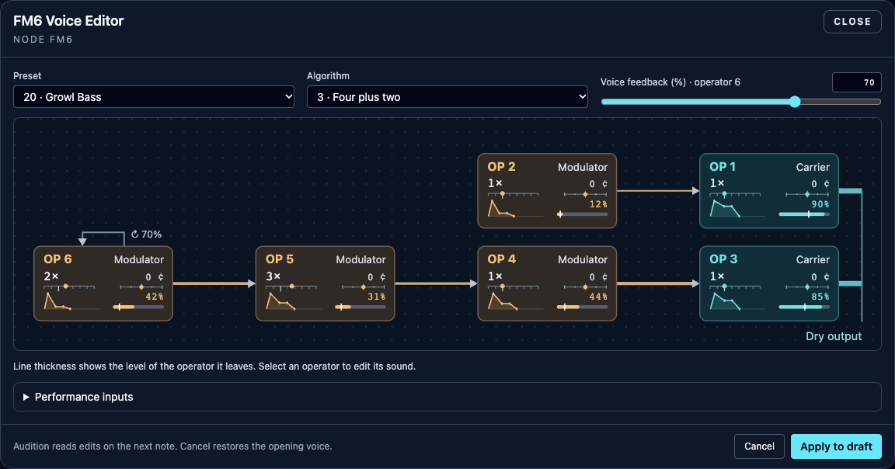
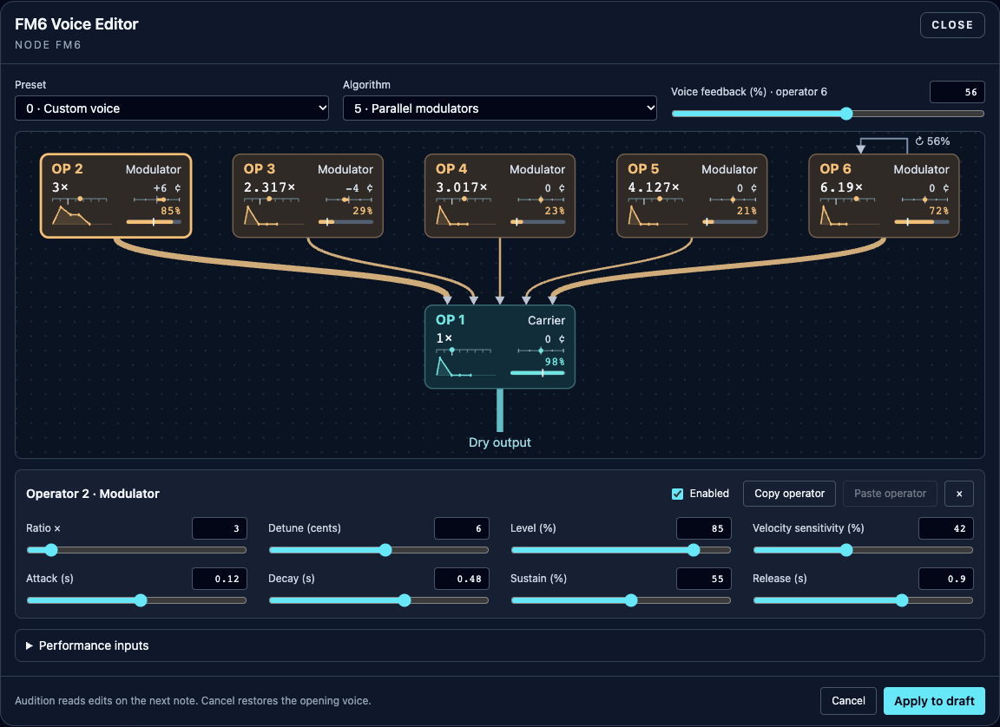

# FM6 Voice and Almost DX7

**Navigation:** [Up](instrument_design.md) | [Previous](gen_table_editor.md) | [Next](control_flow.md)

`fm6_voice` is a dry six-operator synthesizer inspired by 1980s FM sounds. Each sine operator has its own tuning, level, velocity response and ADSR envelope. Operators modulate other operators or contribute directly to the output. This is a simplified phase-modulation instrument, without DX7 SysEx import or exact hardware emulation.

## Start with Almost DX7

[Download Almost DX7](../../examples/instruments/fm/Almost_DX7.orch.instrument.json), import it in Instrument Design and save it. Add the instrument in Perform and route its Stereo Output to Master. Add reverb, chorus or delay as separate mixer effects if desired; the instrument itself contains none.

Each new note reads the performance controls; held notes retain their original settings. Preset accepts whole numbers only. The instrument allows up to 16 simultaneous voices, including release tails.

| Control | Range | Default | Use |
| --- | --- | --- | --- |
| Preset | 1–32, integer | 1 | Select a starter sound below. |
| Brightness | 0–200% | 100% | Scale modulation between operators. |
| Attack | 0.25–4× | 1× | Multiply all six attack times. |
| Release | 0.25–4× | 1× | Multiply all six release times. |
| Vibrato | 0–100 cents | 0 | Pitch vibrato at 5 Hz. |
| Output | −36–0 dB | −12 dB | Gain before the mixer. |

| Preset | Sound | Algorithm |
| --- | --- | --- |
| 1 | Tine Piano | 1 |
| 2 | Soft Electric Piano | 1 |
| 3 | FM Bass | 3 |
| 4 | Slap Bass | 7 |
| 5 | Glass Bell | 1 |
| 6 | Wooden Mallet | 3 |
| 7 | Synth Brass | 5 |
| 8 | Digital Organ | 8 |
| 9 | Bright Pluck | 1 |
| 10 | Evolving Pad | 2 |
| 11 | Metallic Lead | 4 |
| 12 | Shimmer Keys | 6 |
| 13 | Solid Sub Bass | 7 |
| 14 | Rubber Synth Bass | 3 |
| 15 | Fingered FM Bass | 7 |
| 16 | Picked FM Bass | 1 |
| 17 | Fretless FM Bass | 2 |
| 18 | Octave Slap Bass | 7 |
| 19 | Hollow Square Bass | 6 |
| 20 | Growl Bass | 3 |
| 21 | FM Clavinet | 1 |
| 22 | Metallic Tom | 7 |
| 23 | Wire Snare | 7 |
| 24 | Space Chime | 2 |
| 25 | Crosswind | 2 |
| 26 | Whistling Draft | 7 |
| 27 | Anvil Strike | 1 |
| 28 | Brake Drum | 5 |
| 29 | Sheet Metal Crash | 2 |
| 30 | Scanner Blip | 3 |
| 31 | Reactor Startup | 4 |
| 32 | Alien Transmission | 5 |

Presets **13–20** add eight bass voices. Start around **E1–E3** (MIDI 28–52).
Solid Sub Bass emphasizes the fundamental; Rubber Synth Bass has a short, elastic
attack; Fingered and Picked FM Bass offer rounded and sharper attacks. Fretless FM
Bass blooms more slowly, Octave Slap Bass adds a bright octave transient, Hollow
Square Bass emphasizes odd harmonics, and Growl Bass has a rougher sustained body.
Velocity changes both weight and brightness. Use shorter Release for tight sequences.

FM Clavinet is a short rhythmic pluck. Metallic Tom and Wire Snare are synthesized
percussion: their pitch follows the played note, so try different octaves. Space
Chime uses inharmonic ratios and slower modulation for a ringing effect. All remain
dry. Existing presets **1–12** retain their original sounds and numbers.

Preset numbers are also listed in the instrument description and opcode **?** help.

For **wind**, hold a low note on **25 Crosswind** for two or three seconds. Two
stacks swell at different speeds, with strong operator-6 feedback roughening one
layer. **26 Whistling Draft** adds two close pitches that beat over the air sound.
To hear what feedback contributes, compare Crosswind with **Feedback override**
set to **0** and then **−1** (the preset value), retriggering the note each time.

For **metallic hits**, **27 Anvil Strike** has a short, hard attack. **28 Brake
Drum** rings longer, with four modulators at different non-integer ratios and a
fifth adding feedback to the attack. **29 Sheet Metal Crash** spreads the strike
across two stacks for a broader rattle. Try the same note softly and then hard.

For **sci-fi sounds**, tap **30 Scanner Blip** for a fast burst that loses its
upper frequencies. Hold **31 Reactor Startup** for at least two seconds to let
successive modulators bring the low hum to a buzz. **32 Alien Transmission**
uses two pairs of close modulator ratios for a flickering tone. All eight effects
come from the six operators and their envelopes. Their tails are part of the dry voice.

## Design a voice

Add `fm6_voice` from the **fm** category and click its **FM6** button. The node initially shows frequency, velocity and preset sockets. Expand **Performance inputs** for the others; connected sockets stay visible when collapsed. Double-click a socket to edit its value or formula with the Input Formula Assistant.

1. Choose a starter or **Custom voice (0)**.
2. Choose an algorithm and follow the amber arrows from modulators or the cyan lines from carriers to **Dry output**. A thicker line means a higher **Level** on the operator it leaves. A thin dashed line marks a disabled operator or a level of zero. The loop on operator 6 shows voice feedback.
3. Click an operator in the diagram, or focus it and press **Enter** or **Space**. Drag a slider or type an exact value. Each operator shows its frequency ratio, detune in cents, envelope and level. The white tick on the level bar marks its level at minimum velocity. Hover over an operator for exact values. **Copy operator** and **Paste operator** transfer all its settings.
4. Adjust voice feedback above the diagram. Expand **Performance inputs** for brightness, envelope scaling, vibrato, feedback override and output gain.
5. To listen while editing, start **Audition** before opening **FM6**. Play the keyboard inside the editor or enable **Autoplay** to repeat the last note or chord while adjusting operators. Each new note takes the current voice, including its algorithm. Held notes and release tails finish with their original settings.
6. **Apply to draft** keeps your edits. **Cancel**, **Close**, **Escape** or clicking the backdrop restores the settings from when you opened the editor. Save the instrument to keep the voice in your library.

Editing an operator, voice feedback or algorithm copies the starter into **Custom (0)**. Browsing starter presets preserves custom settings. The starter bank itself is unchanged by edits.

Graph-driven fields identify their source and preserve their connections and formulas. The corresponding performance fields are read-only. A connected preset input takes priority over the dialog selection: the dialog then browses voices while the graph decides which sounds. To hear custom edits in Almost DX7, disconnect the preset controller or extend its minimum to **0** and select **0**.

## Eight algorithms

Arrows mean “modulates”; audible outputs are mixed. These are Orchestron numbers, not Yamaha's original numbering. Operator 6 can feed back into itself in every algorithm.

| No. | Name | Modulation paths | Audible operators |
| --- | --- | --- | --- |
| 1 | Three pairs | 2 → 1; 4 → 3; 6 → 5 | 1 + 3 + 5 |
| 2 | Two stacks | 3 → 2 → 1; 6 → 5 → 4 | 1 + 4 |
| 3 | Four plus two | 6 → 5 → 4 → 3; 2 → 1 | 1 + 3 |
| 4 | Deep stack | 6 → 5 → 4 → 3 → 2 → 1 | 1 |
| 5 | Parallel modulators | 2, 3, 4, 5, 6 → 1 | 1 |
| 6 | Shared modulation | 6 → 5; 5 → 1, 2, 3, 4 | 1 + 2 + 3 + 4 |
| 7 | Stack, pair and sine | 6 → 5 → 4; 3 → 2; 1 directly out | 1 + 2 + 4 |
| 8 | Six carriers | All operators directly out | 1 + 2 + 3 + 4 + 5 + 6 |

Three pairs suit layered electric pianos and bells; two stacks allow separately evolving layers. The deep stack produces complex metallic spectra. Six carriers works as a small additive organ: Brightness has no effect there, although operator-6 feedback still works.

## Operator controls

| Control | Range | Meaning |
| --- | --- | --- |
| Enabled | On/off | Silence this operator and its modulation contribution. |
| Ratio | 0.25–32× | Frequency relative to the played note. Fractional ratios support inharmonic sounds. Each tick on the left scale is an octave. The tall tick marks 1×. |
| Detune | −100–100 cents | Fine tuning relative to the ratio. The right scale centers on zero, with flat to the left and sharp to the right. The first 10 cents occupy half of each side so small offsets are visible. |
| Level | 0–100% | Volume for a carrier; modulation depth for a modulator. |
| Velocity sensitivity | 0–100% | At 0, velocity has no effect. At 100, level follows normalized velocity. |
| Attack | 0.001–10 s | Rise from zero to full level. |
| Decay | 0.001–20 s | Fall from full level to sustain. |
| Sustain | 0–100% | Level after attack and decay while held. |
| Release | 0.001–20 s | Fade from the current level after note-off. |

As you drag either tuning slider or type a value, the dot beneath its exact readout moves. For example, a ratio of **3×** falls between the **2×** and **4×** ticks, and a detune of **+6 cents** sits just to the right of center.

Each operator’s envelope redraws as you drag a slider or type a value. Dots mark the attack peak, the start of sustain, note-off and the end of release. The horizontal scale is logarithmic so you can see short stages alongside long ones. Sustain height shows the selected percentage. The drawing uses a short hold for illustration. When playing, the note holds until you release the key.

A modulator's envelope changes timbre; a carrier's envelope changes audible level. Short modulator decays create bright attacks with softer bodies.

## Opcode inputs and output

Connect `cpsmidi.kfreq` to Frequency and `ampmidi.iamp` to Velocity, with `ampmidi` scaled to **1**. No external amplitude envelope is needed: FM6 includes six operator envelopes. Connect its mono output through `pan2` to Stereo Output.

Frequency can change during a note. All other inputs initialize with each new note. FM6 supports polyphonic note-activated instruments; Continuous and `midi_legato` are not supported.

FM6 also exposes **Feedback override** and **Vibrato rate**. Override **−1** uses the voice's feedback; **0–100%** replaces it. Thus each starter retains its own feedback when switching presets. Vibrato rate spans **0.1–12 Hz**. Voice feedback spans **0–100%** and always belongs to operator 6.

Carriers use a fixed mix scale, so changing algorithms does not normalize loudness. Adjust carrier levels and Output as needed. Extreme ratios, modulation and feedback can produce aliasing on high notes; reduce those settings for cleaner tones.

**Navigation:** [Up](instrument_design.md) | [Previous](gen_table_editor.md) | [Next](control_flow.md)
