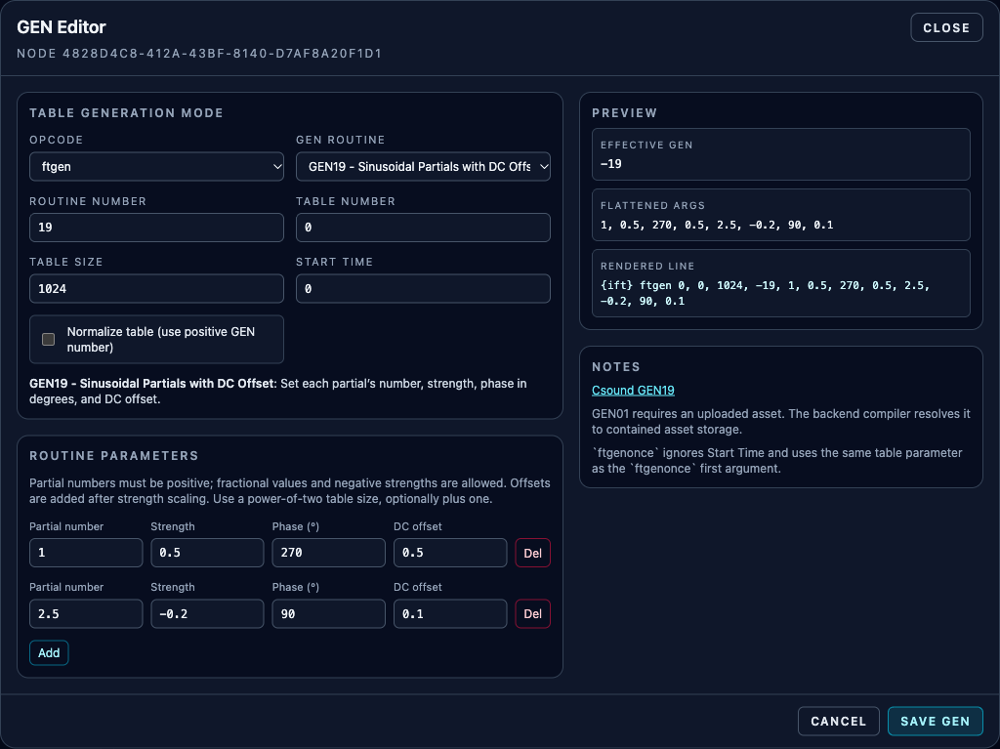
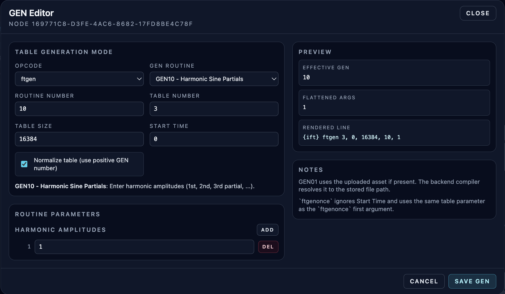
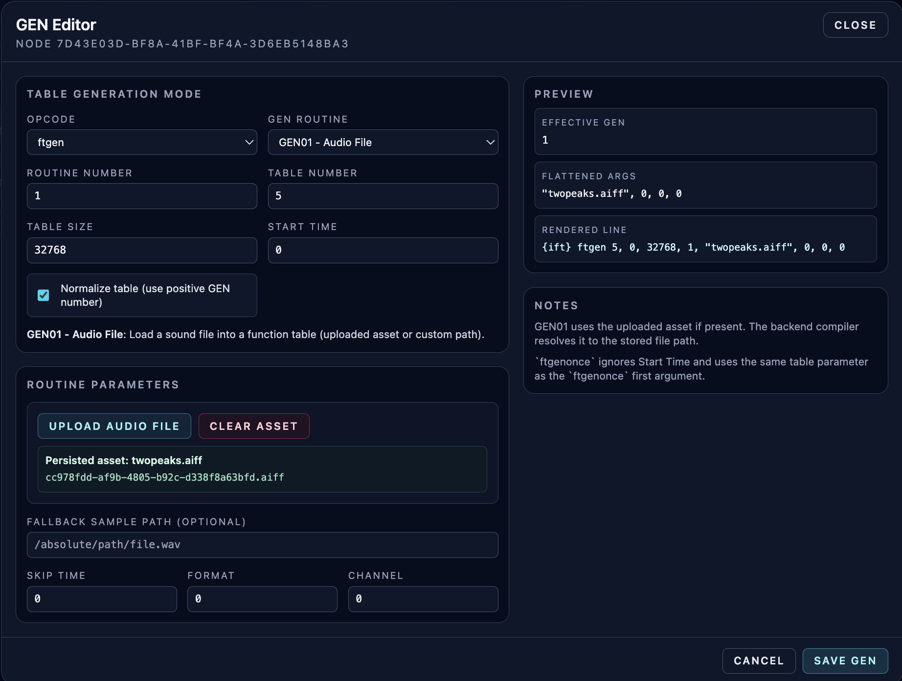
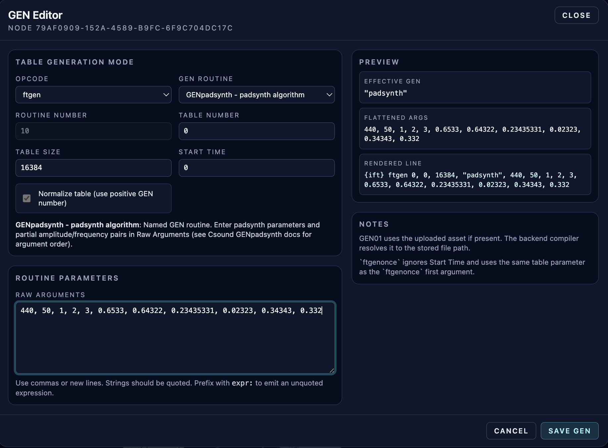

# GEN Table Editor (GEN Meta-Opcode)

**Navigation:** [Up](instrument_design.md) | [Prev](input_formula_assistant.md) | [Next](runtime_panel_and_compilation.md)

The `GEN` meta-opcode is a specialized table generator node that opens a dedicated editor for building `ftgen` / `ftgenonce` lines visually.

## Why The GEN Meta-Opcode Exists

Csound function-table generation is powerful but argument-heavy. The GEN editor provides a structured UI for common GEN routines and a preview of the generated `ftgen`/`ftgenonce` line.

## Opening The GEN Editor

- Add the `GEN` opcode to the graph.
- Click the `GEN` button on the node card.

## Editor Overview

The editor has two main areas:

- Left side: generation mode, routine selection, parameters
- Right side: preview (`Effective GEN`, flattened args, rendered line) and notes

## Table Generation Mode (Top Section)

### Opcode Mode

Choose which Csound table opcode style to generate:

- `ftgen`
- `ftgenonce`

### Routine Selection

You can choose from structured editors for common routines and a named routine option:

- `GEN01` - Audio File
- `GEN02` - Value List
- `GEN07` - Segments
- `GEN08` - Cubic Spline Segments
- `GEN10` - Harmonic Sine Partials
- `GEN11` - Harmonic Cosine Partials
- `GEN17` - Step Table From x/y Pairs
- `GEN19` - Sinusoidal Partials with DC Offset
- `GEN20` - Window / Distribution Function
- `GENpadsynth` (named routine)
- Custom routine number / raw arguments

### Core Table Fields

- `Routine Number`
- `Table Number`
- `Table Size`
- `Start Time` (disabled for `ftgenonce` UI mode)
- `Normalize table` (positive GEN number vs negative GEN number behavior)

The backend validates GEN table settings before storage and again before Csound orchestra emission. `Table Size` can be `0` only for `GEN01`; other routines require a positive size. The maximum table size is `4194304` samples, and raw or structured GEN argument lists are capped at 512 entries. Raw argument text is limited to 8192 characters, with each token limited to 512 characters.

## Supported Routine Editors (Structured UI)

| Routine | Purpose | Main Parameters In Editor |
| --- | --- | --- |
| `GEN10` | Harmonic sine partial amplitudes | Harmonic amplitude list |
| `GEN11` | Harmonic cosine partials | harmonic count, lowest harmonic, multiplier |
| `GEN02` | Literal value list | Numeric value list |
| `GEN07` | Segments | Start value + repeated length/value rows |
| `GEN08` | Cubic spline segments | Start value + repeated length/value rows |
| `GEN17` | Step table from x/y pairs | x/y pairs (editable list) |
| `GEN19` | Sinusoidal partials with independent phase and DC offset | repeated partial number / strength / phase / offset rows |
| `GEN20` | Window / distribution | window type, max, optional parameter (for selected windows) |
| `GEN01` | Load audio file into table | uploaded asset, skip time, format, channel |

## GEN19: Sinusoidal Partials with DC Offset

Choose **GEN19** and add a row for each sinusoid. Each row emits four arguments in order: **Partial number**, **Strength**, **Phase (°)**, **DC offset**. Partial numbers are positive frequency ratios, including fractions; strengths may be negative. The offset is added after strength scaling. Phase uses degrees.

The initial row is `1, 1, 0, 0`. For an `hsboscil` octave window, use `1, 0.5, 270, 0.5`, table size `1024`, and disable normalization. Use a power-of-two table size or that size plus one. Up to 128 partials fit the 512-argument limit. Both `ftgen` and `ftgenonce` support these rows; **Normalize table** selects `19` or `-19`.

Existing GEN19 patches with raw arguments keep their raw editor and values on save/reload. Structured rows take precedence if a configuration also contains old raw arguments. See the [Csound GEN19 reference](https://csound.com/docs/manual/GEN19.html).



## `GENpadsynth` (Named Routine)

Orchestron supports a named GEN routine for padsynth (`GENpadsynth`).

- Select the `GENpadsynth` routine option.
- Enter padsynth parameters and partial amplitude/frequency pairs in the raw arguments editor.
- Argument order follows the Csound `GENpadsynth` documentation.

## Custom / Raw Routine Arguments

For routines without a dedicated structured editor:

- Use the raw arguments editor.
- Separate tokens by commas or new lines.
- Quote string literals manually (for example `"file.wav"`).
- Prefix an argument with `expr:` to force raw Csound expression rendering without quotes.
- Keep raw argument lists within the backend validation limits: 512 tokens total, 512 characters per token, and 8192 characters for the raw text field.

Examples:

```text
1, 0.5, expr:1024*2, "file.wav"
```

## GEN01 Audio File Workflow (Important)

The `GEN01` editor loads sound files through uploaded backend assets:

### Uploaded Asset

- Click `Upload Audio File`
- Select an audio file (UI accepts common formats such as WAV/AIFF/FLAC/MP3/OGG and `audio/*`)
- Orchestron stores the uploaded asset on the backend and references it in the GEN node config

Benefits:

- Instrument/performance exports can include the audio file automatically
- Imports can restore the asset automatically when using ZIP bundles
- Runtime compilation resolves the asset inside the configured backend asset directory
- Raw absolute paths and parent-traversal paths are rejected before Csound starts

### Additional GEN01 Parameters

- `Skip Time`
- `Format`
- `Channel`

### Upload Limits and Notes

- Default backend upload limit for GEN audio assets is 64 MiB per file (`VISUALCSOUND_GEN_AUDIO_ASSET_MAX_BYTES`)
- Persistent generated-asset storage is also capped by total bytes (`VISUALCSOUND_GEN_AUDIO_ASSETS_MAX_TOTAL_BYTES`, 1 GiB by default) and asset count (`VISUALCSOUND_GEN_AUDIO_ASSETS_MAX_COUNT`, 1024 by default)
- Garbage collection removes unreferenced generated assets older than `VISUALCSOUND_GEN_AUDIO_ASSET_GC_MIN_AGE_SECONDS` (24 hours by default)
- The backend streams GEN audio uploads and rejects requests once they exceed the configured cap
- ZIP bundle imports also enforce request, member-count, JSON, and total-uncompressed-size caps before importing bundled assets
- Deployments should set a matching maximum request size at the ASGI server, reverse proxy, or load balancer
- The preview/note panel explains that uploaded assets are required for GEN01 sample loading

## Preview Panel

The preview section shows:

- `Effective GEN` (including normalization sign / named routine behavior)
- Flattened argument list
- Rendered `ftgen` / `ftgenonce` line preview

Use this to verify the exact Csound line before compile.

## Editor Notes Worth Knowing

- `ftgenonce` behavior differs from `ftgen` and the editor shows notes about the differences.
- `GEN01` asset-backed generation is resolved by the backend compiler to contained stored asset paths.
- `GEN01` asset dependencies are automatically bundled in ZIP exports when referenced.

## Save Behavior

- `Save GEN` writes the GEN node configuration into patch UI metadata (`graph.ui_layout`).
- Closing without saving leaves the previous GEN node settings unchanged.

## Screenshots

<p align="center">
  
</p>
<p align="center"><em>GEN editor in structured routine mode with live preview panel.</em></p>

<p align="center">
  
</p>
<p align="center"><em>GEN01 table setup using an uploaded backend audio asset.</em></p>

<p align="center">
  
</p>
<p align="center"><em>GENpadsynth named routine using raw arguments input.</em></p>

**Navigation:** [Up](instrument_design.md) | [Prev](input_formula_assistant.md) | [Next](runtime_panel_and_compilation.md)
