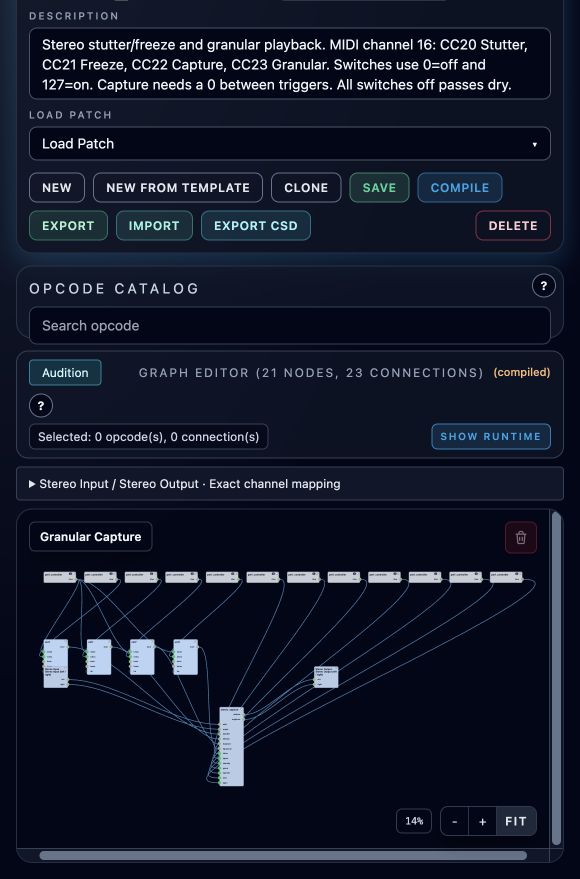

# Granular Capture: Stutter, Freeze and Grains

**Navigation:** [Up](../performance/standard_effects.md) | [Previous](continuous_effects.md) | [Next](stereo_moog_filter.md)

**Granular Capture** is one continuous stereo effect with Stutter and Granular playback and a shared Freeze control. Add it as a mixer insert, feed its grouped stereo input, and route its grouped output onward. It records incoming audio continuously, even while playing a frozen snapshot. The two channels keep separate samples and share capture timing and grain positions.

  

## MIDI switches

The default **MIDI Control Channel is 16**. This setting is independent of MIDI note activation: the instrument remains Continuous and needs no note channel. Each switch has its own configurable CC number. Choose distinct CCs and avoid collisions with other receivers. Mapping knobs stop at 95 because Csound handles RPN/NRPN and some higher CCs specially. Send the initial Reset Value 0 before recording; standard CCs such as volume can start above zero. Instances sharing a channel and CC respond together; select another channel or CC set for independent instances.

| Switch | Default CC | 0–63 | 64–127 |
| --- | --- | --- | --- |
| Stutter | 20 | Release stutter | Capture and repeat the recent slice; an existing Freeze snapshot is retained |
| Freeze | 21 | Release frozen source | Capture and hold the recent slice |
| Capture | 22 | Arm the next trigger | Rising edge replaces the snapshot, including while frozen |
| Granular | 23 | Loop playback when Stutter/Freeze is on; otherwise dry | Play windowed grains from live history or the held snapshot |

Use **0 and 127** in step cells. Capture is a value-edge trigger: put **0 between successive 127 values**. Repeating 127 sends another MIDI message but does not produce another rising edge. Capture alone updates the snapshot without enabling wet playback. Stutter or Freeze alone produces a loop; Granular on produces grains. Freeze off resumes live grains unless Stutter is still holding the snapshot. All three playback/hold switches off returns to dry audio with Output gain.

## Configure a step pattern

1. Add a Controller Sequencer and select **Step Mode**.
2. Select only MIDI channel **16** and set **Controller # 20**.
3. Set **Reset Value 0**. Enter `127` where stutter should begin and `0` where it should end. Empty cells hold the current state.
4. Add lanes for CC21, CC22 and CC23 when needed, each with Reset Value 0. Enable Freeze before switching to Granular to turn a repeat into a sustained texture.
5. For recapture while frozen, send CC22 `127`, then `0`, then another `127` at the next capture point.

A four-beat pattern at 120 BPM with four steps per beat can use:

| Lane | Populated steps (one-based) |
| --- | --- |
| Stutter, CC20 | 3: 127; 7: 0 |
| Freeze, CC21 | 9: 127; 15: 0 |
| Capture, CC22 | 13: 127; 14: 0 |
| Granular, CC23 | 11: 127; 16: 0 |

The [reproducible example](../../examples/instruments/granular_capture/README.md) includes a matching sequencer example. Sequencer start/stop and finite endings send Reset Value. Pad changes and loops hold the current value. A controller stopped with a nonzero Reset Value can leave an effect active. Muted controller lanes do not send their reset; release the corresponding CC manually or restart the rack.

## Performance settings

These settings belong to each rack instance. Controls marked **Live** respond during playback; **Requires restart** identifies initialization settings. MIDI switches act during playback.

| Setting | Range | Default |
| --- | --- | --- |
| MIDI Control Channel | 1–16, rounded | 16 |
| Stutter / Freeze / Capture / Granular CC | 0–95, rounded | 20 / 21 / 22 / 23 |
| Slice | 20–1000 ms | 125 ms |
| Grain Size | 5–200 ms | 50 ms |
| Grains / Second | 1–80 | 40 |
| Grain Pitch | −24–24 semitones, fractional allowed | 0 |
| Position Spread | 0–1 | 0.5 |
| Mix | 0–1 | 1 |
| Output | −24–0 dB | −6 dB |

Slice is the **stutter repeat period**, with an extra 5 ms of history captured for its overlapping seam. At 120 BPM, 125 ms is a sixteenth note. This is a millisecond setting, not automatic tempo synchronization: use `60000 / BPM / subdivisions per beat` and restart after adjusting. Grain Pitch affects granular playback only. Position Spread zero starts each grain at the beginning of the slice; higher values scatter starts within it. Sparse short grains sound choppy; overlapping long grains produce a smoother sustained texture.

Mix zero preserves dry audio, with Output gain and no processing delay. Inactive playback also passes dry. Use an insert: a parallel send would duplicate dry audio while inactive. Freeze can intentionally sustain indefinitely, so send a release before the end of an offline render. Capture before enough history exists includes silence. Engine stop/restart clears both history and snapshot buffers.

## Playback limits

Each instance has its own capture history. Loop seams and state changes use short crossfades. High Grain Pitch values can introduce aliasing; reduce the interval if the result becomes too harsh. This is a time-domain freeze, so it retains a slice of the waveform rather than holding a spectral analysis.

Use normal sequencer step lengths for the MIDI switches. Extremely short on/off pulses can pass between audio updates and fail to trigger a capture. Stop/restart clears captured audio.

## Download and further details

- [Download Granular Capture](../../examples/instruments/Granular_Capture.orch.instrument.json)
- [Processor design and technical checks](../../specifications/manual-reference/granular_capture.md)

**Navigation:** [Up](../performance/standard_effects.md) | [Previous](continuous_effects.md) | [Next](stereo_moog_filter.md)
