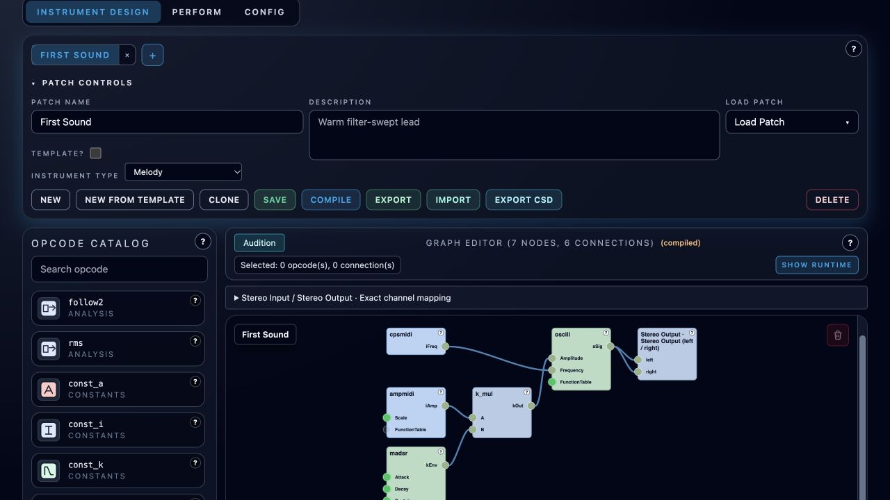

# Instrument Design

**Navigation:** [Up](../user_documentation.md) | [Previous](../getting_started.md) | [Next](patch_toolbar_and_tabs.md)

This chapter covers the complete **Instrument Design** workflow on the `Instrument Design` page.

Start with a built-in playable instrument or import a supplied sound. You can work with an empty library. If you are new to the app, complete [Getting Started](../getting_started.md) first.

Create or load an instrument, connect its graph, compile and audition it, then save it. The following guides explain each step and the more advanced authoring tools.

## Chapter Contents

<!-- manual-contents:start -->
- [Patch Toolbar and Instrument Tabs](patch_toolbar_and_tabs.md)
- [Opcode Catalog and Integrated Documentation](opcode_catalog_and_documentation.md)
- [Graph Editor](graph_editor.md)
- [Input Formula Assistant](input_formula_assistant.md)
- [GEN Table Editor (GEN Meta-Opcode)](gen_table_editor.md)
- [If, Switch and Drumset](control_flow.md)
- [Monophonic Legato](midi_legato.md)
- [Defining Performance Controls](performance_controls.md)
- [Runtime Panel and Compilation Workflow](runtime_panel_and_compilation.md)
- [Instrument Import / Export and CSD Export](instrument_import_export.md)
- [Supported Opcodes](supported_opcodes.md)
<!-- manual-contents:end -->

## What You Can Do Here

- Build instruments visually from Csound opcodes using the graph editor.
- Maintain multiple instrument tabs (parallel drafts or different patches).
- Use localized integrated help and opcode-level documentation without leaving the app.
- Choose built-in instrument, effect and output starters and define grouped stereo audio interfaces.
- Compile the current graph, inspect generated ORC, and audition drafts in isolation or in a temporary performance snapshot.
- Define advanced input-combine formulas when multiple signals feed the same input.
- Configure function tables with the `GEN` meta-opcode (including `GEN01` audio-file tables and `GENpadsynth`).
- Export instruments as Orchestron bundle files and as `.csd`.

  

<em>Instrument Design with the saved starter graph. Open Show runtime to inspect compilation output.</em>

## Recommended Workflow

1. Create or load a patch in the patch toolbar.
2. Add opcodes from the catalog (click or drag-and-drop).
3. Connect signals and set constant values.
4. If needed, define an Input Formula on a socket with multiple inputs.
5. Compile and inspect the runtime panel output.
6. Save the patch.
7. Export a `.csd` or an Orchestron instrument bundle.

## Important Behavior

- The compile status badge is per active instrument tab/patch snapshot (`compiled`, `pending changes`, `errors`).
- Runtime starts collapsed to give more graph space; open it with `Show runtime`. Collapse `Patch controls` to hide metadata and file actions while keeping instrument tabs visible. Both choices survive view switches until browser reload.
- Saving a normal patch performs compile validation first; a failing compile prevents a bad save.
- Saving a patch marked `Template?` skips compile validation so incomplete starter graphs can be stored and reused. Template patches remain loadable in Instrument Design but are not selectable as Perform rack instruments.

**Navigation:** [Up](../user_documentation.md) | [Previous](../getting_started.md) | [Next](patch_toolbar_and_tabs.md)
