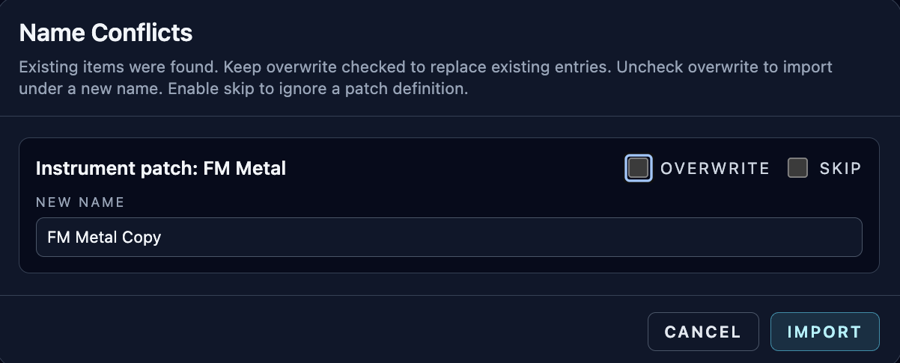

# Instrument Import / Export and CSD Export

**Navigation:** [Up](instrument_design.md) | [Previous](runtime_panel_and_compilation.md) | [Next](supported_opcodes.md)

This page documents all user-facing import/export options available from the Instrument Design page.

## Instrument Export Types

### 1. Orchestron Instrument Bundle (`Export` button)

The `Export` button creates an Orchestron instrument definition bundle containing the patch graph and metadata.

File extensions:

- `.orch.instrument.json` (JSON bundle)
- `.orch.instrument.zip` (ZIP bundle)

### JSON vs ZIP Export Selection

Orchestron chooses the format automatically:

- JSON export when no referenced uploaded GEN01, `sfload`, or `adsyn` assets are present
- ZIP export when the instrument references uploaded GEN01 audio assets or `sfload` SoundFont assets or `adsyn` analysis files (so audio dependencies can be included)

### 2. Csound CSD Export (`Export CSD` button)

The `Export CSD` button compiles the patch and downloads a `.csd` file.

Use this when you want to run the generated instrument outside Orchestron in a Csound workflow.

## What Is In An Instrument Bundle

An instrument bundle contains:

- patch name
- patch description
- template flag
- instrument type (Percussion, Melody, Bass, Effects / Noise, or Continuous)
- complete editable graph, layout and engine settings

If a ZIP bundle is required, it also contains referenced uploaded audio/SoundFont/analysis assets under an `audio/` folder in the archive.

## Instrument Import (`Import` button)

The import button accepts:

- standalone instrument bundle JSON
- standalone instrument bundle ZIP
- performance bundle JSON/ZIP (to extract included patch definitions)

This means you can import patches directly from a performance export without manually splitting files. Instrument Type is preserved for both new and overwritten patches, including imports renamed during conflict resolution. Older bundles without a type receive an inferred type; always-on patches become Continuous and unmatched MIDI patches default to Melody.

## Conflict Resolution (Patch Name Already Exists)

When importing one or more patch definitions and a patch name already exists, Orchestron opens a conflict dialog.

Per patch, you can choose:

- `Overwrite` (update existing patch)
- `Rename` (disable overwrite and provide a new target name)
- `Skip` (patch imports only)

The dialog validates name collisions before proceeding. Cancelling leaves the library and audio storage unchanged. After confirmation, the selected patches and their new audio assets are saved together; a failed import rolls back the whole batch. Invalid definitions and duplicate source IDs are rejected before anything is stored.

  

<em>Patch import conflict dialog with overwrite/rename/skip decisions.</em>

## Audio Dependency Handling

For ZIP imports that include referenced GEN01 audio or `sfload` SoundFont assets or `adsyn` analysis files:

- Orchestron validates the archive structure
- Stores the selected instruments' audio files after confirmation
- Restores the patch graph with the asset references intact
- Rejects archives that exceed import limits before unpacking large members

## Import limits and compatibility

Keep the downloaded archive intact: missing audio assets prevent import. Default limits are 256 MiB for the compressed file, 8 MiB for its instrument/performance definitions, 512 ZIP entries, and 256 MiB total unpacked content. An installation may use different limits; the import error identifies the rejected input.

Instrument Type survives export/import. Older bundles infer Continuous for always-on instruments and Melody for unmatched MIDI instruments. For format and deployment details, see the [technical reference](../../specifications/manual-reference/instrument_import_export.md).

## Instrument Bundle vs Performance Bundle

Use the right export for the right task:

- Instrument bundle: share one patch design
- Performance bundle: share a full performance setup (instrument rack + sequencers + controllers + piano rolls + optional patch definitions)

See [Performance Import / Export](../performance/performance_import_export.md) for performance bundles.

**Navigation:** [Up](instrument_design.md) | [Previous](runtime_panel_and_compilation.md) | [Next](supported_opcodes.md)
