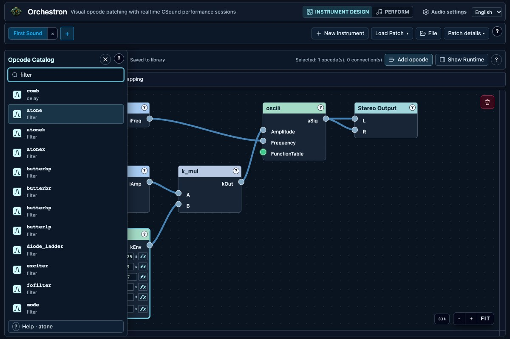
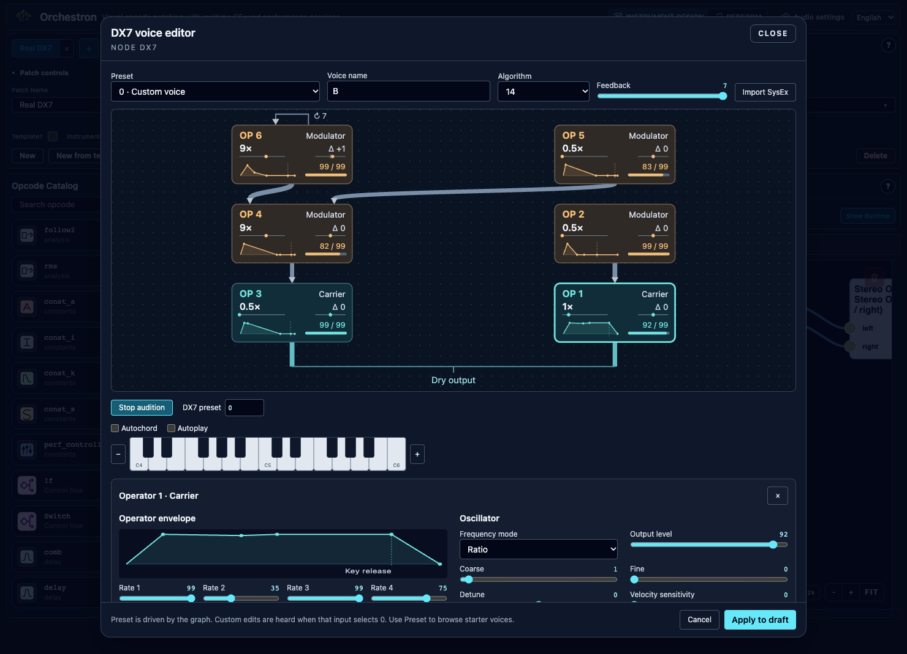
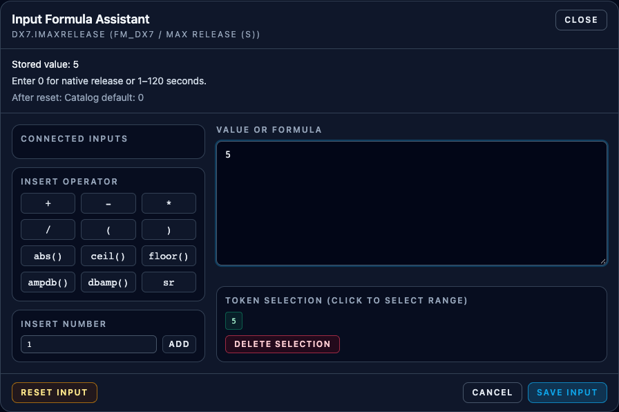
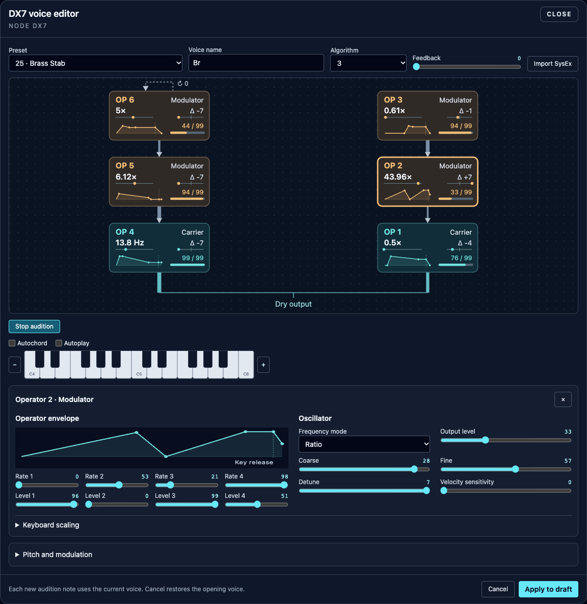
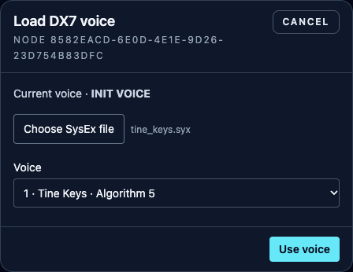
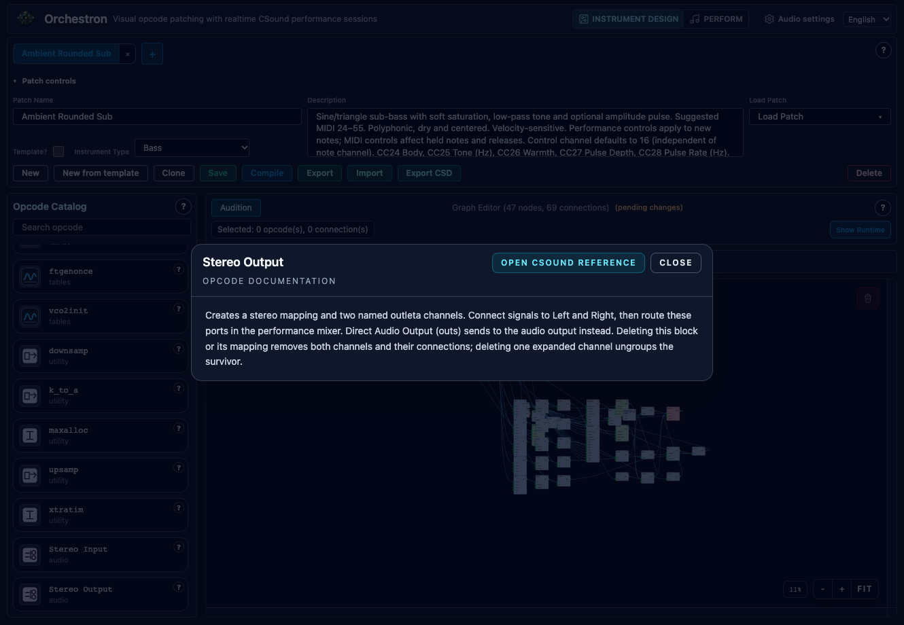
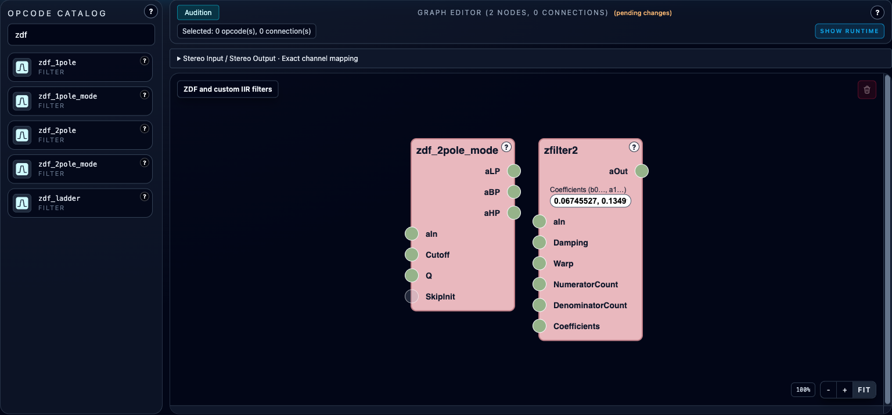
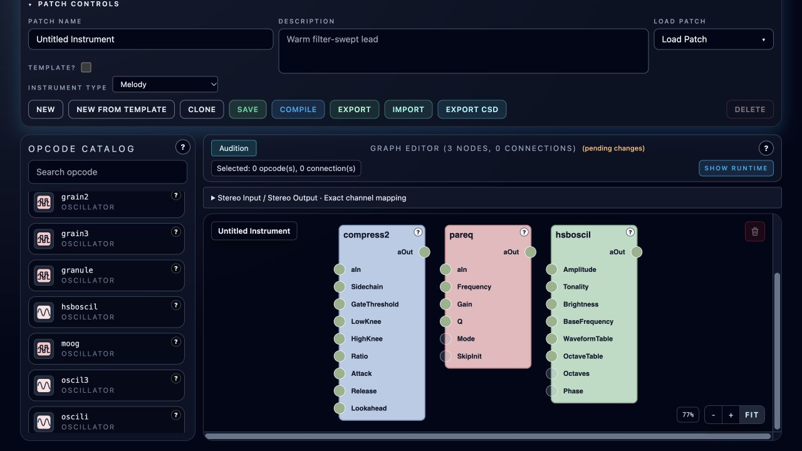
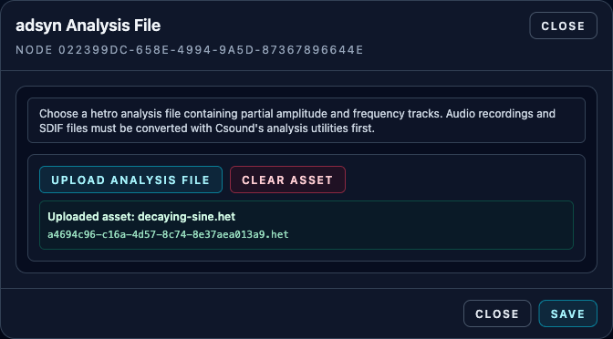

# Opcode Catalog and Integrated Documentation

**Navigation:** [Up](instrument_design.md) | [Previous](patch_toolbar_and_tabs.md) | [Next](graph_editor.md)

The opcode catalog is the source list of all supported building blocks you can place in the graph editor.

## What The Catalog Supports

- Search by opcode name
- Search by category
- Search by description text
- Search by tags
- Click to add an opcode to the graph
- Drag-and-drop an opcode into the graph canvas at a chosen position

On narrower screens, choose **Add opcode** above the graph to open the catalog. Search, use the up and down arrow keys to highlight a result, then press Enter to insert it. Tab moves from search to help for the highlighted result. Escape returns to the graph toolbar. You can also drag a result onto the canvas.



## Search Behavior

The **fm** category includes [`fm6_voice`](fm6_voice.md), with an **FM6** voice-editor button, eight routing diagrams and 32 starter presets covering keys, basses, percussion, wind, metallic hits and sci-fi sounds.

The search field filters on these opcode fields:

- `name`
- `category`
- `description`
- `tags`

This makes it easy to find opcodes by function (for example `filter`, `midi`, `reverb`, `soundfont`) even if you do not remember the exact Csound opcode name.

## Adding Opcodes

### Click To Add

- Clicking an opcode row inserts the node into the graph using the app's add-node behavior.
- This is fastest when exact placement is not important yet.

### Drag-and-Drop To Place

- Drag an opcode from the catalog and drop it into the graph canvas.
- The graph editor computes the drop location and places the node there.
- While dragging over the graph, the canvas highlights to confirm drop targeting.

## Visual Information In The Catalog

Each catalog entry shows:

- Opcode icon (backend-served icon asset)
- Opcode name
- Category label

These same categories influence node coloring in the graph editor for quick visual grouping.

## Load a DX7 voice

Add **fm_dx7** from the **fm** category in a polyphonic note instrument. Connect **notnum** to **MIDI key**, **ampmidi** with a scale of 1 to **Velocity**, and the mono output to your instrument’s audio path. The initial voice is a sine tone. **Pitch bend** accepts semitones during a note.

To try a complete instrument, import **Real_DX7.orch.instrument.json** from the example instruments. Its **Tine Keys** electric piano uses three modulator–carrier pairs in algorithm 5. Play softly and then strike the same key harder to hear how velocity changes the attack.

Click **DX7** on the node and open **Preset** to browse 32 sounds by instrument role. Try **Short Sub** with **Glass Strike** for a synth-pop bass line and arpeggio, **Low Mist** under **Wire Bass** for darkwave, or **Brass Stab** over **Clock Click** for new wave. The preset menu uses descriptive names. **Voice name** shows the original name stored in the SysEx program. The sounds come from Aquanode’s original cartridges 1, 2 and 4, released under CC0. They are included with Orchestron and work offline. [Original cartridges](https://github.com/aquanodemusic/aquanode-soundscapes/tree/c050fabf402a60f1e8946b1bdc62bfb8ac2a6e92/dexed) · [License](https://github.com/aquanodemusic/aquanode-soundscapes/blob/c050fabf402a60f1e8946b1bdc62bfb8ac2a6e92/LICENSE)

**0 · Custom voice** recalls your own sound after browsing. Editing a preset copies the result into Custom, replacing the previous custom sound. Importing a program also puts it in Custom. **Apply to draft** keeps the selection and Custom together. **Cancel** restores both to the state they had when you opened the editor.

To browse banks and programs directly in Perform, open [Instrument controls](../performance/performance_controllers.md#dx7-banks). To drive the program from a graph controller, connect **perf_controller → iout** to the **Preset** input on the **fm_dx7** node. Set the controller type to **Integer**, minimum **0**, maximum **32** and default **0**. At **0** each new note plays the voice shown in the DX7 editor, including your edits or an imported program. At **1–32** each new note plays the corresponding factory preset. For example, with a softened Hollow Bass in the editor, switch between **0** and **7** to compare it with the original. Held notes keep their sound through release. Both CSD export modes include the bank.



Double-click the **Max release (s)** input socket on the graph node. Leave it at **0** for the native envelope or enter **1–120** seconds, including fractional values. For example, **5** gives a long pad up to five seconds after key-up. Shorter tails end naturally and you can hold the key as long as you like. You can also wire a performance controller to this input. Each note keeps the setting it had at key-down.



DX7 voices free their slots once all carriers reach silence and their remaining envelope stages stay silent. This can happen while you hold a percussive sound. A voice that swells again on key-up keeps its slot. If the instrument also has another sound source or an effect with its own tail, that sound can continue. With **maxalloc**, each new note takes a free slot first. At the limit, the quietest released voice fades out over 8 ms as the new note starts. When every slot holds a pressed key, the oldest voice fades.

Choose one of the 32 algorithms and click an operator in the diagram. Cyan carriers feed the audio output. Amber modulators feed other operators. Each card shows oscillator tuning, detune, output level and its envelope. A thicker connection indicates a higher source output level.

Adjust **Rate 1–4** and **Level 1–4** to reshape the envelope on the card and in the inspector. Each rate controls how quickly the envelope approaches its corresponding level. Level 3 holds while the key is down. Releasing the key starts the move toward Level 4. The dashed line marks key release and the horizontal scale compresses long stages. The inspector also offers ratio or fixed-frequency tuning, velocity sensitivity and keyboard scaling. Expand **Pitch and modulation** for the voice-wide pitch envelope and LFO.

Click **Audition** and play the keyboard in the editor. With the Preset input at 0, the next note uses the current editor settings, including a changed algorithm or imported program. **Apply to draft** keeps the edits. **Cancel**, **Close** or Escape restores the voice you opened, including its name. Save the instrument to keep the voice for later or include it in a CSD export.



To load a Yamaha DX7 **.syx** file, choose **Import SysEx** in the voice editor. A single-voice dump has one entry. A 32-voice bank lists each program by slot, name and algorithm. Select a program and click **Use voice** to bring it into the editor.



## Integrated Opcode Documentation (`?` on node)

After placing an opcode in the graph, use the node's `?` button to open the opcode documentation modal.

The opcode documentation modal provides:

- Localized description (English/German/French/Spanish)
- Category and syntax/template summary
- Input/output port descriptions (including optional/default/accepted types)
- Tags
- Direct link to the Csound reference page (`Open Csound Reference`)

<p align="center">
  
</p>
<p align="center"><em>Integrated opcode documentation modal opened from a graph node.</em></p>

## Monophonic Legato

Use [`midi_legato`](midi_legato.md) for touching or overlapping notes that share a voice. Its live pitch and velocity outputs drive the sound while `madsr` follows the phrase. Gaps restore articulation. The node is opt-in and belongs in the main graph.

## Atone High-Pass Filters

Search for `atone` or `highpass` in the `filter` category:

- [atone](https://csound.com/docs/manual/atone.html) filters an audio signal (`asig`) and produces audio (`aout`). Its `khp` cutoff accepts control-rate or init-rate values and starts at 200 Hz.
- [atonek](https://csound.com/docs/manual/atonek.html) filters a control signal (`ksig`) and produces control output (`kout`) for modulation. Its `khp` cutoff starts at 10 Hz. Both inputs accept control-rate or init-rate values.
- [atonex](https://csound.com/docs/manual/atonex.html) cascades multiple `atone` stages for a sharper cutoff. Its audio input/output are `asig`/`aout`; `xhp` accepts audio-rate, control-rate, or init-rate cutoff values and starts at 200 Hz. The optional init-rate `inumlayer` sets the stage count and defaults to 4.

Each filter exposes optional init-rate `iskip`: 0 clears its internal state at initialization, while a nonzero value retains previous state. The default is 0. Setting only `iskip` on `atonex` retains the default four layers. Cutoff defaults are editor starting values; Csound requires a cutoff argument.

Connect the audio outputs of `atone` and `atonex` to downstream audio nodes or both `outs` inputs. Connect `atonek` to a control input such as oscillator amplitude or frequency. The node's `?` help documents every port in English, German, French, and Spanish.

## ZDF and Custom IIR Filters

Search for `zdf` in the `filter` category. All five nodes accept audio input `ain`; `xcf` accepts init, control, or audio rate and starts at 1200 Hz. The two-pole and ladder filters also expose `xq` (0.5–25, default 1) at the same rates.

- [`zdf_1pole`](https://csound.com/docs/manual/zdf_1pole.html): 6 dB/oct, with `kmode` 0 = low-pass, 1 = high-pass, 2 = allpass.
- [`zdf_1pole_mode`](https://csound.com/docs/manual/zdf_1pole_mode.html): simultaneous `alp`, `ahp` outputs, in that order.
- [`zdf_2pole`](https://csound.com/docs/manual/zdf_2pole.html): 12 dB/oct, with `kmode` 0 = low-pass, 1 = high-pass, 2 = band-pass, 3 = unity-gain band-pass, 4 = notch, 5 = allpass, 6 = peak.
- [`zdf_2pole_mode`](https://csound.com/docs/manual/zdf_2pole_mode.html): simultaneous `alp`, `abp`, `ahp` outputs, in that order.
- [`zdf_ladder`](https://csound.com/docs/manual/zdf_ladder.html): four-pole (24 dB/oct) Moog ladder low-pass; Q = 25 reaches self-oscillation.

`kmode` accepts control or init rate and defaults to 0. Every ZDF node has optional init-rate `istor`: 0 clears filter memory, nonzero retains it. Setting `istor` alone preserves other defaults. Cutoff and Q defaults are editor starting values.

[`zfilter2`](https://csound.com/docs/manual/zfilter2.html) uses custom IIR coefficients with control/init-rate `kdamp` and `kfreq`. Positive damping adjustments lengthen ringing and negative ones shorten it; positive warp shifts pole frequencies upward and negative warp shifts them downward. Both start at 0 (unchanged poles); use values strictly between -1 and 1.

Edit its inline **Coefficients** field as a comma-separated list: all numerator coefficients starting at b0, followed by denominator coefficients starting at a1. The leading denominator coefficient a0 is implicitly 1. **NumeratorCount** (`im`) counts numerator coefficients including b0; **DenominatorCount** (`in`) counts denominator coefficients. Connect `const_i` nodes to change these counts. Defaults are 3 and 2, with `0.06745527, 0.13491055, 0.06745527, -1.1429805, 0.4128016`, a stable second-order low-pass filter.

You can instead connect init-rate sources to **Coefficients** in coefficient order. Each connection supplies one coefficient, replacing the entire inline list; these inputs are not summed, and the list does not accept a combine formula. Connection order survives save/export. Use separate upstream init-rate calculations for individual coefficients.

Supply exactly `im + in` coefficients. The editor supports 1–51 numerator coefficients and 1–49 denominator coefficients for Csound 6 compatibility: zero poles and 50 poles encounter native bugs in Csound 6.18. Invalid literal counts fail compilation; invalid connected counts stop the affected voice before the native filter initializes. Coefficients remain the responsibility of the filter design: count checks do not establish stability.



## Compression, Equalization and Cyclic Tonality

- [`compress2`](https://csound.com/docs/manual/compress2.html), in **dynamics**, processes `aasig` using peak detection on the separate `acsig` sidechain. Connect the same source to both for ordinary compression, or a different source for ducking. Gate and knee levels use dBFS. Editor defaults are -90 dB gate, -52/-30 dB knees, ratio 3, attack 0.01 s, release 0.1 s and lookahead 0.05 s. Lookahead adds audio latency. The detector and ratio controls accept control or init rate; lookahead is init rate.
- [`pareq`](https://csound.com/docs/manual/pareq.html), in **filter**, offers **Mode** 0 = peaking, 1 = low shelf, 2 = high shelf. **Gain** is linear: 1 is neutral, less than 1 cuts, greater than 1 boosts. Frequency, gain and Q accept control or init rate; their editor defaults are 1000 Hz, 1 and approximately 0.7071. Optional init-rate **SkipInit** defaults to 0; setting it alone retains peaking mode.
- [`hsboscil`](https://csound.com/docs/manual/hsboscil.html), in **oscillator**, separates cyclic **Tonality** from **Brightness**, both measured in octaves relative to **BaseFrequency** (initially 220 Hz). Ramp tonality with fixed brightness for a Risset glissando. Amplitude, tonality and brightness accept control or init rate. **Octaves** is an optional init-rate count from 2 to 10, default 3; **Phase** defaults to 0, with -1 skipping initialization.

`hsboscil` needs two function tables. **WaveformTable** defaults to the built-in sine table 1. **OctaveTable** must be supplied: add a **GEN** node with routine **19**, normalization disabled, table size **1024**, and a [GEN19 partial row](gen_table_editor.md#gen19-sinusoidal-partials-with-dc-offset) with **Partial number 1**, **Strength 0.5**, **Phase 270°**, and **DC offset 0.5**; connect its `ift` output to **OctaveTable**. Connect a second GEN node to **WaveformTable** for a custom waveform. Table numbers use init-rate ports, matching GEN's `ift` output. They are distinct from the `f` signals used by spectral nodes.

Each node produces mono audio; connect its output to both `outs` inputs for centered stereo. The `?` help describes all ports in English, German, French and Spanish. Prefilled required parameters are editor starting values; optional parameters retain Csound defaults.



## Prepared Piano

Search for [`prepiano`](https://csound.com/docs/manual/prepiano.html) in **physical_modeling**. The node exposes the stereo form: connect `al` to the left output and `ar` to the right output. Connect `cpsmidi` to init-rate `ifreq` for note pitch; use downstream gain or envelopes for volume shaping.

The starting values follow the Csound example: 60 Hz, three strings, 10 cents detuning, stiffness 1, a 3-second decay to −30 dB, high-frequency loss 0.002, pivoting ends, hammer mass 1, hammer frequency 5000 Hz, initial hammer position −0.01, strike position 0.09, strike velocity 20, scan frequency 0 Hz and stereo scan-frequency spread 0.1 Hz. These are editor starting values. Use two or three strings with Csound 6; its implementation divides the detuning spread by the string count minus one.

Only `kbcl` and `kbcr` accept live control-rate changes (or init-rate constants): **1 = clamped**, **2 = pivoting**, **3 = free**. Changing boundaries during a note can glitch. Other inputs are init rate. Keep stiffness positive for new voices; negative stiffness skips native initialization and is intended for continuing an already initialized model.

Optional `irattles` and `irubbers` default to **0**, disabling that preparation. To add one, create a [GEN02 value-list table](gen_table_editor.md), disable normalization, and connect its init-rate `ift` output to the corresponding table port. Use a table size large enough for a count followed by four values per object (`1 + 4 × count`; size 8 holds one object):

| Preparation | Values after the count | Example value list |
| --- | --- | --- |
| Rattle | Position along the string, mass-density ratio, frequency, vertical length | `1, 0.6, 10, 100, 0.001` |
| Rubber | Position along the string, mass-density ratio, frequency, loss | `1, 0.7, 50, 500, 1000` |

Either table can be used alone. When only a rubber table is connected, the rattle argument stays 0. These examples render with the 60 Hz starting settings; retune stiffness and preparations when changing register. The native physical model can become unstable with other combinations, including these rubber settings at 220 Hz with stiffness 1. Start with low output gain when experimenting. The node's `?` help covers every port in English, German, French and Spanish.

## STK Instruments

Search for `stk` to find the 27 Synthesis Toolkit instruments in the `physical_modeling`, `fm`, and `oscillator` categories. They include strings, winds, percussion, voices, organs, and electric pianos. Each node produces one mono audio signal; connect it to both `outs` inputs for centered stereo output.

- `ifrequency` and `iamplitude` are init-rate inputs: frequency in Hz and note amplitude from 0 to 1. Use `cpsmidi` for note pitch; apply envelopes or gain after the audio output for continuous level changes.
- `STKDrummer` uses the frequency to select a drum sample. Connect `cpsmidi` and play MIDI drum notes. `STKDrummer`, `STKPlucked`, and `STKSitar` have no documented controller inputs.
- The other nodes expose the manual's controller number/value pairs in order. The controller number is prefilled with the documented number. Set or connect its paired `kv` value to enable that control. Both ports accept init-rate or control-rate sources, so controller values can change during a note.
- Unset controller values omit the entire pair and retain STK's instrument defaults. You can enable a later pair without filling earlier pairs. For example, set only `kv7` to `3` on `STKBandedWG` to send instrument preset controller `16` with value `3`.
- Most values range from 0 to 127, but preset selectors use model-specific ranges. `STKShakers` uses controller **1071**, not a MIDI CC in the 0–127 range, for its instrument selection. Check the node's `?` help for each controller's meaning.

Runtime requires the [Csound STK plugin (`stkopd`)](https://github.com/csound/plugins) and its rawwave data on the machine running the Csound backend. Set `RAWWAVE_PATH` to the installed rawwaves directory before starting the backend; some Csound builds do not register any STK opcodes without it. For example, an Apple Silicon Homebrew installation of STK uses `RAWWAVE_PATH=/opt/homebrew/opt/stk/share/stk/rawwaves/`. Catalog availability and successful graph compilation do not install this runtime dependency.

## Context Help (`?` in page sections)

In addition to opcode-level docs, the app provides context help buttons for page sections (toolbar, catalog, graph, runtime, sequencer panels, config panels). These open integrated markdown help content in the currently selected GUI language.

For the opcode catalog specifically, the integrated help now focuses on search/add workflow and on the distinction between catalog help and the node-level opcode documentation modal.

See also:

- [GUI Language and Integrated Help](../configuration/gui_language_and_integrated_help.md)
- [Supported Opcodes](supported_opcodes.md) for the full opcode index table

## Additive Resynthesis with adsyn

[`adsyn`](https://csound.com/docs/manual/adsyn.html) resynthesizes sinusoidal
partials from a Csound `hetro` analysis file. Find it in **oscillator**, add it
to the graph, and open its configuration button to upload the analysis.
The selected filename is saved with the instrument. Use **Clear Asset** to
remove a selection or upload another file to replace it.



The three control-rate inputs also accept init-rate connections and formulas:

| Input | Default | Meaning |
| --- | --- | --- |
| `kamod` | 1 | Amplitude multiplier |
| `kfmod` | 1 | Frequency multiplier; 2 raises every partial by an octave |
| `ksmod` | 1 | Analysis playback speed; 2 traverses the envelopes twice as fast |

Connect the mono audio output `ares` to your envelope/effects chain and then
an audio output. Add your own release envelope for MIDI articulation. `adsyn`
can be placed in the main graph or inside an If/Switch synthesis case.
The analysis file is chosen when each note initializes; the three controls
can change at control rate during playback.

Upload analysis data, not a WAV recording. Generate it outside Orchestron
with [Csound hetro](https://csound.com/docs/manual/hetro.html), for example:

```sh
csound -U hetro -f440 -h16 source.wav source.het
```

Set `-f` to the approximate fundamental of the source. SDIF data must first
be converted with Csound's `sdif2ad` utility. The file picker allows arbitrary
extensions because Csound analysis files need not be named `.het`.

Orchestron accepts portable HETRO text and legacy native-endian binary analysis.
Malformed tracks are rejected before compilation or CSD export.
Orchestron resolves uploaded/imported files from its asset storage; raw paths
and numeric Csound filename aliases are not supported. Instrument/performance
ZIPs carry the analysis file, and both performance CSD modes include it under
`assets/`. No analysis-generation tool or piano conversion is included.

**Navigation:** [Up](instrument_design.md) | [Previous](patch_toolbar_and_tabs.md) | [Next](graph_editor.md)
