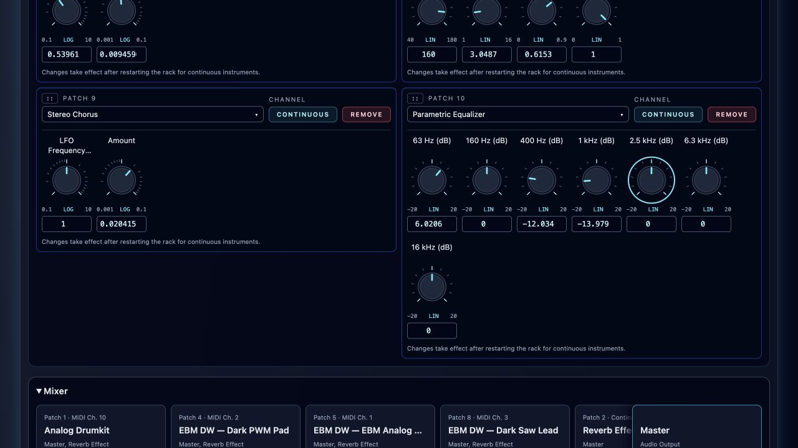
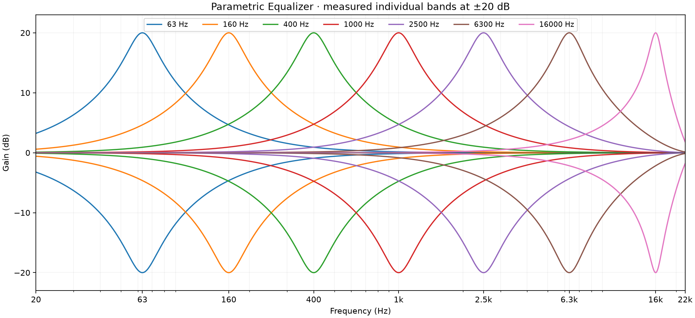
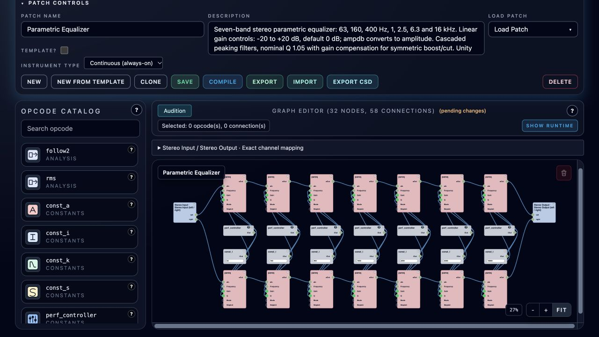

# Parametric Equalizer

**Navigation:** [Standard Effects](../performance/standard_effects.md) | [Prev](autopanner.md) | [Next](continuous_effects.md) | [Mixer and routing](../performance/audio_mixer_and_routing.md) | [Performance controllers](../performance/performance_controllers.md)

[Download Parametric Equalizer](../../examples/instruments/Parametric_Equalizer.orch.instrument.json)
and import it using **Instrument Design → Import**. This continuous stereo effect
has seven peaking bands, with independent left/right signal paths and linked gain
settings. Add it to a source strip or Master using **Perform → Mixer → Inserts…**.

## Controls

| Center | Typical use | Gain range | Default |
| --- | --- | --- | --- |
| 63 Hz | Sub/bass weight | −20 to +20 dB | 0 dB |
| 160 Hz | Bass warmth | −20 to +20 dB | 0 dB |
| 400 Hz | Low-mid body | −20 to +20 dB | 0 dB |
| 1 kHz | Midrange | −20 to +20 dB | 0 dB |
| 2.5 kHz | Presence | −20 to +20 dB | 0 dB |
| 6.3 kHz | Definition | −20 to +20 dB | 0 dB |
| 16 kHz | Air | −20 to +20 dB | 0 dB |

All seven controls use a **linear dB scale**. Zero is neutral; −20 dB gives
amplitude gain 0.1, and +20 dB gives 10. The graph converts each setting with
`ampdb(db)` before feeding `pareq.kv`, as in the
[Csound EQ example](https://csound.com/docs/manual/pareq.html).

**Restart the rack after changing these controls**, then Save Performance to retain
the instance settings. Allow headroom when boosting: overlapping bands add gain,
and this EQ has no limiter. Its named stereo inputs and outputs are `left`/`right`.
Use it as an insert; a parallel dry return changes the resulting EQ response.

## Frequency spacing and Q

The rounded centers are approximately 1⅓ octaves apart. Nominal **Q = 1.05** gives
broad tonal shaping with useful overlap, approximately 1⅓-octave half-gain bandwidth
at low frequencies. These are general-purpose defaults; edit the frequency
constants and paired Q formulas in Instrument Design for narrower corrections.
Digital frequency warping narrows the uppermost bell near Nyquist. The supplied
graph runs at 48 kHz, keeping 16 kHz below Nyquist.

For symmetric boosts/cuts, each `pareq.kq` input uses `1.05 * ampdb(db / 2)`.
This adjusts Csound's denominator Q by the square root of linear gain to match
the [Audio EQ Cookbook's peaking convention](https://www.w3.org/TR/audio-eq-cookbook/).
Nominal musical Q stays 1.05; the raw opcode Q varies with gain. The two channels
use identical settings. Seven filters run **in series per channel**, giving unity
gain when all controls are zero.

## Updating the original three-band instrument

The earlier graph summed three full-range EQ outputs in parallel. At neutral
settings this produced amplitude gain 3, or **+9.54 dB**. The new cascade corrects
that behavior, so existing mixes can sound quieter and their EQ curves change.

The original three controller IDs are retained, with centers changing from
100 → 63 Hz, 600 → 400 Hz and 1.2 → 1 kHz. Four new bands default to zero.
When updating an older library manually, convert any stored amplitude override
with `20 * log10(old value)`; for example, 2 becomes +6.0206 dB and 0.2 becomes
−13.9794 dB. Range clamping alone does not convert units. Keep a backup of old
performances and reload open browser sessions after migration.

See the [example and validation guide](../../examples/instruments/parametric_equalizer/README.md)
for the preserved original graph, rebuild commands and audio checks.
