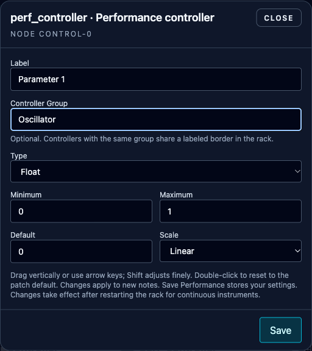

# Defining Performance Controls

**Navigation:** [Up](instrument_design.md) | [Previous](midi_legato.md) | [Next](runtime_panel_and_compilation.md)

Add controls to an instrument when performers should be able to adjust its sound without editing the graph. Each rack instance can retain different values.

## Define a Controller

Add `perf_controller` from Constants in Instrument Design. Click its gear button and configure:

| Type | Configuration | Perform control |
| --- | --- | --- |
| Float | Minimum, Maximum, Default, linear/logarithmic Scale, Label, Controller Group | Existing knob with exact numeric entry |
| Integer | Whole-number Minimum, Maximum and Default, Label, Controller Group; linear only | Up triangle, editable number, down triangle |
| Bool | On/Off Default, Label, Controller Group | On/off toggle, output `0` or `1` |

The Type selector initially chooses **Float**. Existing patches without a stored type also use Float. Float defaults remain minimum `0`, maximum `1`, default `0.5`, linear scale and label `Parameter`. Integer definitions without numeric fields use minimum `0`, maximum `1`, default `0`. Bool defaults to **Off** and uses a fixed internal `0–1` linear range.

The fields are fixed values, without input sockets or formulas. Float numbers must be finite, minimum smaller than maximum, and default within the range. Logarithmic minimum must be positive. Integer has the same ordering requirements and accepts only safe whole numbers from `−9007199254740991` to `9007199254740991`. Labels must contain non-whitespace text and be no more than 128 characters long.

Changing Type to Integer rounds the numeric fields to the nearest integer, with ties toward positive infinity (`-1.5` becomes `-1`). If rounding makes minimum and maximum equal, correct the range before saving. Changing to Bool maps a default below `0.5` to Off and any default at least `0.5` to On. Integer and Bool always use linear scale.

For a logarithmic attack-time control, choose Float, minimum `0.001`, maximum `5`, default `0.01`, and label `Attack (s)`. Connect `iout` to the envelope’s I-rate attack input, then save the patch. All three types use the same numeric `iout` socket and existing compatible connections. Continuous instruments automatically use live updates when every connected input accepts K-rate.

## Organize controls into groups

Set **Controller Group** in the gear dialog to organize related controls, such as Oscillator, Filter or Envelope. The optional field accepts up to 128 characters. Names are case-sensitive; surrounding spaces are ignored. Leave it blank for ungrouped controls.

Matching group names appear inside one labeled border in Perform. Groups and controls follow their order in the patch. Group names survive native import/export and do not affect values, MIDI assignments or sound. Renaming a group does not require restarting the rack.

## Use the controls in Perform

Save the instrument, add it to a rack, and adjust its controls. See [Using Performance Controls](../performance/performance_controllers.md) for MIDI assignments, saving and the Live / Requires restart labels.

**Navigation:** [Up](instrument_design.md) | [Previous](midi_legato.md) | [Next](runtime_panel_and_compilation.md)
