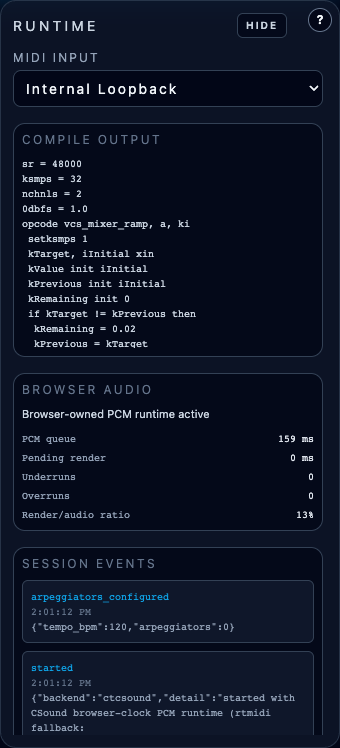
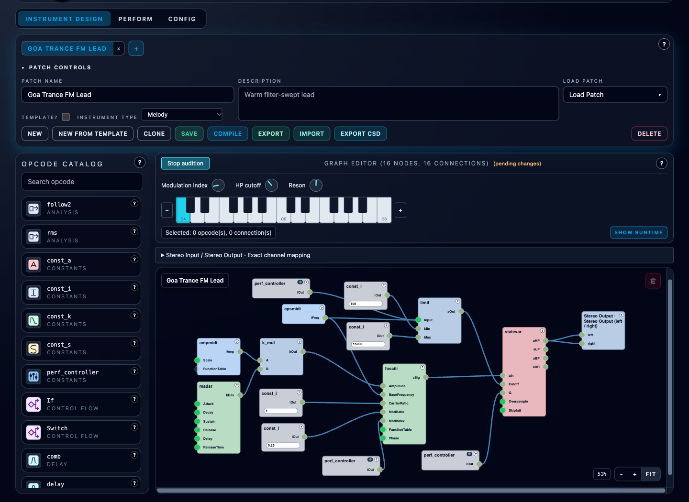
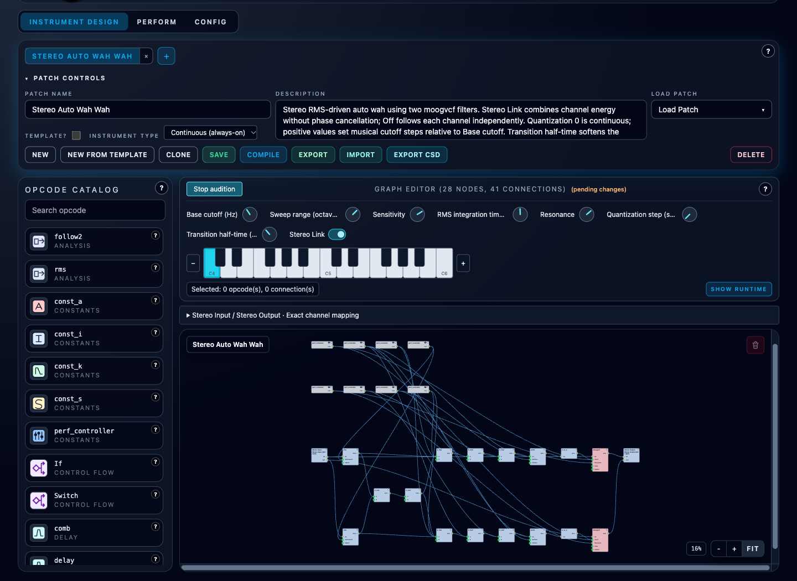

# Runtime Panel and Compilation Workflow

**Navigation:** [Up](instrument_design.md) | [Previous](performance_controls.md) | [Next](instrument_import_export.md)

The Runtime panel supports live testing of the current patch and exposes compile/runtime diagnostics for the unified browser-clock runtime.

## Runtime Panel Sections

- `MIDI Input` selector
- `Compile Output` (generated ORC)
- `Browser Audio` status for browser-clock mode
- `Session Events` log (recent backend/runtime events)

  

<em>Runtime panel showing MIDI input selection, generated ORC, active browser-owned PCM runtime, queue diagnostics and recent session events.</em>

## MIDI Input Binding

Use the `MIDI Input` dropdown to bind an external MIDI input to the active runtime session.

- This is how external hardware/DAW MIDI reaches the running instrument session.
- `internal:loopback` is always available as the built-in app-only loopback.
- Internal sequencers, piano rolls, and manual controller lanes always go straight to the session engine and do not depend on this binding.
- The selected input is session-specific and also reflected on the Performance page status footer.

See [MIDI Setup and Inputs](../configuration/midi_setup_and_inputs.md) for OS-level MIDI setup guidance.

## Compile Output (Generated ORC)

After compiling a patch, the panel shows the generated ORC text.

This is useful for:

- Verifying the compiled signal chain
- Understanding how formulas/GEN/meta-opcodes are rendered
- Debugging compile issues with concrete generated code

A compilable patch must contain at least one audio output sink: either `outs` for direct stereo output or `outleta` for named audio routing into another instrument. This allows source instruments to feed always-on effects without also writing directly to the final stereo output.

## Session Events

The event list shows recent session events (most recent first, limited window in the UI).

Typical uses:

- Confirm that start/stop events happened
- Check runtime errors and session state
- Diagnose issues during live testing

## Browser Audio

The runtime now always uses `browser_clock` audio mode, so the Runtime panel can show:

- Browser PCM queue/runtime status (`connecting`, `live`, `error`)
- Error message when the controller socket or AudioWorklet path fails
- No `<audio>` player, because playback is owned directly by the browser `AudioContext`

See [Browser-Clock Latency](../configuration/browser_clock_latency.md) for the browser-clock mode guide and tuning workflow.

## Runtime Panel Collapse / Show

Runtime starts collapsed. Open it with Show runtime in the graph header and close it with Hide. Your choice survives view switches until browser reload; compilation and playback continue while it is hidden.

To maximize graph editor space:

- Click `Hide` in the Runtime panel to collapse it
- Use `Show runtime` in the graph header to bring it back

This is especially useful on smaller displays or complex patches.

## Compile Status Badge (Graph Header)

The instrument page header above the graph displays a compile-state badge for the current patch/tab snapshot:

- `compiled` - the current graph snapshot matches the last successful compile
- `pending changes` - the graph changed since the last successful compile
- `errors` - the last compile for this exact snapshot failed

This helps you avoid assuming a graph is live-valid after edits.

## Recommended Test Loop

1. Edit the graph.
2. Click **Audition** to compile and start an isolated preview.
3. Play the mini keyboard and adjust the compact performance controls.
4. Click **Stop audition** when finished.
5. Save the instrument when you are happy with it.

The integrated `?` help for this panel now focuses on session-specific external MIDI binding, generated ORC inspection, runtime event feedback, and browser-clock PCM playback.

## Audition a draft

**Audition** is a toggle in the graph header. Click it to compile the current draft and start an isolated preview. While it is running, the button reads **Stop audition**, and compact performance controls and a mini keyboard appear below it. Click again to stop and hide both. The graph stays accessible throughout. Compile remains available to validate the graph without starting audio.

Compilation finishes before any current performance is stopped. A compilation error leaves that performance running and appears beside the audition controls. During preparation, click **Preparing… · Cancel** to cancel the pending start.

### Play and adjust the sound

- **Float** controls have a label and tiny knob. Drag vertically or use the arrow keys; hold Shift for fine adjustments. Hover to see the value, or double-click to reset to the patch default.
- **Integer** controls have a label and number field. Type a whole number or use Up/Down; Home/End selects the limits. Enter or leaving the field applies an entry; Escape cancels. Fractional entries are rejected and whole numbers are clamped to the configured range.
- **Bool** controls have a label and small on/off toggle.
- Controls appear in one flat row that wraps as needed. There are no controller groups, MIDI assignments or automation controls in audition.
- Hold a piano key to play, then release it to stop the note. Focused keys also respond to Space or Enter. The **−** and **+** buttons shift the two-octave keyboard. It uses fixed velocity, with no scale, mode or automatic chords. Starting audition does not hold a test note automatically.

Controls start at the patch defaults. Changes are temporary and do not change the library patch or a performance. They survive stopping and restarting audition for the same instrument, and reset when you leave Instrument Design or switch instrument tabs. Changing a controller range or type reconciles its temporary value on the next start.

Note instruments use changed values on the next note or phrase. Continuous instruments update live when all connected inputs support it; other settings require stopping and restarting audition. Hover over a control for its timing behavior. See [Using Performance Controls](../performance/performance_controllers.md).

### Effects and continuous instruments

An isolated effect automatically receives the built-in playable test instrument. Play the mini keyboard to send that source through the effect. Audition needs a stereo main output; effects also need a stereo main input compatible with the built-in source. Direct Audio Output is supported.

Continuous generators start immediately. If there is no note-triggered instrument in the preview, the mini keyboard remains visible but disabled.

### Stop or change the draft

Stopping audition releases held notes, removes the temporary session and restores the original performance playhead with transport stopped. Restart that performance explicitly when ready. Switching instruments or leaving Instrument Design also ends audition. Temporary patches, test sources and routes are never saved into the library.

If you edit the graph during audition, a **Draft changed** message reminds you to stop and restart audition to hear the updated draft. Performance controls continue to address the running snapshot until then.

### Audition notes for branching instruments

The mini keyboard initially shows the octave containing the first MIDI-number Switch case (36 for Drumset); other patches start at 60. Play 38 or 42 to test other drums, or an unmatched note to check Default Silence. Use the octave buttons to reach other pitches. See the [Branching guide](control_flow.md).

**Navigation:** [Up](instrument_design.md) | [Previous](performance_controls.md) | [Next](instrument_import_export.md)
