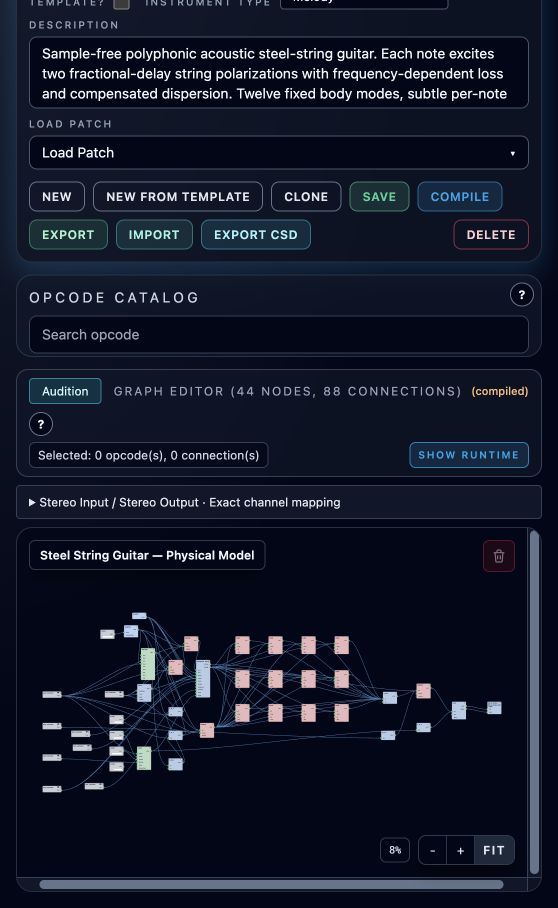
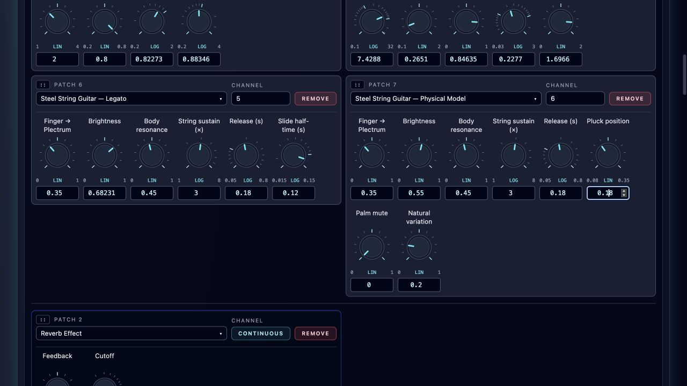

# Physical Steel-String Guitar

**Navigation:** [Up](../supplied/instruments.md) | [Previous](../supplied/instruments.md) | [Next](ambient_techno.md)

**Steel String Guitar — Physical Model** is a polyphonic Melody instrument.
Each note has its own pluck and string state. Overlapping notes and manually timed
strums ring independently. The two existing steel-string guitars remain available.

Import `Steel_String_Guitar_Physical_Model.orch.instrument.json` from the
[native instrument download](../../examples/instruments/Steel_String_Guitar_Physical_Model.orch.instrument.json),
add it to Perform, and route its Stereo Output to Master. The output is centered
and dry. Play E2–E6 for the intended register; use note lengths to control damping.
There is no legato, sample playback, convolution, reverb, or pitch-transposition stage.

## Playing controls

These are [per-instance performance settings](../performance/performance_controllers.md).
Changes apply to new notes; held notes retain their settings.

| Control | Range | Default | Effect |
| --- | --- | --- | --- |
| Finger → Plectrum | 0–1 | 0.35 | Sharper contact and more attack brightness toward Plectrum. |
| Brightness | 0–1 | 0.55 | Contact softness and high-frequency retention inside the string. |
| Body resonance | 0–1 | 0.45 | Amount of fixed wooden-body resonances. |
| String sustain | 1–8×, logarithmic | 3 | Nominal string decay multiplier. |
| Release | 0.05–0.8 s, logarithmic | 0.18 s | Damping and final body fade after note-off. |
| Pluck position | 0.08–0.35 | 0.18 | Contact location as a fraction of string length. |
| Palm mute | 0–1 | 0 | Shorter, darker decay. |
| Natural variation | 0–1 | 0.2 | Small changes to contact, position and energy. |

Velocity changes excitation energy, contact duration and brightness. Natural
variation does not move note timing or wobble pitch. Chords and strums use the
individual note timing you author.

## Editable synthesis

The editable graph separates the pluck, string model, body resonance and output shaping. Clone the instrument before changing these blocks to keep the supplied sound available. The dry model leaves room for your own reverb or other mixer effects.

The [string model technical reference](../../specifications/manual-reference/steel_string_waveguide.md) describes its inputs, physical model, stability and measurements.

## Graph and controls

## Verification and previews

Judge the sound in your own arrangement: dry instrument previews do not include a recorded guitar's microphone, room or overlapping strings. The technical reference above describes the measurements and comparisons.

## References

- [Csound mode](https://csound.com/docs/manual/mode.html): body resonators and Q.
- [Csound deltap3](https://csound.com/docs/manual/deltap3.html): fractional delay taps.
- [Csound setksmps](https://csound.com/docs/manual/setksmps.html): local sample processing.

**Navigation:** [Up](../supplied/instruments.md) | [Previous](../supplied/instruments.md) | [Next](ambient_techno.md)
