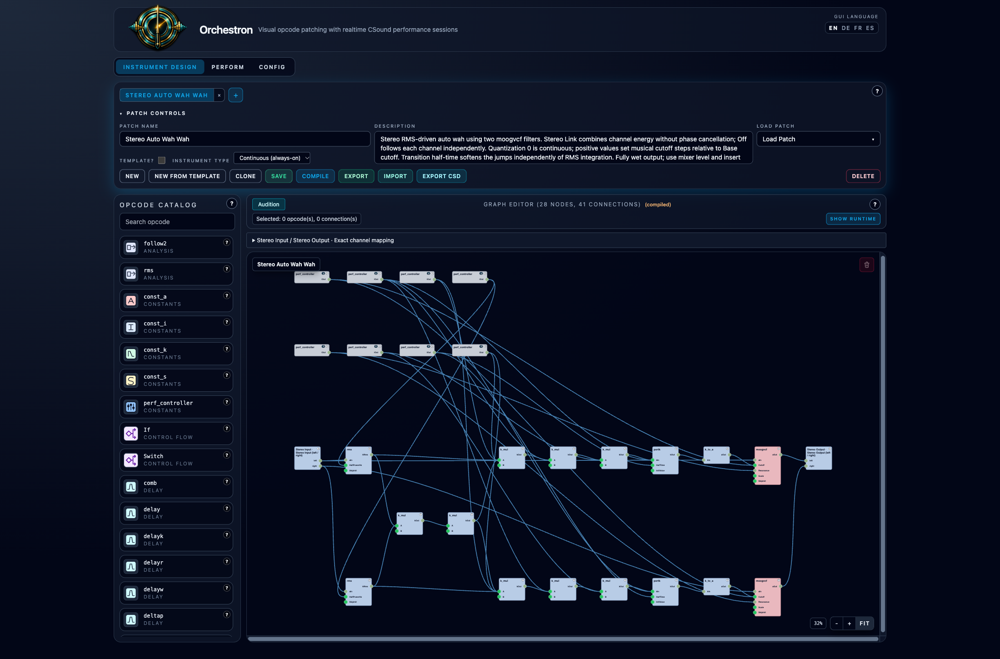

# Stereo Auto Wah Wah

**Navigation:** [Standard Effects](../performance/standard_effects.md) | [Mixer and routing](../performance/audio_mixer_and_routing.md)

**Stereo Auto Wah Wah** is a Continuous stereo filter effect that opens with the
input's loudness and closes as the sound fades. Import and save the
[native instrument](../../examples/instruments/Stereo_Auto_Wah_Wah.orch.instrument.json),
then add it as an instrument-strip or Master insert. It starts without MIDI notes.
The output is fully processed; use the mixer for level and insert bypass.

## Performance settings

| Setting | Range | Default | Use |
| --- | --- | --- | --- |
| Base cutoff (Hz) | 50–2,000, logarithmic | 200 | Lowest cutoff, reached as the input falls silent. |
| Sweep range (octaves) | 0–6 | 4 | Distance the envelope can open the filter. Zero keeps a fixed cutoff. |
| Sensitivity | 0.25–32, logarithmic | 8 | How strongly input loudness opens the filter. Increase for quieter sources. |
| RMS integration time (ms) | 1–1,000, logarithmic | 30 | Averaging time of the loudness detector. Larger values respond more slowly. |
| Resonance | 0–0.95 | 0.65 | Emphasis around the cutoff frequency. Higher values give a more pronounced wah. |
| Quantization step (semitones) | 0–24 | 0 | Zero is continuous; positive values set the interval between cutoff steps. |
| Transition half-time (ms) | 1–100, logarithmic | 5 | Time to move halfway toward each new cutoff target. |
| Stereo Link | Off / On | On | Use one combined envelope, or let each channel move independently. |

Settings belong to each rack instance. **Restart the rack after changing them.**
These are performance settings, not live MIDI CC controls.

## Continuous sweeps and musical steps

Start with Quantization at **0** for a smooth envelope-following wah. Set
Sensitivity so quieter notes leave the filter partly closed and strong attacks
open it noticeably. If it stays wide open, reduce Sensitivity. With the default
Base cutoff and Sweep range, the sweep runs from 200 Hz to approximately 3,200 Hz.

Try **1** for fine semitone steps, **7** for fifths, **12** for octave jumps or
**24** for two-octave jumps. Fractional steps are also supported. The steps are
relative to Base cutoff: at 200 Hz with octave steps, the targets are 200, 400,
800, 1,600 and 3,200 Hz. This is frequency spacing, not detection of the notes
being played. The highest target is limited to Sweep range, so a final step may
be shorter when the interval does not divide that range evenly.

RMS integration and Transition half-time serve different purposes. Integration
averages the input's loudness **before** selecting a target; Transition softens
movement **after** the target is quantized. Keep Transition short for distinct
jumps with rounded edges, or raise it for a gliding effect. Long transitions can
blur rapid steps. The cutoff remains between 20 Hz and the lower of 18 kHz or
40% of the sample rate.

## Stereo response

**Stereo Link On** combines the channels' RMS energy so both filters move
together. Opposite-phase signals do not cancel the detector. With equal signals
on both sides, the detected level is the same as either channel alone; with
only one side active, its combined detected level is about 3 dB lower.

**Stereo Link Off** lets each channel's own loudness drive its filter. This can
create different left/right movement from staggered notes or stereo percussion.
The audio paths always stay separate: linking the detector does not mix sound
between channels.

## Saving and exports

Save Performance retains each instance's settings. Native bundles preserve the
editable graph, Continuous type and grouped stereo ports. Both MIDI and SCORE
CSD exports retain the envelope following and softened cutoff steps.

The filter uses [moogvcf](https://csound.com/docs/manual/moogvcf.html), with
[rms](https://csound.com/docs/manual/rms.html) detection and
[portk](https://csound.com/docs/manual/portk.html) transition smoothing.
