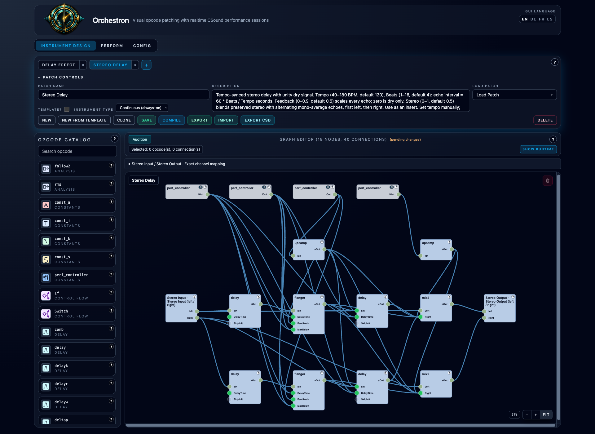

# Stereo Delay

**Navigation:** [Instrument Design](instrument_design.md) | [Mixer and routing](../performance/audio_mixer_and_routing.md) | [Performance controllers](../performance/performance_controllers.md)

[Download Stereo Delay](../../examples/instruments/Stereo_Delay.orch.instrument.json)
and import it using **Instrument Design → Import**. This continuous stereo effect
adds tempo-synced echoes while returning the original left and right channels at
unity gain.

## Use as an insert

1. With instruments stopped, open **Perform → Mixer**.
2. On a source strip or Master, open **Inserts…**, select **Stereo Delay**, and click **Add**.
3. Set Tempo to your performance's BPM and Beats to the desired echo interval.
4. Start the instruments. **Restart the rack after changing any of these controls**; the continuous effect reads its settings at startup.
5. Save Performance to retain that instance's settings.

The named stereo input and output channels are `left` and `right`. The effect
already includes dry audio; using it as a parallel return also adds that dry
signal to the mix. It has no dry/wet control or limiter. Overlapping echoes can
exceed full scale, especially with high Feedback; allow headroom in the source
or downstream mixer.

## Controls

| Controller | Minimum | Maximum | Default | Scale |
| --- | ---: | ---: | ---: | --- |
| Tempo (BPM) | 40 | 180 | 120 | Linear |
| Beats | 1 | 16 | 4 | Linear |
| Feedback | 0 | 0.9 | 0.5 | Linear |
| Stereo | 0 | 1 | 0.5 | Linear |

**Tempo and Beats** set the interval to `60 × Beats / Tempo` seconds, rounded to
the nearest audio sample. At 120 BPM, Beats 1 means 0.5 seconds and Beats 4 means
2 seconds. Fractional Beats are supported. The full range is approximately
0.333–24 seconds. Beats counts quarter-note beats, independent of the sequencer's
meter. Enter Tempo manually; this instrument does not read sequencer tempo.

**Feedback** scales every echo. At 0.5, the first echo is multiplied by 0.5, the
second by 0.25, the third by 0.125, and so on. Zero produces only the unchanged
dry signal. This gain is applied before the Stereo blend.

**Stereo** controls echoes only. At zero, every echo preserves its original
left/right channels. At one, each echo uses the average `(left + right) / 2`:
the first goes entirely left, the second entirely right, then left again.
Intermediate values linearly blend these behaviors. Averaging keeps identical
left/right input from doubling in level; a one-sided signal becomes half as
large in the fully panned branch, and opposite-phase channels can cancel there.

The four per-instance settings use stable IDs `sd_tempo`, `sd_beats`,
`sd_feedback` and `sd_stereo`. Native instrument/performance bundles and both
CSD export modes retain the controls and selected instance values.

## Editable graph and validation

Each input channel has separate odd- and even-echo streams. A feedback delay at
twice the interval generates the even echoes; a second delay fills the odd
positions. A one-sample seed delay and matching feedback-loop compensation keep
successive echoes on the selected sample interval. The dry path bypasses these
delays and the panning formulas.

The graph uses existing `delay`, `flanger`, `upsamp`, `mix2`, `inleta`, `outleta`
and `perf_controller` nodes. See the [example and validation guide](../../examples/instruments/stereo_delay/README.md)
for reproducible renders and tests. Long intervals with high Feedback need long
render tails; the instrument does not extend the export duration automatically.

References: [Csound flanger](https://csound.com/docs/manual/flanger.html),
[Csound delay](https://csound.com/docs/manual/delay.html).
