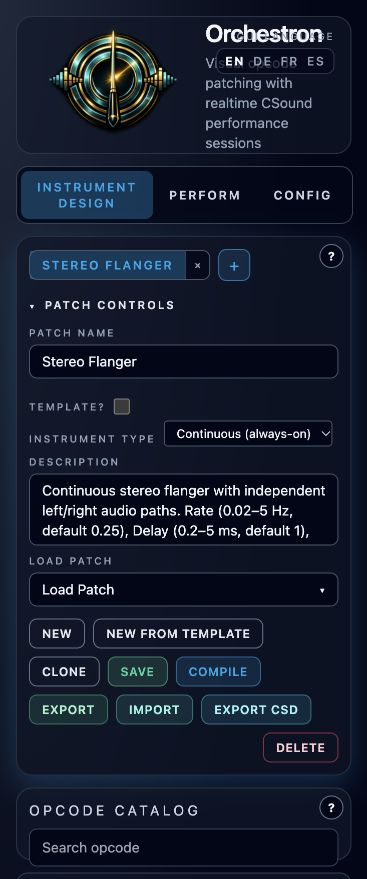

# Stereo Flanger

**Navigation:** [Instrument Design](instrument_design.md) | [Mixer and routing](../performance/audio_mixer_and_routing.md) | [Performance controllers](../performance/performance_controllers.md)

[Download Stereo Flanger](../../examples/instruments/Stereo_Flanger.orch.instrument.json)
and import it with **Instrument Design → Import**. This continuous effect mixes
each channel with a short, moving delay to produce sweeping comb-filter notches.
Left and right retain separate audio paths; Stereo Phase offsets their sweeps.

## Use in a performance

1. With instruments stopped, open **Perform → Mixer**.
2. On an instrument strip or Master, open **Inserts…**, select **Stereo Flanger**, and click **Add**.
3. Start with the defaults, then adjust the six performance controllers.
4. **Restart the rack after changing settings.** Continuous instruments read these values at startup.
5. Save Performance to retain that instance's settings.

For a shared send effect, set Mix to **1** so the return contains only wet audio.
Stereo Input and Stereo Output both expose `left` and `right` channels. The effect
needs routed audio and does not use MIDI notes.

## Controls

| Controller | Range | Default | Scale |
| --- | --- | --- | --- |
| Rate (Hz) | 0.02–5 | 0.25 | Logarithmic |
| Delay (ms) | 0.2–5 | 1 | Linear |
| Depth (ms) | 0–5 | 2 | Linear |
| Feedback | −0.9–0.9 | 0.5 | Linear |
| Stereo Phase (deg) | 0–180 | 90 | Linear |
| Mix | 0–1 | 0.5 | Linear |

**Rate** sets the sweep speed in cycles per second. The default completes one
cycle every four seconds; tempo synchronization is manual.

**Delay** is the shortest delay. **Depth** is the sine wave's amplitude, with the
same amount added as a positive offset. The delay therefore sweeps from
`Delay` to `Delay + 2 × Depth`: **1–5 ms** at the defaults. Depth zero produces
a static comb filter. Across all settings, delays stay between **0.2 and 15 ms**
inside a 20 ms buffer.

**Feedback** sharpens the resonances. Negative values invert successive repeats,
changing the comb's character. Zero removes recirculation but keeps the moving
delay. Wet gain is multiplied by `1 − abs(Feedback)` to compensate for feedback
buildup; increasing feedback can reduce average loudness while emphasizing the
resonant frequencies.

**Stereo Phase** sets the right sweep's phase relative to the left. Zero gives
matching sweeps; 90 degrees gives a quarter-cycle offset; 180 degrees makes them
sweep in opposite directions. It does not cross-feed audio between channels.

**Mix** crossfades linearly from untouched dry audio at zero to compensated wet
audio at one. Intermediate settings produce the familiar flanging interference;
wet-only settings emphasize pitch modulation and feedback coloration.

## Editable graph and validation

The graph uses two audio-rate `poscil3` sine oscillators, two `flanger` delay
lines, and ordinary stereo input/output blocks. Stable controller IDs are
`sf_rate`, `sf_delay`, `sf_depth`, `sf_feedback`, `sf_phase`, and `sf_mix`.
Native bundles and both CSD modes preserve the graph and instance settings.

See the [example guide](../../examples/instruments/stereo_flanger/README.md)
for the editable patch, reproducible previews, and regression checks.

References: [Csound flanger](https://csound.com/docs/manual/flanger.html),
[Csound poscil3](https://csound.com/docs/manual/poscil3.html).
