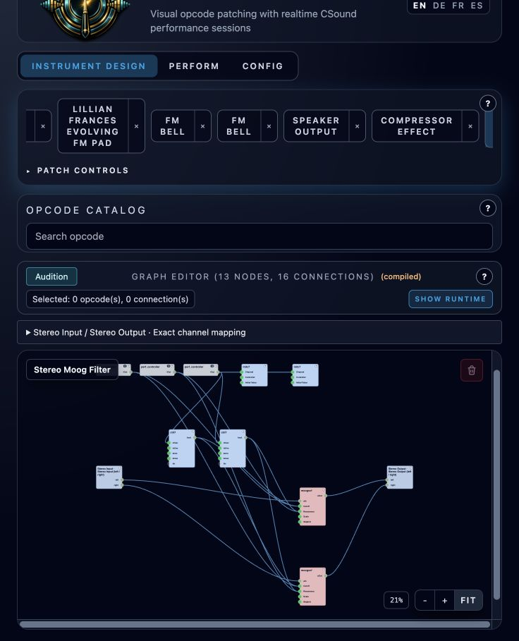

# Stereo Moog Filter

**Navigation:** [Standard Effects](../performance/standard_effects.md) | [Prev](granular_capture.md) | [Next](../configuration/configuration.md) | [Mixer and routing](../performance/audio_mixer_and_routing.md)

**Stereo Moog Filter** is a Continuous stereo resonant low-pass effect. Import and
save the [native instrument](../../examples/instruments/Stereo_Moog_Filter.orch.instrument.json),
then add it as an instrument-strip or Master insert. Its grouped Stereo Input and
Stereo Output preserve separate left and right audio; both channels share the
same cutoff and resonance settings. No MIDI notes are required.

## Performance settings

| Setting | Range | Default |
| --- | --- | --- |
| Cutoff (Hz) | 20–20,000, logarithmic | 1,000 |
| Resonance | 0–1, linear | 0.3 |
| MIDI Control Channel | 1–16, rounded | 16 |

These settings belong to each rack instance. **Restart the rack after changing
them.** The effect is fully processed, with no additional output gain, dry/wet
blend or smoothing. Use the mixer strip for output level. Resonance near 1 can
self-oscillate, so leave headroom.

<!-- pagebreak -->

## MIDI control

| Controller | Effective value |
| --- | --- |
| CC20 | Cutoff × CC20 / 127 |
| CC21 | Resonance × CC21 / 127 |

The factors are bounded to 0–1. A value of 127 uses the full performance setting,
64 uses approximately 50.39%, and 0 produces an exact zero factor. The cutoff
knob's logarithmic scale does not change the linear MIDI multiplier. For example,
Cutoff 4,000 Hz and CC20 64 produce about 2,015.75 Hz.

MIDI changes take effect at the next engine control block for both channels
together. A cutoff of zero blocks new input, while the filter's existing state
continues to decay nonlinearly; it is not an instant output mute. Raising CC20
reopens the filter.

Starting the instrument initializes CC20 and CC21 to maximum, so the performance
settings work immediately without a MIDI controller. Later MIDI values replace
that initialization. In Controller Sequencers select the effect's MIDI channel,
use CC20 or CC21, and set **Reset Value 127** to return to the selected performance
setting when the lane stops. Empty steps hold the preceding value.

**Shared channel behavior:** MIDI state is shared by channel and CC, including
startup initialization. Instances on the same channel respond together; starting
one resets these two CCs for other receivers. Channel 16/CC20–21 also overlap
Granular Capture's default Stutter and Freeze switches. Assign different MIDI
Control Channels when using the effects independently.

## Graph and exports

Two native [moogvcf](https://csound.com/docs/manual/moogvcf.html) nodes process the
audio channels. Two [ctrl7](https://csound.com/docs/manual/ctrl7.html) nodes supply
normalized live factors, and two [initc7](https://csound.com/docs/manual/initc7.html)
nodes initialize them once. The graph bounds the factors because Csound's
initializer internally stores `127 × value + 0.5`, slightly above full scale
when the normalized initial value is 1.

Native instrument and performance exports preserve the graph and instance
settings. CSD MIDI and SCORE exports preserve initialization and automation;
SCORE uses the explicit-channel controller array. Their event timing can differ
by one control block. Controller state itself is runtime state.

See the [example README](../../examples/instruments/stereo_moog_filter/README.md)
for reproduction, auditions and validation.
