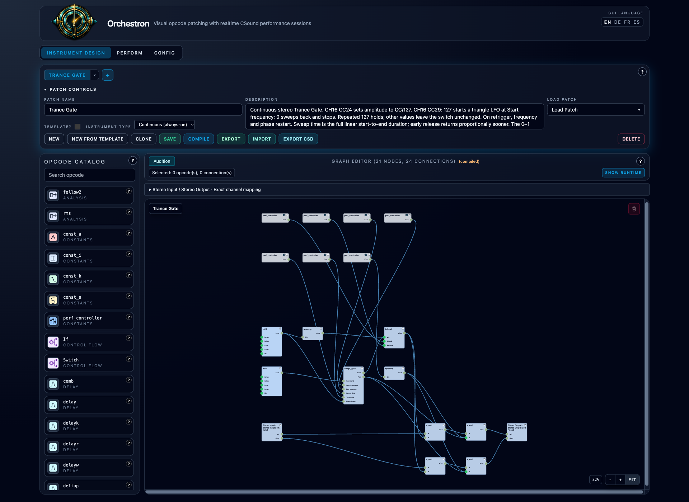
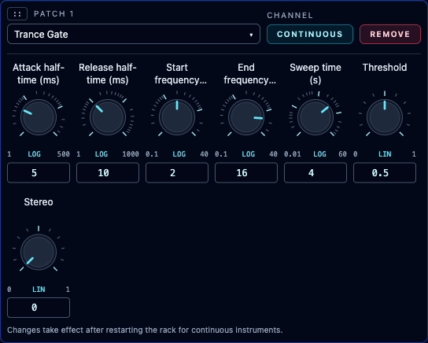

# Trance Gate

**Navigation:** [Standard Effects](../performance/standard_effects.md) | [Mixer and routing](../performance/audio_mixer_and_routing.md) | [Performance controllers](../performance/performance_controllers.md)

**Trance Gate** is a continuous stereo insert with direct MIDI gating and a swept triangle LFO. Import the [native instrument](../../examples/instruments/Trance_Gate.orch.instrument.json), save it, and insert it on an instrument strip or Master. Both channels share the same gain envelope while keeping their audio separate. Use a serial insert: a parallel dry route continues passing ungated audio.

## MIDI controls

Both controllers use **MIDI channel 16**, independently of the source instrument's note channel.

| Controller | Behavior |
| --- | --- |
| CC24 | Sets direct gate amplitude to CC/127: 127 is unity, 0 is closed, and 64 is approximately half amplitude. |
| CC29 = 127 | Switches on the LFO at Start frequency with its triangle at zero, rising. Repeating 127 keeps it running. |
| CC29 = 0 | Sweeps back from the current frequency to Start, then stops the LFO and closes its gate. |
| CC29 = 1–126 | Leaves the LFO switch state unchanged. |

While on, frequency moves linearly from Start to End in the selected **Sweep time**, then stays at End. On release it returns at the same speed: releasing halfway through a four-second sweep returns in two seconds. Descending sweeps work too. If Start equals End, the LFO runs at that frequency and stops immediately on 0. Switching on during a return sweep resets both frequency and phase.

The triangle runs from **0 to 1** and opens the gate only when strictly above **Threshold**. Threshold 0.5 gives approximately 50% open time at constant frequency; higher thresholds shorten openings. Threshold 1 stays closed; threshold 0 opens everywhere except the triangle's minimum. Frequency is in Hz and is independent of the performance tempo.

The requested gain is the **maximum of CC24/127 and the binary LFO gate**, smoothed by the shared Attack/Release envelope. Keep CC24 at **0** to hear only the LFO. CC24 at 127 keeps audio fully open even after the LFO stops; intermediate CC24 values set the level between LFO openings.

## Step sequencer setup

1. Add a Controller Sequencer in **Step Mode**, channel **16**, Controller **29**, **Reset Value 0**.
2. Put **127** where the sweep should start and **0** where it should return. Empty cells and repeated 127 values continue the current sweep.
3. Leave CC24 at 0 for LFO-only gating, or add a separate CC24 lane for direct amplitude steps.
4. Allow time after the last 0 for the return sweep and release envelope. Stopping the audio engine itself stops all processing immediately.

Starting an instance does not initialize or reset either shared controller. A fresh runtime starts silent; an existing CC29 value of 127 starts the LFO when the instance starts. Instances share CH16/CC24 and CH16/CC29 commands but have independent phase, sweep and envelope settings. Avoid using those same channel/CC pairs for unrelated automation. Muted controller lanes hold their last received value; send 0 explicitly when needed.

## Performance settings

| Control | Range | Default |
| --- | --- | --- |
| Attack half-time (ms) | 1–500, logarithmic | 5 |
| Release half-time (ms) | 1–1000, logarithmic | 10 |
| Start frequency (Hz) | 0.1–40, logarithmic | 2 |
| End frequency (Hz) | 0.1–40, logarithmic | 16 |
| Sweep time (s) | 0.01–60, logarithmic | 4 |
| Threshold | 0–1, linear | 0.5 |
| Stereo | 0–1, linear | 0 |

Restart the rack after changing these per-instance initialization settings. MIDI commands act during playback. A half-time halves the remaining distance to the requested gain; ten half-times cover approximately 99.9% of a transition. High LFO rates or long half-times soften the gate and may prevent it from fully opening or closing between pulses.

## Stereo movement

**Stereo 0** preserves the existing stereo output exactly. Raising Stereo adds channel balance movement, following the same convention as [Autopanner](autopanner.md): each input stays in its own channel. At **Stereo 1**, pan 0 passes only the left channel and pan 1 only the right; the center gives each channel gain 0.5. A signal present on only one input fades in that channel rather than moving to the other.

- **CC29 / LFO:** pan follows the current 0–1 triangle, including its return sweep. The gate threshold still applies, so only the open portions of that sweep are audible. Retriggering during return resets phase and pan together.
- **CC24 / manual:** each transition from 0 to any positive value samples a fresh noise value and holds that random pan position. Repeated positive values, or changes between positive values, do not resample. The position holds through the release envelope.
- **Both sources:** the running LFO takes priority for pan. CC24 openings still sample a position in the background; if CC24 remains positive after the LFO stops, its held random position takes over. With neither source active, the last pan position holds through release. A new instance starts centered.

For pan position `p` and Stereo `s`, left gain is `1 − s × p` and right gain is `1 − s × (1 − p)`, applied after the shared gate envelope. This adds no gain or crossfeed. The stable performance-controller ID is `tg_stereo`; its setting takes effect after rack restart. Random choices belong to each instance and are not saved automation, so separate renders can choose different manual positions.

## Graph and exports

Two `ctrl7` readers feed the direct gain and the Orchestron **swept_gate** node. This application-defined Csound UDO keeps its state per instance and computes triangle phase and frequency travel with local `ksmps=1`. The command reader retains the host's control-block timing. Its binary audio-rate output combines with the direct gain before the existing `follow2` envelope and separate stereo multipliers. The Pan output controls the two final balance multipliers; a local `rand` noise stream and `samphold` choose each manual opening’s position.

Native exports preserve the graph and seven performance controls. MIDI and SCORE CSD exports include the processor and the same explicit-channel automation. The finite export must include enough time for the return and release: send 0 early enough, leave trailing rests, or extend the final `f 0` duration as described in the export's rendering instructions.

Rebuild the authoring payloads and native export with `.venv/bin/python tools/trance_gate/build.py`. The builder compiles before writing files and does not write the library. Automated audio tests use independent versioned original and extended fixtures, checking sweep timing against an analytic phase integral and verifying sample-identical CC24-only playback. See [Csound local control periods](https://csound.com/docs/manual/setksmps.html) and [follow2](https://csound.com/docs/manual/follow2.html).
