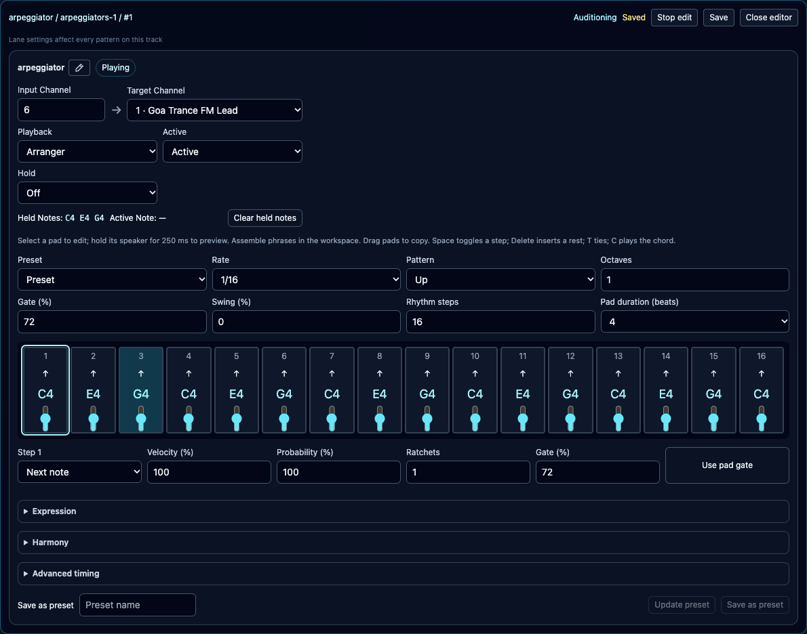

# Arpeggiators

**Navigation:** [Up](performance.md) | [Prev](controller_sequencers.md) | [Next](piano_rolls.md)

An arpeggiator processes MIDI notes and drives an existing rack instrument. Send chords from a melodic sequencer, an on-screen keyboard, or external MIDI to its **Input Channel**. Choose the named instrument in **Target Channel**. Both controls are always visible in the top row, with **Input Channel → Target Channel** showing the MIDI direction. Inputs must be unique; an arpeggiator cannot target another arpeggiator input.

## Start and Synchronize

**Arranger** follows song playback, seeks and loop selections. Incoming chords join the next subdivision of the shared beat; chord changes keep the phrase position. Seeks and loop wraps reconstruct the phrase at the destination, and playback stops at Song end. The arpeggiator needs input notes or a held chord to produce sound.

**Live** runs independently while the instrument engine is active. The first incoming note establishes the Live clock; subsequent chords retain its pulse. Both modes use global BPM, including tempo changes.

**Restart** controls phrase position without moving the subdivision clock:

- **Continue:** keep advancing through chord changes (default).
- **First held note:** restart the phrase on a fresh key gesture.
- **Every beat / Every bar:** restart at the next subdivision of each master beat/bar.

Straight, triplet and dotted rates use musical beat positions. Swing alternates long and short intervals with an unchanged total duration for each pair.

## Hold and Processing

**Hold Off** is the default. Releasing all input notes silences the output, preserving rests in a source sequence. **Hold and replace** remembers the last chord after release; the next fresh gesture replaces that chord. **Add/remove notes** toggles pitches explicitly. **Clear held notes** releases the arpeggiator's notes and clears pending input and launches.

**Active** generates the pattern; **Bypass** forwards incoming notes to the target; **Mute** consumes notes silently. Stop, removal, routing changes and processing/playback-mode changes release notes owned by this arpeggiator.

## Musical patterns

Choose **Add track → Arpeggiator** in the arranger, add a clip and a pattern, then double-click the pattern to edit it. Each pattern stores its order, rate, octave range, transpose, expression, harmony, rhythm, rotation and random seed.

Rhythm length and pattern duration are independent. A rhythm has 1–32 steps; pattern duration is 1–8 or 16 master beats. A five-step rhythm can continue through repeated four-beat occurrences of the same pattern. Changing patterns restarts the musical cursors. Arrangement rests silence output while incoming pitches continue to be tracked.

Use linked patterns to repeat a phrase, or **Create variation** for an independent version. Groups and supergroups collect reusable content inside clips.

## Audition and save

Use **Play edit** to audition the open pattern with incoming notes or a chord. During song playback it temporarily replaces its track while the other tracks continue. **Stop edit** restores the track at the current song position. Hold and Active/Bypass/Mute remain effective during audition.

**Save** offers **Only this occurrence** or **All linked occurrences**. It preserves the rhythm, expression, harmony and random seed. See [Patterns and Reusable Phrases](pattern_pads_and_pad_looper.md).

## Edit the Rhythm Grid

Select a step, then choose its action:

| Action | Result |
| --- | --- |
| Next note | Play the next pitch in the selected order |
| Chord-note position | Play a relative position in the ascending, octave-expanded input pool; oversized positions wrap |
| Rest | Advance time silently |
| Tie | Extend the preceding note/chord without retriggering; silent without a preceding note |
| Chord | Play the entire expanded input pool |

Velocity bars scale incoming accents in percent. Each step also has probability, a gate override and **1–4 ratchets**. Gate supports **5–200%**; values above 100% overlap different pitches. **Use pad gate** clears the step override. Rests and probability misses keep the automatic note cursor stationary unless **Advance through rests** is enabled. **Note repeats** repeats an automatic pitch before moving on. **Rotation** changes the rhythm's starting step.

Keyboard editing: Left/Right selects adjacent steps; Space toggles a rest; Delete/Backspace inserts a rest; T inserts a tie; C plays the chord; N restores Next note. Double-click also toggles a rest. Controls have accessible text labels.

Note previews use large 18 px labels. Narrow grids scroll horizontally; long chord labels stay on one line with an ellipsis. Hover over a step for the complete note list and scale degrees, also available to screen readers.

With **Follow source** or **Custom** scale handling, step borders use the piano keyboard’s degree colours: **1 red, 2 orange, 3 yellow, 4 green, 5 teal, 6 blue, 7 violet**. Degrees describe the generated pitches after transposition and quantization. Follow source uses each note’s incoming scale context, with the pad’s scale as fallback. Octave repetitions keep the same colour. Chords show equal, distinct border segments for their degrees, ordered 1–7. **Scale Off**, missing previews, rests and ties keep neutral borders. Previews and colours appear only when editing the playing pad. A cyan outer outline marks the selected step independently of its degree colour; the playback background and keyboard focus remain separate.

## Expression and Harmony

Input velocity preserves accents; Fixed and Random velocity remain available. Timing and velocity humanization change individual strikes. Timing variation stays inside each strike's scheduling window and never moves the next clock position.

**Repeat variation** repeats seeded random choices; **Evolve** varies them by cycle. **New variation** changes the saved seed. Each pad has its own seed, independent of other devices; identical input and transport positions produce reproducible events in playback and exports.

Octaves expand the input pool before applying note order. Down descends through the complete range. Up/Down reverses without duplicating endpoints. **Octave by octave** retains an alternative traversal in Advanced timing.

Scale handling defaults to **Off**. **Follow source** uses the source's root/mode and falls back to the pad's configured scale when absent. **Custom** always uses the pad's scale. The effective scale and resolved pitch preview help explain the output. Playback highlights follow audible PCM status.

## Presets, Live Edits and Collapse

Presets apply only to the pattern being edited. **Modified** marks changes from its preset. **Update preset** overwrites a user preset; **Save as preset** creates a new one. Built-in presets remain available. Routing, playback settings and other patterns are preserved.

Live edits coalesce for 80 ms and apply at audio render boundaries, preserving transport and pending launches. Invalid edits retain the working configuration. Status updates never resubmit musical settings. Collapse hides visual work while preserving playback, pattern selection, details and drafts.

## Clip transposition

The clip arranger supports [shared repetition transpositions and independent nested offsets](multitrack_arranger.md#transpose-clips-without-changing-notes). Saved settings are preserved by native bundles and both MIDI and SCORE CSD exports. Transposition uses performance format v25; older readers cannot safely edit it.
