# Audio mixer and routing

**Navigation:** [Up](performance.md) | [Previous](sample_player.md) | [Next](performance_controllers.md)

Choose **Perform → Mix → Mixer**. Select a strip to edit its outputs and sends. The pinned Master controls audio routed into it. A **Direct Audio Output** badge identifies paths that bypass Master; these still respond to their own strip's fader, balance, mute and solo.

Leaving Mixer releases its visible meters. When you return, the channel bank recalls its scroll position and shows current levels. Audio keeps playing while you work in another view.

Use **?** for integrated help in English, German, French or Spanish.

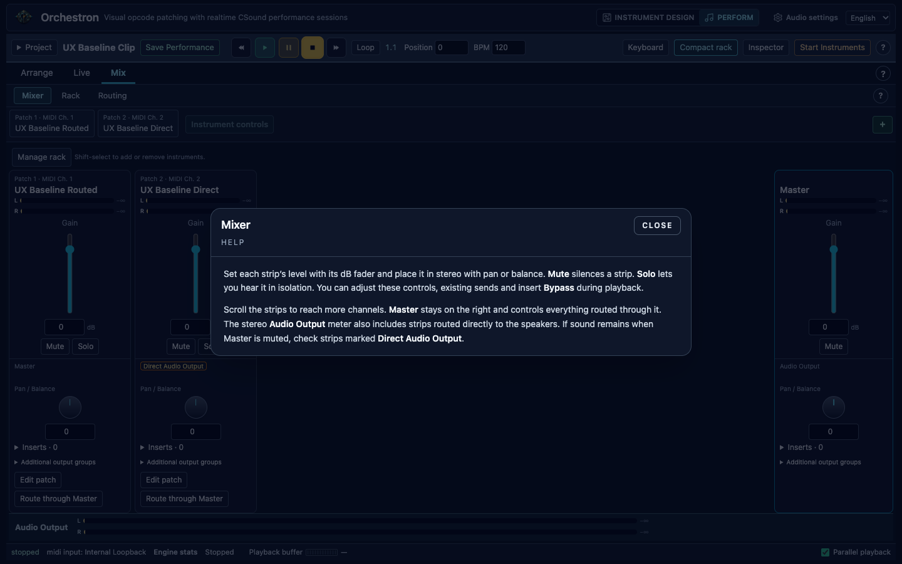

## Mix a performance

Open **Mix → Mixer** to balance the performance. Scroll the instrument and return strips left or right. **Master** stays on the right, and the stereo **Audio Output** meter below the strips shows what reaches the speakers. If Master is muted and that meter still moves, look for a strip marked **Direct Audio Output**. Mute that strip to check its contribution.

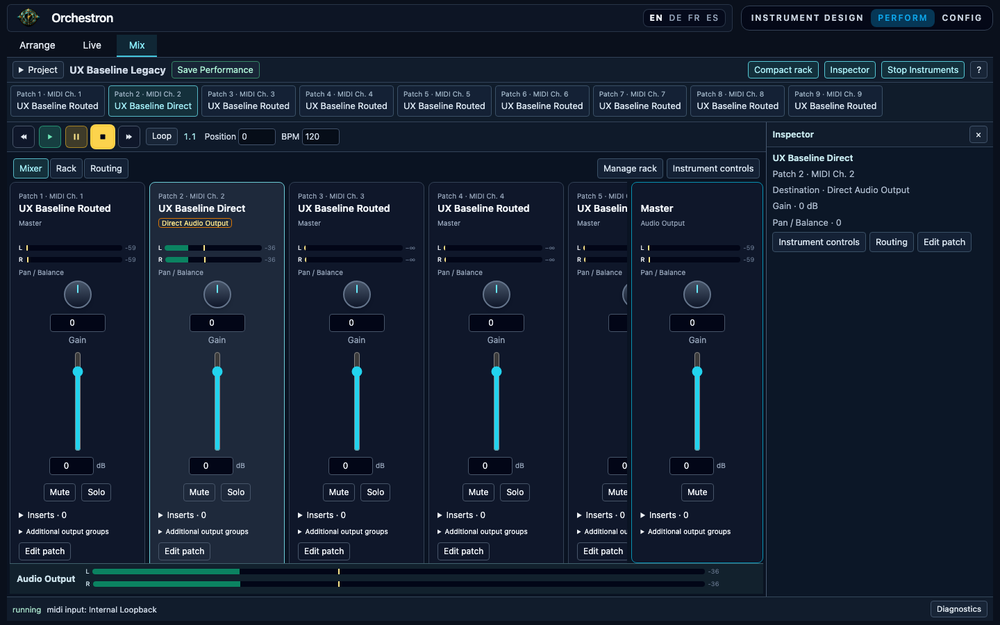

Leave **Samples** open and start a preview. Use the kit’s **Mute** to silence and restore it, **Solo** to hear it on its own, or the dB field to match its level. These controls and the selected insert’s **Bypass** stay at the top of the strip. Scroll inside the lower part of the strip for pan, sends and routing.

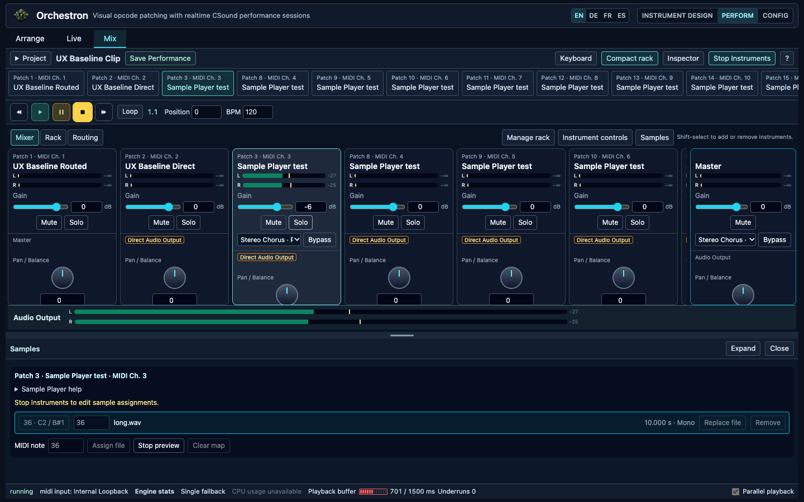

Select a strip name and open **Instrument controls** to adjust the instrument and its insert effects together. Shift-click another strip name or compact rack entry to add it to the selection. Shift-click it again to remove it. A plain click selects a single instrument. The Inspector and **Samples** follow the most recently selected instance. Its patch number and MIDI channel distinguish two copies of the same sound.

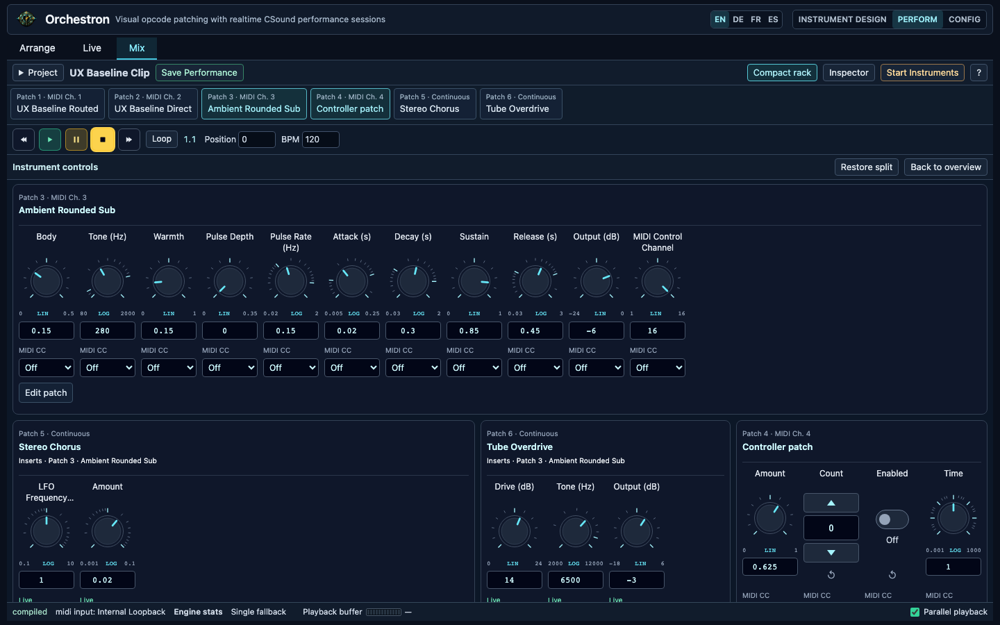

When the editor fills the pane, its header brings the focused channel, Master and the stereo **Audio Output** meter with it. On a short or narrow screen, use **Mixer channel** to switch between the focused instrument and Master. You can mute Master, adjust its level or compare a Master insert while the same sample or instrument stays open.

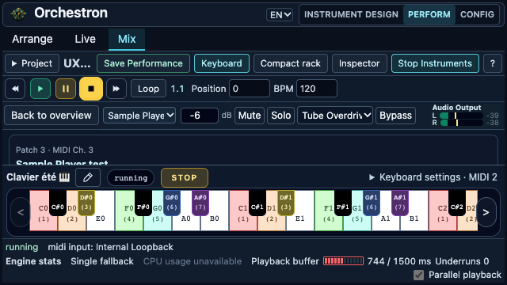

To hear an insert change on a sustained sound, open **Keyboard** and hold a note or Autochord. You can start the chord in Live and carry it into Mix. With Space or Enter held on a piano key, drag a live insert knob with the mouse. On a touch screen, hold the key with one finger and turn the knob with another. Selecting an instrument for editing keeps the keyboard on its original MIDI channel.

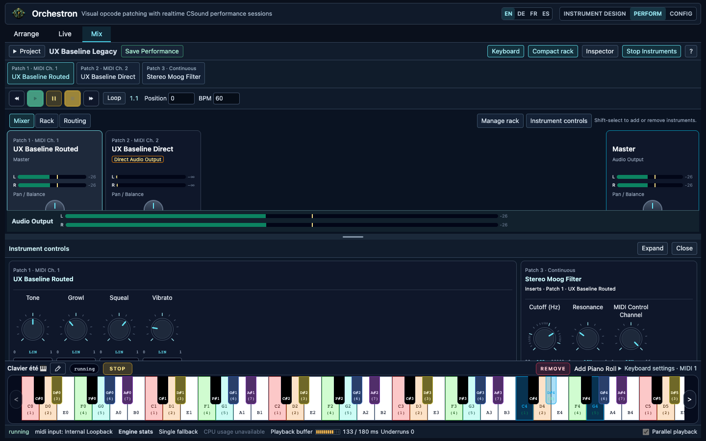

Use **Compact rack** in Arrange or Live to select an instance and open its controls, samples or routing. **Manage rack** opens the full Rack for adding, assigning, reordering and removing instruments. Return to Arrange or Live with its view button to resume your edit.

Open **Routing** while listening to inspect destinations, exact channel mappings, the routing diagram and diagnostics. Gain, balance, Mute/Solo, existing send controls and eligible insert Bypass work during playback. Choose **Stop to edit routing** or **Stop to edit rack** when you need to change connections or the rack itself.

## Build your first mix

1. In Instrument Design, choose **New → Playable instrument**, name the draft and **Save** it. Create and save an **Audio effect** when you need a processor. The built-in effect is a stereo pass-through starter; add your processing inside its graph.
2. In **Mix → Rack**, use **Add Instrument** and select the saved instrument. Set its MIDI channel. Guided instruments connect to the fixed internal Master automatically. For existing patches, inspect their destination labels and use **Route through Master** if needed.
3. Choose **Mixer**. Above each instrument name, a small label shows its rack patch number and MIDI channel, for example **Patch 2 · MIDI Ch. 3**. Continuous instruments and effects show **Patch 4 · Continuous**. Patch numbers match the rack even when insert processors have no separate mixer strip. Each strip header selects its source for the routing editor. The Master strip stays pinned at the right; scroll horizontally when the rack has many strips. Strips follow the instrument rack’s order, with note-triggered instruments before continuous returns. Stop the instruments and drag the rack’s `::` handles to reorder within either group. This changes display order only; insert processors remain in their owner’s insert chain.
4. Start with 0 dB gain and centered Pan / Balance. Build routes and insert chains while stopped, then open **Routing diagnostics → Check routing**.
5. Click **Start Instruments** and play via a piano roll, sequencer or MIDI input. Change gain, balance, mute/solo and existing send settings while listening. Watch strip meters and the final Audio Output meter.
6. Use **Save Performance** to retain this mix. Stop the engine before adding/removing routes, replacing assignments or reordering inserts.

  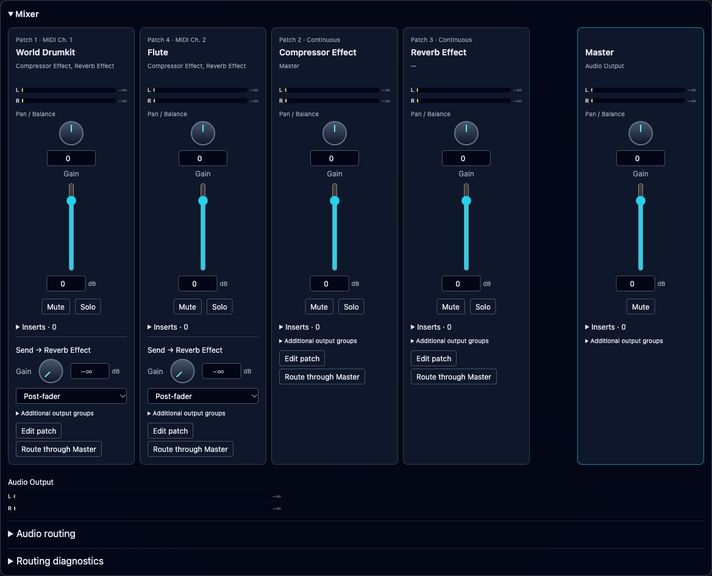

<em>Live “Ratchet drums demo” mixer, stopped: the strips show their rack patch numbers and MIDI channels or Continuous above their names, with Master pinned at the right. World Drumkit and Flute have post-fader send controls for Reverb Effect; both sends are set to silence (−∞ dB). This performance has no insert processors.</em>

## Signal flow

| Path | Processing order |
| --- | --- |
| Instrument | Summed voices → Perform inserts → pan/balance → fader → destination |
| Pre-fader send | After inserts → send amount → destination |
| Post-fader send | After pan/balance and fader → send amount → destination |
| Return | Summed inputs → effect patch → inserts → balance → return fader |
| Master | Incoming routes → internal stereo bus → inserts → balance → Master fader → Audio Output |

Effects drawn inside an instrument graph run per voice. Perform inserts receive summed voices. Each inserted effect is a dedicated rack instance. Reordering an insert changes explicit connections; if custom connections no longer form a simple chain, **Custom routing** preserves those connections.

Additional output groups retain their own port names and mappings. They share the owning strip's gain and mute; inserts process the designated main output. Custom routes can express other processing arrangements.

### Inserts versus shared returns

An **insert** processes one strip in series after its voices are summed. Select that strip, choose a saved continuous patch with audio inputs and outputs in the **Inserts…** selector below the routing controls, then click the adjacent **Add**. Open **Inserts** on the strip to inspect its chain. Click a processor name to edit its patch, **↑** to move it earlier, or **×** to remove that insert instance. Reusing one saved effect creates separate processing instances; an insert does not appear as a separate mixer strip.

Removing an instrument from the rack also removes its dedicated inserts, including any inserts on those processors, plus their connections and mixer settings. Removing a single insert through the rack or its **×** button reconnects the remaining simple chain. Custom connections between surviving instances are preserved for inspection and repair; unrelated returns, sends and Master controls remain unchanged.

A **return** is a continuous rack instance that can receive sends from several sources and has its own mixer strip. Add it with **Add Instrument**, connect its output to Master, then add sends from the source strips. For a parallel reverb/delay arrangement, design the return patch to output the desired wet signal; the starter pass-through would merely add another copy of the dry signal.

### Compare inserts with Bypass

Choose a processor in the strip’s **Inserts** selector and press **Bypass**. Press **Bypassed** to hear the effect again. The selector includes nested effects and shows each processor’s rack patch number, so you can distinguish two copies of the same patch. In **Instrument controls**, each insert card also has its own Bypass. Both controls follow the same processor. You can compare inserts during playback with several instruments selected. Open the strip’s **Inserts** list to see the full chain. Stop the instruments to reorder or remove an insert.

Bypass passes that effect’s main input to its main output, using the declared channel order. A 20 ms crossfade suppresses abrupt transitions. The selected effect’s output, including its tails, fades out; downstream effects keep processing and can retain their own tails. The bypassed processor keeps receiving audio and running internally, so reactivation retains its current state. Live bypass does not reduce CPU use.

For example, bypassing Distortion in `Instrument → EQ → Distortion → Reverb` lets Reverb receive the EQ output directly. Other inserts, including inserts nested inside the bypassed processor, retain their own states. Strip gain/balance and mute/solo still apply. Additional effect outputs have no dry substitute and fade to silence. Bypass requires matching main input/output channel counts; an incompatible mapping disables the button. Bypass does not infer or compensate a patch’s internal processing latency.

The control is available only on continuous instances assigned as inserts, not on standalone generators, shared returns or note instruments. New inserts default to Active. Each instance’s state survives Save/Load, Clone, autosave and native JSON/ZIP bundles without changing its library patch. Match listening levels when comparing effects that change volume.

Both **CSD (MIDI)** and **CSD (SCORE)** omit bypassed effect synthesis, initialization, performance-controller channels and assets used only by those effects. Incoming audio connects directly to downstream consumers; necessary strip and route controls remain. Exported CSDs contain no live bypass crossfade stage. Native exports retain all effect definitions so they can be reactivated after import.

  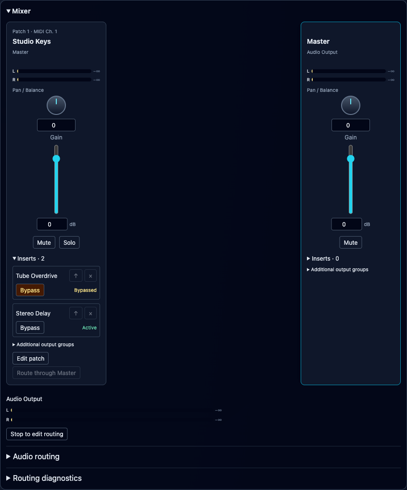

<em>Each insert has its own Bypass control and explicit state. The remaining chain stays active.</em>

### Add a stereo send

1. Stop the engine. Add the saved effect as a rack instance and use its **Route through Master** button to connect its main output.
2. In **Audio routing**, choose the instrument under **Source** and the return under **Destination**.
3. Leave **Stereo** checked and verify **Exact channel mapping**, for example `left / right → left / right`. Choose **Send** in the Route selector and click the routing row's **Add**.
4. On the source strip, find **Send → [return name]**. New sends start at silence; enter a value such as -12 dB to hear the return.
5. Choose **Post-fader** when the send should follow the source's fader/balance, or **Pre-fader** for an independent send amount. The source's Mute still silences either kind of send.

Adding a send does not replace the main output route. Avoid adding duplicate connections: parallel paths sum and can increase output level. Up to 1,024 individual channel connections and 64 rack instances (including processors, excluding internal Master) are supported; a stereo pair uses two connections.

## Controls

- Faders span −60 to +12 dB, with an exact-silence position below −60. Clearing the numeric value selects silence. Double-click resets to 0 dB.
- Sends span silence to +6 dB. New sends start silent and post-fader. Pre/post can change during playback.
- Rotary controls support vertical dragging, arrow keys, Page Up/Down, Home/End, exact numeric editing and double-click reset. Shift-drag provides finer adjustment.
- Stereo balance preserves both channels at unity in the center and attenuates the opposite channel toward either side. Explicit mono-to-stereo routing uses equal-power pan. Custom mono mappings stay unchanged.
- Mute blocks all outgoing paths, including pre-fader sends. Processors keep running, allowing downstream tails to decay.
- Multiple solos are allowed. Solo preserves required upstream inputs and downstream processors. Soloing a return excludes its sources' unrelated dry branches. Mute takes precedence. Master has no Solo control.
- Gain, balance, send and mute/solo changes use finite 20 ms ramps. Playback starts at the saved values, without an initial fade.

Meters show stereo peak and RMS. CLIP indicates a peak at or above 0 dBFS; no automatic limiting, normalization or clipping is applied. The final **Audio Output** meter includes Master and direct paths. Connectivity diagnostics describe structure; meters measure actual audio activity.

## Routing and repair

Choose a source, destination and explicit channel mapping before adding a main route, send or custom connection. Stereo groups expand into their exact member ports. Uncheck **Stereo** to select one exact source port and destination inlet at a time, including custom or mono mappings. Group display names are not inlet names; legacy label suggestions never rename ports.

Open **Destination matrix** to inspect incoming routes grouped by destination. Expand a route row to change its source port, destination instance or destination port; **Remove** deletes that grouped connection. This is also where broken references can be repaired instead of discarding the performance.

Open **Routing diagram** to follow the same connections as source → destination cards. Expand **Exact channel mapping** on a card to inspect port names and processing stages. Click source/destination names to select routing endpoints; use the strip's **Edit patch** action to open its instrument graph.

  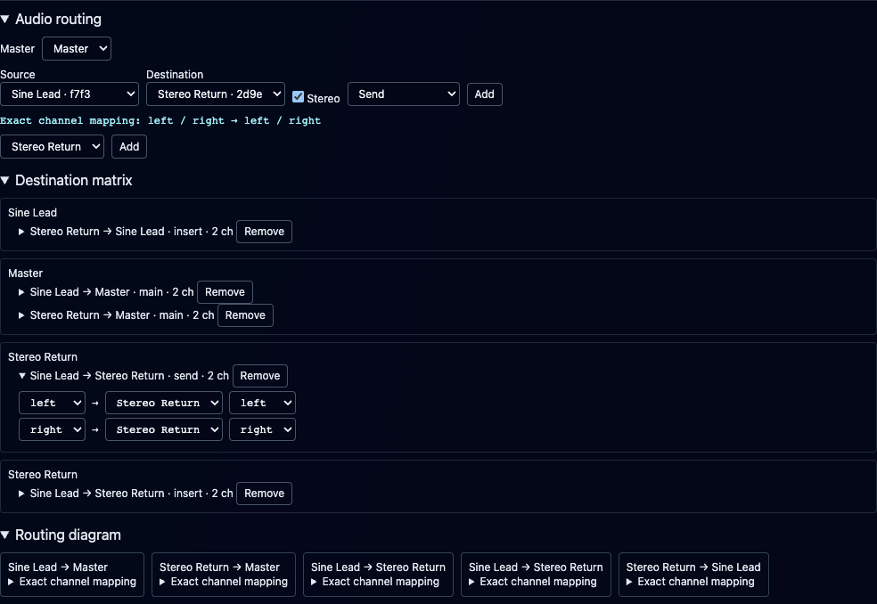

<em>The send's left and right mappings expanded in Destination matrix. Matrix and diagram show the same routes, including the dedicated insert's input and return-to-strip connections.</em>

**Route through Master** replaces the selected strip's main routes with stereo connections to the designated Master in this performance. Sends and custom routes are retained. Master is a fixed internal stereo output with volume, balance, mute, meters and effect inserts. It is always available, has no editable patch and occupies no library entry or rack slot. Its controls and inserts belong to the performance. **Audio Output** remains available as an editable starter for custom output processors.

New guided instruments connect to Master automatically. Loading an older performance preserves its authored direct/custom paths. Master gain or mute affects only paths routed into Master: a direct strip can still be audible. Check the **Direct Audio Output** badge and the final Audio Output meter when tracking down sound that remains after lowering Master.

Topology changes require stopping the engine. **Stop to edit routing** makes that action explicit. Existing mixer controls remain live, including with **Parallel playback** enabled: faders, balance, mute, solo, sends and insert bypass continue to affect the sound. Invalid references and genuine feedback cycles block playback and CSD export. Broken routes remain available for repair. Unused ports, incomplete stereo pairs and parallel direct/processed paths are warnings.

### Troubleshoot routing and silence

Expand **Routing diagnostics** and click **Check routing** after editing connections. Diagnostics describe connectivity, while meters report measured sound. Clicking an instance-related diagnostic can open its patch for inspection. A **Muted or silent path** entry selects the corresponding strip.

Invalid insert assignments appear in red, including an insert whose processor or owning strip is missing, or which refers to itself. These errors are detected even when all visible connections to the deleted instance have already been removed. Backend validation failures appear directly beside **Check routing**. Previous check results are discarded after changes to the rack, patch definitions, routing or mixer settings; check again after editing.

Feedback loops appear above the mixer strips as soon as their connections are present. Each path lists instrument and effect names, instance IDs (to distinguish repeated uses of a patch), MIDI channels, exact audio ports and processing stages. **Before inserts** is the instrument's raw output; **Processed strip** is its output after insert returns; **Input** feeds the effect's processing. Ordinary insert chains returning to their owner's strip are valid.

Choose **Show offending connections** to open the routing diagram and enable **Only feedback connections**. Red borders and **Feedback loop** badges identify the affected strips, inserts, sends and route groups; the Destination matrix highlights the same connections. Expand **Exact channel mapping** to inspect or remove individual channel connections. Turn off the filter to inspect surrounding routes. Highlights update immediately after a routing edit, and all connections become visible again once the loop is gone.

The display shows one closed path for each connected group of feedback loops and highlights every cyclic connection in that group. A group may contain additional overlapping loops. Unrelated incoming routes and downstream output routes are not highlighted. Break every remaining loop, including both stereo channels; muting, bypassing or lowering a send does not remove its processing dependency.

For example, sending a lead's processed strip into its own Reverb insert closes **Lead → Reverb → Stereo Widener → Lead**. Use a separate shared Reverb instance with its own output return if that is the intended effect. The screenshot below uses a temporary copy of Effectomania's earlier routing.

  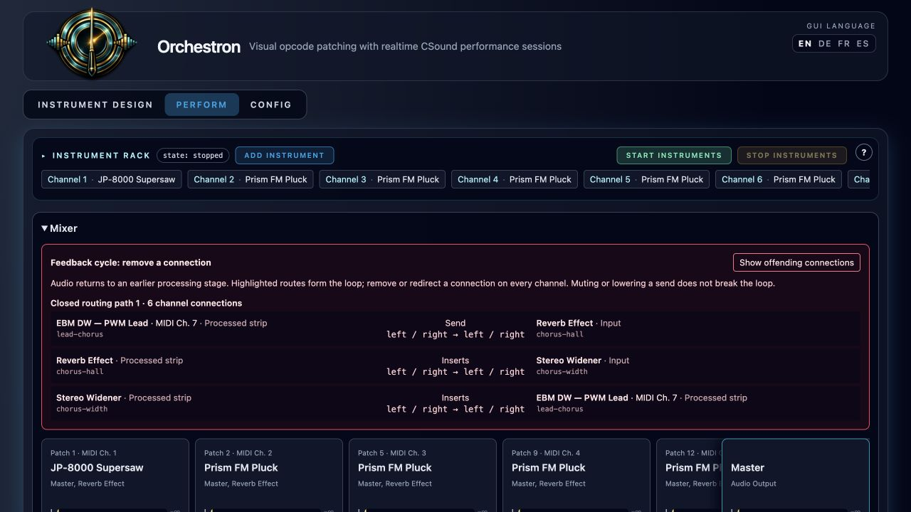

  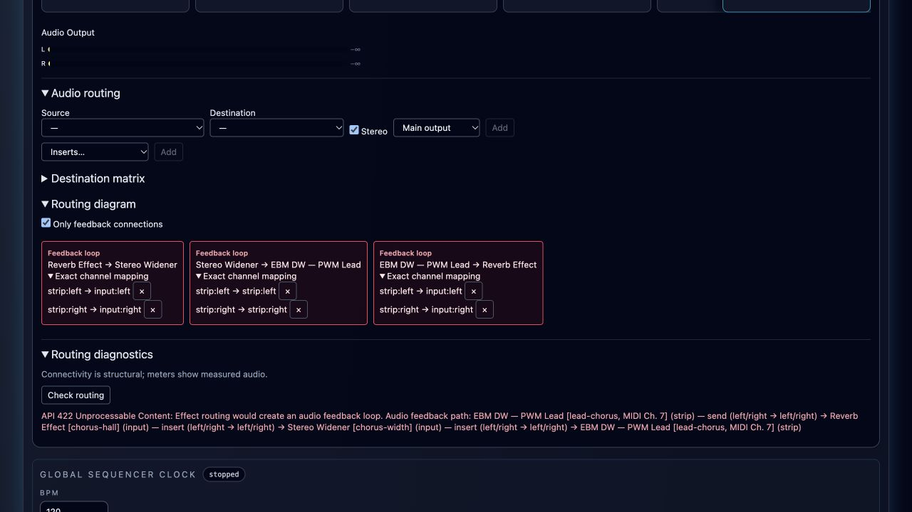

| Symptom or diagnostic | What to check |
| --- | --- |
| Repair route / Missing reference | Restore the referenced patch or repair the destination and exact port names in Destination matrix. |
| Invalid insert ownership | Repair the insert assignment that refers to a missing instance or to itself. Removing audio connections alone does not repair an invalid insert assignment. |
| Feedback cycle | Follow the named path and choose **Show offending connections**. Remove or redirect a connection on every affected channel. Playback and CSD export remain blocked until all cycles are resolved. |
| Connect an audio output / Select an audio source | Follow the source to an output sink; route audio into effects that require inputs. |
| Complete stereo mapping / Unused ports | Check both channel mappings and the declared audio groups. These structural warnings do not prove a patch is silent. |
| Review parallel output paths | Check whether both direct and processed copies intentionally reach the output. Serial insert chains, including Master inserts, do not trigger this warning. |
| Muted or silent path | Clear Mute or raise a fader/send from silence; also check active solos and whether the source is producing notes/audio. |
| CLIP | Reduce gain along the contributing paths. No limiter is applied automatically. |

The same routing diagnostics appear in CSD exports. A serial insert feeds back into its owner's strip before reaching Audio Output. A parallel-output warning means the other branch can reach Audio Output through a separate exit, such as a shared effect return or an additional output from an insert processor.

  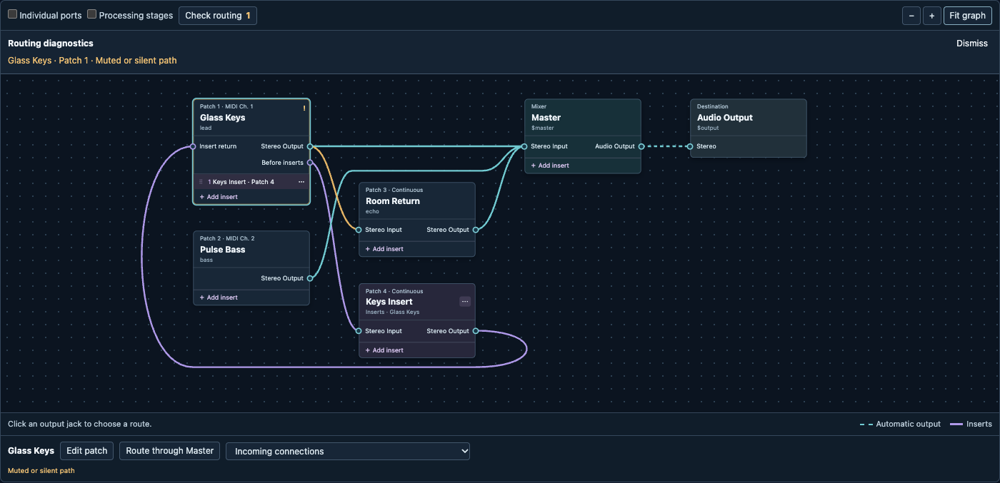

<em>A valid route can still be silent: here the Sine Lead strip is muted.</em>

  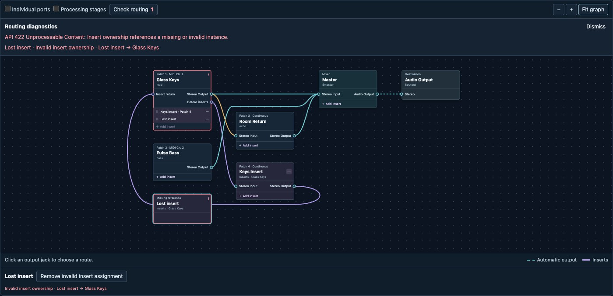

<em>A diagnostic preview of the damaged Sunlit Strings performance: the missing insert assignment is flagged locally and the backend failure appears in the same section. The saved performance was repaired separately.</em>

## Persistence and compatibility

Save Performance retains routes, strip gain, balance, mute, bypass, sends, inserts and instance settings. Clone and native exports preserve them too. Mixer automation recording is not included. See [Performance Import / Export](performance_import_export.md) for portable backups and offline rendering.

Older performances are upgraded when opened. Older Level controls become audio gain; they no longer scale note velocity, so velocity-sensitive instruments can change timbre. Authored note velocities are retained.

## Upgrading existing Masters

The current Master is a fixed output strip. Customized older Master instruments remain as processing instruments routed into it. If a legacy Master is missing, stop playback and use **Replace missing Master with internal output**. Check any unresolved channel mappings in the routing matrix, then save the performance.

Library migration and recovery procedures are in the [developer reference](../../specifications/manual-reference/audio_mixer_and_routing.md).

**Navigation:** [Up](performance.md) | [Previous](sample_player.md) | [Next](performance_controllers.md)
