# Clip arranger preview

The clip arranger is a development preview. It introduces fixed clip windows and reusable patterns, groups and supergroups while keeping the existing musical editors. The compatibility arranger remains available; the preview is not yet the default rollout.

For a development build, start the frontend with `VITE_CLIP_ARRANGER=1 npm --prefix frontend run dev`. **New** creates an empty clip arrangement and one fixed piano keyboard. **Add track** chooses Melodic, Score, Drummer, Controller or Arpeggiator and creates its first pattern. Assign the instrument through the existing rack and MIDI-channel controls.

For an existing compatible performance, **Multitrack arranger · Preview** downloads its original configuration before converting. Keep that file: import it to recover the original workflow with the same instrument library. This recovery file contains configuration only; keep a native performance bundle to restore instruments and assets on another installation. Existing Manual pads, Live arpeggiators and multiple-keyboard performances remain in the compatibility view; conversion reports the reason instead of changing their playback behavior. A clip performance requires a version-23-capable reader, or version 24 when it uses instrument automation. Disabling the preview flag does not downgrade saved data.

The top-right **?** opens help specifically for this clip workflow in the selected GUI language (English, German, French or Spanish). It covers clip windows, reusable content, musical and structural drafts, save scope, transport, sections, transposition and instrument automation. Close it with **Close**, Escape or a click outside the dialog.

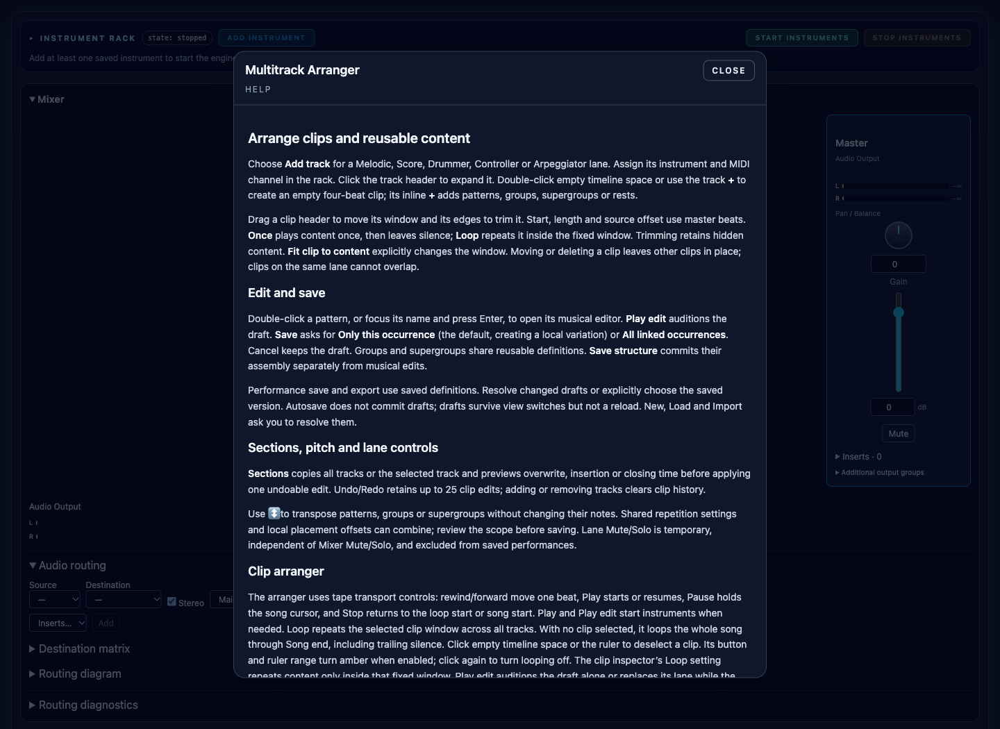

## Arrange fixed windows

Unselected tracks stay compact. Click a track header to expand its clips into nested pattern, group and supergroup boxes. Drag a clip header to move it, or its borders to trim it; the inspector also accepts numeric start, length and source offset in master beats. Double-click empty lane space to create an empty four-master-beat Once clip immediately, snapped to quarter beats. The track **+** appends the same empty clip. Its inline **+** opens the content picker; inserted content replaces silence, preserving any remaining rest. Longer content can grow the window when space permits. Moves and deletion leave other clips in place. Overlap on the same lane is rejected.

The clip window and content duration are independent. **Once** plays the content from its source offset and leaves silence after its end. **Loop** repeats content within the window. Trimming preserves the original notes and content; **Fit clip to content** explicitly changes the window. A local edit of one generated repeat splits its original window into before, edited and after parts.

Open **Content** for the selected clip to adopt existing definitions, create a new pattern, add a rest, reorder children, or select adjacent children for Group/Supergroup. Grouping retains reusable definitions. Ungroup opens one level. Removing an occurrence retains its definition. Groups and supergroups have their own contextual child editor.

**Sections** copies a range of all tracks or the selected track. Paste and overwrite, paste and insert, insert time and close time show a preview before applying one undoable transaction. A repeating legacy lane must first be converted to song clips; this materializes its repeats across the current song duration. Ordinary clip edits do not silently change that independent cycle. Track-order arrows change the visible lane order. Removing a track removes its source and drafts; source creation/removal clears clip history because source topology is outside clip-only undo.

Undo/Redo retains up to 25 clip edits through performance save/load, autosave recovery and native bundles. Earlier preview histories are converted automatically while preserving their undo/redo position. History stores changes compactly so ordinary edits do not repeatedly duplicate every pattern in the saved performance.

## Instrument automation

The [Performance Creator skill](../../integrations/skills/orchestron-performance-creator/SKILL.md)
can author the same clip model through `orchestron_cli`. Start with
`edit begin --new --arranger clips`, then apply a versioned song document with
`edit apply-song --file PATH`. Definitions are shared across clip repetitions;
pitch-only changes use transposition plans. Inspect returned occurrence targets
before scoped musical/structural edits, use dry runs and undo, validate online,
then commit. The CLI protects saved revisions and preserves unused definitions,
hidden notes and trailing silence. It does not see unsaved GUI editor drafts.
See the [command cookbook](../../integrations/skills/orchestron-performance-creator/references/song_workflow.md)
for migration recovery, owned automation, audition and exports. This does not
change the preview rollout gate.

Select an instrument clip and use **Generate automation** to create one bound controller lane per assigned MIDI CC. Edit song-length curves directly inside expanded clips, with at most ten points and explicit Save/Discard. MIDI channel and CC follow the rack instrument. See [Instrument automation clips](instrument_automation.md) for generation, duration, split/merge and suspended-target behavior.

## Edit the current musical controls

For a Score track, add a clip, use its inline **+** / **Add content → New pattern**,
then double-click the nested pattern to open the **Score sequencer**. Hold its
piano keys to audition pitches or double-click them to append quarter notes.
Use **Save** to choose a local variation or update all linked occurrences.
See the [Score pattern walkthrough](score_sequencers.md#create-a-score-pattern-in-the-clip-arranger).

Double-click a nested box, or focus its name and press Enter, to open the existing sequencer or arpeggiator in context. Its separate pattern workspace and old pad-source controls are replaced by the clip breadcrumb, draft status, Play edit and Save. Musical controls remain the production controls: notes/chords/holds/strums, sparse score notes, drum velocities/ratchets, both controller datasets, and arpeggiator parameters/presets. Lane-wide timing, routing and instrument settings affect the whole track.

Melodic and Score clips use compact Note maps. Drums use step dots with a fixed velocity gradient. Arpeggiators show parameters, because their pitches depend on incoming chords. Controller Step Mode uses bars; Curve Mode uses the real interpolation. Selecting a curve pattern also opens the production curve editor inside its expanded lane, sharing the same draft as the full editor. Drag, click and double-click retain their usual behavior; the point list offers numeric position and value editing, including independent endpoint values.

**Save** always asks whether to update **Only this occurrence** or **All linked occurrences**. Local is the default. A local variation gets a new definition; shared ancestors are copied only where necessary. Musical-pattern saves retain clip boundaries. Container assembly uses the structural growth rules described below. Cancel retains the draft. Conflicting revisions or invalid content leave the saved arrangement untouched.

Performance save and native/CSD export use saved definitions. If drafts changed, return to resolve their individual scopes or explicitly use the saved definitions. Autosave does not commit drafts. New/Load/Import prompts before discarding changed drafts. Drafts survive ordinary view switches; they are not reload recovery data.

## Play and jam

**Play** (triangle) and **Play edit** start instruments when needed. The tape controls provide rewind/forward by one beat, Play/resume, Pause, and Stop. Pause holds the song cursor; Stop returns to the selected loop start or song start. With the song stopped, Play edit auditions its target. With the song playing, the editor audition temporarily replaces its source lane while other lanes continue. Song start/stop/seek preserves the editor audition; Stop edit returns to the arrangement's current position or silence when the song is stopped. Audition state appears in the compact lane header. The open editor follows the audible pattern position with its existing step highlights, score playhead, controller cursor or arpeggiator status; standalone audition leaves the song cursor still. Closing the editor or leaving Perform ends the audition and retains its draft.

Arpeggiator **Play edit** waits for incoming notes or a chord on its input channel. Once notes arrive, its existing rhythm-step highlight and generated-note previews follow the audition. The source’s saved enable switch does not need to be on. Both save scopes preserve playback and its indicators when the saved performance is reloaded.

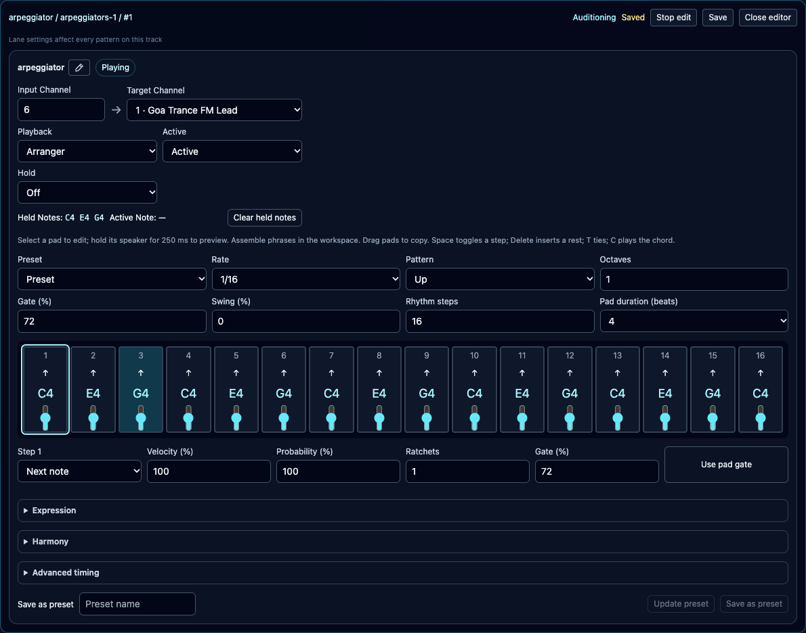

**Loop** repeats the selected clip’s time window across all tracks. With no clip selected, it repeats the whole song from the start through **Song end**, including trailing silence. Click empty timeline space or the ruler outside a clip to deselect it; clicking a clip selects it again. The button and ruler range turn amber when enabled; click again to turn it off. This is separate from **Loop** in the clip inspector, which repeats its content only within the fixed clip window. The playhead and Position field follow song position through loops and remain stationary during standalone audition. Newly created clips are selected automatically.

Loading selects a clip even when looping is off: a matching saved loop takes priority, then a clip at the cursor, then the earliest clip. Tracks stay compact and the editor stays closed. Explicitly clearing the selection stays cleared through Play, Stop and Rewind. You can toggle the loop without reopening its editor. See the [restored loop selection](../../screenshots/clip-arranger-restored-loop.png).

**Position** accepts a seek destination in master beats. While you edit it, playback continues without replacing your text or moving focus. Press Enter or leave the field to seek once; Escape cancels and resumes displaying the current song position. Empty or negative values are discarded. Loading or importing a performance clears an unfinished position edit.

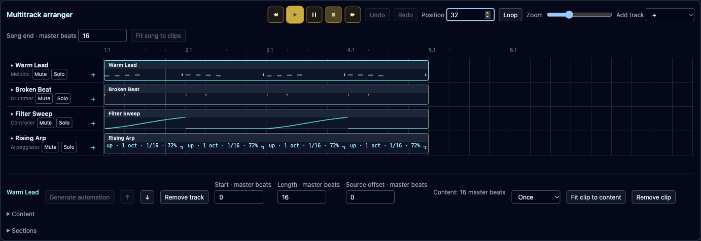

**Song end** shows the actual playback boundary in master beats, marked by a dashed amber line. Moving or shortening clips retains trailing silence. To stop at the last clip instead, press **Fit song to clips**, or enter a Song end at or beyond the final clip. This is an undoable arrangement edit, saved with the performance; it does not cut off clips. Position and Song end use master beats, while the ruler uses bar/beat labels.

Move **Zoom** all the way left, or focus the slider and press **Home**, to see the entire song through **Song end**, including trailing silence. The overview adjusts when the song length or timeline width changes. Zoom back in for beat markers and detailed clip editing.

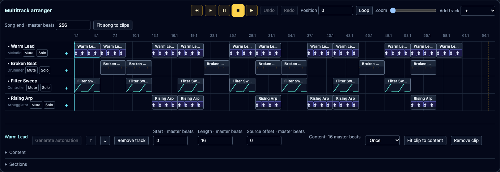

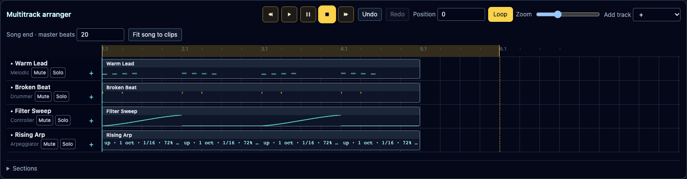

The actual piano keyboard and configurable MIDI controller rows sit below the arranger/editor, each full width. They retain Start/Stop, routing, channel/OMNI, scale/autochord, velocity and CC controls. Their existing Auto/Live/Listening buffer policy still applies. An enabled device does not force low-latency buffering indefinitely. Arpeggiator Arranger/Live clock settings remain separate from clip placement.

Transport buttons wrap onto another row when the viewport or enlarged text leaves too little space. Track headers reserve less than half the viewport, leaving the timeline reachable at enlarged text sizes. Transposition controls wrap inside their dialog. The timeline keeps its own horizontal scrolling.

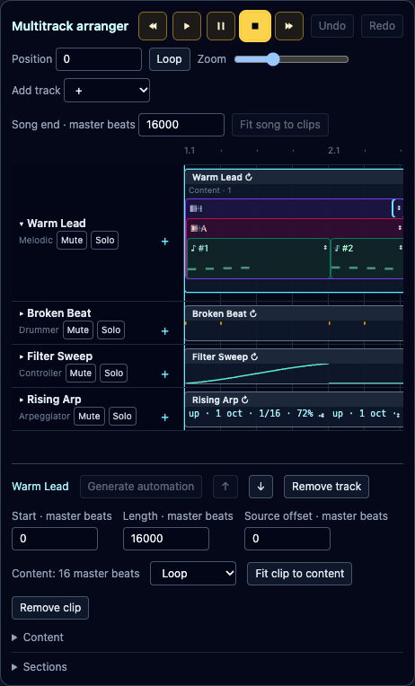

## Preview limits and release verification

The rollout gate remains off by default until the implementation acceptance matrix is complete. Do not treat the development preview as a promise of lossless downgrade to an older app. Keep the downloaded original and existing saved performances when evaluating migration. Long/dense visual workloads and the full hardware-input/transport stress matrix require final release review. Group audition uses exact clip timing, including fractional-beat rests and more than 256 resolved items, in every supported clip format. Temporary audition capacity is separate from the saved definition limit, so a full lane can still audition an edited pattern. Saved definitions and the saved format remain unchanged. Legacy CLI pad-edit commands reject clip performances; CLI round trips, runtime compilation and exports support the new format. See the implementation record under `specifications/redesign-arranger/` for the current evidence and remaining gates.

## Assemble content directly on the timeline

Expand a track and click a content header to select it. Shift-click another header to select the inclusive chronological range. Shift+Left/Right extends or contracts the range, including across loop repetitions and beyond the visible area. **Group** combines consecutive patterns/rests; **Supergroup** combines consecutive groups. Enter a name in the selection toolbar before grouping. Right-click provides the same grouping actions. Double-click opens the musical/container editor.

**Content · 1, Content · 2, …** label loop repetitions. For four repetitions `A A A A`, click the pattern in Content 2, Shift-click the pattern in Content 3, choose **Group**, then **Save structure**. The result is one clip containing `A [A A] A`. The outer clip keeps its name, start and length; the selected occurrences become a group. Its patterns remain linked to their original definitions.

Grouping across repetitions converts the clip to **Once** with explicit ordered content. Complete source content from cropped first/last repetitions is retained, including hidden notes and rests. Timing, neighboring clips and Song end stay unchanged. Repetition-specific transposition remains attached to the original occurrences, including after later edits to shared profiles. This save applies only to this clip; it does not offer an all-clips scope. The conversion and grouping form one draft Undo action and one saved arranger Undo action. Undo restores the compact loop.

Cross-repetition selection applies to content directly inside one clip. Nested selection stays within one container occurrence; selection cannot cross clips or tracks. Command/Control and Option/Alt are not range-selection shortcuts. While a selection spans repetitions, dragging, reordering, removing and ungrouping are disabled. Group it first to obtain ordinary editable content. Existing hierarchy limits still apply. Save/Discard/Cancel resolves an existing structural draft before crossing repetitions; if saving changes the selected occurrences, select the range again. Capacity rejection preserves the selection and existing drafts.

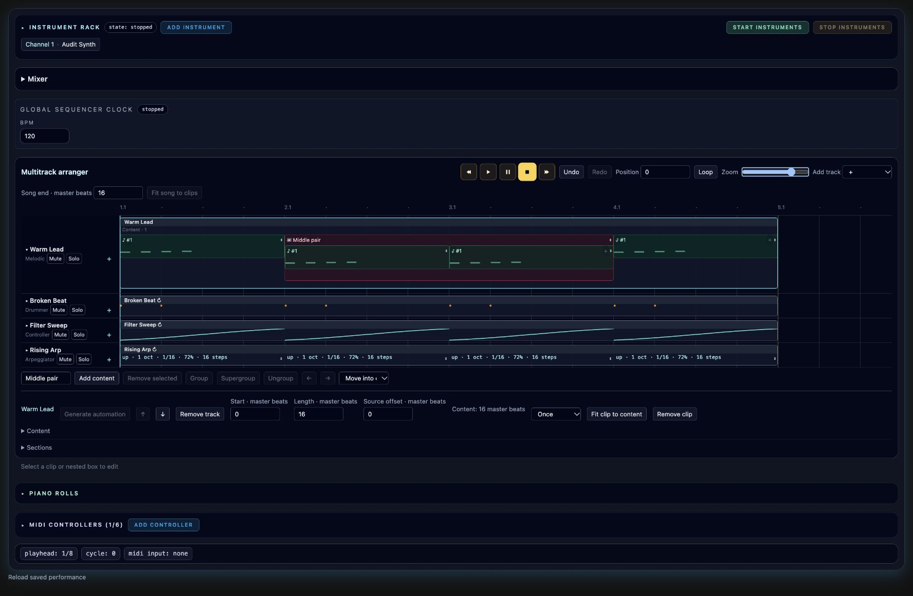

Use **Add content** or the **+** insertion markers before, between or after boxes to search the track's existing definitions. **Adopt linked** retains sharing; **Create variation** gives the inserted definition its own identity. The picker also offers **New pattern** and explicit rests. Unused saved definitions remain available. Double-click an empty area or rest inside a clip to open the same picker at the clicked position, snapped to a quarter master beat. Inside a group or supergroup, the insertion belongs to that container. Existing content stays in place; an insertion that overlaps it is rejected. Content headers still open their editors on double-click, and automation curves retain their point-editing gestures.

Expanded tracks keep the cyan **+** insertion buttons fully visible with 21 × 15 px targets. Collapsed tracks use smaller 14 × 10 px transposition buttons. Content names, indigo **↕** transposition buttons and the final **+** each have their own space in the header. The content boxes retain their dimensions and timing positions.

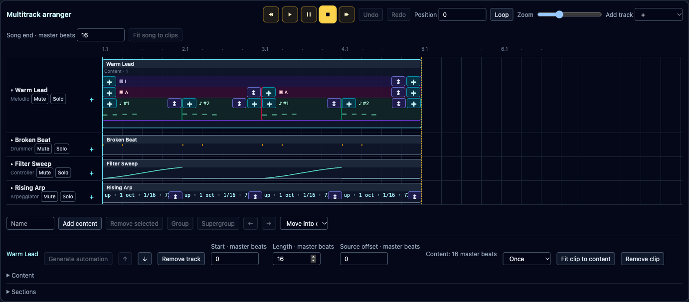

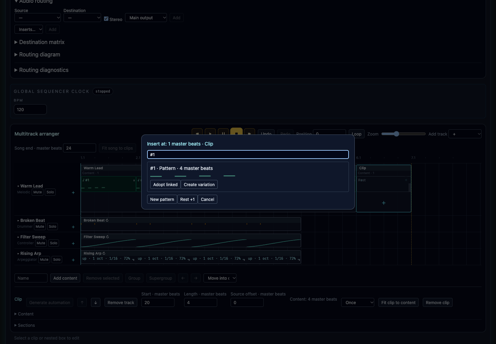

Right-click a pattern, group or supergroup and choose **Duplicate** to append a linked occurrence at the clip root, immediately after its last musical item. Consecutive sibling selections retain their order and internal rests. Trailing silence is used first; unused silence remains. The clip grows only when needed, and neighboring clips stay in place. **Ungroup** appears only when all selected items are groups or supergroups. Rest-only and cross-repetition selections cannot be duplicated.

For a looped clip, Duplicate appends **once after the final repetition**, converting the original repetitions to explicit content in one Once clip. Complete cropped source content is retained; the duplicate follows the full retained final item. Existing repetition-specific transposition and definition links are preserved. This structural save affects only the selected clip, and one Undo restores the loop. Resolve any pending structure before duplicating a loop, then reselect the content if prompted. Capacity rejection retains the selection; a collision leaves the draft available for correction.

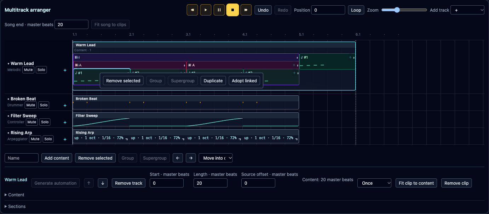

Drag a box or contiguous selection to a quarter-beat position. Moves within a clip/pass leave rests at the source and consume silence at the destination; other content stays in place. Overlapping drops are rejected. Between clips on the same track, dragging copies linked content. Between tracks of the same device type, it copies independent definitions using destination timing. Drum keys must have unambiguous destination rows; controller modes must match. Compact clips accept root drops, and hovering expands the destination track. The destination text shows the position. Self-nesting and moves across loop passes are rejected. Left/Right on a focused content header nudges it by a quarter beat. The toolbar move arrows and **Move into container** retain their explicit reorder behavior. Escape or cancelling a pointer gesture leaves the structure unchanged.

Use **Remove selected**, the matching context-menu action, or Delete/Backspace while a box is focused to remove patterns, rests or containers. The same actions work inside groups and supergroups. Removing content closes its position within the container but does not shrink the clip window; unused pattern definitions remain available. Empty containers disappear. Removing an entire clip’s content leaves a timeline gap; removing one loop pass locally preserves its other passes. Save structure still asks which occurrences to change.

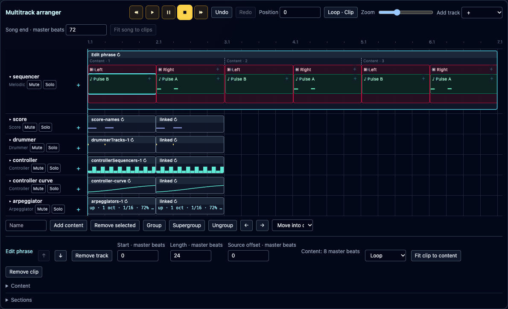

Structural work is a session-only draft: the song continues to play saved content. **Save structure** applies the local/all-linked scope atomically; **Discard** abandons it. Draft Undo/Redo is separate from the arranger's saved history. Performance save/export offers the existing saved definitions when unresolved drafts remain; loading another performance requires resolving them.

Longer content grows the affected windows if space permits. Loop windows preserve their full and partial repetition span. Saving all linked occurrences evaluates every affected clip together. A collision rejects the complete save, retains the draft and names the blocking clips; later independent clips are never shifted. Shortening content does not automatically shrink clips. Valid growth extends Song end when necessary.

## Container inspector and musical draft conflicts

Double-click a group or supergroup to open its child inspector. Adopt linked content, add a new pattern or rest, reorder, group, ungroup, rename or remove children there. These controls edit the **same structural draft** as the expanded timeline. **Save structure** shows the same affected definitions, clip boundaries and local/all-linked choices, including collision rejection and empty-container removal. Draft Undo/Redo and Discard apply to both surfaces.

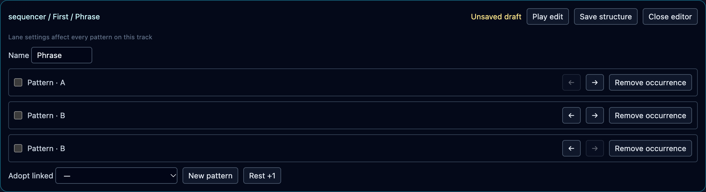

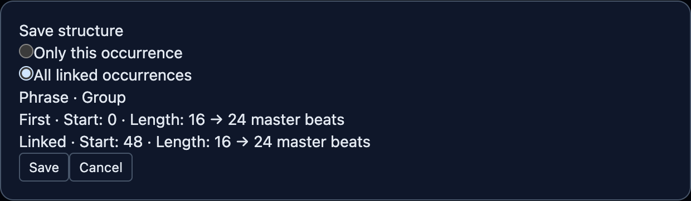

If the pending action intersects an unsaved musical draft, choose Save, Discard or Cancel. Save opens that pattern’s existing occurrence-scope dialog, then resumes the pending edit. Discard removes only the conflicting draft and resumes; Cancel keeps both drafts and leaves the arrangement unchanged. Other musical drafts remain available. If several drafts conflict, resolve them individually. A failed musical save keeps the draft and displays its error inside the dialog.

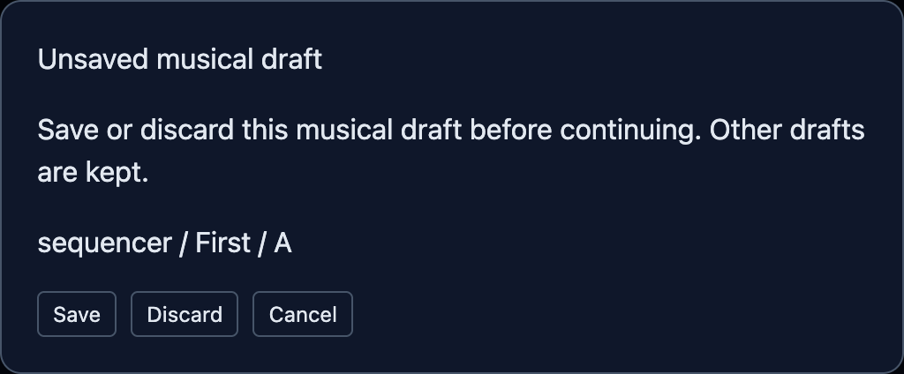

When a musical save forks shared parents or splits a loop pass, the pending structural edit follows the new occurrence paths and retains draft Undo/Redo. Following passes created from that same source during resolution still move when its edited portion grows. Independent clips stay in place. If the conflict was found while saving structure, review the refreshed impact preview and press Save again to commit the structural transaction.

Container **Play edit** auditions a snapshot of the current structure. Further structural edits remain visual and do not re-prepare audio; stop and restart Play edit to hear the changed structure. Saving ends the editor audition through the existing lifecycle. Musical sequencer controls retain their existing live-edit behavior.

See the [direct-content review](../../specifications/redesign-arranger/direct-content-review.md) for the implementation and verification record.

## Transpose clips without changing notes

Click the transposition badge on a pattern, group or supergroup in the expanded arranger lane. This opens **Transpose in arranger** for that occurrence without opening or replacing the musical editor. Compact lanes also offer badges on their pattern previews; expand the lane to edit a group or supergroup directly. The existing **Transpose** controls in the detail editor remain available.

Transposition buttons always show a larger **↕** symbol with an indigo outline and background. Active buttons also show the effective signed offset when space permits: **D** means diatonic steps and **C** means chromatic semitones. Enclosing offsets are included, so each pattern shows its complete total. Hover or focus a button to identify the occurrence and its effective offset. Narrow active buttons retain their brighter indigo highlight. Click any button to add or change a transposition, including on a generated repetition.

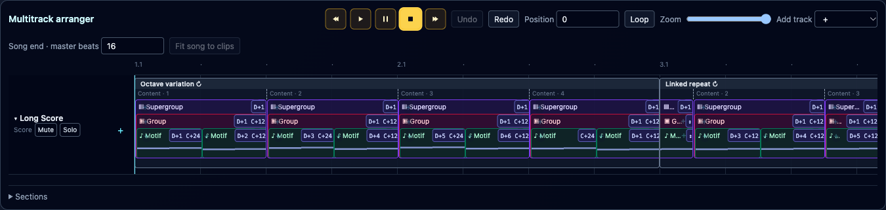

Choose **Diatonic steps** to move through each pattern’s configured scale and mode, or **Semitones** for chromatic movement. Negative values move down. Switching the displayed component preserves the other value. All pattern, group and supergroup contributions add; diatonic steps apply first, then semitones. Notes outside MIDI 0–127 after the complete transform are silent. The musical editor continues to show the original notes; timeline Note maps show the sounding pitches.

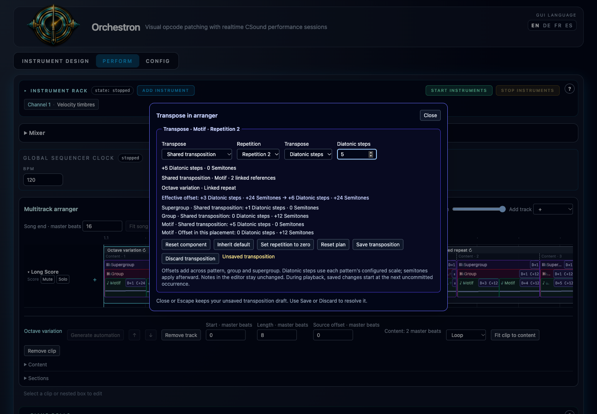

Choose the owner before changing a value:

- **Shared transposition** changes the selected definition everywhere it is used, including other clips. Its repetition settings are shared too.
- **Offset in parent** belongs to this reference inside its parent. Reusing that parent also reuses this offset.
- **Offset in this placement** belongs only to this nested location in this clip. It adds to the shared and parent settings and does not create a new pattern or split the clip.

The contribution list shows the selected item and its enclosing offsets. The inspector lists affected linked clips, compares saved and draft totals, and reports selected-pattern notes that fall outside the MIDI range. Each leaf pattern uses its own scale and mode, including when a group contains patterns with different scales.

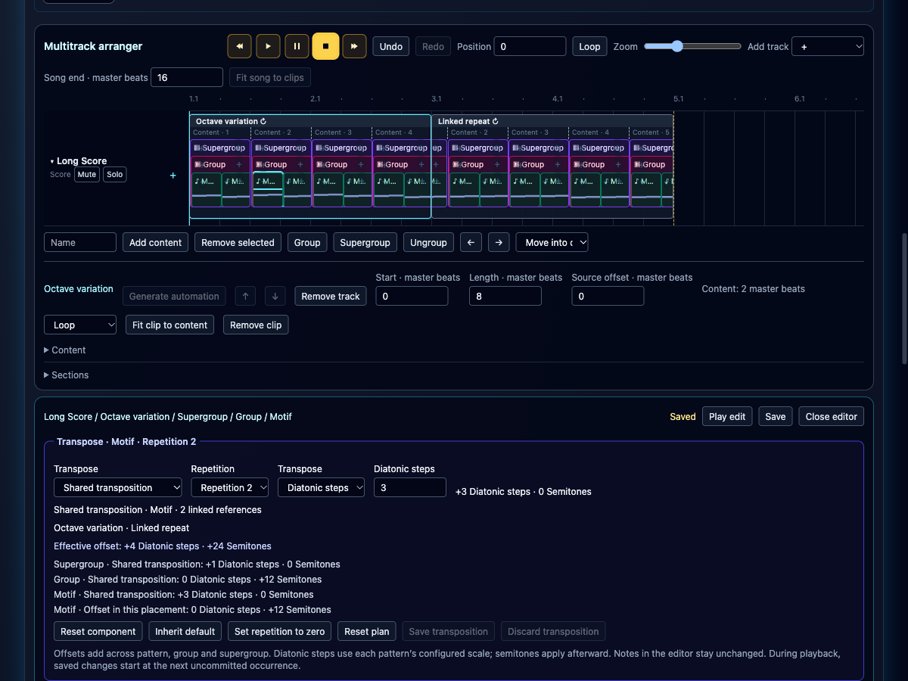

Choose **Default** for the plan’s base value, or select a generated repetition in the timeline and edit that **Repetition**. Repetition numbers follow the source content: a cropped clip can begin partway through repetition 2. They do not count how often transport has played. Descendants normally inherit their enclosing reference’s repetition number. Grouping across repetitions retains each child’s original number: a new group uses the first selected occurrence’s number, while its children can retain different numbers. Each enclosing offset is evaluated at its own reference’s number.

An explicit repetition replaces its own plan’s default; other plans still add. **Set repetition to zero** stores an explicit zero pair. **Inherit default** removes that repetition entry. **Reset component** clears only the displayed component; **Reset plan** clears the default and every repetition entry. Shortening a clip keeps hidden repetition settings for later extension.

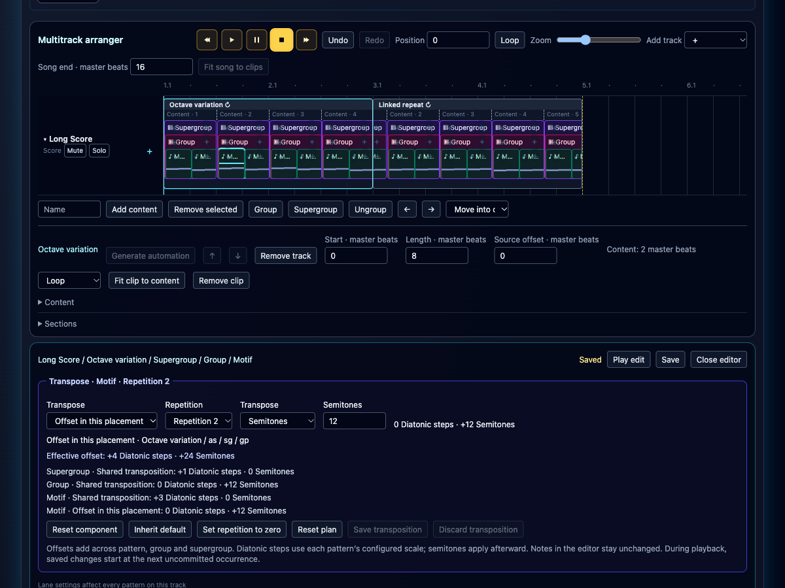

**Save transposition** commits the draft as one undoable edit. **Discard transposition** leaves saved music unchanged. The pattern editor’s **Save** can commit musical and transpose changes together. Shared transposition retains its explicitly selected scope even when musical notes are saved as a local variation; that new variation receives its own copied profile. Conflicting edits report an error instead of overwriting another change.

Saving from the lane closes the dialog and updates affected badges and note previews, including linked clips. **Close**, **Escape**, or clicking the backdrop keeps the unsaved draft; its badge turns amber and gains an asterisk. Reopen it to **Save transposition** or **Discard transposition**. Badge totals continue to show saved settings until Save. Keyboard users can focus a badge and press **Enter** or **Space**; closing the dialog returns focus to that badge. Existing musical drafts are preserved.

**Play edit** auditions the full selected definition from its own start, using the selected repetition and all enclosing offsets. It retains each reference’s repetition number while auditioning; a group assembled across repetitions therefore preserves its children’s distinct transpositions. Transposition and structural drafts are snapshots for audition. Saving during arrangement playback changes the next occurrence whose notes have not started; an early attack can already belong to the next repetition. A pending indicator names the target clip, repetition and leaf position. Seek or restart uses the latest saved settings immediately.

Melodic, Score and Arpeggiator lanes support these controls. For arpeggiators, the new mapping follows their existing transpose and quantizer, and uses the pattern’s configured scale. Bypass remains unchanged. Drummer, controller and instrument-automation lanes do not offer pitch transposition.

Transposition performances require a version-25-capable reader (app-state version 7, clip model version 3). Native bundles, CLI runtime projection and MIDI/SCORE CSD exports preserve the saved settings. Unsaved transpose drafts and temporary audition state are not exported. Older identity-only clip performances retain their existing format until transposition is saved.

<!-- pagebreak -->

## Resize patterns on the track

In an expanded track, drag the lower left or right border of a pattern. The box follows your drag, and **Length** shows the new total duration in master beats. The opposite edge stays fixed; length follows the pattern editor’s supported beat increments. Notes remain relative to the pattern start, and shortening retains hidden notes. Growing consumes adjacent silence; shortening inserts rests. Occupied time cannot be overwritten. Focus a pattern border and use Left/Right for keyboard resizing. Escape cancels a gesture. Clip borders continue to trim the outer playback window.

A trailing rest has a visible right-edge handle. Drag it or focus it and press Left/Right to change its duration in quarter-master-beat steps. The handle stays reachable at the visible clip edge when the rest extends beyond it; the next resize starts there. Shortening a nested trailing rest also shortens its enclosing containers when they end there. Other content keeps its position. A rest can be shortened to zero when other content remains; an otherwise empty clip keeps a positive duration.

Trimming a clip changes only its playback window and preserves hidden patterns, notes and rests. To remove a silent tail from the content, shorten or delete the trailing rest and **Save structure**. Then use **Fit clip to content** to shorten the outer window too. Moving or trimming a clip keeps any pending structural edits and their Undo/Redo history. A genuine change to the underlying content still requires resolving the draft. For repeated clips, use **Only this occurrence** when changing the rest duration would move later repetitions.

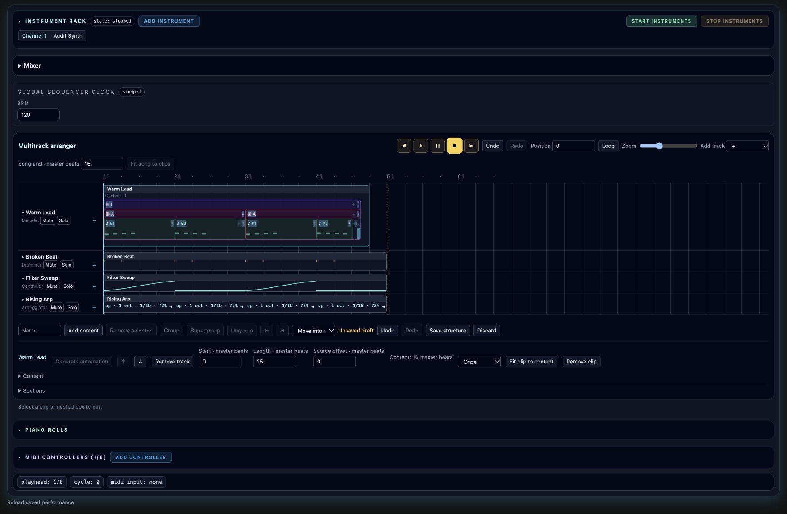

Placement, copying and pattern resizing share the structural draft and Save/Discard workflow. Save defaults to Only this occurrence. All linked occurrences validates every affected use; collisions retain the draft. New empty clips commit immediately and support arranger Undo.

A reserved strip below the last track keeps the horizontal scrollbar clear of collapsed clips.

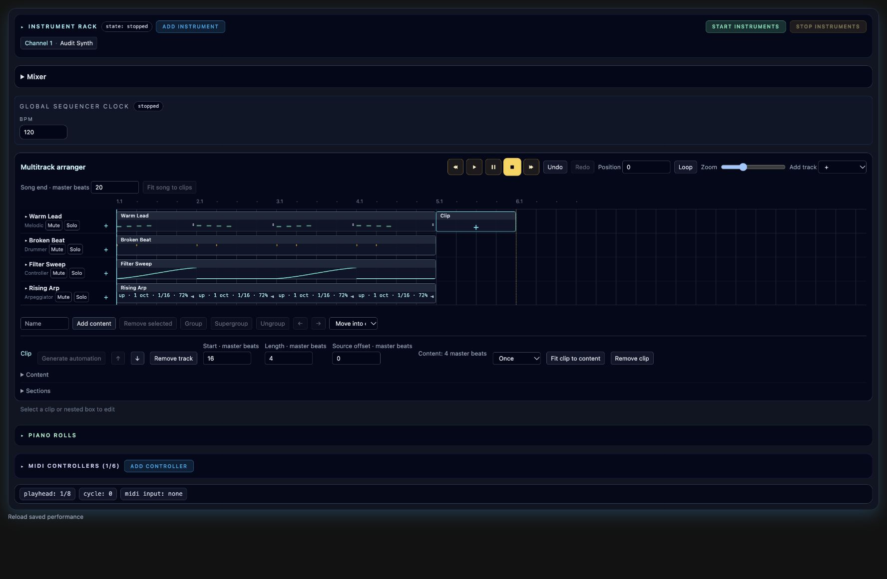

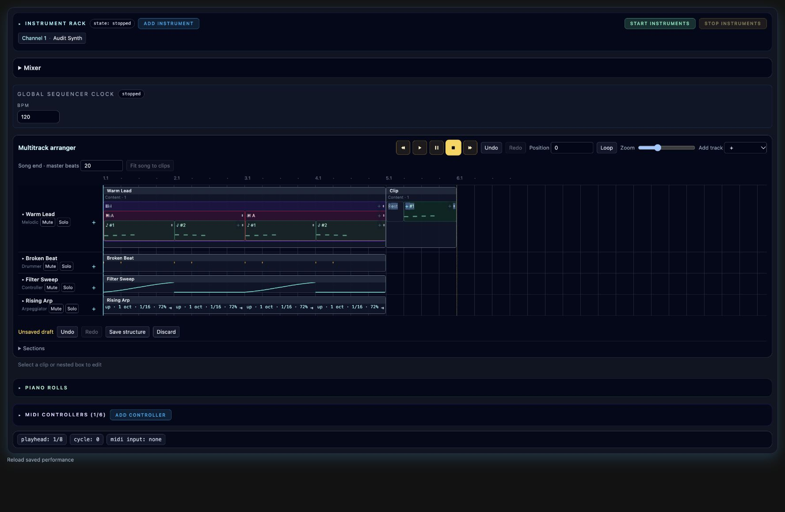

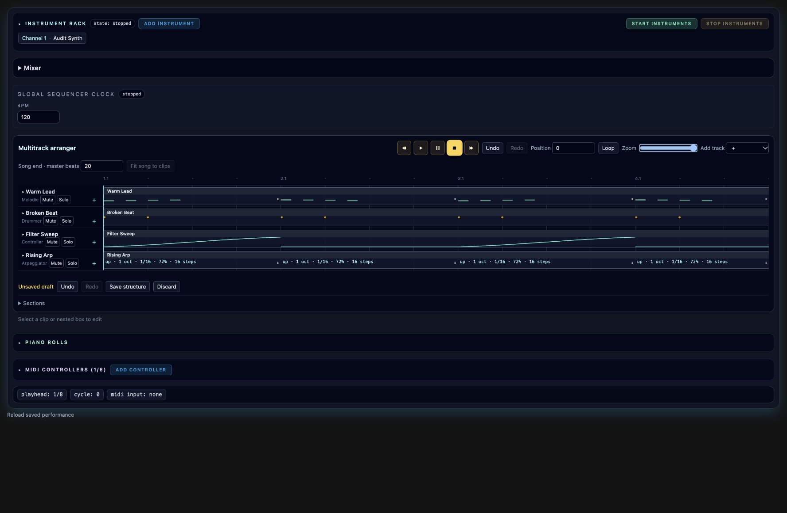
