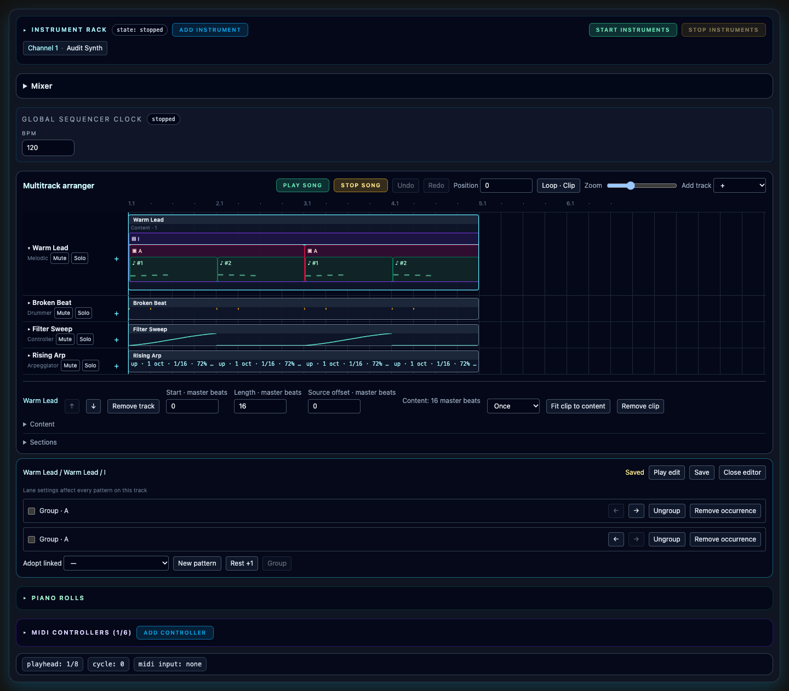
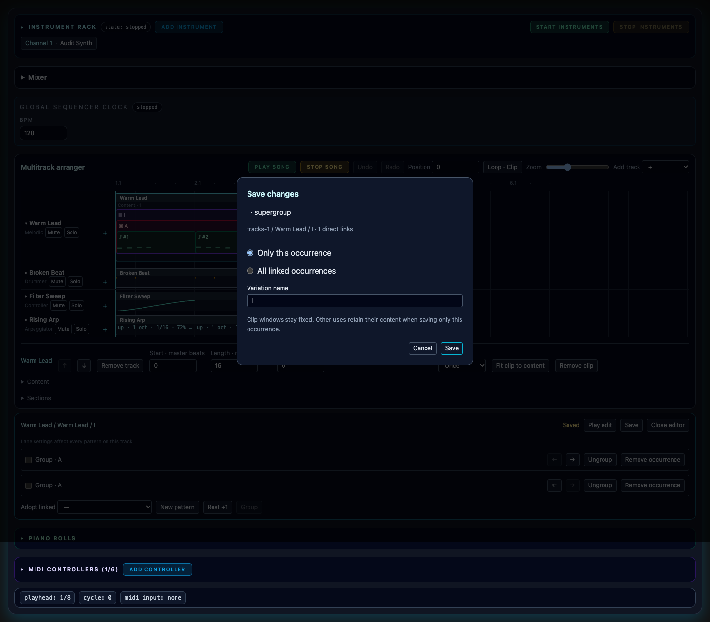
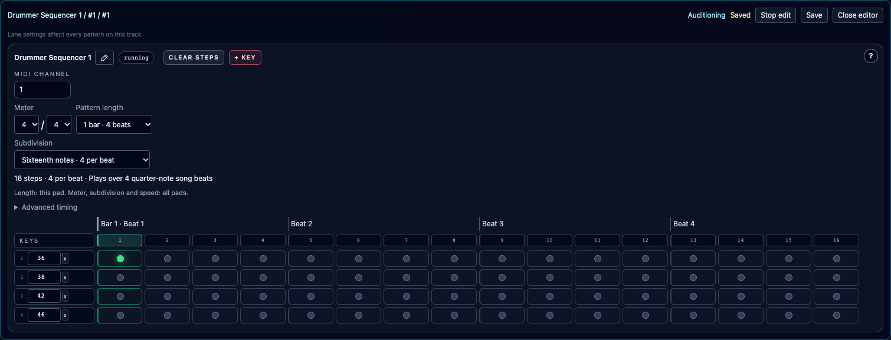
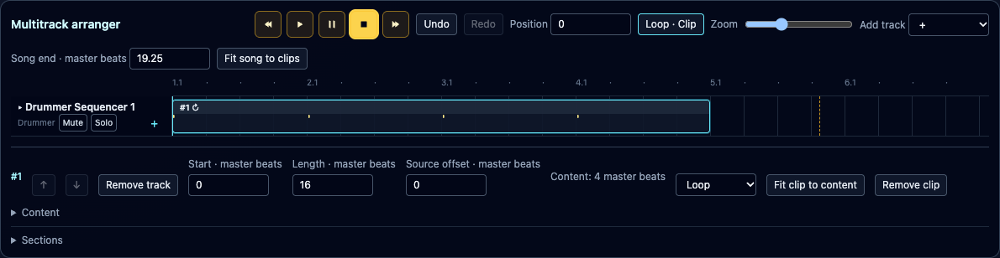
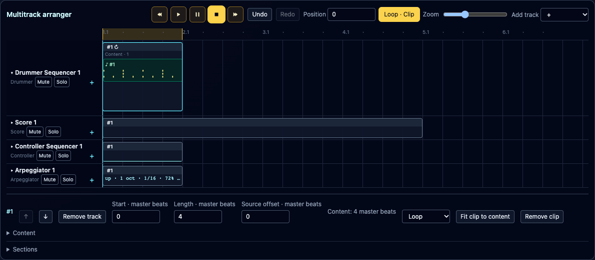
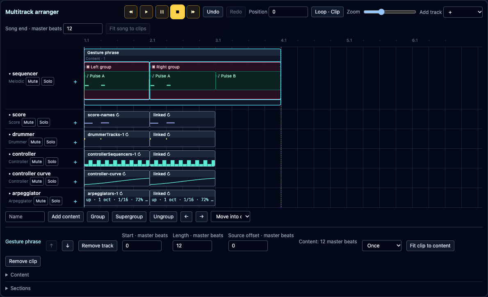

# Clip arranger preview

The clip arranger is a development preview. It introduces fixed clip windows and reusable patterns, groups and supergroups while keeping the existing musical editors. The compatibility arranger remains available; the preview is not yet the default rollout.

For a development build, start the frontend with `VITE_CLIP_ARRANGER=1 npm --prefix frontend run dev`. **New** creates an empty clip arrangement and one fixed piano keyboard. **Add track** chooses Melodic, Score, Drummer, Controller or Arpeggiator and creates its first pattern. Assign the instrument through the existing rack and MIDI-channel controls.

For an existing compatible performance, **Multitrack arranger · Preview** downloads its original configuration before converting. Keep that file: import it to recover the original workflow. Existing Manual pads, Live arpeggiators and multiple-keyboard performances remain in the compatibility view; conversion reports the reason instead of changing their playback behavior. A new-format performance requires a version-23-capable reader. Disabling the preview flag does not downgrade saved data.

## Arrange fixed windows

Unselected tracks stay compact. Click a track header to expand its clips into nested pattern, group and supergroup boxes. Drag a clip header to move it, or its borders to trim it; the inspector also accepts numeric start, length and source offset in master beats. Double-click empty lane space to add content at that position, or use its **+** button to append. The add dialog also accepts an exact start. Moves and deletion leave other clips in place. Overlap on the same lane is rejected.

The clip window and content duration are independent. **Once** plays the content from its source offset and leaves silence after its end. **Loop** repeats content within the window. Trimming preserves the original notes and content; **Fit clip to content** explicitly changes the window. A local edit of one generated repeat splits its original window into before, edited and after parts.

Open **Content** for the selected clip to adopt existing definitions, create a new pattern, add a rest, reorder children, or select adjacent children for Group/Supergroup. Grouping retains reusable definitions. Ungroup opens one level. Removing an occurrence retains its definition. Groups and supergroups have their own contextual child editor.

**Sections** copies a range of all tracks or the selected track. Paste and overwrite, paste and insert, insert time and close time show a preview before applying one undoable transaction. A repeating legacy lane must first be converted to song clips; this materializes its repeats across the current song duration. Ordinary clip edits do not silently change that independent cycle. Track-order arrows change the visible lane order. Removing a track removes its source and drafts; source creation/removal clears clip history because source topology is outside clip-only undo.

Undo/Redo retains up to 25 clip edits through performance save/load, autosave recovery and native bundles. Earlier preview histories are converted automatically while preserving their undo/redo position. History stores changes compactly so ordinary edits do not repeatedly duplicate every pattern in the saved performance.

## Edit the current musical controls

Double-click a nested box, or focus its name and press Enter, to open the existing sequencer or arpeggiator in context. Its separate pattern workspace and old pad-source controls are replaced by the clip breadcrumb, draft status, Play edit and Save. Musical controls remain the production controls: notes/chords/holds/strums, sparse score notes, drum velocities/ratchets, both controller datasets, and arpeggiator parameters/presets. Lane-wide timing, routing and instrument settings affect the whole track.

Melodic and Score clips use compact Note maps. Drums use step dots with a fixed velocity gradient. Arpeggiators show parameters, because their pitches depend on incoming chords. Controller Step Mode uses bars; Curve Mode uses the real interpolation. Selecting a curve pattern also opens the production curve editor inside its expanded lane, sharing the same draft as the full editor. Drag, click and double-click retain their usual behavior; the point list offers numeric position and value editing, including independent endpoint values.

**Save** always asks whether to update **Only this occurrence** or **All linked occurrences**. Local is the default. A local variation gets a new definition; shared ancestors are copied only where necessary. Clip boundaries remain fixed after a content-duration change. Cancel retains the draft. Conflicting revisions or invalid content leave the saved arrangement untouched.

Performance save and native/CSD export use saved definitions. If drafts changed, return to resolve their individual scopes or explicitly use the saved definitions. Autosave does not commit drafts. New/Load/Import prompts before discarding changed drafts. Drafts survive ordinary view switches; they are not reload recovery data.

## Play and jam

**Play** (triangle) and **Play edit** start instruments when needed. The tape controls provide rewind/forward by one beat, Play/resume, Pause, and Stop. Pause holds the song cursor; Stop returns to the selected loop start or song start. With the song stopped, Play edit auditions its target. With the song playing, the editor audition temporarily replaces its source lane while other lanes continue. Song start/stop/seek preserves the editor audition; Stop edit returns to the arrangement's current position or silence when the song is stopped. Audition state appears in the compact lane header. The open editor follows the audible pattern position with its existing step highlights, score playhead, controller cursor or arpeggiator status; standalone audition leaves the song cursor still. Closing the editor or leaving Perform ends the audition and retains its draft.

Arpeggiator **Play edit** waits for incoming notes or a chord on its input channel. Once notes arrive, its existing rhythm-step highlight and generated-note previews follow the audition. The source’s saved enable switch does not need to be on. Both save scopes preserve playback and its indicators when the saved performance is reloaded.

**Loop · Clip** repeats the selected clip’s time window across all tracks. The button and ruler range turn amber when enabled; click again to turn it off. This is separate from **Loop** in the clip inspector, which repeats its content only within the fixed clip window. The playhead and Position field follow song position through loops and remain stationary during standalone audition. Newly created clips are selected automatically.

Loading selects a clip even when looping is off: a matching saved loop takes priority, then a clip at the cursor, then the earliest clip. Tracks stay compact and the editor stays closed. You can toggle the loop without reopening its editor, including after Play, Stop and Rewind. See the [restored loop selection](../../screenshots/clip-arranger-restored-loop.png).

**Song end** shows the actual playback boundary in master beats, marked by a dashed amber line. Moving or shortening clips retains trailing silence. To stop at the last clip instead, press **Fit song to clips**, or enter a Song end at or beyond the final clip. This is an undoable arrangement edit, saved with the performance; it does not cut off clips. Position and Song end use master beats, while the ruler uses bar/beat labels.

The actual piano keyboard and configurable MIDI controller rows sit below the arranger/editor, each full width. They retain Start/Stop, routing, channel/OMNI, scale/autochord, velocity and CC controls. Their existing Auto/Live/Listening buffer policy still applies. An enabled device does not force low-latency buffering indefinitely. Arpeggiator Arranger/Live clock settings remain separate from clip placement.

## Preview limits and release verification

The rollout gate remains off by default until the implementation acceptance matrix is complete. Do not treat the development preview as a promise of lossless downgrade to an older app. Keep the downloaded original and existing saved performances when evaluating migration. Long/dense visual workloads and the full hardware-input/transport stress matrix require final release review. Group audition currently uses the bounded legacy audition sequence: rests must fit whole local beats, and at most 256 tokens can be auditioned. Arrangement playback itself supports exact tick rests. Legacy CLI pad-edit commands reject clip performances; CLI round trips, runtime compilation and exports support the new format. See the implementation record under `specifications/redesign-arranger/` for the current evidence and remaining gates.

## Assemble content directly on the timeline

Expand a track and click a nested box to select it. Shift-click another sibling to select the inclusive range; Shift+Arrow extends that range with the keyboard. **Group** combines consecutive patterns/rests; **Supergroup** combines consecutive groups. Enter a name in the selection toolbar before grouping. Right-click a box for the same grouping actions. Double-click continues to open the existing musical/container editor.

Use **Add content** or the **+** insertion markers before, between or after boxes to search the track's existing definitions. **Adopt linked** retains sharing; **Create variation** gives the inserted definition its own identity. The picker also offers **New pattern** and explicit rests. Unused saved definitions remain available.

Drag a box or contiguous selection to an insertion boundary. The cyan target and destination text show where it will go. Compatible containers within the same clip/pass accept moves; overlapping, cross-track, cross-clip and self-nesting moves are rejected. Move arrows and **Move into container** provide keyboard alternatives. Escape or cancelling a pointer gesture leaves the structure unchanged.

Structural work is a session-only draft: the song continues to play saved content. **Save structure** applies the local/all-linked scope atomically; **Discard** abandons it. Draft Undo/Redo is separate from the arranger's saved history. Performance save/export offers the existing saved definitions when unresolved drafts remain; loading another performance requires resolving them.

Longer content grows the affected windows if space permits. Loop windows preserve their full and partial repetition span. Saving all linked occurrences evaluates every affected clip together. A collision rejects the complete save, retains the draft and names the blocking clips; later independent clips are never shifted. Shortening content does not automatically shrink clips. Valid growth extends Song end when necessary.

