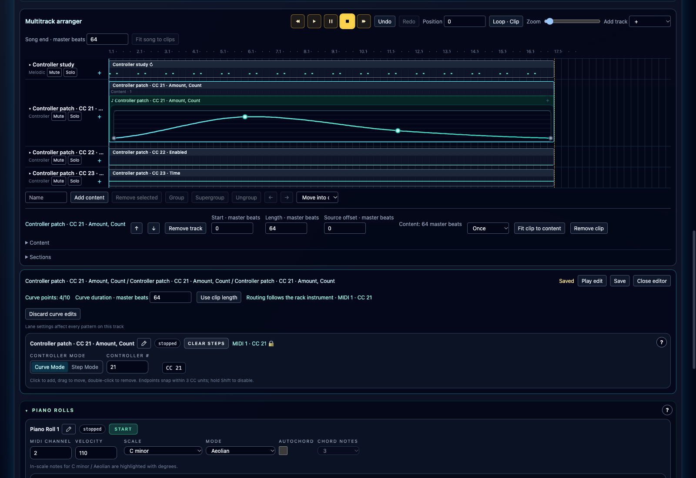

# Controller Sequencers

**Navigation:** [Up](performance.md) | [Previous](arpeggiators.md) | [Next](instrument_automation.md)

Controller Sequencers automate MIDI CC values using editable curves or discrete steps.

Use the pen beside the device name to rename it. See [Device Names](performance.md#device-names) for editing controls, validation, and import/export behavior.

See [Sequencer timing](sequencer_timing.md) for triplets, beat grouping and editing behavior.

## Open and close the editor

Double-click a pattern in the arranger to open its editor. **Close editor** returns to the timeline and retains its draft. Closing the editor ends **Play edit** auditioning; the song's transport remains independent.

## What A Controller Sequencer Does

A controller sequencer sends timed MIDI Control Change messages on its selected channels. **Curve Mode** (the default) samples an editable curve. **Step Mode** sends an integer at each populated grid cell. The mode applies to every pattern on the track; switching modes preserves both datasets.

Typical uses:

- filter sweeps
- morph controls
- modulation depth animation
- macro movement synchronized to transport

## Adding / Removing Controller Sequencers

Choose **Add track → Controller** in the arranger, then add a clip and a pattern. Select a clip on the track to access **Remove track**. A performance can contain up to 16 controller sequencers.

## Per-Controller-Sequencer Controls

Each controller sequencer provides:

- Running/stopped state badge
- `Controller #` (`0..127`)
- **MIDI Channels** checkboxes, 1–16 in one row beside `Clear Steps`
- `Meter` (`2..7` over `4` or `8`)
- `Subdivision` (1, 2, 3, 4, 6 or 8 steps per local meter beat)
- `Advanced timing → Playback speed` (`1:1`, `2:1`, `3:2`, `4:3`, `3:4`, `5:4`, `4:5`, `7:4`)
- `Pattern length` (every integer from 1–32 local beats, subject to 128 steps)
- CC label preview (`CC N`)
- **Curve Mode / Step Mode** toggle
- Curve editor or step grid
- **Reset Value** (`0..127`, default `0`) in Step Mode

### MIDI Channels

Check the channels that receive the sequencer's CC messages. All 16 are checked by default (OMNI); at least one must remain checked. The row scrolls horizontally on narrow screens. This is a track setting shared by all its patterns.

Channel edits use the same 80 ms live-edit synchronization as curve edits and take effect at the next engine block without restarting transport. In Curve Mode, the current curve value is sent to the new selection; removed channels retain their last received value. In Step Mode, departing CC/channel pairs receive Reset Value, newly targeted pairs receive Reset Value, and continuing pairs hold their state until the next populated step.

Selections survive Save/Load Performance, browser reload, native JSON/ZIP export/import, and both CSD export modes. Older performances without the setting load with all 16 channels checked.

### Pattern Length (1–32 local beats)

This defines the pattern repeat length relative to the controller sequencer's own timing. Step Mode shows `length × subdivision` cells, up to 128; shortening hides trailing cells without deleting them. Keypoints stay normalized across the full pad duration, so the same curve shape stretches automatically when you choose a longer beat length.

`Advanced timing → Playback speed` changes how quickly the controller sequencer moves through that curve relative to the shared transport. Faster ratios create repeating automation polyrhythms without changing the stored keypoint positions.

## Instrument-bound automation

In the clip arranger, **Generate automation** creates controller lanes from the instrument rack’s CC assignments. These lanes lock routing to the rack instance and support song-length curves with at most ten points. Curve duration uses master beats independently of the retained Step Mode grid. See [Instrument automation clips](instrument_automation.md) for inline editing, Save/Discard and mapping changes.

## Edit patterns in the arranger

Double-click a pattern inside an expanded clip to open this editor. The breadcrumb identifies the occurrence being edited. **Play edit** auditions its draft; during song playback, other tracks continue. **Save** lets you update **Only this occurrence** or **All linked occurrences**. Cancel keeps the draft.

Assemble patterns, groups, supergroups and rests directly inside clips. See [Patterns and Reusable Phrases](pattern_pads_and_pad_looper.md) for linked content, variations and structural editing.

## Step Editor and Reset Value

Enter a whole number from **0 to 127** in a cell. Press Enter or leave the cell to apply; Escape cancels. Delete the text to leave a cell empty. Empty cells send nothing and the receiver holds its previous value. Zero sends a real CC message, and repeated identical values each send again at their own step. Beat/bar groups and the highlighted playing step follow the device's own meter, subdivision and playback speed.

Live playback and CSD (MIDI) retain those repeated messages. CSD (SCORE) can omit writes that leave the receiving channel/CC unchanged, preserving playback and all authored step data. Startup writes remain; exports with note-triggered `initc7` patches retain repeats. See [offline export](performance_import_export.md#offline-render-export-export-csd-midi--export-csd-score).

**Reset Value** is sent for the chosen CC on the selected channels on start and stop, including finite endings. It is sent before the first step and notes at the start position. Starting in an empty part of the pattern waits for the next populated step. Choose a value appropriate to the controlled parameter: zero is the default, not a universal neutral setting for every CC.

A seek during playback sends Reset Value, then continues from the new position without replaying earlier cells. A stopped seek sends nothing. Pattern changes, loops and arrangement rests hold the last received value without resetting. **Play edit** initializes the controller on entry and resets it when restoring playback.

Entering Step Mode while running initializes Reset Value. Leaving it resets the old step output before the curve takes over. Editing Reset Value takes effect on the next reset. Reset messages obey lane mute/solo, and only address the selected CC/channel pairs; no automatic “Reset All Controllers” message is sent. Sources sharing a CC/channel still use last-message-wins behavior.

See [Granular Capture](../instrument_design/granular_capture.md) for a complete four-lane stutter, freeze, capture and granular step pattern.

## Curve Editor Interactions

The curve editor is an interactive graph view (spline-based curve display and sampling).

When all keypoints have the same value, the curve appears as a horizontal line across the editor. This also applies to the minimum (`0`) and maximum (`127`) CC values.

Supported interactions:

- Click background to add a point (interior points only)
- Drag a point to change position/value
- Double-click an interior point to remove it
- Endpoints are boundary anchors (positions remain at start/end of the curve)

Start and end values are independent. While dragging either endpoint, it snaps to the
opposite endpoint's value when the difference is **3 CC units or less**. An amber
horizontal guide, endpoint rings and an **Endpoint snap** value label show the snap.
Hold **Shift** to disable snapping; pressing or releasing Shift also works without
moving the pointer during a drag. Only the dragged endpoint changes. Numeric entry
stays exact and never snaps. Interior points do not snap to the endpoints.

To build continuous automation across pads, match each pad's end value to the next
pad's start: for example, **20 → 50**, then **50 → 90**. Match a pad's own endpoints
when it should repeat without a value jump. Repeating a pad with different endpoint
values deliberately returns to its start value. Matching endpoint values does not
guarantee matching curve slopes.

Save/load, native bundles and MIDI/SCORE exports retain independent endpoint values.
Existing closed curves keep their shape; an omitted end point still defaults to the
start value. Curve playback continues to send only changed CC values.

### Visual Playback Indicators (When Running)

When the main transport is running and the controller sequencer is enabled, the editor shows:

- a vertical playback position line
- a marker showing the currently sampled CC value on the curve

This makes it easy to understand exactly what value is being sent at each transport moment.

## Live Use Notes

- Controller sequencers run alongside melodic sequencers on the same backend transport clock.
- Curve and step edits are combined after an 80 ms editing pause and prepared while the previous configuration keeps playing. They take effect at the next engine block without resetting transport. The editor modifies the displayed pad even when the arranger selected it automatically.
- See [Editing During Playback](live_status_and_safety_controls.md#editing-during-playback) for failure handling and transport behavior.
- Open the pattern you want to edit, then use **Play edit** to audition its draft.
- You can combine automated controller sequencers with manual MIDI controller knob lanes on the same performance page.
- If you automate the same CC number from multiple sources, the last-sent value wins at the MIDI receiver side (plan mappings accordingly).

## Inline automation editing

Controller curves can also be edited directly inside an expanded clip. See [Instrument automation](instrument_automation.md) for generating curves tied to rack controls.

**Navigation:** [Up](performance.md) | [Previous](arpeggiators.md) | [Next](instrument_automation.md)
