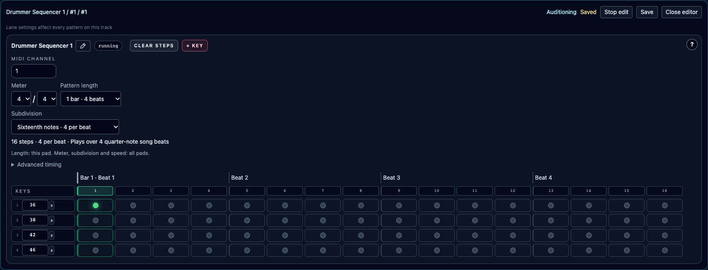

# Drummer Sequencers

**Navigation:** [Up](performance.md) | [Previous](sequencer_tracks_and_steps.md) | [Next](score_sequencers.md)

Drummer sequencers are drum-machine style step sequencers for fixed MIDI drum keys.

They are optimized for per-step drum hit programming instead of melodic note/chord entry.

Use the pen beside the device name to rename it. See [Device Names](performance.md#device-names) for editing controls, validation, and import/export behavior.

See [Sequencer timing](sequencer_timing.md) for triplets, beat grouping and editing behavior.

## Open and close the editor

Double-click a pattern in the arranger to open its editor. **Close editor** returns to the timeline and retains its draft. Closing the editor ends **Play edit** auditioning; the song's transport remains independent.

## What Makes Them Different

Compared to melodic sequencers, drummer sequencers:

- use MIDI key numbers (`0..127`) per row (drum instrument selection)
- do not use scale / mode / chord controls
- let you program multiple drum rows per step
- store velocity per active drum hit (per row + step)

## Adding / Removing Drummer Sequencers

Choose **Add track → Drummer** in the arranger, then add a clip and a pattern. Select a clip on the track to access **Remove track**. A performance can contain up to 16 drummer sequencers.

## Per-Drummer-Sequencer Controls

The drummer pattern editor provides:

- sequencer state badge (running/stopped or queued start/stop state)
- `Clear Steps`
- `+ Key` (add another drum row)
- `MIDI Channel` (`1..16`)
- `Meter` (`2..7` over `4` or `8`)
- `Subdivision` (1, 2, 3, 4, 6 or 8 steps per local meter beat)
- `Advanced timing → Playback speed` (`1:1`, `2:1`, `3:2`, `4:3`, `3:4`, `5:4`, `4:5`, `7:4`)
- `Pattern length` (every integer from 1–16 local beats; whole bars show both units)

## Drum Rows (`Keys`)

The left side of the drummer grid contains vertically stacked drum rows.

Each row has:

- row index label
- MIDI key input (`0..127`)
- row remove button (`x`)

### Auditioning Drum Keys While Editing

When the instrument engine session is running, changing a row key sends a short one-shot MIDI note preview on the drummer sequencer's MIDI channel.

This helps identify which drum sound is mapped to a given MIDI key number.

## Drum Step Grid (LED Matrix)

The grid is row-based:

- rows = selected drum keys
- columns = `beats * steps per beat`

This keeps the `Keys` column horizontally aligned with the LED rows.

### LED States

- inactive step: dark LED with visible border
- active step: red LED
- current playing column: highlighted across every drum row
- active step in the current playing column: flashing green LED

### Velocity (Per Hit)

Velocity is shown by LED color saturation (stronger color = higher velocity).

The LED border color stays visible even at low velocities, so low-velocity active hits remain distinguishable from inactive steps.

While dragging vertically on a hit, the UI also shows a live numeric `velocity: xx` readout next to the edited step.

### Editing Workflow

- Click an inactive LED to activate a hit
- Click an active LED (without dragging) to deactivate it
- Click and drag vertically on an LED to change velocity (`0..127`)
- While dragging, watch the live `velocity` readout for the exact value
- Keyboard:
  - `Enter` / `Space` toggles the hit
  - `Arrow Up` / `Arrow Down` adjusts velocity

## Early and Late Notes

Timing moves an individual attack by **−50% to +50% of one local step**, in 1% increments. Zero means **On grid**. The millisecond readout follows the current tempo, grid and beat ratio: at 120 BPM with 4/4, Subdivision 4 and speed 1×, −20% is 25 ms early. Timing belongs to each pad and does not change its length, meter or playback speed.

Moving a hit also moves its release. A following attack in the same drum row can shorten the preceding hit to avoid overlap. If neighboring attacks in that row land at exactly the same instant, the later logical step wins. For repeated hits within a step, see [Ratchets and Velocity Ramps](#ratchets-and-velocity-ramps).

An early first step plays before the boundary when the same pad repeats. On a fresh start or a different-pad launch it plays at the boundary instead. Queued stops, pauses and finite arrangement ends suppress repeat anticipation. A command received after an anticipated attack has already sounded cannot undo that attack.

Copying steps or pads preserves timing. Clear Steps resets it. Inactive drum cells retain their timing for reactivation. Old performances load on grid; Save/Load, browser restoration, native bundles and both CSD export modes preserve offsets. Timing edits during playback use the normal coalesced live-edit workflow.

Drag a hit **left/right** to adjust timing, or **up/down** to adjust velocity. The first drag direction locks the property until release; clicking without dragging still toggles the hit. Changed hits show a signed percentage and a displaced indicator.

Use **Left/Right** arrow keys for timing and **Up/Down** for velocity. Right-click a hit, or press **Shift+F10**, to open **Step properties**, which includes Timing controls with a slider, numeric field and reset. The controls affect that hit in the displayed pad. Closing or collapsing the editor ends the gesture.

## Edit patterns in the arranger

Double-click a pattern inside an expanded clip to open this editor. The breadcrumb identifies the occurrence being edited. **Play edit** auditions its draft; during song playback, other tracks continue. **Save** lets you update **Only this occurrence** or **All linked occurrences**. Cancel keeps the draft.

Assemble patterns, groups, supergroups and rests directly inside clips. See [Patterns and Reusable Phrases](pattern_pads_and_pad_looper.md) for linked content, variations and structural editing.

Pattern length uses local beats, while meter, subdivision and playback speed belong to the track. All drum rows share the pattern duration. Choose a duration that fits the meter to create one-bar patterns in odd meters.

## Typical Uses

- Kick / snare / hat step programming
- Percussion layers with multiple rows
- Switching between groove variations using pattern pads
- Automating drum pattern changes with the arranger while performing on piano roll/controllers

## Ratchets and Velocity Ramps

Right-click a drum cell, or focus it and press **Shift+F10**, to open **Step properties**. Set **Ratchets** to 1–8: 1 is the normal single hit, and higher counts divide one local step into evenly spaced hits. An **×N** badge identifies the roll in the grid. At 120 BPM with Subdivision 4 in 4/4, four hits occur at 0, 31.25, 62.5 and 93.75 ms within a 125 ms step.

Enable **Velocity ramp** and choose **Final velocity** (0–127). The first hit uses the cell's velocity and the remaining hits interpolate to the final value. For four hits, 100 → 40 produces 100, 80, 60, 40. Zero-velocity hits are silent. Disable the ramp for constant velocity. At one hit the ramp controls are disabled, but their values are retained.

Timing shifts the whole roll while preserving its spacing. The next active cell in the same drum row cuts off unfinished repeats; an equal-time collision belongs to the later step. On a fresh start or a different-pad launch an early first roll starts at the boundary. On a confirmed same-pad repeat it can begin early, and a late final roll can finish across that boundary. Stopping or seeking that device, launching a different pad, entering an arrangement rest or reaching its finite end cancels unfinished rolls. A roll already in progress keeps its count, ramp and timing when those settings are edited; the next occurrence uses the prepared changes.

Editing these properties does not activate an inactive cell. Disabling and re-enabling a cell preserves them; copying pads and saving/exporting preserves them, including hidden steps. Clear Steps restores one hit without a ramp. The panel edits the displayed pad and closes when changing pads, collapsing the drummer section or removing the target. Escape also closes it. Existing click toggles, horizontal timing drags, vertical velocity drags and arrow-key editing remain available.

**Navigation:** [Up](performance.md) | [Previous](sequencer_tracks_and_steps.md) | [Next](score_sequencers.md)
