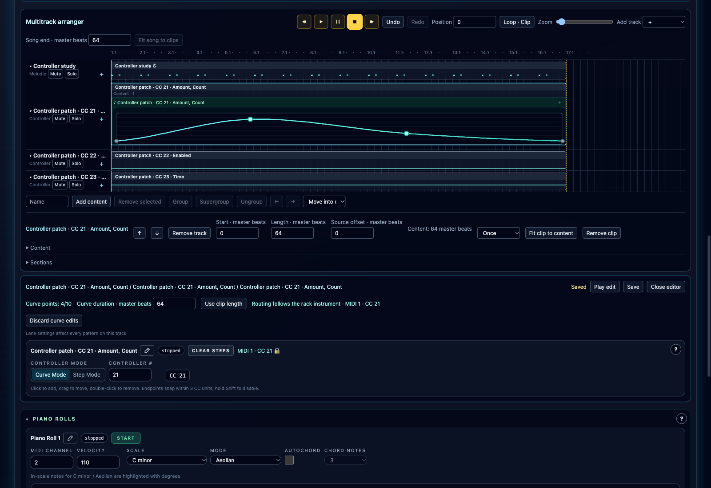

# Instrument Automation Clips

**Navigation:** [Up](performance.md) | [Previous](controller_sequencers.md) | [Next](live_status_and_safety_controls.md)

In the clip arranger, **Generate automation** creates controller clips owned by a rack instrument. Assign MIDI CCs to its performance controllers in the rack first. Select a Melodic, Drummer, Score or Arpeggiator clip, then choose Generate automation in its inspector. If several rack instances receive that source's output channel, choose the instance in **Automation instrument**. Continuous instruments and invalid or unassigned controls are excluded.

One lane is created per distinct CC, with the instrument and mapped control names in its label. Controls sharing a CC share one lane. Existing lanes are reused. Each new clip starts and ends with the selected source clip and contains one equally long curve, with zero source offset and Once playback. Its initial two points use the first mapped control in patch order and the current rack value, converted through its linear, logarithmic or Boolean mapping.

Generating again preserves existing automation with the same start and length. Other overlaps reject the entire operation. Automation clips can subsequently move, trim, loop or disappear independently. Deleting their source clip or source lane leaves automation intact. Bound automation can exceed 16 controller lanes, within the arranger's 72-lane total; generic controller sequencers retain their 16-device limit.

## Edit a slow curve inside its clip

Expand the automation lane and select its curve preview, or double-click the pattern header. Click the curve background to add a point, drag to move it, and double-click an interior point to remove it. Clip headers still move clips, borders trim them, and pattern headers select or move structure. Zoom, scrolling, nested groups, repeated occurrences and source offsets preserve the curve's original coordinates.

The counter allows **10 points including both endpoints**. Endpoint positions stay fixed; their values are independent. Endpoint dragging retains the existing three-unit snapping and Shift override. Use shorter, looped patterns for fast movements.

**Curve duration · master beats** stretches the normalized curve without changing its points or the clip window. **Use clip length** copies the selected window's duration. Trimming crops the existing content. Extending Song end leaves existing curves at their saved durations. Curves can span up to the arrangement limit of 1,000,000 master beats.

Shared curves follow the same [editing scope and saving rules](pattern_pads_and_pad_looper.md#edit-and-save) as musical patterns, including when editing their inline points. **Discard curve edits** removes the selected draft. Play edit auditions the draft through the usual workspace controls. Performance save, autosave and native/CSD export retain committed definitions; unsaved curves remain session-only. Committed edits use arranger Undo/Redo. Adding, splitting or merging source lanes clears clip history, following the existing topology rules.

## Routing and reassignment

The owning rack instance determines MIDI channel and CC. Both are read-only in the automation editor. Changing its rack channel follows automatically. Changing one mapped CC retargets the lane without changing its music. If controls sharing a lane move to different CCs, their complete automation is copied into independent lanes.

When mappings merge, identical automation combines automatically. If candidates differ, choose which complete lane survives; **Cancel** preserves both the old mapping and all automation. Save or discard affected automation drafts before changing assignments. Live changes prepare first. If preparation fails, the previous playing configuration remains in place and the error is shown.

Off mappings, removed controls and missing instruments retain their automation with a suspended warning. Suspended lanes send no MIDI. Reassignment uses the same split/merge rules. Ownership stays with the rack instance, even if the original note source disappears.

## Step mode and compatibility

Step Mode keeps its local timing controls, 128 stored cells, hidden-cell retention and Reset Value behavior. Mode applies to the lane. Switching modes preserves both datasets and their separate durations: the step grid does not resize a long curve, and the curve duration does not resize the grid.

To generate another curve on an existing Step Mode automation lane, switch that lane back to Curve Mode first. Generation preserves its existing music and does not change the lane mode for you.

Use a current Orchestron version when sharing performances with instrument automation. Older performances retain their existing generic controller behavior.

For note instruments, mapped performance settings affect newly started notes or phrases. Continuous controls marked **Live** can change during playback; **Requires restart** controls retain their values until restart. See [Using Performance Controls](performance_controllers.md).

**Navigation:** [Up](performance.md) | [Previous](controller_sequencers.md) | [Next](live_status_and_safety_controls.md)
