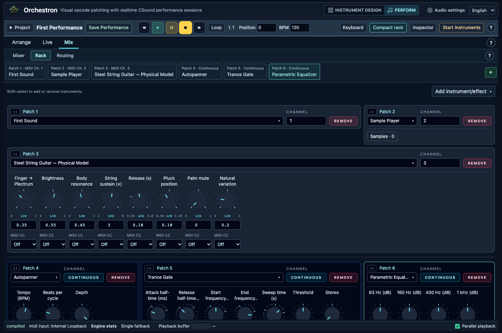
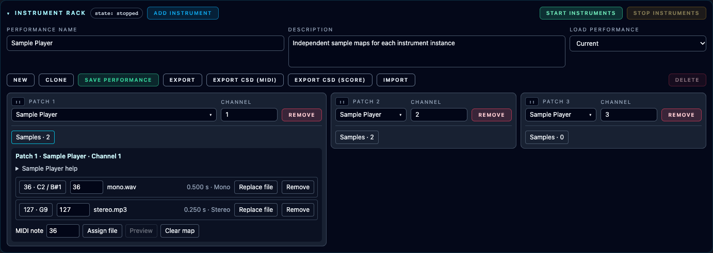
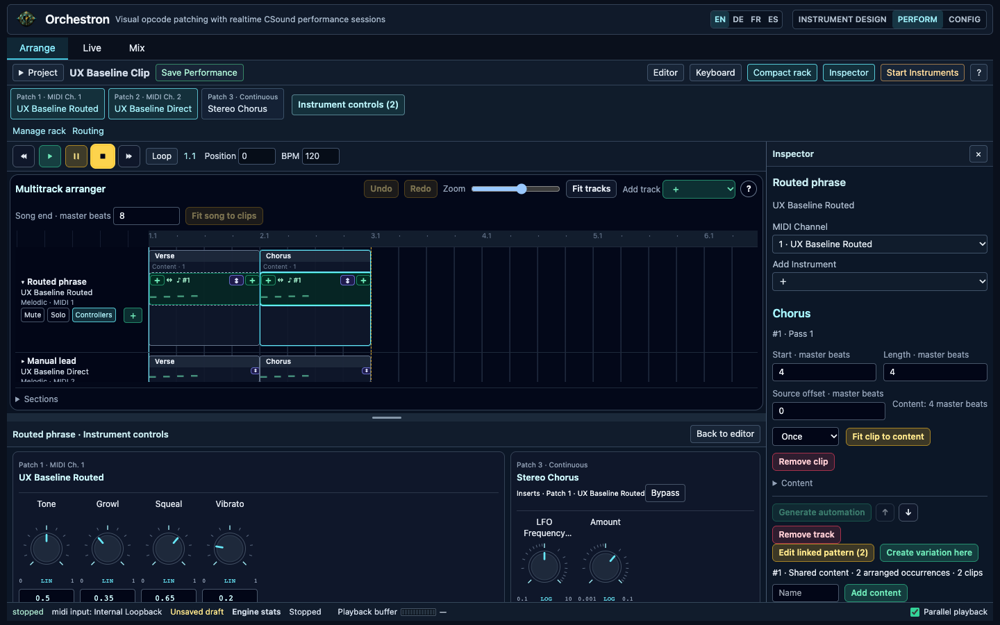
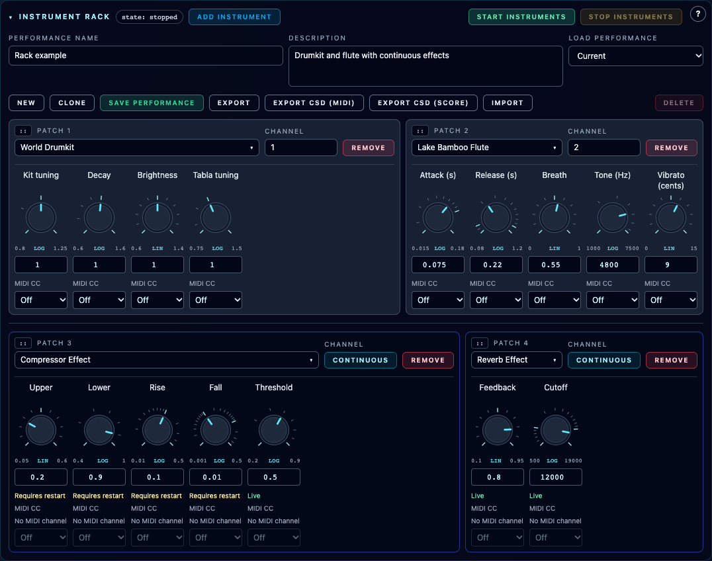
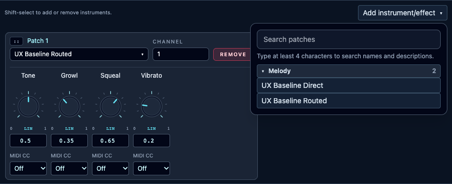

# Instrument Rack and Engine Transport

**Navigation:** [Up](performance.md) | [Previous](performance.md) | [Next](sample_player.md)

Open **Perform → Mix → Rack** to assign instruments and channels. **Start Instruments** and **Stop Instruments** are available from every Perform view.

## Adaptive Expanded Rack

Perform fills the available browser width with normal outer margins. Instrument
cards automatically share rows or span the full rack according to their controller
content. The layout reduces vertical space while keeping the saved instrument
order and the divider between note-triggered and continuous instruments.

Optional **Controller Group** names in Instrument Design give related controls a
thin labeled border. Groups remain expanded; cards and groups wrap without
shrinking the controls. Narrow windows use a single column and a wrapping header.
See [Performance Controllers](performance_controllers.md) for grouping rules.

**Mix → Rack** shows knobs, controller groups, MIDI CC assignments and sample maps on each instrument card. Click its patch number to select it. Shift-click another patch number to add or remove an instrument.

## Add a Sample Player

Choose **Add Instrument**, search for **Sample Player** and select it to create a rack slot.
Open **Samples** on the card to assign WAV, MP3 or M4A files to MIDI notes. Each instance has its own
map. See [Sample Player](sample_player.md) for editing, preview and exports.

## Compact Rack

Select **Compact rack** in the top band of Arrange, Live or Mix. The rack opens below the navigation tabs. Click one instrument. Hold **Shift** and click others to add or remove them. With the keyboard, focus an entry and press **Shift+Enter** or **Shift+Space**. The patch number and MIDI channel distinguish instances of the same instrument.

With the instruments stopped, click the **+** at the right of the compact rack to browse instruments by category or search. To remove a rack instance, right-click it or focus it and press **Shift+F10**, then choose **Remove instrument**. If a track uses it, the warning lists the tracks to reassign first.

Choose **Instrument controls** beside the rack entries to open the selection and its insert effects. Arrange shows the controls below the timeline. Live opens them in Mix. To adjust one lane’s sound, click **Controllers** beside its **Mute** and **Solo**. Choose **Back to editor** to return to your open clip or pad.

**Samples** and **Routing** use the most recently selected instrument. **Manage rack** opens the full rack in Mix.

## Performance Metadata and Library Actions

Open **Project** for the name, description and library actions. **Save Performance** sits beside the performance name in the top band.

- `Performance Name`
- `Description`
- `Load Performance` dropdown
- `Save Performance`
- `Clone`
- `Delete`
- `Export`
- `Export CSD (MIDI)`
- `Export CSD (SCORE)`
- `Import`

These actions operate on the performance configuration (instrument rack + audio routing/mixer + sequencers + controllers + piano rolls), not on individual patch definitions.

- `Export` writes an Orchestron `.orch.json` / `.orch.zip` performance bundle for backup, sharing, and re-import.
- `Export CSD (MIDI)` creates a Csound package with a MIDI file; `Export CSD (SCORE)` embeds the events in the Csound score. See [Performance Import / Export](performance_import_export.md) for choosing a format, samples, rendering and release tails.

## Instrument Assignments (Rack Slots)

Each rack entry selects a saved patch and a MIDI channel (1–16), or displays Continuous activation. Up to 64 user patch instances are supported, including processors. Generated mixer stages do not occupy rack slots or MIDI channels. Use distinct MIDI channels for note-triggered instances.

### Instrument Order

Note-triggered instruments appear above continuous (always-on) instruments. A thin horizontal line separates the groups when both are present.

With the instrument engine stopped, drag a card's `::` handle onto another card in the same group. An insertion line shows the destination: the upper half inserts before the target, and the lower half inserts after it. You can also focus the handle and use **↑/↓** to move one position within its group. Instruments cannot move across the divider. Press **Escape** to cancel a drag; collapsing the rack or starting the engine also cancels it.

The compact rack and mixer strips follow this order. Master stays pinned at the right of the mixer, and insert processors remain inside their owner's insert chain. Moving a rack card changes display order without changing MIDI channels, routing, insert processing order, or controller and mixer values. Autosave, Save/Load, Clone, and native export/import preserve the instrument order.

  

<em>World Drumkit and Lake Bamboo Flute sit above the thin divider, with continuous compressor and reverb below. The :: handles reorder instruments within each group while the engine is stopped.</em>

### Instrument Controls

Patches containing [`perf_controller`](performance_controllers.md) show five compact tuning knobs per standard rack-card row; extras wrap below. They remain editable while playing. New notes use updated values. Continuous controls marked **Live** update during playback. **Requires restart** identifies I-rate or mixed connections. Both CSD export modes use initialization values for continuous controls. Open the rack’s **?** help and look for **Performance Controllers** for details. Save Performance stores explicit overrides.

The [Mixer in Mix](audio_mixer_and_routing.md) provides audio faders, pan/balance knobs, mute/solo, pre/post sends, inserts and meters. The old numeric Level field has been removed. Mixer gain affects held notes and external MIDI audio without changing note velocity.

While instruments run, adding/removing assignments, changing patch/channel assignments, and changing routing topology are locked. Existing mixer controls stay live. Use **Stop to edit routing** before changing connections or insert order.

### Add Instrument

- Choose **Add Instrument**, expand a category such as **Melody** or **Bass**, then pick an instrument by name. The rack creates and selects its card when you choose the name. Press Escape to cancel.
- Names are alphabetical within each category. To search across categories, enter at least four characters of a name or description. Open the patch name on an existing card to replace its instrument using the same picker.
- This enables multi-instrument performances driven by different MIDI channels.
- Continuous effects run as explicit rack instances. Adding an insert creates a dedicated instance automatically; simply saving an effect in the library does not start it.
- The button is unavailable while the engine is running; stop instruments before changing rack assignments.

## Rack Transport (Instrument Engine Control)

The rack transport controls the instrument runtime session itself.

Buttons:

- `Start Instruments`
- `Stop Instruments`

### `Start Instruments` / `Stop Instruments`

These start/stop the underlying instrument engine session.

Global song transport lives in the [multitrack arranger](multitrack_arranger.md#play-and-jam). **Play** starts or resumes, **Pause** holds the song cursor, and **Stop** returns to the loop start or song start. Rewind and forward move one master beat. Play starts instruments when needed; Stop stops instruments started by Play, while instruments that were already running remain running. **Stop Instruments** stops the engine. Use **Play edit** to audition a pattern or phrase.

## Session State Badge

The rack shows current session state (localized label), for example:

- running
- stopped / idle

This is the state of the instrument engine session, not just the sequencer transport.

## Error Banner

If an engine or transport action fails, read the full error in the status bar at the bottom of any Perform view.

## Tips

- Save the performance after significant changes (rack assignments, sequencers, piano rolls, controller mappings).
- Use distinct MIDI channels for note-triggered rack instances.
- Use `sname` labels on source `outleta` nodes to name the available matrix channels. The label can be stored directly on the node or supplied by a direct `const_s` connection.

**Navigation:** [Up](performance.md) | [Previous](performance.md) | [Next](sample_player.md)
