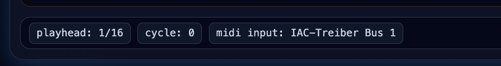

# Live Status and Troubleshooting

**Navigation:** [Up](performance.md) | [Previous](instrument_automation.md) | [Next](performance_import_export.md)

The Perform page includes several status for live operation.

## Browser Audio Health

The Runtime panel shows queued PCM and pending-render milliseconds, underrun and overrun counters, and
the latest backend render-time/audio-time percentage while a browser-clock session is active.

Audio refills and PCM writes run in a Dedicated Worker. Sequencer step and pad updates are carried with
the rendered PCM and applied only when their target frame becomes audible. If the Perform page is hidden,
visual animation pauses and resumes from the current audible snapshot instead of replaying missed steps.

Performances are limited to 128 flattened backend note tracks. Each drummer row becomes one backend note
track, so the total includes melodic sequencers plus all drummer rows.

## Footer Status Bar

At the bottom of the Perform page, Orchestron shows live status values such as:

- `playhead` position (`current step / step count`)
- `cycle` count
- active `midi input` name (for example `internal:loopback` or a helper-provided device)

This footer is useful during performance because it gives quick feedback without opening the Instrument Design runtime panel.

  

<em>Footer status bar with playhead/cycle/MIDI input.</em>

## Engine Stats and Parallel Playback

A narrow **Engine stats** line stays fixed at the bottom of the Perform window. It shows
whether the session uses **Single** or **Parallel** rendering. It also contains the optional
**Parallel playback** checkbox.

To opt in, stop the instruments, enable **Parallel playback**, then start them again. The engine
analyses the connections between whole instruments, inserts, sends and shared effects. It
keeps dependent work and shared mutable resources together and distributes independent groups
across available CPUs. Instruments are never split internally. No catalog or per-song
registration is required, and browser latency settings do not control eligibility.

The number of processes depends on the graph and available container capacity; one process
handles the shared downstream effects and output. Built-in read-only sine tables are present
in each process. Shared mutable tables, MIDI initialization and shared random state keep their
users together. Unsupported resource behavior, insufficient independent work or insufficient
CPU/memory capacity selects **Single fallback**. Splitting a graph does not guarantee a speedup:
small instruments and shared effects can still dominate the work.

The choice is off by default, resets when the page reloads, and is not saved in a performance
or an export. It cannot be changed while instruments are running. Turning it off while stopped
returns the next session to single rendering. Audio timing, buffer sizes and CSD exports are
unchanged. Sequencer controllers retain their MIDI channels and reach every relevant instrument
across the parallel processes.

On Linux, parallel rendering shows the total load on the logical CPUs assigned to its workers,
for example `cpu0: 60% cpu1: 45% cpu3: 77%`. These CPU readings include other work using those
CPUs. With single rendering, **Server process** shows the combined CPU usage of the server
process: 100% represents one CPU, and the value can exceed 100%. It is not a per-instrument meter.
Unsupported platforms or unavailable readings show **CPU usage unavailable**, not zero.
Each CPU percentage has a reserved, right-aligned space, so neighbouring readings stay in place
as the load changes between one, two and three digits.

- **Green:** 0–50%.
- **Orange:** above 50% through 85%, including the 50–60% interval.
- **Red:** above 85%.

Readings update about once a second while Perform is visible. Switching views or hiding the tab
suspends observation; audio keeps playing. Load percentages do not replace the audio underrun
and queue indicators. Live-input latency is a separate diagnostic and may still vary.

If a parallel worker fails during playback, the engine stops and reports the error. It does not
silently replace the running synths or replay audio. Stop and explicitly restart; automatic
fallback can use single rendering on that restart.

## Track State Labels (Queued Changes)

A track's state badge can reflect queued actions that apply at the next cycle boundary, for example:

- starting @ step 1
- stopping @ step 1

This helps you understand why a track button press did not take effect immediately while transport is running.

## Error Banner (Transport / Runtime Errors)

The Perform page displays an error banner for problems such as:

- no active instrument session when trying to start sequencers
- trying to play piano roll notes before the instrument engine is ready
- pad queue request failures
- controller send failures
- sequencer config sync failures

## Editing During Playback

Notes, controller curves, tempo and arrangement edits keep the transport at its current position. Rapid edits are combined after an 80 ms pause; the previous configuration keeps playing while the update is prepared. The completed edit takes effect at the next engine block. Editing a displayed pad changes that pad, including when the arranger has selected it automatically.

Automatic pad changes, playhead movement and status updates do not resubmit the performance configuration. Queued pad launches still wait for their usual pad boundary. Stop cancels pending configuration application. Shortening a finite arrangement past the current position stops playback without rewinding.

If preparation fails, the error banner reports it and the previous configuration continues playing. Your edit remains in the editor. Make another edit or explicitly restart to try again; the app does not continuously retry a failed update. Saving and exporting retain the existing file formats.

## MIDI Input Reference

The footer's MIDI input display reflects the session's bound external MIDI input (selected in the Instrument Design Runtime panel). If it shows `internal:loopback`, internal app MIDI is still active, but external hardware/DAW MIDI will not reach the session until a helper-provided input is bound.

See [Runtime Panel and Compilation Workflow](../instrument_design/runtime_panel_and_compilation.md) and [MIDI Setup and Inputs](../configuration/midi_setup_and_inputs.md).

## Live Performance Safety Checklist

1. Confirm instrument session is running.
2. Confirm expected MIDI input is bound.
3. Check track/controller/piano-roll enable states.
4. Save the performance after major routing changes.

## Definition audition

A preview is temporary and does not save a pattern or change its authored arrangement. If it fails to prepare, current playback continues and your draft remains available. See [Play and jam](multitrack_arranger.md#play-and-jam) for the current clip-editor transport controls.

## Temporary lane output controls

Lane **Mute** and **Solo** affect future output while the track keeps its place in the song. A muted controller leaves its target at the last value received. See [lane controls](multitrack_arranger.md#temporary-lane-mute-and-solo) for the complete behavior and how they differ from mixer controls.

**Navigation:** [Up](performance.md) | [Previous](instrument_automation.md) | [Next](performance_import_export.md)
