# Multitrack Arranger

**Navigation:** [Up](performance.md) | [Previous](midi_controllers.md) | [Next](pattern_pads_and_pad_looper.md)

Open **Perform → Arrange**. The multitrack arranger brings melodic, Score, drummer, controller and arpeggiator tracks onto one timeline. Clips set where content plays; reusable patterns, groups and supergroups hold the music.

**New** creates an empty arrangement and one piano keyboard. Choose **+ Add track** below the last lane. The new track has a first clip and pattern, and its channel dropdown has keyboard focus. Choose a channel to use the instruments already on it, or **Add Instrument…** to find a playable sound by category or search. Choosing a sound adds it to the rack and assigns the track to its channel. Double-click the clip when you are ready to edit. Double-click empty track space to add another clip. Use a clip’s **+** to add a new pattern or reuse existing content.

Each lane header shows the assigned rack instrument beside its channel, such as **CH01 ▾**. The MIDI channel and lane buttons stay visible while you scroll the timeline. For a long name or a list of instruments, hover over the name or select the lane and open the **Inspector** to read it in full. An unassigned channel shows **No rack instrument**. Controller lanes list their target channels, with **CH01–16** for all channels. An arpeggiator shows its input and output in order, for example **CH03 → CH07**.

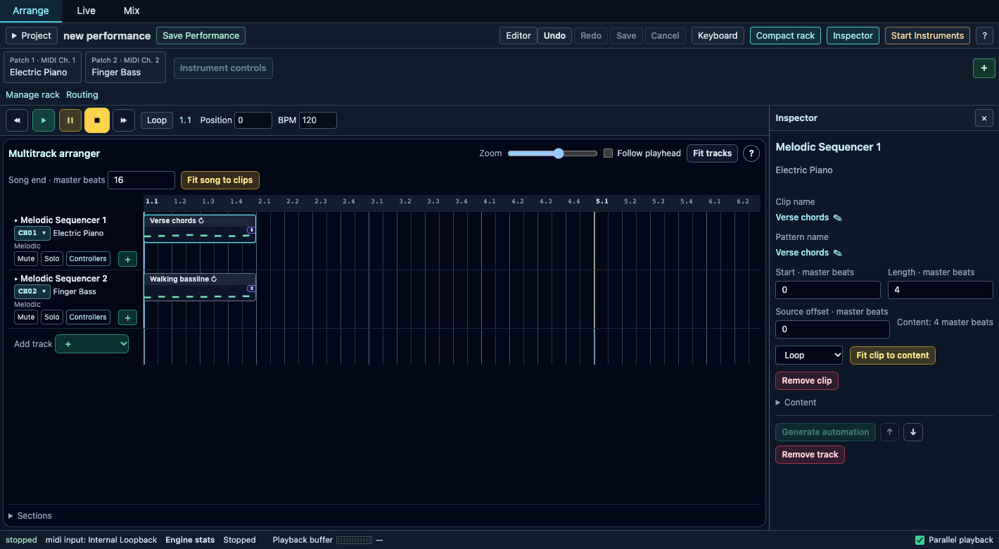

Click a track name to see the patterns and groups inside its clips. A faint cyan band extends from the track name across the timeline. Click another track name to move the highlight there, or click the expanded track name again to collapse it and clear the highlight.

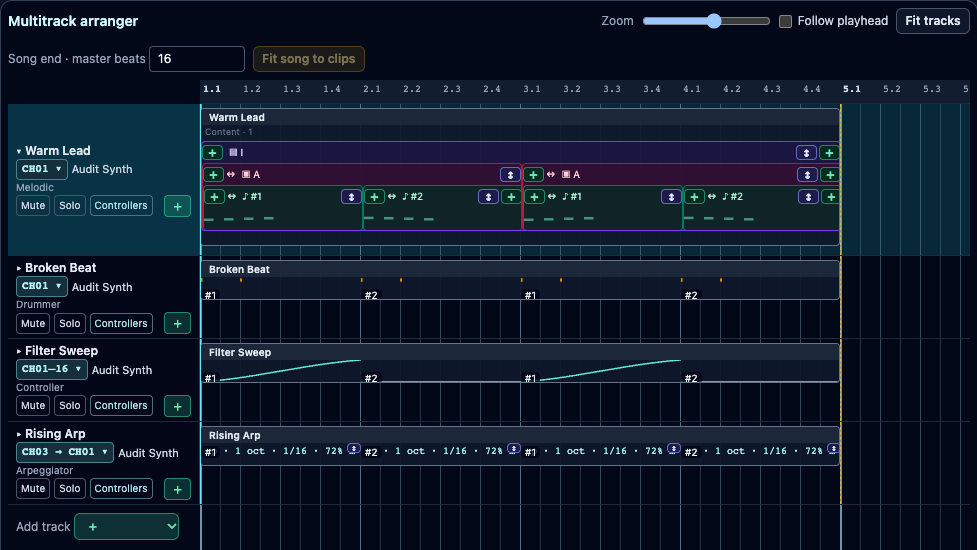

Click **Controllers** beside a lane’s **Mute** and **Solo** to adjust its instrument and insert effects in the lower panel. The button is available when at least one destination instrument publishes a usable performance control. An automation lane opens its bound instrument. Choose **Back to editor** to resume your open clip or pad, or **Close** if you opened controls from the timeline. On a very short screen the panel can occupy the working area.

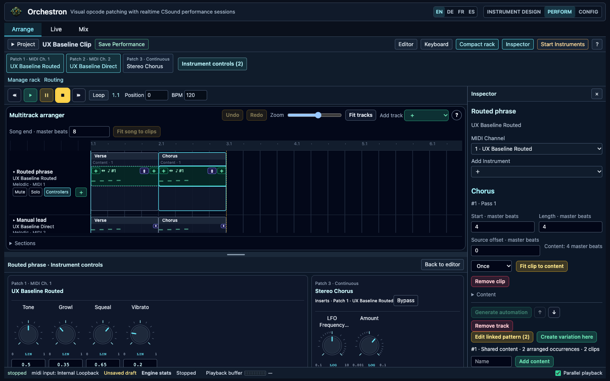

The top-right **?** opens help specifically for this clip workflow in the selected GUI language (English, German, French or Spanish). It covers clip windows, reusable content, musical and structural drafts, editing scope, transport, sections, transposition and instrument automation. Close it with **Close**, Escape or a click outside the dialog.

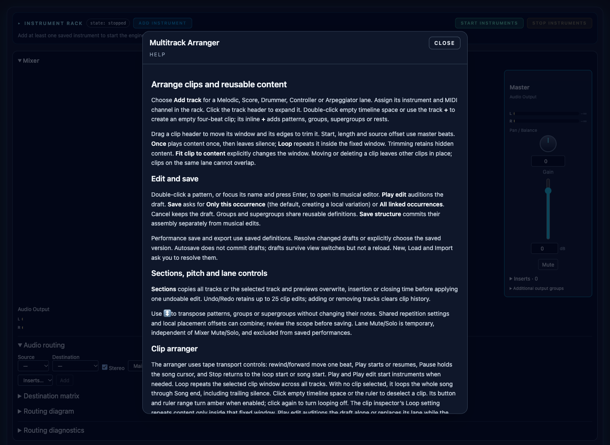

## Arrange fixed windows

Click or right-click a clip header to select its whole window. The continuous outer outline shows the target. Right-click anywhere inside the window and choose **Duplicate clip** or **Delete clip**. The copy takes the first later gap on the same track that fits its length, extending Song end when needed. Its crop, loop settings and transposition travel with it, and its patterns stay linked. Deleting a window leaves a gap and preserves trailing silence.

To **merge clips**, click the first clip header, then Shift-click the last header on the same track. Every clip between the two is selected, in either direction. Right-click any selected header and choose **Merge clips**. The merged window takes the first clip’s name and spans the entire selection. Gaps become rests. Patterns keep their links, and cropped or looping passages keep their source timing and transposition.

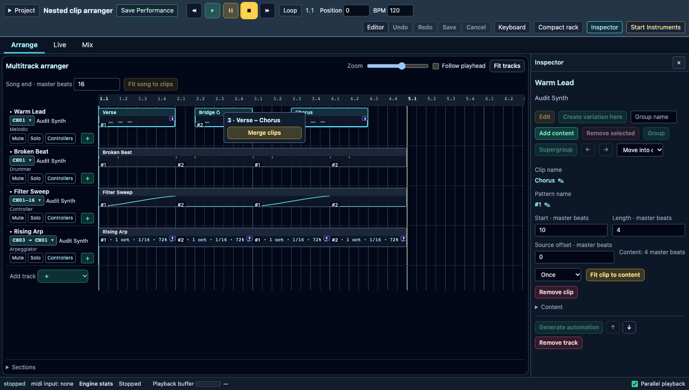

To **split a clip**, right-click its header and choose **Split clip…**. Click inside the clip or drag the scissors to place the vertical line. Left and Right move it by a quarter of a master beat. Choose **Cut** or press Enter to create two clips. **Cancel** or Escape dismisses the scissors. A held note plays through the cut while the halves remain adjacent and their source timing and content match. Undo reverses a confirmed merge or cut. After arranger **Save**, Undo restores the complete saved batch.

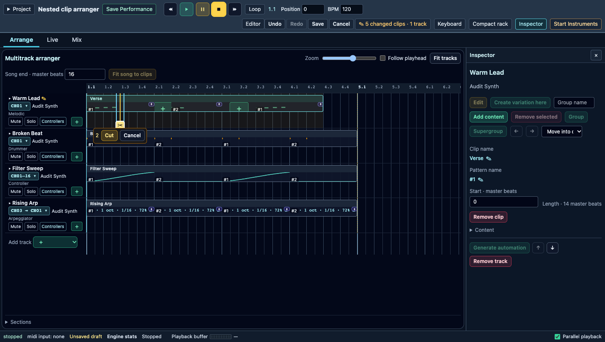

Click a pattern or group to select its content. Shift-click extends the selection. Right-click within that range to act on those items together. With the target focused, Shift+F10 opens its menu and Delete removes it. Drag the header to move the window, drag its edges to trim it, or enter precise values in the Inspector. Double-click the header to edit the content at that position. Double-click empty lane space to create a four-beat clip on the quarter-beat snap. The track **+** appends one.

When a clip looks narrow at your current zoom, the hand cursor covers the whole window. Drag from either edge, the header or the preview to move the clip. Inside a wider clip, you can grab a narrow pattern to move that occurrence. Zoom in to reveal the trim handles, **+** and **↕** as each item gains enough room. You can also press Tab to reveal a control, then use Enter or Space for a button or Left/Right for a resize handle.

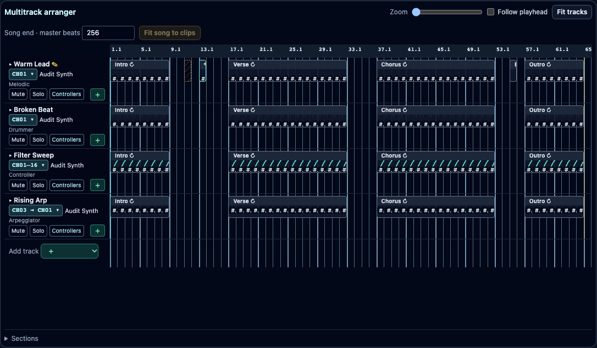

The clip window and content duration are independent. **Once** plays the content from its source offset and leaves silence after its end. **Loop** repeats content within the window. Trimming preserves the original notes and content; **Fit clip to content** explicitly changes the window. A local edit of one generated repeat splits its original window into before, edited and after parts.

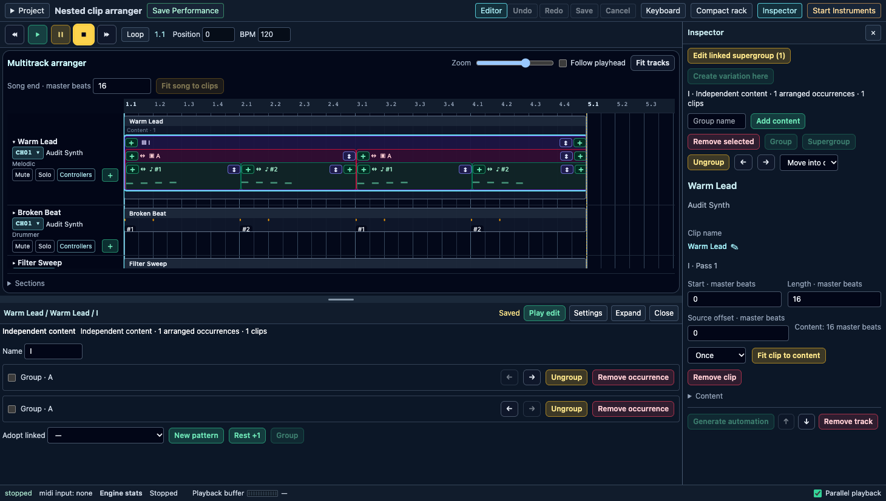

Open **Content** for the selected clip to adopt existing definitions, create a new pattern, add a rest, reorder children, or select adjacent children for Group/Supergroup. Grouping retains reusable definitions. Ungroup opens one level. Removing an occurrence retains its definition. Groups and supergroups have their own contextual child editor.

**Sections** copies a range of all tracks or the selected track. Pasting, inserting or closing time stages the result on the timeline. The track-order arrows also stage their changes. Adding or removing a track and generating automation set up devices immediately. If pending edits involve a track you want to remove, use the arranger’s **Save** or **Cancel** first.

Amber edges and edit marks identify pending changes, including on collapsed tracks. A plus marks a new clip. Hatching shows the former position of a moved or deleted window. Open the change count beside **Save** to review affected tracks and clips, including linked uses outside the viewport.

Arrange **Play** previews valid edits together. You can edit a copy, move it, close its editor and continue on another track. **Undo** and **Redo** step through gestures across tracks and editors. While typing, the keyboard shortcut edits the text. Elsewhere use Cmd/Ctrl+Z and Cmd/Ctrl+Shift+Z.

**Save** commits the complete batch. One Undo then restores the previous arrangement. **Cancel** restores it at the current transport position and preserves its Undo/Redo history. Undoing every pending gesture leaves Redo available until you cancel. A collision keeps the draft available for correction. **Save Performance** writes the committed arrangement to the library. Autosave and export also use committed data. Up to 25 saved edits survive reload and native bundle import.

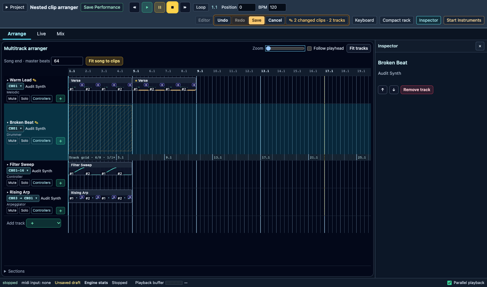

## Temporary lane mute and solo

Use **Mute** to silence a track or **Solo** to hear it on its own. These controls leave the track's clock and place in the song unchanged. Several tracks can be soloed together; an explicit mute still silences its track. Drum rows are controlled together.

Track Mute/Solo is separate from the mixer, so tracks sharing an instrument can be controlled independently. Existing notes release normally. A muted controller track sends no new values; its target keeps the last value received. Soloing an arpeggiator also keeps its required input tracks active.

These controls are temporary: they are excluded from saved performances and exports and reset when a performance is loaded, imported or replaced.

## Instrument automation

Select an instrument clip and use **Generate automation** to create one bound controller lane per assigned MIDI CC. Edit song-length curves directly inside expanded clips, with at most ten points. MIDI channel and CC follow the rack instrument. See [Instrument automation clips](instrument_automation.md) for generation, duration, split/merge and suspended-target behavior.

## Edit a pattern

For a new Score track, double-click its first clip to open the **Score sequencer**. In a later empty clip, use its inline **+** and choose **New pattern**. Hold its
piano keys to audition pitches or double-click them to append quarter notes.
See the [Score pattern walkthrough](score_sequencers.md#create-a-score-pattern-in-the-clip-arranger).

Double-click a pattern name or its note preview to open the editor. You can also focus the name and press Enter. The editor toolbar shows the pattern, loop pass and edit scope beside **Play edit**. The notes, drum cells or curve are immediately below. Click the scope or **Settings** to change the scope, rename the pattern or adjust track settings. You can edit notes/chords/holds/strums, sparse score notes, drum velocities/ratchets, both controller datasets, and arpeggiator parameters/presets. Lane-wide timing, routing and instrument settings affect the whole track.

Press **Play** to hear musical edits at their position in the arrangement. You can keep editing while it plays or switch tracks to hear the result in context.

Melodic and Score clips use compact Note maps. Drums use step dots with a fixed velocity gradient. Arpeggiators show parameters, because their pitches depend on incoming chords. Controller Step Mode uses bars; Curve Mode uses the real interpolation. Selecting a curve pattern also opens the production curve editor inside its expanded lane, sharing the same draft as the full editor. Drag, click and double-click retain their usual behavior; the point list offers numeric position and value editing, including independent endpoint values.

To rename a clip or pattern, select it and click the pencil beside **Clip name** or **Pattern name** in the Inspector. Type the new name, then click elsewhere or press Tab to stage the name. Press Esc to keep the previous name. A clip name belongs to its window. A linked pattern name appears wherever the pattern is used.

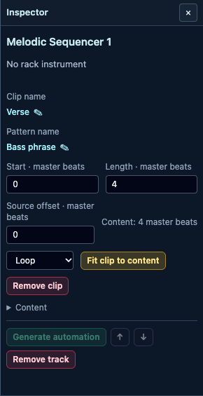

You can also right-click a pattern name or its preview and choose **Rename pattern**. Type the new **Pattern name** in the editor and save. Choose **Create variation here** and edit **Variation name** to rename just this occurrence. **Group name** names a new group of selected items. The saved pattern name appears inside each occurrence, including on compact tracks. Use **Loop details** for the beat ranges affected by a local edit.

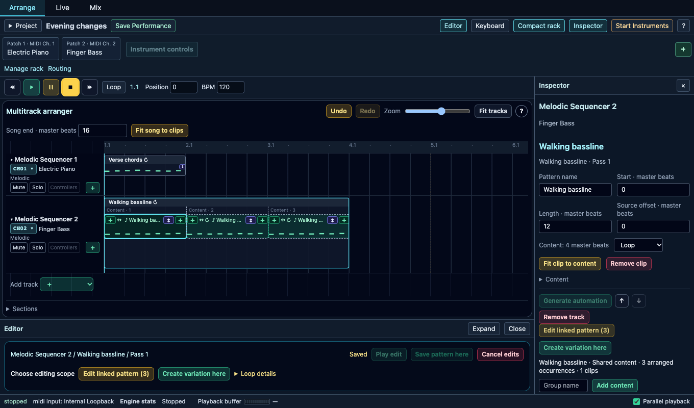

Double-click the original pass of a loop to edit its linked definition directly. Saving updates all linked uses. Double-click a later pass to choose **Edit linked pattern** for every use or **Create variation here** for that pass alone. Double-clicking the clip header opens the top-level item at the clicked beat. The [pattern editing guide](pattern_pads_and_pad_looper.md#edit-and-save) owns the scope, save and draft rules. A variation within a loop can split its window into before, edited and after parts while preserving the song's timing.

## Play and jam

To harmonize with an unsaved variation, start **Play edit**, then open **Keyboard**. The editor keeps its draft, occurrence and editing scope as you play. On a small screen, **Back to overview** shows the arrangement above the keys. The **Stop edit** button next to **Editor** ends the audition from either pane.

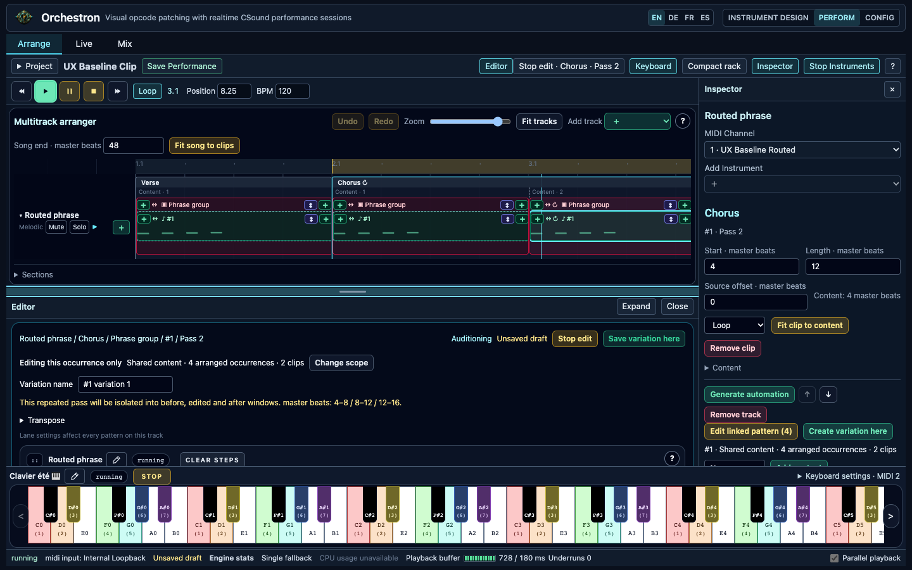

**Play** (triangle) and **Play edit** start instruments when needed. The tape controls provide rewind/forward by one beat, Play/resume, Pause, and Stop. Pause holds the song cursor; Stop returns to the selected loop start or song start. With the song stopped, Play edit auditions its target. With the song playing, the editor audition temporarily replaces its source lane while other lanes continue. **Stop edit** returns the lane to the arrangement at its current position. Starting or stopping the song clears temporary auditions. Audition state appears in the compact lane header. The open editor follows the audible pattern position with its existing step highlights, score playhead, controller cursor or arpeggiator status; standalone audition leaves the song cursor still. Closing the editor ends its audition and keeps the pattern draft. Use the arranger **Save** to commit all pending edits or **Cancel** to discard the batch. Leaving Perform ends the audition and keeps the draft for your return.

Arpeggiator **Play edit** waits for incoming notes or a chord on its input channel. Once notes arrive, its existing rhythm-step highlight and generated-note previews follow the audition. The source’s saved enable switch does not need to be on. A reopened performance recalls the authored pattern. Start a new audition to preview it again.

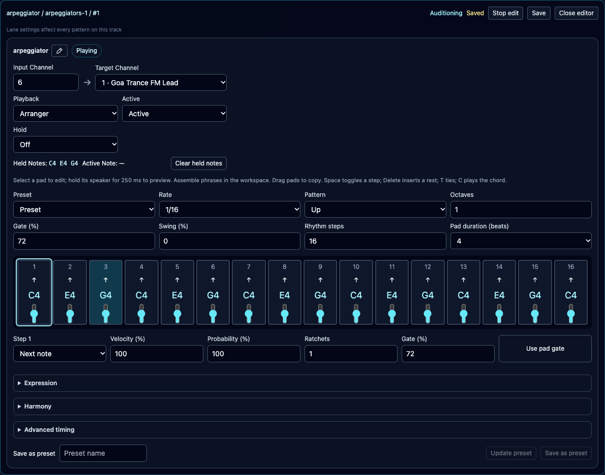

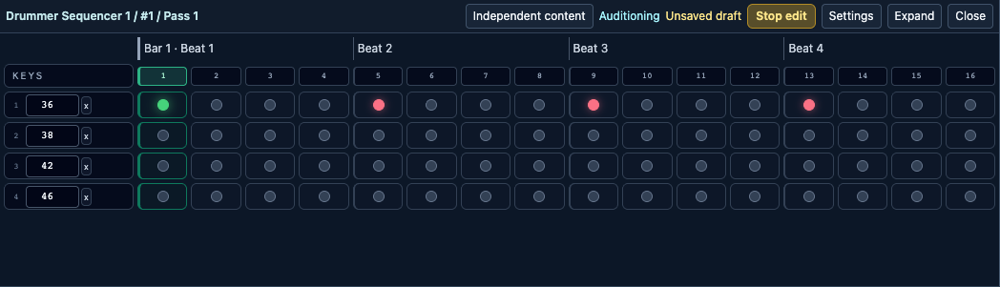

Click a pattern, or click the first pattern and Shift-click the last, then turn on **Loop** in the playback controls. All tracks repeat that time range, including rests between the patterns. The amber ruler shows the loop boundaries. You can select patterns inside a group or span adjacent repetitions at the top level of a clip. A trimmed clip loops only the visible part of a pattern.

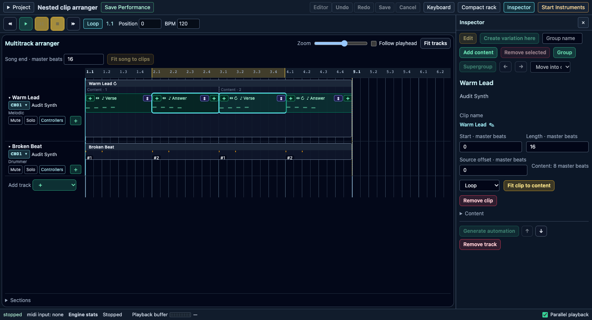

Select just the clip header before turning on **Loop** to repeat its full window. With no clip selected, it repeats the whole song from the start through **Song end**, including trailing silence. Click empty timeline space or the ruler outside a clip to deselect it; clicking a clip selects it again. Click **Loop** again to turn it off. This is separate from **Loop** in the clip inspector, which repeats its content only within the fixed clip window. The playhead and Position field follow song position through loops and remain stationary during standalone audition. Newly created clips are selected automatically.

Loading selects a clip even when looping is off: a matching saved loop takes priority, then a clip at the cursor, then the earliest clip. Tracks stay compact and the editor stays closed. Explicitly clearing the selection stays cleared through Play, Stop and Rewind. You can toggle the loop without reopening its editor.

**Position** accepts a seek destination in master beats. While you edit it, playback continues without replacing your text or moving focus. Press Enter or leave the field to seek once; Escape cancels and resumes displaying the current song position. Empty or negative values are discarded. Loading or importing a performance clears an unfinished position edit.

**Song end** shows the actual playback boundary in master beats, marked by a dashed amber line. Moving or shortening clips retains trailing silence. To stop at the last clip instead, press **Fit song to clips**, or enter a Song end at or beyond the final clip. This is an undoable arrangement edit, saved with the performance; it does not cut off clips. Position and Song end use master beats, while the ruler uses bar/beat labels.

Check **Follow playhead** beside **Zoom** to scroll the tracks during song playback. At first the vertical line moves across the tracks. When it reaches the middle, it stays there as the ruler and tracks scroll together. Once **Song end** is visible, scrolling stops and the line moves to the end. If the whole song fits on screen, the tracks stay still throughout playback.

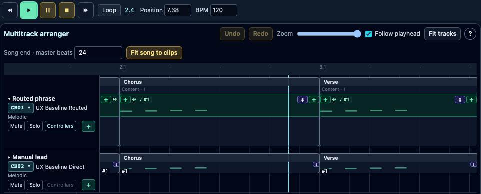

Uncheck **Follow playhead** to browse another passage while the song plays. Check it again to return to the current position. The arranger remembers your choice when you pause or switch views. It starts unchecked when you create, load or import a performance or reload the page.

Point at a beat on the ruler or in a track. On a Mac trackpad, spread two fingers to zoom in or pinch them together to zoom out. On Windows or Linux, roll the mouse wheel up to zoom in or down to zoom out. The beat stays under the pointer until the view reaches either end. On Mac, sliding two fingers still scrolls the tracks.

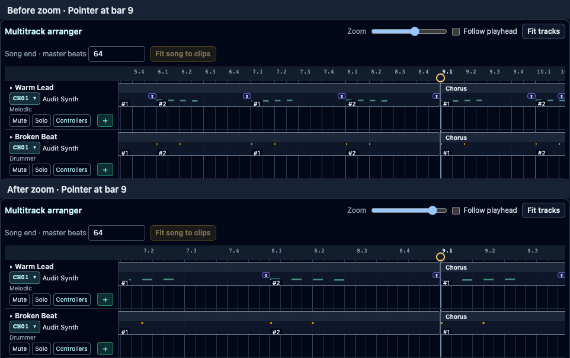

To zoom around the middle of the tracks, use the **Zoom** slider. At close zoom the ruler and track backgrounds show subdivisions, beats, bar lines and stronger accents at bars 1, 5, 9 and 13. Zoom out to see intervals of four, sixteen or sixty-four bars.

Expand a track with different timing to see its local meter and speed below the clip. In a 4/4 song, a 6/8 track at normal speed starts a new bar every three quarter notes. Its fifth bar meets master bar four, twelve quarter notes from song start. Collapsed tracks share the master ruler.

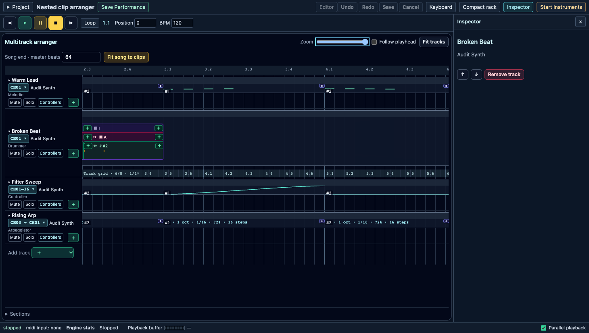

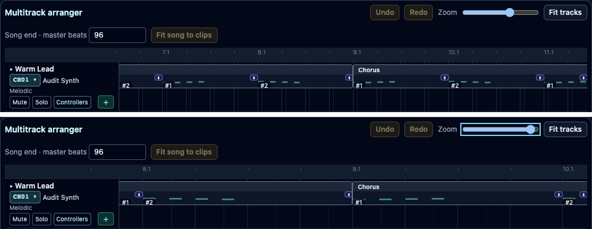

Move **Zoom** all the way left, or focus the slider and press **Home**, to see the entire song through **Song end**, including trailing silence. The overview adjusts when the song length or timeline width changes.

Choose **Keyboard** to play below the timeline. For hands-on CC control, open **Live** and use the MIDI controller rows. Each device retains its Start/Stop and channel settings. Keyboard velocity, scale and Autochord are under **Keyboard settings**. The Auto/Live/Listening buffer policy applies as you play.

Transport buttons wrap onto another row when the viewport or enlarged text leaves too little space. Track headers reserve less than half the viewport, leaving the timeline reachable at enlarged text sizes. Transposition controls wrap inside their dialog. The timeline keeps its own horizontal scrolling.

For the current scope controls, see [Edit and save](pattern_pads_and_pad_looper.md#edit-and-save).

## Assemble content directly on the timeline

Expand a track and click a content header to select it. Shift-click another header to select the inclusive chronological range. Shift+Left/Right extends or contracts the range, including across loop repetitions and beyond the visible area. **Group** combines consecutive patterns/rests; **Supergroup** combines consecutive groups. Enter a name in the selection toolbar before grouping. Right-click provides the same grouping actions. Double-click opens the musical/container editor.

Base content uses a stronger fill; generated loop repetitions use a lighter fill and **↻**. **↔** marks shared content independently of repetition. Selecting one occurrence gives it a strong outline and its related uses a quiet dashed outline. Related uses are not selected for dragging, deleting or grouping. The summary counts nested occurrences, partial repetitions and off-screen clips. Unused saved references are indicated separately, as are repeating lane cycles. Names and colors do not determine sharing. Selecting several items disables the single-content editing actions.

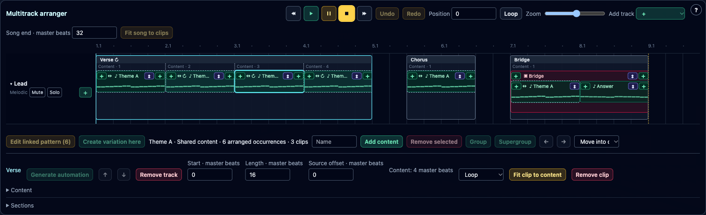

**Content · 1, Content · 2, …** label loop repetitions. For four repetitions `A A A A`, click the pattern in Content 2, Shift-click the pattern in Content 3, choose **Group**, then **Save**. The result is one clip containing `A [A A] A`. The outer clip keeps its name, start and length; the selected occurrences become a group. Its patterns remain linked to their original definitions.

Grouping across repetitions converts the clip to **Once** with explicit ordered content. Complete source content from cropped first/last repetitions is retained, including hidden notes and rests. Timing, neighboring clips and Song end stay unchanged. Repetition-specific transposition remains attached to the original occurrences, including after later edits to shared profiles. This save applies only to this clip; it does not offer an all-clips scope. One draft Undo reverses the grouping. After Save, Undo reverses the whole batch.

Cross-repetition selection applies to content directly inside one clip. Nested selection stays within one container occurrence; selection cannot cross clips or tracks. Command/Control and Option/Alt are not range-selection shortcuts. While a selection spans repetitions, dragging, reordering, removing and ungrouping are disabled. Group it first to obtain ordinary editable content. Existing hierarchy limits still apply. If a previous edit splits the loop, select the range again in the updated windows. Capacity rejection preserves the selection and existing drafts.

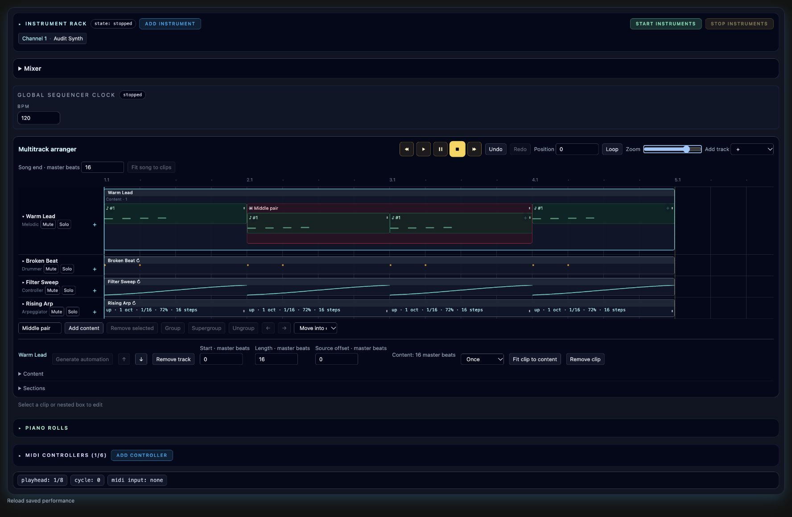

Use **Add content** or the **+** insertion markers before, between or after boxes to search the track's existing definitions. **Adopt linked** retains sharing; **Create variation** gives the inserted definition its own identity. The picker also offers **New pattern** and explicit rests. Unused saved definitions remain available. Double-click an empty area or rest inside a clip to open the same picker at the clicked position, snapped to a quarter master beat. Inside a group or supergroup, the insertion belongs to that container. Existing content stays in place; an insertion that overlaps it is rejected. Content headers still open their editors on double-click, and automation curves retain their point-editing gestures.

Expanded tracks keep the cyan **+** insertion buttons fully visible with 21 × 15 px targets. Collapsed tracks use smaller 14 × 10 px transposition buttons. Content names, indigo **↕** transposition buttons and the final **+** each have their own space in the header. The content boxes retain their dimensions and timing positions.

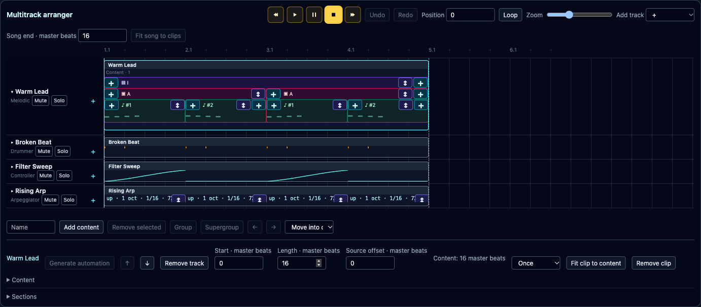

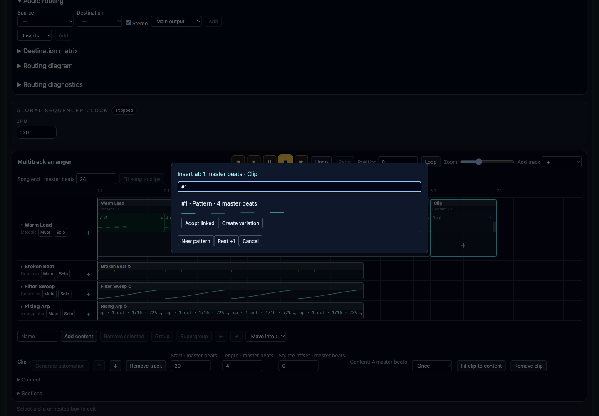

Right-click a pattern, group or supergroup and choose **Duplicate** to append a linked occurrence at the clip root, immediately after its last musical item. Consecutive sibling selections retain their order and internal rests. Trailing silence is used first; unused silence remains. The clip grows only when needed, and neighboring clips stay in place. **Ungroup** appears only when all selected items are groups or supergroups. Rest-only and cross-repetition selections cannot be duplicated.

For a looped clip, Duplicate appends **once after the final repetition**, converting the original repetitions to explicit content in one Once clip. Complete cropped source content is retained; the duplicate follows the full retained final item. Existing repetition-specific transposition and definition links are preserved. This structural save affects only the selected clip, and one Undo restores the loop. Reselect the content if an earlier structural edit split the loop. Capacity rejection retains the selection; a collision leaves the draft available for correction.

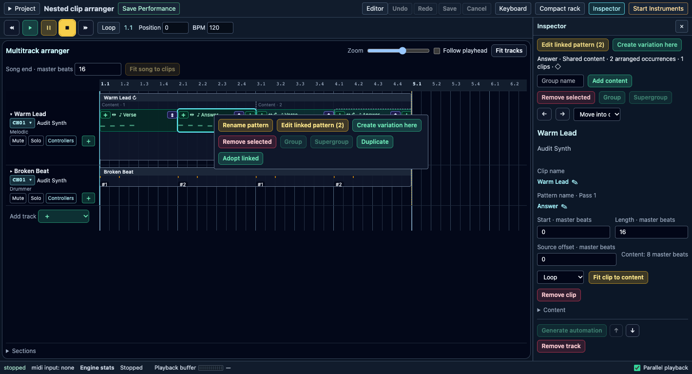

Drag a box or contiguous selection to a quarter-beat position. Moves within a clip/pass leave rests at the source and consume silence at the destination; other content stays in place. Overlapping drops are rejected. Between clips on the same track, dragging copies linked content. Between tracks of the same device type, it copies independent definitions using destination timing. Drum keys must have unambiguous destination rows; controller modes must match. Compact clips accept root drops, and hovering expands the destination track. The destination text shows the position. Self-nesting and moves across loop passes are rejected. Left/Right on a focused content header nudges it by a quarter beat. The toolbar move arrows and **Move into container** retain their explicit reorder behavior. Escape or cancelling a pointer gesture leaves the structure unchanged.

Use **Remove selected**, the matching context-menu action, or Delete/Backspace while a box is focused to remove patterns, rests or containers. The same actions work inside groups and supergroups. Removing content closes its position within the container but does not shrink the clip window; unused pattern definitions remain available. Empty containers disappear. Removing an entire clip’s content leaves a timeline gap; removing one loop pass locally preserves its other passes. The first change to shared structure asks for scope before entering the draft; the shared Save then uses that choice.

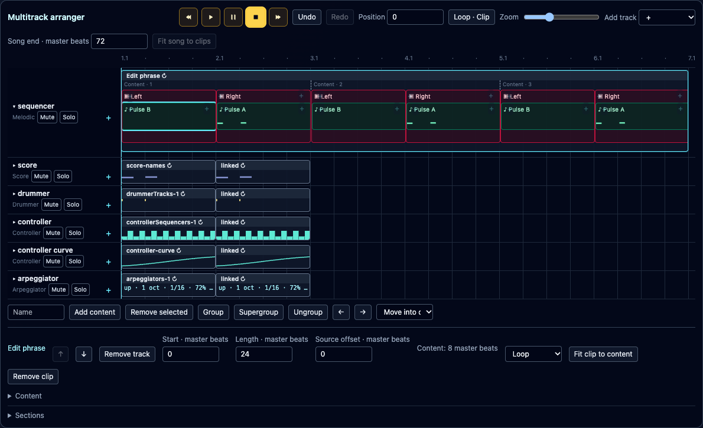

Use arranger **Play** to hear a duplicate where it was added. Drag a pattern and release it to hear it at the new position, or nudge it with Left/Right. You can make these edits while the song plays. Playback follows the chosen edit scope and the draft’s Undo/Redo. If a proposed change overlaps another clip, the arranger plays the saved structure while you correct the draft.

Use **Cancel** to restore the committed arrangement at the current song position, or **Save** to keep the whole batch as one Undo step.

Double-click a duplicated pattern before saving to open its note editor. The copy starts linked to the source. Editing its notes gives the copy its own pattern. Use arranger **Play** to hear the original phrase followed by your variation, or **Play edit** to loop the copy on its own. Closing the note editor keeps the edits pending. Use the shared **Save** to keep the copy and its edits.

Longer content grows the affected windows if space permits. Loop windows preserve their full and partial repetition span. Saving all linked occurrences evaluates every affected clip together. A collision rejects the complete save, retains the draft and names the blocking clips; later independent clips are never shifted. Shortening content does not automatically shrink clips. Valid growth extends Song end when necessary.

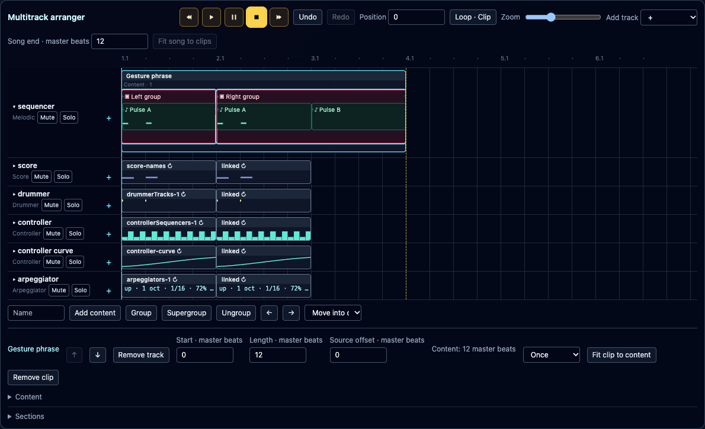

## Container inspector and musical draft conflicts

Double-click a group or supergroup to open its child inspector. Adopt linked content, add a new pattern or rest, reorder, group, ungroup, rename or remove children there. These controls edit the **same structural draft** as the expanded timeline. The original loop pass opens the linked group or supergroup directly. On a repetition, choose whether to edit the linked container or create a variation. The editor shows the affected definitions and clip boundaries, including collision rejection and empty-container removal. Undo and Redo follow edits across the inspector and the timeline. The shared Save applies the chosen scope.

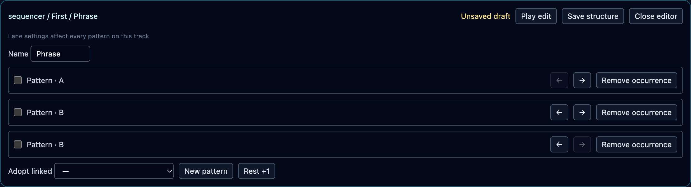

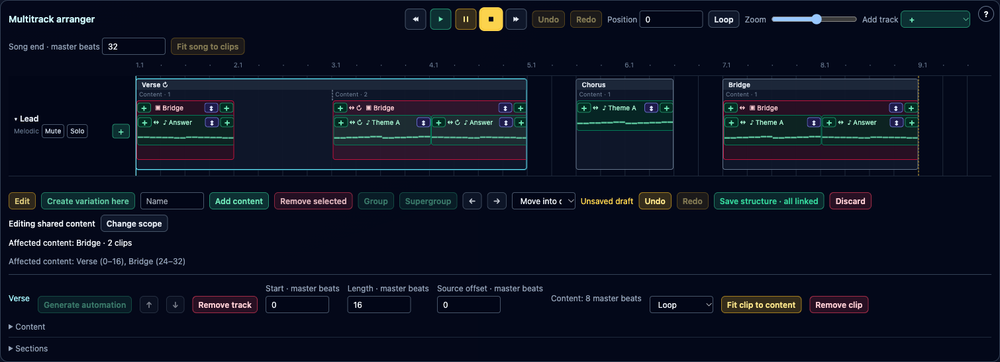

Closing the child inspector retains pending edits. You can continue working on another track and hear both changes during Arrange playback.

A local edit can fork shared parents or split a loop. The inspector follows the edited occurrence. If another clip blocks its growth, correct the conflict before saving.

Container **Play edit** loops the structure as it was when you started the audition. Stop and restart **Play edit** to refresh that loop. If the song is playing, **Stop edit** returns the lane to its current position in the arrangement, including pending structural edits.

## Transpose clips without changing notes

Click the transposition badge on a pattern, group or supergroup in the expanded arranger lane. This opens **Transpose in arranger** for that occurrence without opening or replacing the musical editor. Compact lanes also offer badges on their pattern previews; expand the lane to edit a group or supergroup directly. The existing **Transpose** controls in the detail editor remain available.

Transposition buttons always show a larger **↕** symbol with an indigo outline and background. Active buttons also show the effective signed offset when space permits: **D** means diatonic steps and **C** means chromatic semitones. Enclosing offsets are included, so each pattern shows its complete total. Hover or focus a button to identify the occurrence and its effective offset. Narrow active buttons retain their brighter indigo highlight. Click any button to add or change a transposition, including on a generated repetition.

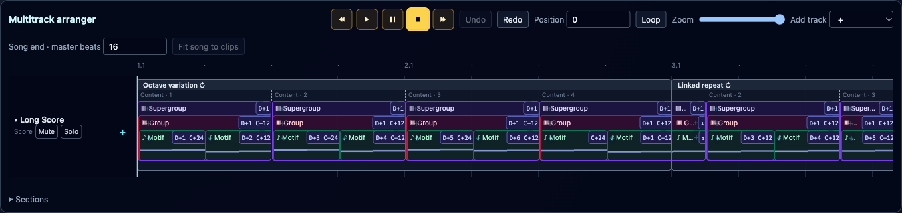

Choose **Diatonic steps** to move through each pattern’s configured scale and mode, or **Semitones** for chromatic movement. Negative values move down. Switching the displayed component preserves the other value. All pattern, group and supergroup contributions add; diatonic steps apply first, then semitones. Notes outside MIDI 0–127 after the complete transform are silent. The musical editor continues to show the original notes; timeline Note maps show the sounding pitches.

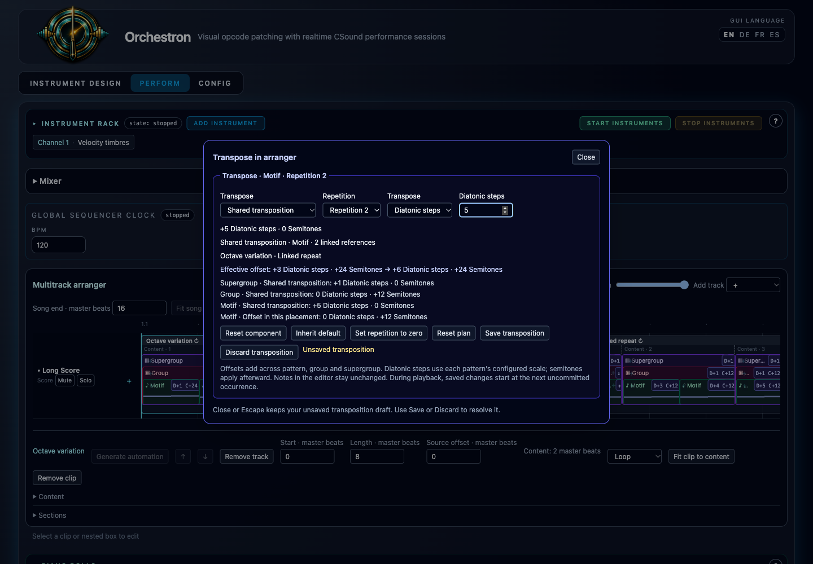

Choose the owner before changing a value:

- **Shared transposition** changes the selected definition everywhere it is used, including other clips. Its repetition settings are shared too.
- **Offset in parent** belongs to this reference inside its parent. Reusing that parent also reuses this offset.
- **Offset in this placement** belongs only to this nested location in this clip. It adds to the shared and parent settings and does not create a new pattern or split the clip.

The contribution list shows the selected item and its enclosing offsets. The inspector lists affected linked clips, compares saved and draft totals, and reports selected-pattern notes that fall outside the MIDI range. Each leaf pattern uses its own scale and mode, including when a group contains patterns with different scales.

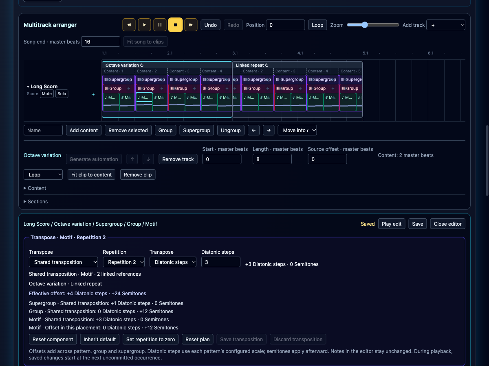

Choose **Default** for the plan’s base value, or select a generated repetition in the timeline and edit that **Repetition**. Repetition numbers follow the source content: a cropped clip can begin partway through repetition 2. They do not count how often transport has played. Descendants normally inherit their enclosing reference’s repetition number. Grouping across repetitions retains each child’s original number: a new group uses the first selected occurrence’s number, while its children can retain different numbers. Each enclosing offset is evaluated at its own reference’s number.

An explicit repetition replaces its own plan’s default; other plans still add. **Set repetition to zero** stores an explicit zero pair. **Inherit default** removes that repetition entry. **Reset component** clears only the displayed component; **Reset plan** clears the default and every repetition entry. Shortening a clip keeps hidden repetition settings for later extension.

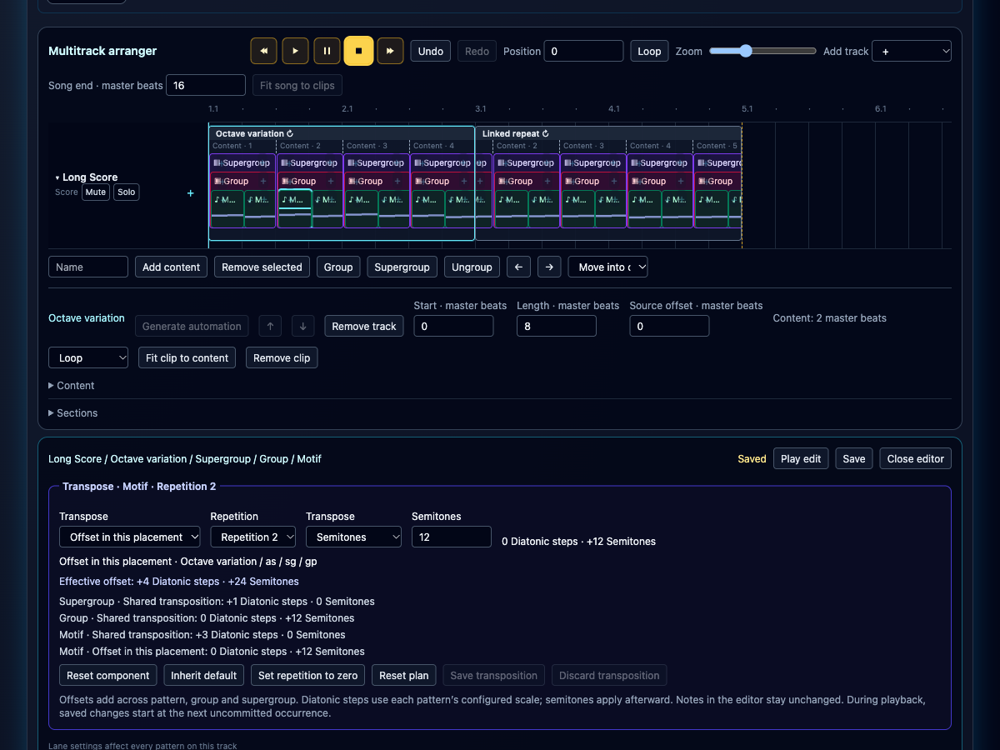

Use the arranger **Save** to keep transposition, musical edits and placements together. Shared transposition keeps its chosen scope when notes are saved as a local variation. The variation receives its own copy of the profile.

Close the transposition dialog with **Close** or Escape to continue editing. An asterisk marks pending transposition. Reopen a badge with Enter or Space.

**Play edit** auditions the full selected definition from its own start, using the selected repetition and all enclosing offsets. It retains each reference’s repetition number while auditioning; a group assembled across repetitions therefore preserves its children’s distinct transpositions. Transposition and structural drafts are snapshots for audition. Saving during arrangement playback changes the next occurrence whose notes have not started; an early attack can already belong to the next repetition. A pending indicator names the target clip, repetition and leaf position. Seek or restart uses the latest saved settings immediately.

Melodic, Score and Arpeggiator lanes support these controls. For arpeggiators, the new mapping follows their existing transpose and quantizer, and uses the pattern’s configured scale. Bypass remains unchanged. Drummer, controller and instrument-automation lanes do not offer pitch transposition.

Use a current Orchestron version when sharing performances with transposition. Native bundles and both CSD exports retain saved transposition settings; unsaved drafts and auditions are not exported.

<!-- pagebreak -->

## Resize patterns on the track

In an expanded track, drag the lower left or right border of a pattern. The box follows your drag, and **Length** shows the new total duration in master beats. The opposite edge stays fixed; length follows the pattern editor’s supported beat increments. Notes remain relative to the pattern start, and shortening retains hidden notes. Growing consumes adjacent silence; shortening inserts rests. Occupied time cannot be overwritten. Focus a pattern border and use Left/Right for keyboard resizing. Escape cancels a gesture. Clip borders continue to trim the outer playback window.

A trailing rest has a visible right-edge handle. Drag it or focus it and press Left/Right to change its duration in quarter-master-beat steps. The handle stays reachable at the visible clip edge when the rest extends beyond it; the next resize starts there. Shortening a nested trailing rest also shortens its enclosing containers when they end there. Other content keeps its position. A rest can be shortened to zero when other content remains; an otherwise empty clip keeps a positive duration.

Trimming a clip changes only its playback window and preserves hidden patterns, notes and rests. To remove a silent tail from the content, shorten or delete the trailing rest and **Save**. Then use **Fit clip to content** to shorten the outer window too. Moving or trimming a clip keeps any pending structural edits and their Undo/Redo history. A genuine change to the underlying content still requires resolving the draft. For repeated clips, use **Only this occurrence** when changing the rest duration would move later repetitions.

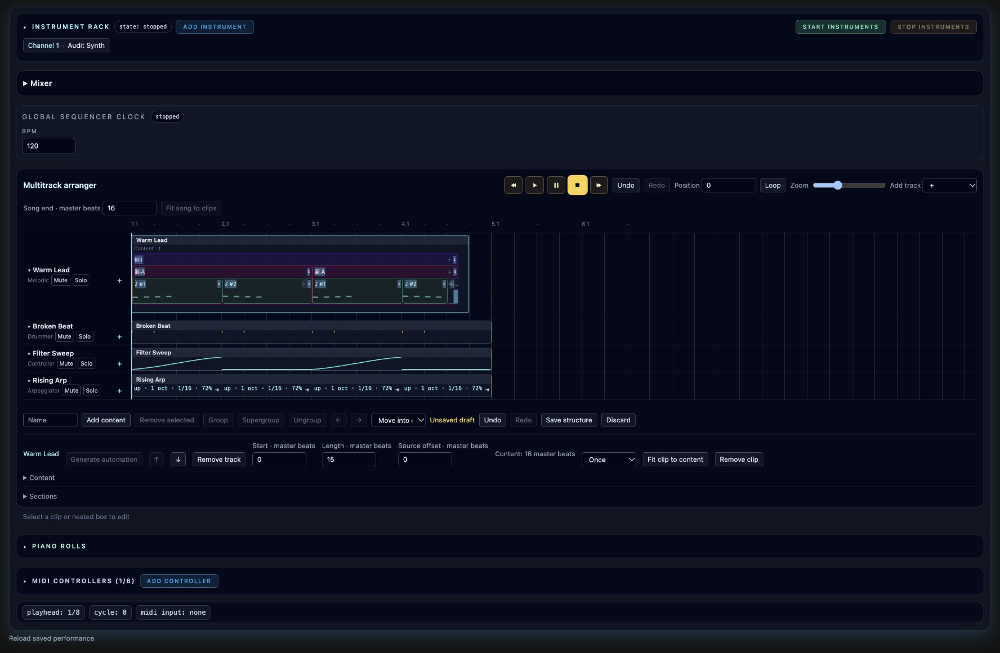

Placement, copying and pattern resizing share the structural draft and arranger Save/Cancel workflow. A first direct action that changes shared definitions is held for **Only this occurrence** or **All linked definitions**. Cancel or Escape leaves the existing draft and selection unchanged. After choosing, the action enters the draft once; subsequent actions reuse the scope. **Change scope** changes the whole draft without losing edits. If a later action requires local scope, choose to switch the entire draft or cancel that action. Root-only changes, cross-repetition grouping and loop duplication are local. All linked editing validates every affected use; collisions retain the draft.

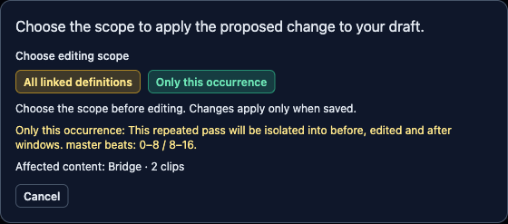

New empty clips join the current arrangement edit.

A reserved strip below the last track keeps the horizontal scrollbar clear of collapsed clips.

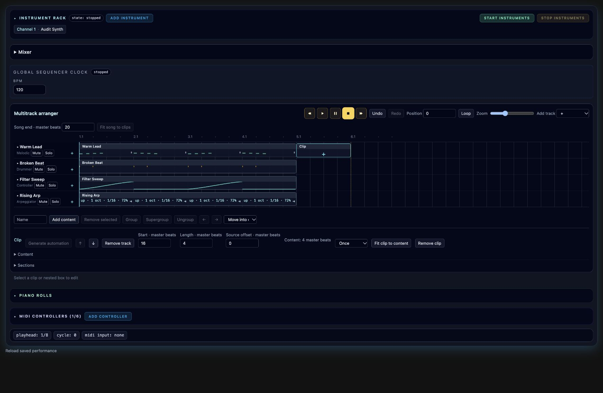

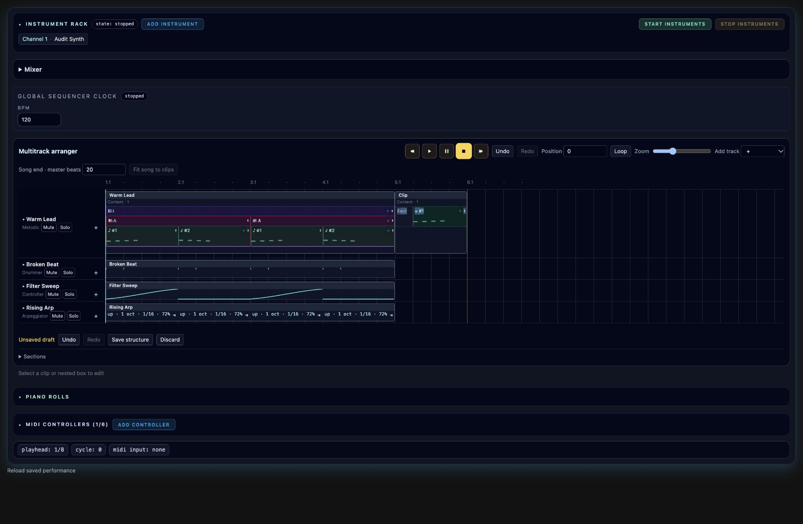

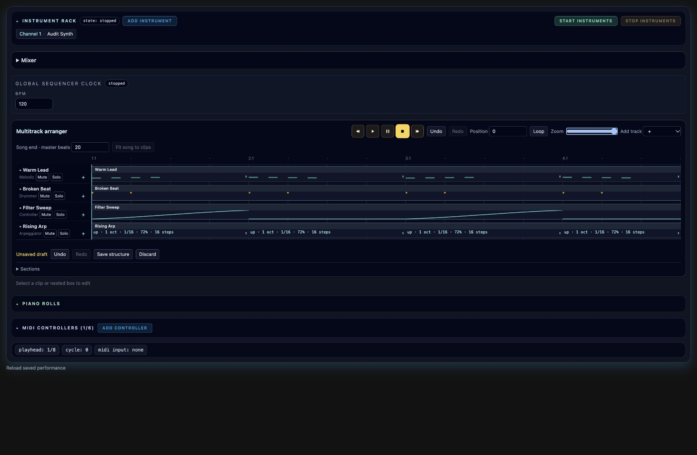

**Navigation:** [Up](performance.md) | [Previous](midi_controllers.md) | [Next](pattern_pads_and_pad_looper.md)
