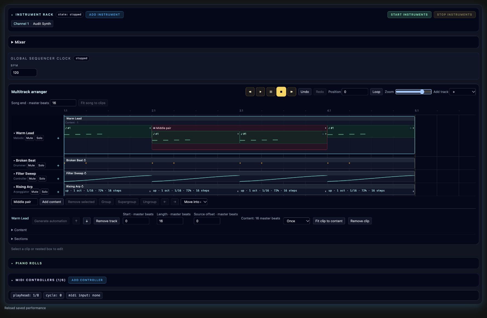
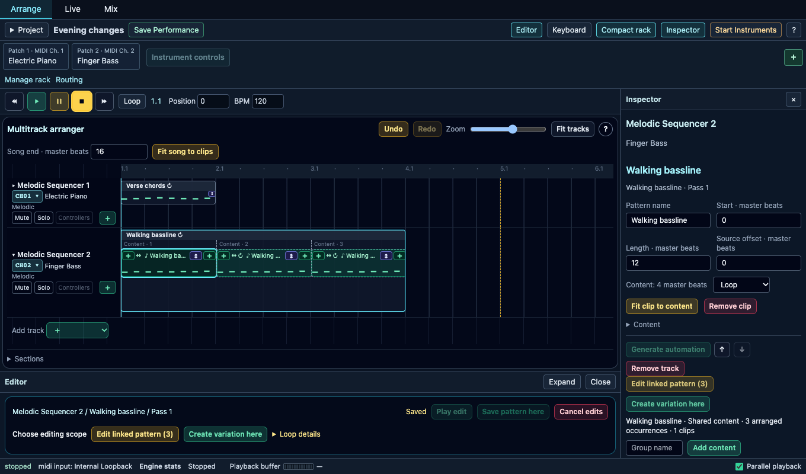
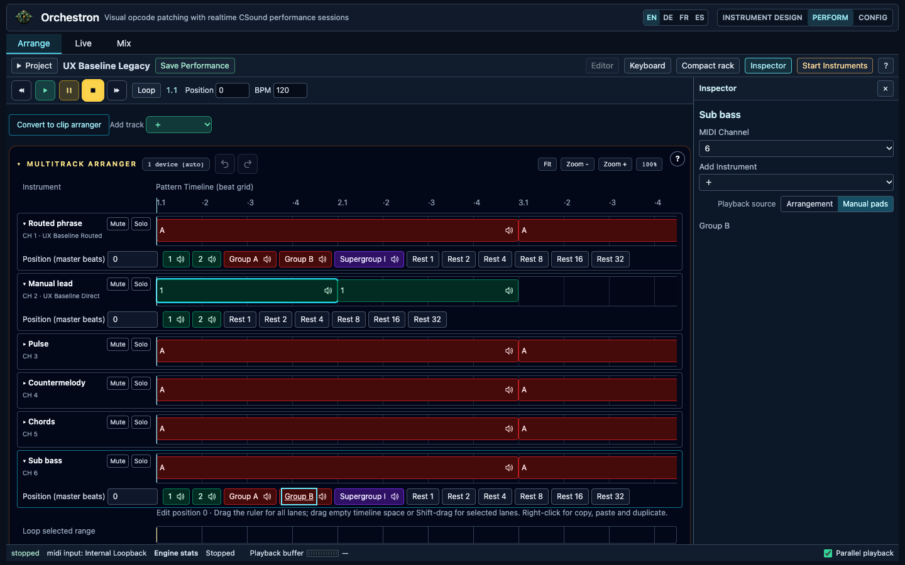

# Patterns and Reusable Phrases

**Navigation:** [Up](performance.md) | [Previous](multitrack_arranger.md) | [Next](sequencer_timing.md)

A pattern holds the musical content for one track. A clip places that content on the song timeline. The same pattern can appear in several clips, so you can reuse a phrase and choose whether an edit affects one occurrence or all linked occurrences.

## Create and reuse patterns

1. Choose **Add track** in the [multitrack arranger](multitrack_arranger.md).
2. Choose the channel in the new track header and double-click its first pattern to edit.
3. For another clip, double-click empty track space or use the track's **+**.
4. Open the clip's **+** or **Add content** and choose **New pattern**, then double-click the pattern to edit it.

Use **Adopt linked** in the content picker to reuse a saved definition. **Create variation** inserts an independent copy. Removing an occurrence from the timeline keeps its definition available for reuse.

Melodic patterns hold notes, chords, holds, strums and timing offsets. Drummer patterns hold hits, velocities, ratchets and ramps for each row. Score patterns hold notes with independent starts and durations. Controller patterns retain curves and step values. Arpeggiator patterns hold rhythm, expression, harmony and random-seed settings.

Pattern duration and clip duration are independent. Trimming a clip hides content without deleting it; **Fit clip to content** explicitly matches the window to the content. Meter, subdivision and playback speed belong to the track, while tempo is shared across the performance.

## Groups and supergroups

Expand a track to see the patterns and rests inside its clips. Click one content header, then Shift-click another or use Shift+Left/Right to select adjacent content. **Group** combines patterns and rests; **Supergroup** combines groups. Name the phrase before grouping.

Groups and supergroups are reusable definitions. **Ungroup** opens one level and retains the definition. Use the content picker to insert saved phrases into another clip on the track. See [Assemble content directly on the timeline](multitrack_arranger.md#assemble-content-directly-on-the-timeline) for selection across repetitions, rests, movement and duplication.

## Edit and save

Double-click a pattern, group or supergroup to edit it. The breadcrumb identifies the selected occurrence. Musical edits and structural edits have separate drafts.

Double-click the original loop pass to edit the linked pattern, group or supergroup directly. On a later pass, choose **Edit linked** to update every use or **Create variation here** to change only that occurrence. Separate placements of a shared definition also offer this choice. **Change scope** keeps the current draft, and Save applies the selected scope. The first structural action that changes shared definitions also waits for a scope choice. Cancel keeps the draft and selection. Save/Discard/Cancel resolves conflicting drafts before another operation proceeds.

Press **Play** to hear your pattern at its place in the song. If the song is already playing, edit notes, drum hits, arpeggiator settings or controller values as it runs. You can select another track or edit a second pattern and still hear both drafts. A local variation sounds only at the chosen occurrence. A linked edit sounds at every use.

**Cancel edits** restores the saved pattern at the current playhead. Saving the pattern commits the change to the arrangement as one undoable edit. If you close a changed pattern, choose its Save action, **Discard edits**, or **Keep editing**. After saving or discarding the last draft, choose **Save Performance**.

Performance save, autosave and exports use saved definitions. Resolve changed drafts before saving the performance, or explicitly choose the saved definitions. Drafts survive view switches until you reload the browser. **Cancel** keeps you in the current view with your edits. If loading a replacement performance fails, your drafts are still available.

## Audition a phrase

Use **Play edit** to hear a draft and **Stop edit** to return to the song. Audition does not save your work. See [Play and jam](multitrack_arranger.md#play-and-jam) for how previews interact with song playback, looping and arpeggiator input.

## Build a legacy phrase from pads

In **Live**, choose **Edit** on a legacy device and open **Pattern workspace**. In **Free workspace**, use **Insert pad…** three times to add pads 1, 2 and 1. Each insertion goes after the selected item, or at the end when the selection is empty. In **Pad actions** mode you can also drag a numbered pad directly to the desired position in the phrase.

Choose **Select all**, then **Group** to save the phrase as a reusable definition. Open the named group to revise its sequence, then choose **Apply** to update every use. **Save Performance** keeps the pads and saved definitions. Place phrases in the song from **Arrange**.

Choose **Open in arranger** to reveal the group or supergroup you are editing in its own lane’s palette. This works before you place the phrase and after you use it several times. In **Free workspace**, the same command reveals the physical pad being edited. The song cursor stays in place. Return to **Live** to pick up the draft, including unapplied changes.

## Transpose reusable content

Use the arranger's transposition controls to change pitch without rewriting notes. Shared repetition settings and local placement offsets can combine. Review the affected occurrences before saving. See [Transpose clips without changing notes](multitrack_arranger.md#transpose-clips-without-changing-notes).

**Navigation:** [Up](performance.md) | [Previous](multitrack_arranger.md) | [Next](sequencer_timing.md)
