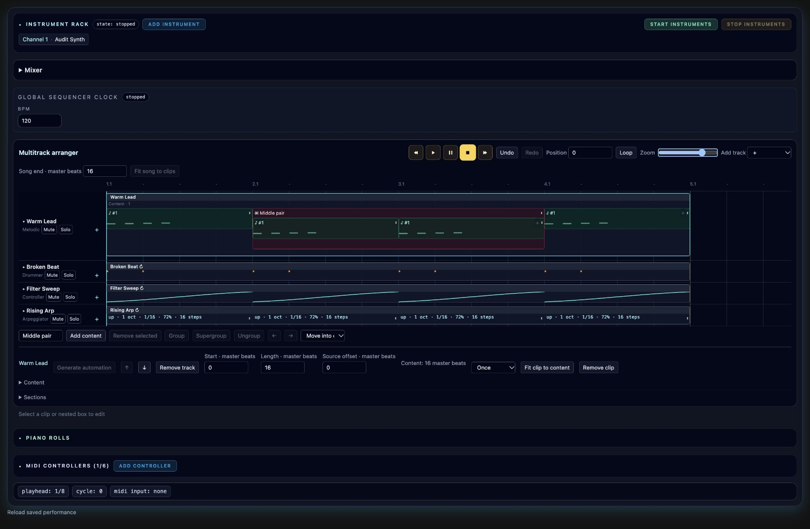
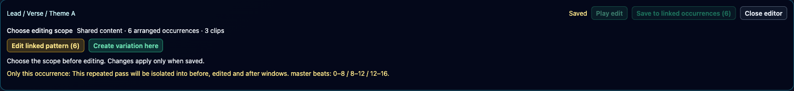

# Patterns and Reusable Phrases

**Navigation:** [Up](performance.md) | [Prev](drummer_sequencers.md) | [Next](multitrack_arranger.md)

A pattern holds the musical content for one track. A clip places that content on the song timeline. The same pattern can appear in several clips, so you can reuse a phrase and choose whether an edit affects one occurrence or all linked occurrences.

## Create and reuse patterns

1. Choose **Add track** in the [multitrack arranger](multitrack_arranger.md).
2. Edit the first pattern that opens with the new track.
3. For another clip, double-click empty track space or use the track's **+**.
4. Open the clip's **+** or **Add content** and choose **New pattern**, then double-click the pattern to edit it.

Use **Adopt linked** in the content picker to reuse a saved definition. **Create variation** inserts an independent copy. Removing an occurrence from the timeline keeps its definition available for reuse.

Melodic patterns hold notes, chords, holds, strums and timing offsets. Drummer patterns hold hits, velocities, ratchets and ramps for each row. Score patterns hold notes with independent starts and durations. Controller patterns retain curves and step values. Arpeggiator patterns hold rhythm, expression, harmony and random-seed settings.

Pattern duration and clip duration are independent. Trimming a clip hides content without deleting it; **Fit clip to content** explicitly matches the window to the content. Meter, subdivision and playback speed belong to the track, while tempo is shared across the performance.

## Groups and supergroups

Expand a track to see the patterns and rests inside its clips. Click one content header, then Shift-click another or use Shift+Left/Right to select adjacent content. **Group** combines patterns and rests; **Supergroup** combines groups. Name the phrase before grouping.

Groups and supergroups are reusable definitions. **Ungroup** opens one level and retains the definition. Use the content picker to insert saved phrases into another clip on the track. See [Assemble content directly on the timeline](multitrack_arranger.md#assemble-content-directly-on-the-timeline) for selection across repetitions, rests, movement and duplication.

## Edit and save

Double-click a pattern, group or supergroup to edit it. The breadcrumb identifies the selected occurrence. Musical edits and structural edits have separate drafts.

**Edit linked pattern/group/supergroup** and **Create variation here** choose scope before editing shared content. Independent content opens directly. The scope remains visible and can be changed while retaining edits; Save applies it without another question. The first structural action that changes shared definitions also waits for a scope choice. Cancel keeps the draft and selection. Save/Discard/Cancel resolves conflicting drafts before another operation proceeds.

Performance save, autosave and exports use saved definitions. Resolve changed drafts before saving the performance, or explicitly choose the saved definitions. Drafts survive view switches, but a browser reload does not restore them.

## Audition a phrase

Use **Play edit** to hear the open pattern or container. With the song stopped, the audition leaves the song cursor still. During song playback it replaces that track while the other tracks continue. **Stop edit** returns the track to its current song position or silence when the song is stopped. Arpeggiators need incoming notes or a chord.

Auditioning does not commit the draft. Save it with the desired occurrence scope to include the changes in the performance.

## Transpose reusable content

Use the arranger's transposition controls to change pitch without rewriting notes. Shared repetition settings and local placement offsets can combine. Review the affected occurrences before saving. See [Transpose clips without changing notes](multitrack_arranger.md#transpose-clips-without-changing-notes).

**Navigation:** [Up](performance.md) | [Prev](drummer_sequencers.md) | [Next](multitrack_arranger.md)
