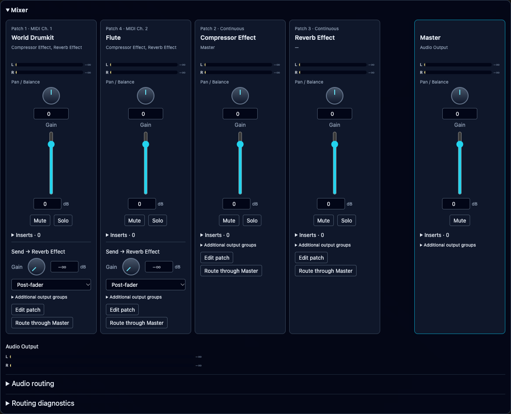

# Performance

**Navigation:** [Up](../user_documentation.md) | [Previous](../instrument_design/supported_opcodes.md) | [Next](instrument_rack_and_engine_transport.md)

Use **Perform** to turn saved instruments into a song or live setup. Start with at least one saved playable instrument, or follow [Getting Started](../getting_started.md). Your first task is to add that instrument to the rack and play it from a track on the same MIDI channel.

The performance description field displays three lines with automatic text wrapping and preserves manual line breaks. Longer descriptions scroll vertically within the field. Hover over the description to see its full text in a tooltip.

New performances start in the [multitrack arranger](multitrack_arranger.md) with one piano keyboard. Use **Add track** to create melodic, Score, drummer, controller or arpeggiator tracks, then add clips and patterns to build the song.

## Chapter Contents

<!-- manual-contents:start -->
- [Instrument Rack and Engine Transport](instrument_rack_and_engine_transport.md)
- [Audio mixer and routing](audio_mixer_and_routing.md)
- [Using Performance Controls](performance_controllers.md)
- [MIDI Setup and Inputs](../configuration/midi_setup_and_inputs.md)
- [Piano Rolls](piano_rolls.md)
- [MIDI Controllers](midi_controllers.md)
- [Multitrack Arranger](multitrack_arranger.md)
- [Patterns and Reusable Phrases](pattern_pads_and_pad_looper.md)
- [Sequencer Timing](sequencer_timing.md)
- [Melodic Sequencers and Step Editing](sequencer_tracks_and_steps.md)
- [Drummer Sequencers](drummer_sequencers.md)
- [Score Sequencers](score_sequencers.md)
- [Arpeggiators](arpeggiators.md)
- [Controller Sequencers](controller_sequencers.md)
- [Instrument Automation Clips](instrument_automation.md)
- [Live Status and Troubleshooting](live_status_and_safety_controls.md)
- [Performance Import / Export](performance_import_export.md)
<!-- manual-contents:end -->

## What You Can Do Here

- Assemble an instrument rack from saved patches and assign MIDI channels
- Mix audio with dB faders, pan/balance, mute/solo, meters, inserts and pre/post sends
- Route instruments and returns through Master or explicit direct paths
- Start/stop the instrument engine session
- Create multiple melodic sequencers, drummer sequencers, and controller sequencers
- Add arpeggiators that turn held notes into routed arpeggiated instrument output
- Edit reusable patterns and phrases, assemble song order in the arranger, and audition drafts in context
- Arrange multiple track timelines in the multitrack arranger with shared transport and loop-range playback
- Copy song sections across all or selected lanes, overwrite destinations, or insert time and shift later material together
- Perform live with piano rolls and manual MIDI controller knobs
- Save/load/clone/delete performances
- Import/export performance bundles (with optional patch definitions)
- Export offline Csound render ZIPs either with `.csd` + `.mid` playback or with inline Csound score playback

  

<em>Live “Ratchet drums demo” mixer with World Drumkit and Flute before the continuous effect strips, followed by pinned Master. Playback is stopped. See the following chapters for rack and sequencer controls.</em>

## Practical Workflow

1. Save at least one patch in Instrument Design.
2. Add instruments to the performance rack and assign channels.
3. Open Mixer, check the destination of each strip, and connect effects/returns. Guided instruments get a neutral Master automatically; existing direct routes stay direct.
4. Use Routing diagnostics → Check routing, then Start Instruments. Adjust existing mixer controls during playback.
5. Choose **Add track**, add clips and patterns, then edit their musical content. Save each draft with the desired occurrence scope.
6. Save the performance to retain the rack, routes and current mix.
7. Export the performance bundle for backup/sharing, or use `Export CSD (MIDI)` / `Export CSD (SCORE)` when you need an offline Csound render package.

Tracks start compact. Expand a track to work with nested patterns, groups and supergroups. Double-click content to edit it and use **Play edit** to audition the draft. Lane Mute/Solo is temporary and independent of the instrument mixer; see [lane controls](multitrack_arranger.md#temporary-lane-mute-and-solo).

## Sequencer timing

Use Meter, Pattern length and Subdivision for melodic, drum and controller sequencers. A one-bar 4/4 pad with three steps per beat displays twelve steps in four labeled beat groups. Playback speed is under Advanced timing. See [Sequencer timing](sequencer_timing.md) for the full guide.

## Device Names

Melodic sequencers, drummer sequencers, controller sequencers, arpeggiators, piano rolls, and MIDI controllers all support custom names. Click the pen immediately to the right of a device name to edit it. The input receives focus with its current name selected.

- **Save** or Enter applies the name; **Cancel** or Escape discards the draft. Clicking elsewhere does not save.
- Use a nonempty name of at most 65 characters, without angle brackets. Names must be unique across device types in the performance, ignoring case and surrounding spaces.
- Renaming keeps the music, routing and playback state. Names are retained by Save Performance and native exports. Switching performances or removing the device discards an unfinished name edit.

## Collapsible Panels

Click a panel title or focus it and press Enter or Space to collapse or expand its contents. Header actions, status and help remain available. Panels collapse independently, start expanded and remember your choices across view switches until browser reload. Adding a device opens its group. Collapsing preserves edits and does not stop playback. The shared tempo stays outside the sequencer groups.

The Instrument Rack, Mixer, keyboard and controller panels can be collapsed to make room for the song. The arranger is visible before adding a track. Click a track header to expand its content; double-click a pattern to open its editor. These layout choices are not saved into performances or exports.

Draft names and controller values, validation feedback, arpeggiator preset drafts, clip selections, open containers, arranger selections, range clipboard and undo history, zoom and scroll positions survive collapse/expand and switching away from Perform. Nested Mixer sections remember their open state when a parent collapses. New, Load and Import clear retained editor state after successfully replacing the workspace, even when reloading the same performance. Saving does not clear it. Removed devices and invalid selections are discarded; restored scroll positions are limited to the current content. This temporary editor state is not stored in performance files or browser storage and does not survive a page reload.

Collapsing closes temporary menus and pickers, cancels active drag previews and releases manually held piano notes. Already-applied edits remain, and existing input save/commit rules still apply. Sequenced notes continue playing. Collapsing reduces visual work and can help on a busy display.

The collapsed rack shows channel and patch name in one horizontally scrolling row. See [Compact Rack](instrument_rack_and_engine_transport.md#compact-rack) for continuous instruments, long names, and keyboard scrolling.

**Navigation:** [Up](../user_documentation.md) | [Previous](../instrument_design/supported_opcodes.md) | [Next](instrument_rack_and_engine_transport.md)
