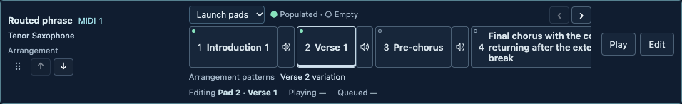
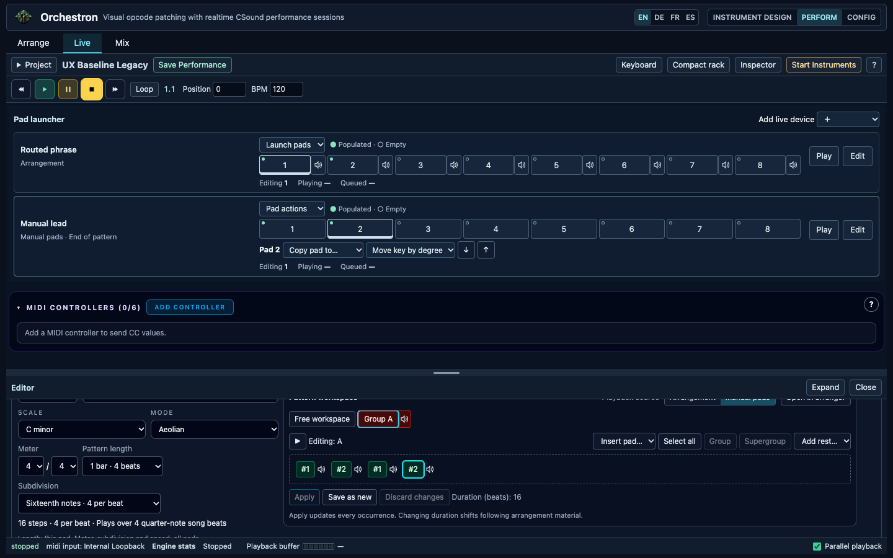
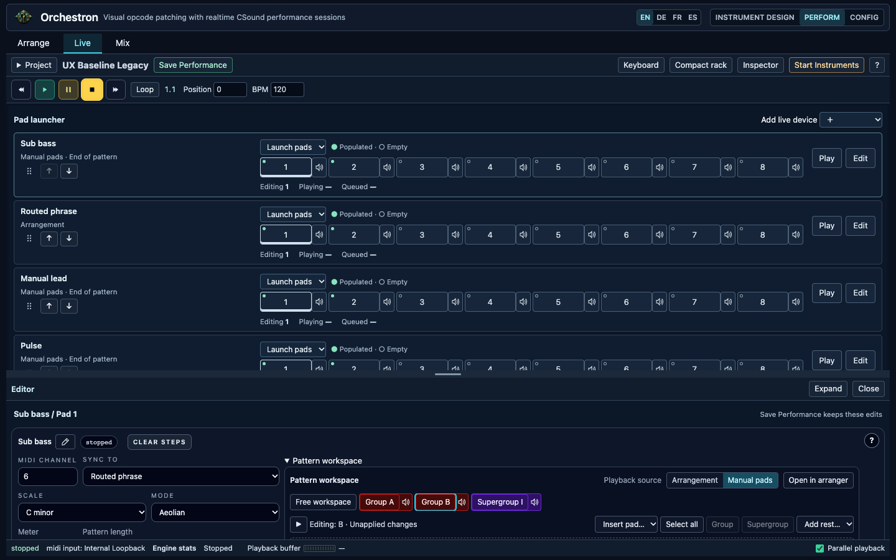
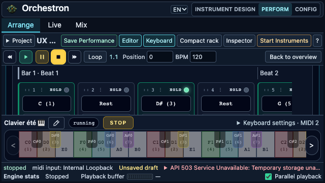
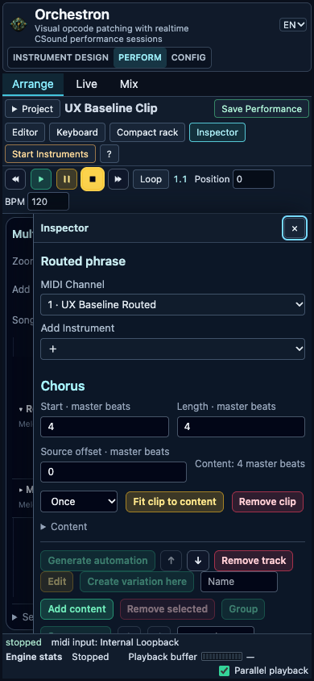

# Performance

**Navigation:** [Up](../user_documentation.md) | [Previous](../instrument_design/supported_opcodes.md) | [Next](instrument_rack_and_engine_transport.md)

Open **Perform** to arrange a song, play it live or mix its instruments. Use **Arrange**, **Live** and **Mix** to switch tasks. Each view remembers its selection, scroll position and open panels. The song transport, **Save Performance**, instrument engine and playback status bar are available in all three.

In **Project**, the performance description field displays three lines with automatic text wrapping and preserves manual line breaks. Longer descriptions scroll vertically within the field. Hover over the description to see its full text in a tooltip.

New performances start in the [multitrack arranger](multitrack_arranger.md) with one piano keyboard. Use **Add track** to create melodic, Score, drummer, controller or arpeggiator tracks, then add clips and patterns to build the song.

## Chapter Contents

<!-- manual-contents:start -->
- [Instrument Rack and Engine Transport](instrument_rack_and_engine_transport.md)
- [Sample Player](sample_player.md)
- [Audio mixer and routing](audio_mixer_and_routing.md)
- [Using Performance Controls](performance_controllers.md)
- [MIDI Setup and Inputs](../configuration/midi_setup_and_inputs.md)
- [Piano Rolls](piano_rolls.md)
- [MIDI Controllers](midi_controllers.md)
- [Multitrack Arranger](multitrack_arranger.md)
- [Patterns and Reusable Phrases](pattern_pads_and_pad_looper.md)
- [Sequencer Timing](sequencer_timing.md)
- [Melodic Sequencers and Step Editing](sequencer_tracks_and_steps.md)
- [Drummer Sequencers](drummer_sequencers.md)
- [Score Sequencers](score_sequencers.md)
- [Arpeggiators](arpeggiators.md)
- [Controller Sequencers](controller_sequencers.md)
- [Instrument Automation Clips](instrument_automation.md)
- [Live Status and Troubleshooting](live_status_and_safety_controls.md)
- [Performance Import / Export](performance_import_export.md)
<!-- manual-contents:end -->

## What You Can Do Here

- Assemble an instrument rack from saved patches and assign MIDI channels
- Map WAV and MP3 files to MIDI notes on each Sample Player instance
- Mix audio with dB faders, pan/balance, mute/solo, meters, inserts and pre/post sends
- Route instruments and returns through Master or explicit direct paths
- Start/stop the instrument engine session
- Create multiple melodic sequencers, drummer sequencers, and controller sequencers
- Add arpeggiators that turn held notes into routed arpeggiated instrument output
- Edit reusable patterns and phrases, assemble song order in the arranger, and audition drafts in context
- Arrange multiple track timelines in the multitrack arranger with shared transport and loop-range playback
- Copy song sections across all or selected lanes, overwrite destinations, or insert time and shift later material together
- Perform live with piano rolls and manual MIDI controller knobs
- Save/load/clone/delete performances
- Import/export performance bundles (with optional patch definitions)
- Export offline Csound render ZIPs either with `.csd` + `.mid` playback or with inline Csound score playback

## Practical Workflow

1. Save at least one patch in Instrument Design.
2. Open **Mix → Rack**, add instruments and assign channels.
3. Open **Mixer**, check the destination of each strip, and connect effects/returns. Guided instruments get a neutral Master automatically; existing direct routes stay direct.
4. Use Routing diagnostics → Check routing, then Start Instruments. Adjust existing mixer controls during playback.
5. Choose **Add track**, add clips and patterns, then edit their musical content. Save each draft with the desired occurrence scope.
6. Save the performance to retain the rack, routes and current mix.
7. Export the performance bundle for backup/sharing, or use `Export CSD (MIDI)` / `Export CSD (SCORE)` when you need an offline Csound render package.

Tracks start compact. Expand a track to work with nested patterns, groups and supergroups. Double-click content to edit it and use **Play edit** to audition the draft. Lane Mute/Solo is temporary and independent of the instrument mixer; see [lane controls](multitrack_arranger.md#temporary-lane-mute-and-solo).

## Arrange

In **Arrange**, click a clip or one of its patterns to see its properties in the right-hand **Inspector**. Double-click a pattern or select it and choose **Editor** to open it below the timeline. The breadcrumb names the track, clip, pattern and loop pass you are editing. Drag the divider to give the steps more room. **Cancel edits** discards the current pattern draft. Closing a changed pattern lets you save, discard, or keep editing.

For a fill on just one chorus repeat, choose **Create variation here**, edit the notes, then choose **Save variation here**. To change the phrase everywhere it plays, choose the linked scope. Its Save button shows how many uses will change. You can switch to Live to edit a physical pad and return to the same unfinished clip. **Save Performance** stores the song.

For a legacy performance, double-click a pad occurrence to edit that physical pad. Every occurrence that refers to the pad plays the change. Use **Edit pad in Live** when you want to move to the launcher. The performance stays in its original format until you explicitly convert it.

## Launch pads in Live

Open **Live** and find the device you want to play. The MIDI channel sits beside its name, with the assigned rack instrument underneath. The compact launcher keeps both in view above the keyboard. Arpeggiators show input → output. Controller devices list their target channels, or **MIDI 1–16** for all channels. Open the **Inspector** to read a long instrument list.

**Editing** shows the physical pad you can change, **Playing** follows playback, and **Queued** shows the next manual launch.

Look for the Arrange pattern name beside the pad number, for example **2 · Verse 1**. If a numbered pattern is the sole content of a uniquely named clip, the pad shows that clip title. Long names wrap. Use the arrows above the row or swipe sideways to reach later pads. Tab moves focus through the pads without launching them. The same names appear in **Preview pads**, **Pad actions** and the pad editor. Patterns created only in Arrange appear under **Arrangement patterns** as a reference, separate from the playable pads.

1. Select a pad on a **Manual pads** device and press **Play** in its row. As soon as the pad shows as playing, you can tap the next pad once to queue it for the pattern boundary. This also works immediately after a speaker preview. To jam alongside a clip song, use **Add live device** to create a separate device.
2. Open **Keyboard** and choose the piano roll assigned to your instrument. Open **Keyboard settings** to set the MIDI channel, velocity and Autochord. Hold a focused key with Space or Enter and click another pad. On a touch screen, keep one finger on the key and tap a pad with the other.
3. Watch the queued pad turn into the playing pad at the device’s launch boundary. The compact launcher stays above the keys on a phone. Use the song transport to bring in the arrangement. An independently started Manual device keeps playing through a song seek or stop.
4. Choose **Edit** in the device row to open its physical pad. Direct pad edits take effect as you play. **Save Performance** stores them with the project. For reusable pattern definitions use **Apply**. Arpeggiator presets have separate **Update preset** and **Save as preset** actions.

A filled green dot marks a pad with playable content in its current length. A hollow dot marks an empty or silent pad. You can launch either. A controller pad sends values to its assigned destination, and an arpeggiator needs input notes to sound.

**Listen before launching.** Hold the speaker beside a pad for a quarter of a second. On a narrow bank, choose **Preview pads**, then hold the numbered speaker with a finger, Space or Enter. Release to hear the underlying part again. A Manual pad already in the queue keeps its launch time. Choose **Launch pads** to resume launching. [Phone view with a held key and pad preview](../../screenshots/perform-workspace-live-pad-preview.png)

**Prepare a variation.** Choose **Pad actions** on the device. Select the source pad, choose a destination under **Copy pad to…**, and press the button showing both pad numbers. You can also drag a pad onto another slot in this mode. For a melodic pad, select the copy and use the arrows to move its notes in scale. Hold an arrow to move the key by one degree, or choose **Move key by degree** and press an arrow once. [Build a legacy phrase from pads](pattern_pads_and_pad_looper.md#build-a-legacy-phrase-from-pads)

**Set the playing order.** Drag the dotted grip by a melodic device’s name onto the upper or lower half of another melodic row. A cyan line shows where it will land. Hold near the top or bottom of the launcher to scroll through a longer set, or press Escape to cancel. **Move up** and **Move down** also work by touch or keyboard. During playback, the editing pad, MIDI channel and queued launch stay with their device. **Save Performance** keeps the order for the next session.

**Mix** recalls the selected instance, open controls and channel-bank position when you return. To reach a kit or effect from Arrange or Live, open **Compact rack**, select its patch number, then choose a destination. [Mix a performance](audio_mixer_and_routing.md#mix-a-performance)

Keep holding the chord and switch to **Mix**. Open the instrument’s controls and turn a live insert knob. The keys continue playing on the piano roll’s MIDI channel until you release them. Closing **Keyboard**, changing its destination or leaving Perform releases held notes. The Live overview also contains the manual MIDI controllers and their channel selectors.

## Sequencer timing

Use Meter, Pattern length and Subdivision for melodic, drum and controller sequencers. A one-bar 4/4 pad with three steps per beat displays twelve steps in four labeled beat groups. Playback speed is under Advanced timing. See [Sequencer timing](sequencer_timing.md) for the full guide.

## Device Names

Melodic sequencers, drummer sequencers, controller sequencers, arpeggiators, piano rolls, and MIDI controllers all support custom names. Click the pen immediately to the right of a device name to edit it. The input receives focus with its current name selected.

- **Save** or Enter applies the name; **Cancel** or Escape discards the draft. Clicking elsewhere does not save.
- Use a nonempty name of at most 65 characters, without angle brackets. Names must be unique across device types in the performance, ignoring case and surrounding spaces.
- Renaming keeps the music, routing and playback state. Names are retained by Save Performance and native exports. Switching performances or removing the device discards an unfinished name edit.

## Collapsible Panels

The editor and keyboard open independently. Close either to return its space to the overview. On a desktop, drag the editor divider or focus it and use the arrow keys. Shift changes its height one pixel at a time. Home and End reach the limits. **Expand** gives the editor the working area above the keys and **Restore split** brings back the overview.

On a narrow or short screen, **Back to overview** returns from the editor. With a clip and keyboard open, this lets you see the song while your edit keeps sounding. **Editor** brings the same draft back. **Keyboard** toggles the keys. The **Inspector** opens over the right edge. Escape closes it and returns focus to the Inspector button.

On a short landscape screen, **Back to overview** sits beside the song transport. Scroll inside the editor to reach the note controls above the keys. If a save or playback error appears, select the red message in the status bar to read and scroll its full text. Press Escape or tap the message again to close it.

Draft names and controller values, validation feedback, arpeggiator preset drafts, clip selections, open containers, arranger selections, range clipboard and undo history, zoom and scroll positions survive collapse/expand and switching away from Perform. Nested Mixer sections remember their open state when a parent collapses. New, Load and Import clear retained editor state after successfully replacing the workspace, even when reloading the same performance. Saving does not clear it. Removed devices and invalid selections are discarded; restored scroll positions are limited to the current content. This temporary editor state is not stored in performance files or browser storage and does not survive a page reload.

Collapsing a panel closes its temporary menus and pickers and cancels its active drag previews. Closing the keyboard releases manually held piano notes. Already-applied edits remain, and existing input save/commit rules still apply. Sequenced notes continue playing. Collapsing reduces visual work and can help on a busy display.

**Compact rack** shows the instances available in this performance. Select an instance to open its controls or samples. [Compact rack](instrument_rack_and_engine_transport.md#compact-rack)

**Navigation:** [Up](../user_documentation.md) | [Previous](../instrument_design/supported_opcodes.md) | [Next](instrument_rack_and_engine_transport.md)
