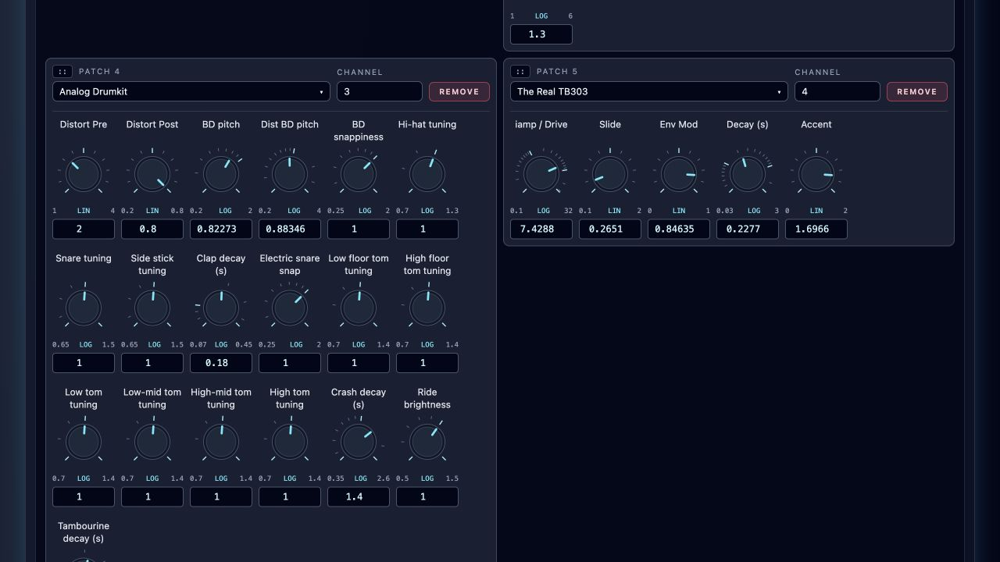
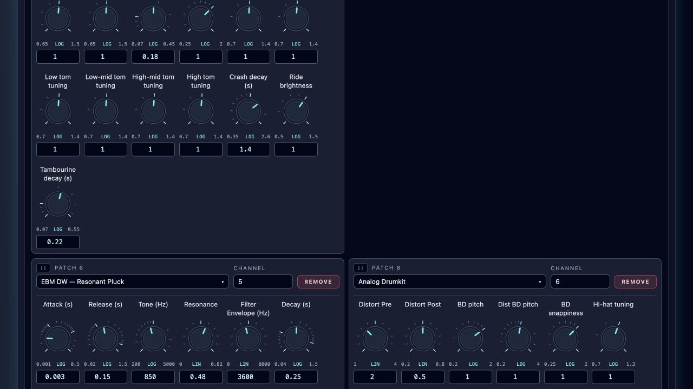

# Performance Controllers

**Navigation:** [Up](performance.md) | [Rack and transport](instrument_rack_and_engine_transport.md) | [Import and export](performance_import_export.md)

Use `perf_controller` to adapt a patch to a particular performance: envelope times, sustain, distortion amount, or another parameter accepting I-rate. Each rack instance owns its settings, even when several instances use the same patch.

## Define a Controller

Add `perf_controller` from Constants in Instrument Design. Click its gear button and configure:

| Field | Initial value | Meaning |
| --- | --- | --- |
| Minimum | 0 | Lowest setting |
| Maximum | 1 | Highest setting |
| Default | 0.5 | Setting before a rack override |
| Scale | Linear | Linear or logarithmic knob movement |
| Label | Parameter | Caption displayed in the rack |

The fields are fixed values, without input sockets or formulas. Numbers must be finite, minimum smaller than maximum, and default within the range. Logarithmic minimum must be positive. Labels must contain non-whitespace text and be no more than 128 characters long. For a logarithmic attack-time control, try minimum `0.001`, maximum `5`, default `0.01`, and label `Attack (s)`. Connect `iout` to the envelope’s I-rate attack input, then save the patch.

## Tune a Rack Instrument

Controllers appear in patch-node order beneath patch and channel. Controls wrap onto additional rows to fit the available card width. Each shows a caption, scale dashes, endpoints, LIN/LOG indicator, and current value. Linear ticks are equally spaced; logarithmic ticks follow ratios and mark decade boundaries.

- Drag vertically, or use arrow keys. Hold Shift for fine adjustment.
- Enter an exact number below the knob; Enter or leaving the field applies it. Escape cancels.
- Home and End choose the endpoints. Double-click, Delete, or Backspace on the focused knob resets to the patch default.
- Changes affect newly started notes. Sounding notes keep their initialized value. Continuous instruments require a rack restart.

For an instrument using [`midi_legato`](../instrument_design/midi_legato.md), settings are sampled at the start of each **phrase**. Touching and overlapping notes keep the same voice and settings; the next note after a gap reads current values.

For example, the [steel-string guitars](../../examples/instruments/steel_string_guitar/README.md)
expose Finger → Plectrum, Brightness, Body resonance, String sustain, and Release.
The legato version also exposes Slide half-time. Finger → Plectrum blends attack
and tone continuously, but its setting is still read at the next phrase or note;
moving the knob does not morph a string that is already sounding.

The [Tube Overdrive example](../instrument_design/tube_overdrive.md) exposes Drive
(dB), Tone (Hz), and Output (dB) for warm stereo saturation. Each insert instance
retains its own settings; restart the rack after changing these continuous-effect
controls.

[Stereo Delay](../instrument_design/stereo_delay.md) exposes Tempo (BPM), Beats,
Feedback and Stereo. At its defaults, echoes repeat every two seconds. Set Tempo
manually and restart the rack to apply changed settings.

[Stereo Flanger](../instrument_design/stereo_flanger.md) provides Rate, Delay,
Depth, Feedback, Stereo Phase and Mix. It preserves separate left/right paths,
supports positive and negative feedback, and can provide a wet-only send return.
Restart the rack after changing its six per-instance settings.

[Parametric Equalizer](../instrument_design/parametric_equalizer.md) provides seven
gain controls at 63 Hz, 160 Hz, 400 Hz, 1 kHz, 2.5 kHz, 6.3 kHz and 16 kHz.
All use a linear −20 to +20 dB range with 0 dB defaults. The graph converts dB
to amplitude for each filter; restart the rack after changing settings.

The [Analog Drumkit](../../examples/instruments/analog_drumkit/README.md) has shared
**BD snappiness** for notes 35/36, shared **Hi-hat tuning** for 42/46, and **Snare
tuning** for 38. Each defaults to **1**, preserving the original sound. Side stick
37, clap 39, electric snare 40, toms 41/43/45/47/48/50, crash 49, ride 51 and
tambourine 54 each have one individual characteristic control. The original four
library controls and their saved overrides remain valid. New notes adopt changes.

## Stereo Chorus Depth

[Download Stereo Chorus](../../examples/instruments/Stereo_Chorus.orch.instrument.json)
and add it as a mixer insert. **Amount** controls all twelve LFO amplitudes from
`0.001` to `0.1` seconds (default `0.02`); **LFO Frequency Multiplier** ranges from
`0.1` to `10` (default `1`). Both controls use logarithmic scales and require a
rack restart. Existing controller IDs and performance overrides are preserved.

Each tap uses `base delay + Amount + LFO`, with a 250 ms buffer. Since the LFO
swings between negative and positive Amount, taps remain between 14 and 230.5 ms
at the supplied 48 kHz / 32-sample settings. Larger Amount values increase both
modulation depth and wet delay, producing a more pronounced modulated-delay sound.
The dry stereo mix and feedback remain unchanged.

Earlier copies that use only `base delay + LFO` with a 50 ms buffer are unsafe
with large Amount values. Update the instrument and restart the rack to clear
invalid delay-buffer contents. Merely enlarging the buffer does not prevent
negative tap times.

## Save, Reload, and Export

Untouched controls follow the patch default. After a value changes, an explicit instance override remains until reset, including when it is subsequently set to the current default. App state retains edits immediately through the existing persistence workflow; Save Performance is required to update a saved performance. Native JSON/ZIP bundles and both CSD (MIDI) and CSD (SCORE) exports preserve instance values. The CSD contains its initial settings and runs without a controller client. These controls do not send MIDI CC and do not become MIDI automation.

Node IDs identify controls; duplicate labels are allowed. Changing the selected patch clears its overrides. Editing a patch range clamps saved values; deleting a controller removes its override, with a notice in the rack. Standalone patch export and isolated audition use defaults; audition within a performance uses the selected instance’s values.

`perf_controller` is an Orchestron editor construct lowered to [I-rate chnget](https://csound.com/docs/manual/chnget.html) and channel initialization. It is not a native Csound opcode.

The [Stereo Widener, Bit Crusher, and Harmonizer](../instrument_design/continuous_effects.md) examples expose four, five, and six performance controls respectively. These continuous effects read their settings when the rack starts. Restart the rack after editing them. Harmonizer aligns its dry signal with its measured 32 ms processing delay at 48 kHz.
