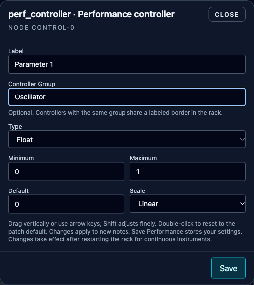
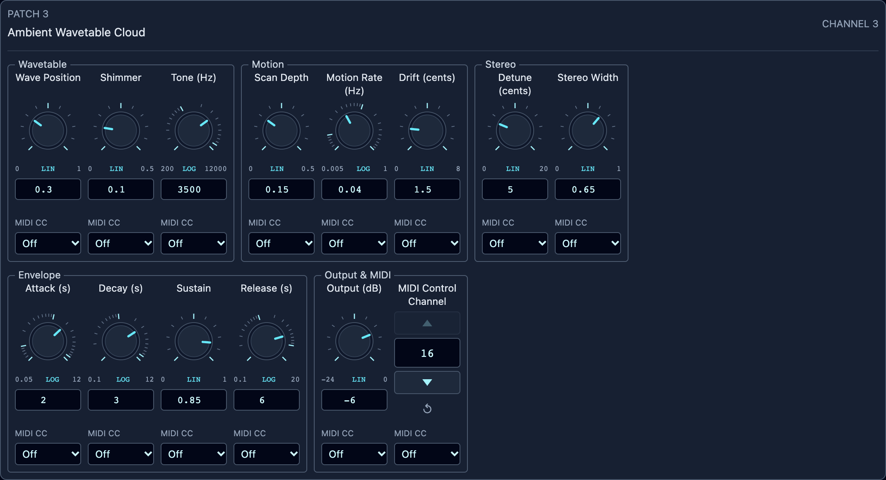
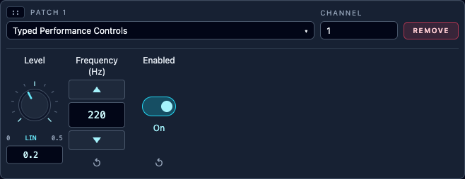
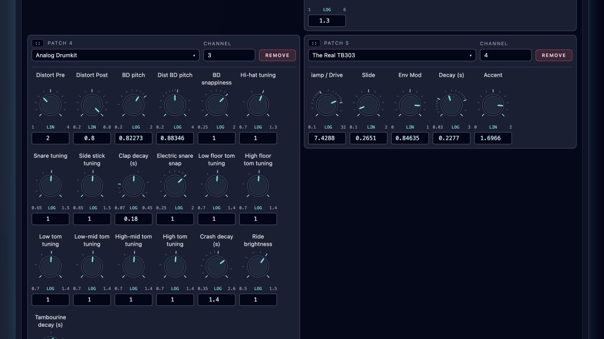
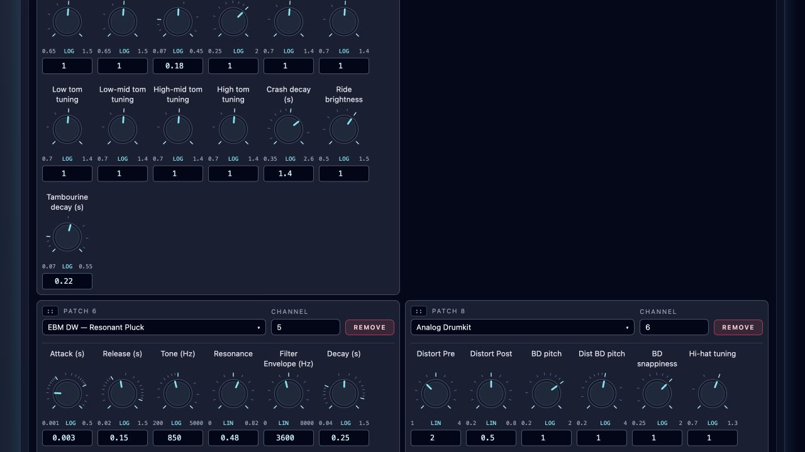
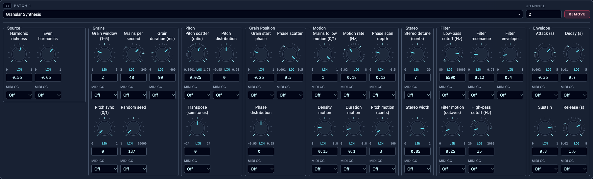
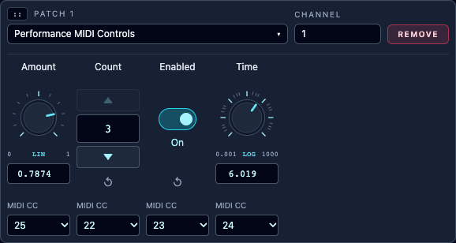

# Performance Controllers

**Navigation:** [Up](performance.md) | [Rack and transport](instrument_rack_and_engine_transport.md) | [Import and export](performance_import_export.md)

Use `perf_controller` to adapt a patch to a particular performance: envelope times, sustain, distortion amount, or another parameter accepting I-rate. Each rack instance owns its settings, even when several instances use the same patch.

## Define a Controller

Add `perf_controller` from Constants in Instrument Design. Click its gear button and configure:

| Type | Configuration | Perform control |
| --- | --- | --- |
| Float | Minimum, Maximum, Default, linear/logarithmic Scale, Label, Controller Group | Existing knob with exact numeric entry |
| Integer | Whole-number Minimum, Maximum and Default, Label, Controller Group; linear only | Up triangle, editable number, down triangle |
| Bool | On/Off Default, Label, Controller Group | On/off toggle, output `0` or `1` |

The Type selector initially chooses **Float**. Existing patches without a stored type also use Float. Float defaults remain minimum `0`, maximum `1`, default `0.5`, linear scale and label `Parameter`. Integer definitions without numeric fields use minimum `0`, maximum `1`, default `0`. Bool defaults to **Off** and uses a fixed internal `0–1` linear range.

The fields are fixed values, without input sockets or formulas. Float numbers must be finite, minimum smaller than maximum, and default within the range. Logarithmic minimum must be positive. Integer has the same ordering requirements and accepts only safe whole numbers from `−9007199254740991` to `9007199254740991`. Labels must contain non-whitespace text and be no more than 128 characters long.

Changing Type to Integer rounds the numeric fields to the nearest integer, with ties toward positive infinity (`-1.5` becomes `-1`). If rounding makes minimum and maximum equal, correct the range before saving. Changing to Bool maps a default below `0.5` to Off and any default at least `0.5` to On. Integer and Bool always use linear scale.

For a logarithmic attack-time control, choose Float, minimum `0.001`, maximum `5`, default `0.01`, and label `Attack (s)`. Connect `iout` to the envelope’s I-rate attack input, then save the patch. All three types use the same numeric I-rate output and existing compatible connections.

## Tune a Rack Instrument

Set **Controller Group** in the gear dialog to organize related controls, for example
**Oscillator**, **Filter** or **Envelope**. This optional field applies to every type
and accepts up to 128 characters. Surrounding whitespace is ignored; names are
case-sensitive. Leave it blank for controls without a group border.

Each instrument instance displays matching names inside one thin labeled border.
Groups follow their first occurrence in patch-node order; controls retain their
order within each group. Ungrouped controls share an unbordered block at their
first occurrence. Groups remain expanded and can sit beside one another or wrap.

Perform uses the available browser width. Instrument cards and controller groups
automatically choose widths and rows while retaining the saved instrument,
group and controller order. Group borders fit their controls closely; spare space
stays outside the borders. To avoid tall, narrow groups, the layout may use up to
5% more height than the shortest group arrangement, favoring less empty space
inside groups and horizontal rows. For example, Envelope can display Attack,
Decay, Sustain and Release together in one row when space allows.

Large instruments can span the rack; small instruments can share a row. The layout
adapts when you resize the window or change browser zoom. Controls retain their
normal size and remain fully visible, including at fractional zoom levels.
Resizing preserves focus and unfinished value edits.

Group names belong to the instrument definition, survive native export/import,
and do not change controller identity, saved values, MIDI assignments or sound.
Changing only a group name does not require restarting the rack.

**Float** retains its knob, caption, scale dashes, endpoints, LIN/LOG indicator and current value. Linear ticks are equally spaced; logarithmic ticks follow ratios and mark decade boundaries.

- Drag vertically, or use arrow keys. Hold Shift for fine adjustment.
- Enter an exact number below the knob; Enter or leaving the field applies it. Escape cancels.
- Home and End choose the endpoints. Double-click, Delete, or Backspace on the focused knob resets to the patch default.

**Integer** shows an upward triangle above the value and a downward triangle below it. Each click changes the value by exactly one; a button disables at its limit. Type a whole number or use Up/Down, Home and End. Enter or leaving the field applies an entry; Escape cancels it. Fractional entries are rejected, and whole numbers outside the configured range are clamped. Uncommitted drafts survive collapsing and expanding the rack.

**Bool** shows a toggle with visible On/Off text. Click it, or focus it and use Space or Enter. Off outputs `0`; On outputs `1`. Integer and Bool each provide a **Reset to patch default** button (↺), which removes the instance override.

Changes affect newly started notes. Sounding notes keep their initialized value. Continuous instruments require a rack restart. Changing a controller’s type while the rack runs also requires a restart. The same behavior applies with **Parallel playback** enabled, including when the engine falls back to single rendering.

For an instrument using [`midi_legato`](../instrument_design/midi_legato.md), settings are sampled at the start of each **phrase**. Touching and overlapping notes keep the same voice and settings; the next note after a gap reads current values.

For example, the [steel-string guitars](../../examples/instruments/steel_string_guitar/README.md)
expose Finger → Plectrum, Brightness, Body resonance, String sustain, and Release.
The legato version also exposes Slide half-time. Finger → Plectrum blends attack
and tone continuously, but its setting is still read at the next phrase or note;
moving the knob does not morph a string that is already sounding.

The [Tube Overdrive example](../instrument_design/tube_overdrive.md) exposes Drive
(dB), Tone (Hz), and Output (dB) for warm stereo saturation. Each insert instance
retains its own settings; restart the rack after changing these continuous-effect
controls.

[Stereo Delay](../instrument_design/stereo_delay.md) exposes Tempo (BPM), Beats,
Feedback and Stereo. At its defaults, echoes repeat every two seconds. Set Tempo
manually and restart the rack to apply changed settings.

[Stereo Flanger](../instrument_design/stereo_flanger.md) provides Rate, Delay,
Depth, Feedback, Stereo Phase and Mix. It preserves separate left/right paths,
supports positive and negative feedback, and can provide a wet-only send return.
Restart the rack after changing its six per-instance settings.

[Autopanner](../instrument_design/autopanner.md) provides Tempo (BPM), Beats per
cycle and Depth. Tempo is entered manually; the default sweep takes four beats
at 120 BPM. Depth zero passes stereo audio unchanged. Restart the rack after
changing any of these per-instance settings.

[Parametric Equalizer](../instrument_design/parametric_equalizer.md) provides seven
gain controls at 63 Hz, 160 Hz, 400 Hz, 1 kHz, 2.5 kHz, 6.3 kHz and 16 kHz.
All use a linear −20 to +20 dB range with 0 dB defaults. The graph converts dB
to amplitude for each filter; restart the rack after changing settings.

The [Analog Drumkit](../../examples/instruments/analog_drumkit/README.md) has shared
**BD snappiness** for notes 35/36, shared **Hi-hat tuning** for 42/46, and **Snare
tuning** for 38. Each defaults to **1**, preserving the original sound. Side stick
37, clap 39, electric snare 40, toms 41/43/45/47/48/50, crash 49, ride 51 and
tambourine 54 each have one individual characteristic control. The original four
library controls and their saved overrides remain valid. New notes adopt changes.

<!-- pagebreak -->

## Granular Synthesis

[Granular Synthesis](../../examples/instruments/granular_synthesis/README.md)
exposes 30 settings for its two `grain3` streams: harmonic source shaping, grain
windows, density and duration, pitch and phase scatter, random distributions,
internal motion, filters, ADSR and stereo width. Pan and level use the rack mixer.
The controls are grouped into Source, Grains, Pitch, Grain Position, Motion,
Stereo, Filter and Envelope. Settings apply to new notes; held notes continue their initialized internal modulation.
The guide includes controller ranges and five reproducible sound recipes.

Minimoog Monophonic also groups its 40 controls by oscillator, modulation, noise,
filter, envelopes and performance settings. Ambient Wavetable Cloud groups its
14 controls into Wavetable, Motion, Stereo, Envelope and Output & MIDI. These
group names only organize the rack; sounds, controller IDs and saved settings
remain unchanged.

## Stereo Chorus Depth

[Download Stereo Chorus](../../examples/instruments/Stereo_Chorus.orch.instrument.json)
and add it as a mixer insert. **Amount** controls all twelve LFO amplitudes from
`0.001` to `0.1` seconds (default `0.02`); **LFO Frequency Multiplier** ranges from
`0.1` to `10` (default `1`). Both controls use logarithmic scales and require a
rack restart. Existing controller IDs and performance overrides are preserved.

Each tap uses `base delay + Amount + LFO`, with a 250 ms buffer. Since the LFO
swings between negative and positive Amount, taps remain between 14 and 230.5 ms
at the supplied 48 kHz / 32-sample settings. Larger Amount values increase both
modulation depth and wet delay, producing a more pronounced modulated-delay sound.
The dry stereo mix and feedback remain unchanged.

Earlier copies that use only `base delay + LFO` with a 50 ms buffer are unsafe
with large Amount values. Update the instrument and restart the rack to clear
invalid delay-buffer contents. Merely enlarging the buffer does not prevent
negative tap times.

## Receive MIDI CC in a Performance

Each controller in the Perform rack has a **MIDI CC** selector: **Off** or **1–50**.
The assignment is saved on that rack instance in the performance. It does not change
the instrument definition. All controls receive on the instrument’s MIDI channel,
set once at the top of its rack slot; choose several target channels in a controller sequencer
to control several instances together. Multiple controls can share the same CC.
Continuous instruments and effects have no MIDI channel, so assignment is unavailable.

The engine must be running, although the arranger may be stopped. External input
uses the selected session MIDI input; manual MIDI controller lanes and controller
sequencers also work. Ordinary MIDI delivery continues, including any patch-authored
CC response. Muted controller lanes do not change mapped settings.

| Type | Incoming CC value 0–127 |
| --- | --- |
| Float | Scale across Minimum–Maximum using the controller’s LIN/LOG scale |
| Integer | Scale across Minimum–Maximum and round to the nearest integer; ties go toward positive infinity |
| Bool | 0–63 is Off; 64–127 is On |

Values 0 and 127 reach the exact endpoints. MIDI has 128 positions, so large integer
ranges skip some values. Widgets follow incoming MIDI, and Save Performance stores
the resulting values. Mouse and keyboard edits remain available; the next matching
CC can change the value again. Repeated CC messages apply even if their raw value
is unchanged. Assignments can change during playback without restarting the rack.
A new assignment waits for the next delivered CC. Off keeps the current value;
Reset to patch default keeps the assignment.

These remain I-rate settings: new notes and new legato phrases use the changed
value, while held notes retain their initialized setting. Mapping CC does not add
continuous modulation to an already sounding note. Native bundles preserve the
assignments. Both CSD export modes preserve authored CC-driven changes; external
hardware gestures are not recorded into the arrangement.

## Save, Reload, and Export

Untouched controls follow the patch default. After a value changes, an explicit instance override remains until reset, including when it is subsequently set to the current default. App state retains edits immediately through the existing persistence workflow; Save Performance is required to update a saved performance. Native JSON/ZIP bundles and both CSD (MIDI) and CSD (SCORE) exports preserve instance values. The CSD contains its initial settings and runs without a controller client. Mouse edits do not send MIDI CC. Optional assignments receive CC input as described above.

Node IDs identify controls; duplicate labels are allowed. Changing the selected patch clears its overrides. Editing a patch range clamps saved values. Changing to Integer rounds overrides to the nearest integer (ties toward positive infinity) and clamps to the range. Changing to Bool maps values below `0.5` to `0` and values at least `0.5` to `1`. Deleting a controller removes its override. These adjustments show a notice in the rack; untouched defaults remain implicit. External API and CLI submissions must already satisfy the selected type: fractional Integer values and Bool values other than `0`/`1` are rejected. Standalone patch export and isolated audition use defaults; audition within a performance uses the selected instance’s values.

`perf_controller` is an Orchestron editor construct lowered to [I-rate chnget](https://csound.com/docs/manual/chnget.html) and channel initialization. It is not a native Csound opcode.

The [Stereo Widener, Bit Crusher, and Harmonizer](../instrument_design/continuous_effects.md) examples expose four, five, and six performance controls respectively. These continuous effects read their settings when the rack starts. Restart the rack after editing them. Harmonizer aligns its dry signal with its measured 32 ms processing delay at 48 kHz.

## Automation from instrument clips

The clip arranger’s **Generate automation** action creates one bound lane per distinct assigned CC. It derives routing from this rack instance and retains suspended automation when assignments are switched Off. Curves support song-length durations, ten points and editing directly inside clips. See [Instrument automation clips](instrument_automation.md) for generation and split/merge rules. I-rate behavior remains unchanged: new notes or phrases adopt the automated value.
