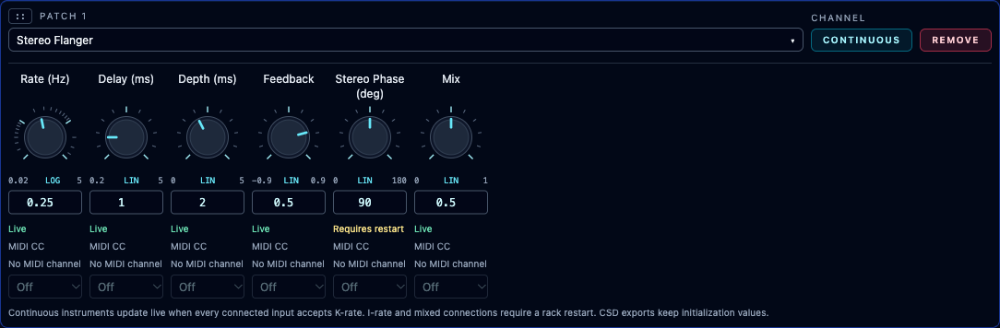

# Using Performance Controls

**Navigation:** [Up](performance.md) | [Previous](audio_mixer_and_routing.md) | [Next](../configuration/midi_setup_and_inputs.md)

Use an instrument’s performance controls to adjust envelope times, tone or other sound parameters for your song. Each rack instance owns its settings, even when several instances use the same patch.

## Define a Controller

To add or wire a control, follow [Defining Performance Controls](../instrument_design/performance_controls.md) in Instrument Design. The rest of this guide explains using controls already supplied by an instrument.

## Tune a Rack Instrument

Open the instrument's card in the rack. Related controls may appear in labeled groups such as Filter or Envelope. The layout adjusts to browser width and zoom without losing unfinished edits. To change group names or wiring, use [Defining Performance Controls](../instrument_design/performance_controls.md).

**Float** retains its knob, caption, scale dashes, endpoints, LIN/LOG indicator and current value. Linear ticks are equally spaced; logarithmic ticks follow ratios and mark decade boundaries.

- Drag vertically, or use arrow keys. Hold Shift for fine adjustment.
- Enter an exact number below the knob; Enter or leaving the field applies it. Escape cancels.
- Home and End choose the endpoints. Double-click, Delete, or Backspace on the focused knob resets to the patch default.

**Integer** shows an upward triangle above the value and a downward triangle below it. Each click changes the value by exactly one; a button disables at its limit. Type a whole number or use Up/Down, Home and End. Enter or leaving the field applies an entry; Escape cancels it. Fractional entries are rejected, and whole numbers outside the configured range are clamped. Uncommitted drafts survive collapsing and expanding the rack.

**Bool** shows a toggle with visible On/Off text. Click it, or focus it and use Space or Enter. Off outputs `0`; On outputs `1`. Integer and Bool each provide a **Reset to patch default** button (↺), which removes the instance override.

Changes affect newly started notes. Sounding notes keep their initialized value. For continuous instruments, Orchestron detects each controller’s behavior from its connections:

- **Live**: every connected input accepts K-rate, so edits apply during realtime playback.
- **Requires restart**: at least one input requires I-rate. If a controller feeds both kinds, all of its destinations keep the initial value until the rack restarts.
- **Not connected**: the controller has no destinations.

Input formulas follow the same connection rules. If/Switch selectors remain initialization settings. Save the instrument after rewiring; changing a controller’s type or detected timing while it runs requires restarting the rack. Existing instruments are analyzed automatically when loaded or compiled. The same behavior applies with **Parallel playback**, including fallback to single rendering.

Both **CSD (MIDI)** and **CSD (SCORE)** exports keep continuous-instrument settings fixed at initialization, including controls marked Live. Note and legato-phrase behavior is unchanged.

For an instrument using [`midi_legato`](../instrument_design/midi_legato.md), settings are sampled at the start of each **phrase**. Touching and overlapping notes keep the same voice and settings; the next note after a gap reads current values.

For sound-specific settings and recipes, see [Supplied Instruments and Effects](../supplied/supplied.md). The same rack controls work across instruments, even when their parameter names differ.

Additional [instrument examples](../supplied/instruments.md#more-instrument-examples) and [Stereo Chorus depth](standard_effects.md#stereo-chorus-depth) are covered in that chapter.

## Receive MIDI CC in a Performance

Each controller in the Perform rack has a **MIDI CC** selector: **Off** or **1–50**.
The assignment is saved on that rack instance in the performance. It does not change
the instrument definition. All controls receive on the instrument’s MIDI channel,
set once at the top of its rack slot; choose several target channels in a controller sequencer
to control several instances together. Multiple controls can share the same CC.
Continuous instruments and effects have no MIDI channel, so assignment is unavailable.

The engine must be running, although the arranger may be stopped. External input
uses the selected session MIDI input; manual MIDI controller lanes and controller
sequencers also work. Ordinary MIDI delivery continues, including any patch-authored
CC response. Muted controller lanes do not change mapped settings.

| Type | Incoming CC value 0–127 |
| --- | --- |
| Float | Scale across Minimum–Maximum using the controller’s LIN/LOG scale |
| Integer | Scale across Minimum–Maximum and round to the nearest integer; ties go toward positive infinity |
| Bool | 0–63 is Off; 64–127 is On |

Values 0 and 127 reach the exact endpoints. MIDI has 128 positions, so large integer
ranges skip some values. Widgets follow incoming MIDI, and Save Performance stores
the resulting values. Mouse and keyboard edits remain available; the next matching
CC can change the value again. Repeated CC messages apply even if their raw value
is unchanged. Assignments can change during playback without restarting the rack.
A new assignment waits for the next delivered CC. Off keeps the current value;
Reset to patch default keeps the assignment.

These remain I-rate settings: new notes and new legato phrases use the changed
value, while held notes retain their initialized setting. Mapping CC does not add
continuous modulation to an already sounding note. Native bundles preserve the
assignments. Both CSD export modes preserve authored CC-driven changes; external
hardware gestures are not recorded into the arrangement.

## Save, Reload, and Export

Untouched controls follow the patch default. After a value changes, an explicit instance override remains until reset, including when it is subsequently set to the current default. App state retains edits immediately through the existing persistence workflow; Save Performance is required to update a saved performance. Native JSON/ZIP bundles and both CSD (MIDI) and CSD (SCORE) exports preserve instance values. The CSD contains its initial settings and runs without a controller client. Mouse edits do not send MIDI CC. Optional assignments receive CC input as described above.

Controls are identified independently of their labels, so duplicate labels can appear. Changing the selected patch clears its overrides. Editing a patch range clamps saved values. Changing to Integer rounds overrides to the nearest integer (ties toward positive infinity) and clamps to the range. Changing to Bool maps values below `0.5` to `0` and values at least `0.5` to `1`. Deleting a controller removes its override. These adjustments show a notice in the rack; untouched defaults remain implicit. Standalone patch export uses defaults. Isolated [draft audition](../instrument_design/runtime_panel_and_compilation.md#audition-a-draft) starts from defaults and offers temporary compact controls; its values survive an audition restart for the same draft but never change a saved performance.

The [Stereo Widener, Bit Crusher, and Harmonizer](../instrument_design/continuous_effects.md) examples expose four, five, and six performance controls respectively. Check each controller’s **Live** or **Requires restart** label to see when edits take effect. Harmonizer aligns its dry signal with its measured 32 ms processing delay at 48 kHz.

## Automation from instrument clips

The clip arranger’s **Generate automation** action creates one bound lane per distinct assigned CC. It derives routing from this rack instance and retains suspended automation when assignments are switched Off. Curves support song-length durations, ten points and editing directly inside clips. See [Instrument automation clips](instrument_automation.md) for generation and split/merge rules. I-rate behavior remains unchanged: new notes or phrases adopt the automated value.

**Navigation:** [Up](performance.md) | [Previous](audio_mixer_and_routing.md) | [Next](../configuration/midi_setup_and_inputs.md)
