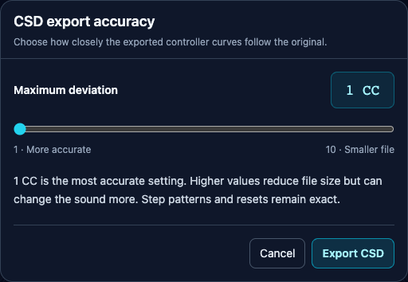
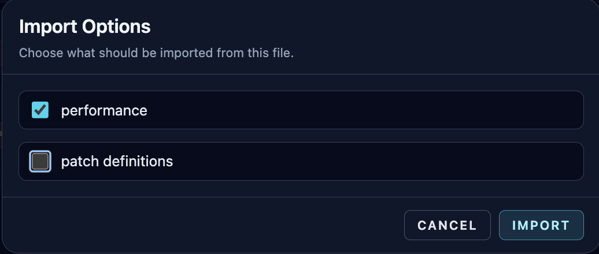
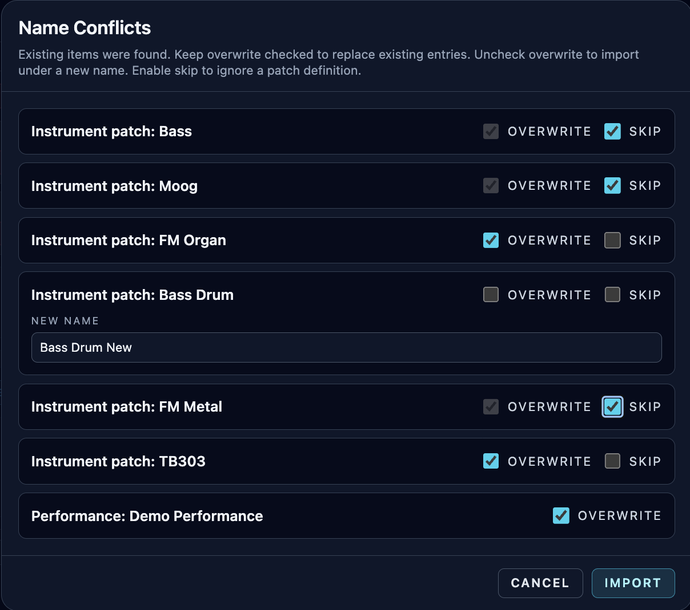

# Performance Import / Export

Performance Creator can export staged authored clips through
`edit export --mode native|midi|score --output PATH`. Native export preserves the
rack and sharing; MIDI/SCORE create the existing CSD archive with render
instructions. Exports exclude temporary auditions and do not save the staged
draft to the library. Use a new output filename. See the
[CLI song workflow](../../integrations/skills/orchestron-performance-creator/references/song_workflow.md).

**Navigation:** [Up](performance.md) | [Prev](midi_controllers.md) | [Next](live_status_and_safety_controls.md)

Performance import/export lets you move complete live setups between machines or save versioned backups.

Save/load, native import/export and autosave recovery preserve up to **16 melodic, 16 drummer and 16 controller sequencers** independently, including their MIDI channels, saved patterns and clip arrangements.

## Performance Export (`Export`)

The Performance page `Export` button creates an Orchestron performance bundle from the current performance workspace.

Use this export when you want to:

- Re-import the performance into Orchestron later
- Move a full performance setup to another machine
- Keep versioned backups of a performance together with its patch references

File extensions:

- `.orch.json`
- `.orch.zip`

## What Gets Exported

A performance export includes:

- Performance metadata (`name`, `description`)
- Up to 25 arranger Undo/Redo actions and their current history position, including redo actions after an undo. New performances and older files without history start empty; incompatible history is discarded with a notice.
- Custom names for all six performance device types. Existing names are preserved on import; the GUI applies its name validation only when renaming a device.
- Sequencer/drummer-sequencer/arpeggiator/piano-roll/controller/controller-sequencer configuration snapshot
- Instrument assignments with stable instance IDs
- Explicit audio routes, internal Master settings, insert ownership and bypass states, strip gain/balance/mute/solo, and send level/pre-post settings
- Referenced patch definitions for the instruments currently assigned in the performance rack
- Patch names (included in the snapshot for easier remapping on import)

If any referenced patch contains uploaded GEN01 audio assets or `sfload` SoundFont assets or `adsyn` analysis files, export is automatically produced as a ZIP and includes those assets.

## Offline Render Export (`Export CSD (MIDI)` / `Export CSD (SCORE)`)

The Performance page provides two offline Csound render exports:

- `Export CSD (MIDI)` creates the traditional ZIP with a compiled CSD and a separate MIDI file.
- `Export CSD (SCORE)` creates a ZIP with the performance notes and controller sweeps embedded as Csound score events.
- Both CSD export modes seed enabled manual MIDI Controller lane values at time 0 on their selected MIDI channels (all 16 by default).

Both modes omit arranger Undo/Redo history from the render request so editing
snapshots do not consume its size budget. The current music and arrangement are
preserved. Saved performances, staged CLI drafts and native exports retain their
history.

Both modes select instruments by device assignment and mixer routing:

- Include rack instances whose MIDI channel is assigned to a melodic sequencer, drummer sequencer, piano-roll keyboard or arpeggiator output. An arpeggiator input alone is not an instrument assignment.
- Device assignments count even when the device is stopped, disabled or has an empty pattern. Selection does not depend on whether a note happens during the exported arrangement.
- Include continuous (`always on`) instruments referenced by mixer routes, internal Master settings or insert ownership. Continuous generators with implicit direct audio output are also included.
- Bypassed continuous inserts contribute no effect synthesis or initialization in either CSD mode. Their inputs connect to downstream consumers, preserving active effects and required mixer controls. Assets exclusive to bypassed effects are omitted; shared assets remain when an active instance needs them. Native bundles retain the full patches and bypass state for later reactivation.
- Omit other rack instances, routes and mixer controls belonging to those omitted instances, and assets used exclusively by omitted patches. Native `Export` still preserves the complete rack.

Each CSD starts with a comment header containing the performance title, description and creation timestamp, followed by an Orchestron attribution, a short summary of Orchestron's visual instrument design, performance devices, audio routing and portable Csound export features, plus the project GitHub link. Each exported instrument also has CSD comments containing its name, description, rack instance ID and Csound reference. Multiline descriptions remain comments on every line. Routing comments identify source/destination instruments and ports, raw/strip stages, insert ownership, Master processing, direct paths that bypass Master, pre/post-fader taps, and initial gain, balance, mute and solo settings. Mixer instruments are emitted in signal-flow order.

This export is different from the normal `Export` bundle:

- `Export` is for Orchestron import/export workflows
- `Export CSD (MIDI)` and `Export CSD (SCORE)` are for rendering outside Orchestron with standard Csound tools

The MIDI ZIP contains:

- A compiled `.csd` with the selected non-template device instruments and routed continuous instruments
- Offline render settings forced to `sr = 48000` and `ksmps = 1`
- WAV output written as 32-bit float (`-f`) so exported files preserve headroom instead of baking clipping into 16-bit samples
- Always-on effect instruments started with Csound `alwayson`
- A finite `f 0 ...` score duration sized for the exported arranger playback plus a release-tail buffer
- The arranger playback rendered as a `.mid` file from beginning to arrangement end
- Enabled manual MIDI Controller lane values written into the MIDI file at tick 0 on their selected MIDI channels (all 16 by default)
- Uploaded bundled sample audio / SoundFont / `adsyn` analysis files used by the exported instruments
- A `README.txt` with the exact Csound command line needed to render the package

The SCORE ZIP contains the same compiled instruments and bundled assets, but omits the `.mid` file. Instead, it embeds note events as score `i` statements, embeds controller sequencer sweeps and enabled manual MIDI Controller lane values as score-controlled CC setter events, and rewrites supported MIDI opcodes such as `cpsmidi`, `ampmidi`, `midi_note`, `notnum`, and `midictrl` for score playback. If export-time approximations are needed, such as best-effort `ampmidi` function-table mapping, the ZIP includes `WARNINGS.txt` and the README lists the warnings.

Score statements are ordered by start time and grouped under comments such as `; Measure 14 | 00:26`, with a blank line between measure blocks. Measure numbers follow the arranger's master-bar ruler, independently of each device's local meter or playback speed. The timestamp is the measure's start time in the exported audio, shown as elapsed minutes and whole seconds (`MM:SS`, rounded down). An export starting partway through the arrangement retains its original measure numbers; its first partial measure starts at `00:00`. Only measures containing note or controller starts have blocks, so silent gaps retain their measure numbers. Sustained notes remain in their starting measure with their full duration.

SCORE exports omit repeated controller writes when the value already held by that MIDI channel and CC is unchanged. This includes Step Mode repetitions across pads, loops and rests. All lanes are considered together, so another lane changing the same channel/CC still makes a later response necessary. Startup writes and resets that change a value retain their timing. Exports containing note-triggered `initc7` patches retain repeated writes because those patches can initialize shared controller state again during playback. Live MIDI and CSD (MIDI) retain every populated step and lifecycle reset; saved performances and native bundles are unchanged.

SCORE export also removes controller-array writes that no compiled instrument reads, after preserving startup state. Dynamic controller lookups retain all destinations. MIDI mappings to per-instance I-rate settings keep the exact values needed at note starts, nearby events and final state; intermediate writes that cannot affect a note are omitted. Legato or independently scheduled/reinitialized voices retain their complete mapped stream. Continuous cutoff and resonance readers still receive their automation throughout held notes.

SCORE exports preserve eligible **original Catmull–Rom controller curves** using a shared Csound helper. Each keypoint pattern is stored once, with its arrangement occurrences. The helper reproduces the sequencer's sampled, rounded CC values, pad changes, rests and finite ending. Continuous controls follow the curve throughout held notes. Mapped I-rate parameters read its value when a new note starts and retain that setting for the note. Instrument comments remain intact.

When controller sequencers are present, **Export CSD (SCORE)** opens the **CSD export accuracy** dialog. **Maximum deviation** defaults to **1 CC** and accepts whole values from **1 to 10 CC units**. This limit applies only when a curve needs fallback approximation. Original curves do not use the tolerance, so changing it may leave file size and sound unchanged. Higher values can reduce fallback curve data at the cost of accuracy. Choose **Export CSD** to continue, or **Cancel** / **Escape** to close without exporting. MIDI export and SCORE export without controller sequencers proceed directly.



The exporter verifies original-curve scheduling against captured controller events. Cases it cannot reproduce use the existing event or approximation path. Competing lanes and note-triggered `initc7` retain explicit events; legato or independently scheduled voices retain explicit mapped parameter updates. Eligible fallback Curve Mode streams use piecewise linear `linseg` approximation, bounded by the selected deviation on the **0–127 MIDI scale** at **48 kHz** and `ksmps=1`. Startup values, abrupt jumps and final resets remain explicit. Step patterns and mapped I-rate fallback values are not approximated. Only ZIPs that actually approximate curves record the selected accuracy in the CSD header and `WARNINGS.txt`.

API exports enable `useOriginalControllerCurves` by default. Set it to `false` to use the previous piecewise-linear export. `controllerCurveTolerance` accepts integers from 1 to 10, default 1. For an exact-event SCORE export without either curve representation, send `approximateControllerCurves: false` to `/api/bundles/export/performance-csd`. Lossless unused-write and I-rate compaction still apply. CSD (MIDI) retains its captured MIDI events and ignores these settings. Changing sample rate or `ksmps` in an external host changes scheduling resolution; render comparisons and approximation bounds apply to the default settings.

SCORE exports also reduce file size without adding approximation: drum settings used only by specific note-selected Switch cases retain updates around those notes, and repeated explicit controller values and fallback curve shapes share compact definitions. Csound expands these score macros to their original numbers before rendering.

SCORE controller events last at least one control block, including double-speed Step Mode gates and stop resets. They also work if you increase `ksmps` in an external host such as the Csound Web IDE; timing then follows that host's control-block resolution. Exports still default to 48 kHz and `ksmps=1`. Re-export older files to obtain this fix, or add `p3 = max(p3, 1 / kr)` inside `instr 9000` before its controller assignment.

Only assets stored through Orchestron's upload/import flow are bundled. GEN01, `sfload`, and `adsyn` nodes must reference uploaded assets; compile, session start, and offline performance CSD export reject raw filesystem `samplePath` values instead of passing them to Csound.

Offline performance CSD export is bounded before synthesis starts: looping playback is rejected, both the range length and its absolute end position are limited to 65,536 transport steps, a single step can carry at most 16 notes, and the estimated MIDI event budget is limited to 200,000 events. MIDI generation also stops if it exceeds the event budget or takes more than 5 seconds. The CSD export request is limited to the configured bundle JSON size (8 MiB by default).

ZIP layout:

- The ZIP contains a single top-level directory
- That directory has the same basename as the exported performance `.csd`
- Inside the MIDI export directory you will find the `.csd`, `.mid`, `README.txt`, and `assets/` subdirectory
- Inside the SCORE export directory you will find the `.csd`, `README.txt`, optional `WARNINGS.txt`, and `assets/` subdirectory

Typical extracted structure:

```text
Offline_Export/
  Offline_Export.csd
  Offline_Export.mid
  README.txt
  assets/
```

Typical SCORE structure:

```text
Offline_Export/
  Offline_Export.csd
  README.txt
  WARNINGS.txt
  assets/
```

Typical use:

- Share a performance as a portable offline render package
- Render the arrangement outside Orchestron with stock Csound
- Archive a self-contained `.csd` + `.mid` + assets bundle, or a single inline-score `.csd` + assets bundle, for later mastering or batch rendering

Rendering workflow:

1. Click `Export CSD (MIDI)` or `Export CSD (SCORE)` on the Performance page.
2. Extract the downloaded ZIP.
3. Change into the bundled directory inside the extracted archive.
4. Run the command from `README.txt`, for example the MIDI export command:

```bash
csound -d -W -f -o Offline_Export.wav -F Offline_Export.mid Offline_Export.csd
```

For SCORE exports the command omits `-F`:

```bash
csound -d -W -f -o Offline_Export.wav Offline_Export.csd
```

The exported `.csd` already includes matching `CsOptions`, so `csound Offline_Export.csd` also works after you change into that directory.

## Performance Import (`Import`)

The Performance page `Import` button supports two categories of files:

Bundle imports are bounded by backend request and ZIP limits before large archive members are decompressed. Defaults are 256 MiB compressed request body, 8 MiB import JSON, 512 ZIP entries, and 256 MiB total uncompressed ZIP content. Tune these with `VISUALCSOUND_BUNDLE_IMPORT_MAX_BYTES`, `VISUALCSOUND_BUNDLE_IMPORT_JSON_MAX_BYTES`, `VISUALCSOUND_BUNDLE_IMPORT_ZIP_MAX_MEMBERS`, and `VISUALCSOUND_BUNDLE_IMPORT_ZIP_MAX_UNCOMPRESSED_BYTES`; individual bundled audio/SoundFont/analysis assets still use `VISUALCSOUND_GEN_AUDIO_ASSET_MAX_BYTES`. Persistent generated-asset storage is capped by `VISUALCSOUND_GEN_AUDIO_ASSETS_MAX_TOTAL_BYTES` and `VISUALCSOUND_GEN_AUDIO_ASSETS_MAX_COUNT`; unreferenced generated assets older than `VISUALCSOUND_GEN_AUDIO_ASSET_GC_MIN_AGE_SECONDS` are eligible for garbage collection.

### 1. Full Orchestron Performance Export (recommended)

If the file matches the performance export format, Orchestron opens an import options dialog.

### 2. Raw sequencer snapshot JSON

If the file is not a full performance export bundle, Orchestron attempts to apply it directly as a sequencer configuration snapshot.

This is useful for advanced workflows and backward compatibility.

## Import Options Dialog (Performance Bundle)

When importing a full performance bundle, you can choose whether to import:

- `performance`
- `patch definitions` (if present in the bundle)

You may import either or both. The preview stores no audio assets. Cancelling either dialog leaves the library and audio storage unchanged. After confirmation, all selected instruments, the performance, and new audio assets are saved together. A failure rolls back that batch. Malformed instrument definitions and duplicate source IDs are rejected before storage.

Typical uses:

- Import both (full environment restore)
- Import only patch definitions (extract instruments from a performance file)
- Import only performance (if the destination machine already has matching patches)

## Conflict Resolution Dialog

If names already exist, Orchestron opens a conflict dialog.

### For Patches

Per patch definition you can choose:

- Overwrite existing patch
- Rename and create a new patch
- Skip importing that patch

### For Performance

For the performance itself you can choose:

- Overwrite existing performance
- Rename and create a new performance

(Performance entries do not use `Skip` in the conflict dialog; skipping is handled via the import options step.)

## Patch ID Remapping During Performance Import

Performance bundles store instrument patch references. On import, Orchestron remaps patch IDs using:

1. Imported patch definitions (source ID -> newly created/updated destination patch ID)
2. Existing patch name matches (when patch definitions are not imported but patch names match)

This makes performance imports more portable across machines and patch databases.

## Import Validation (Resolvable Instruments Required)

A performance import fails if no instrument assignments can be resolved to available patches.

In that case:

- import patch definitions from the bundle, or
- create/match patches locally by name first

## Related Workflows

- Instrument bundle import/export is documented in [Instrument Import / Export and CSD Export](../instrument_design/instrument_import_export.md).
- You can also import patch definitions from a performance bundle on the Instrument Design page.

## Mixer snapshot

Native bundles and both performance CSD modes capture version 11 routing and mixer settings: gain, pan/balance, mute/solo, sends including pre/post, Master and inserts. Export waits for outstanding live mixer acknowledgments and reports synchronization failures. Mixer values are initialized inside each CSD and require no control client. MIDI and SCORE notes retain their authored velocities; SCORE instrument references come from the compiler manifest.

Offline rendering remains 48 kHz with ksmps=1, float WAV output, packaged assets and release tails. Equivalent routing and settings are guaranteed, not sample-identical live/offline waveforms. Finite exports without MIDI notes are supported when a routed continuous source can produce audio. Standalone patch exports remain independent of Perform settings. See [Audio mixer and routing](audio_mixer_and_routing.md) for migration and signal flow.

Both performance CSD modes use an offline compilation profile. Saved mixer settings become fixed coefficients, so rendering avoids interactive mixer smoothing and unused peak/RMS meters. These exported coefficients cannot be changed through live mixer control channels. Musical MIDI/controller curves, per-instance settings, synthesis, routing and effect tails retain their existing behavior. Previously exported CSD files are unchanged.

Csound's default logging is preserved: inlet/outlet instance creation and removal messages may still appear as notes play. For optional quiet rendering, run `csound -m0 Offline_Export.csd` from the extracted package directory. This also suppresses warning-level messages; omit `-m0` when diagnosing a render.

## Screenshots

<p align="center">
  
</p>
<p align="center"><em>Performance import options dialog for importing performance and/or patch definitions.</em></p>

<p align="center">
  
</p>
<p align="center"><em>Conflict dialog for imported patch/performance name collisions.</em></p>

**Navigation:** [Up](performance.md) | [Prev](midi_controllers.md) | [Next](live_status_and_safety_controls.md)

## Performance controller settings (version 12)

Native JSON/ZIP bundles and both CSD export modes preserve each rack instance’s `performanceControllerValues`, keyed by the `perf_controller` node ID. Unchanged controls use patch defaults; reset removes the override. Version 12 adds these values while preserving version 11 routing and mixer data; versions 1–11 still load. Patch-ID remapping during import preserves node identities and their settings.

CSD (MIDI) and CSD (SCORE) initialize values in the Csound orchestra before notes and continuous instruments start. No additional MIDI CC messages or external control client are required. Export waits for outstanding live controller updates and reports synchronization failures. Standalone patch exports use defaults. See [Performance controllers](performance_controllers.md).

## MIDI controller channel selections (version 13)

Version 13 stores each MIDI Controller and Controller Sequencer's `targetChannels` selection as a sorted list of MIDI channels 1–16. At least one channel is required. Selections survive Save/Load Performance, browser reload, and native JSON/ZIP export/import. Versions 1–12 still load; missing channel selections default to all 16 channels (OMNI).

Both CSD modes route manual initial values and automated curves to the selected channels. Manual lanes sharing a CC number keep independent values on different channels; at render start, the later enabled lane wins only where both channel and CC number overlap. Channel selection does not change which instruments are included in the CSD. The native bundle envelope remains version 1, and browser app state remains version 2.

## Internal Master (version 14)

The fixed Master is stored as `$master` in `audioGraph.masterId`, route endpoints, mixer strips and insert ownership. It has no instrument assignment or patch definition. Native imports normalize designated neutral legacy Masters before importing patches, preventing duplicate library entries. Both CSD modes generate the internal output and initialize its saved controls and inserts. Direct Audio Output paths retain their own controls and continue to bypass Master.

Versions 1–13 remain readable. App state remains version 2 and native bundle envelopes remain version 1. See [Master migration and repair](audio_mixer_and_routing.md#upgrading-existing-masters) for backups, customized processors and missing references.

## Saved patterns and arrangement

Native bundles preserve clip windows, linked pattern/group/supergroup definitions, repetitions, rests, trailing silence, transposition and instrument automation. Unused saved definitions are retained. Save each musical or structural draft before exporting, or explicitly choose the saved definitions when prompted.

Save, autosave and exports use the saved arrangement. Temporary audition selection, playback position and pending launches are not exported. Arranger Undo/Redo retains up to 25 clip edits through save/load, autosave recovery and native bundles.

Arpeggiator patterns retain rhythm steps, seeds, expression, harmony and processing/hold/playback settings. MIDI and SCORE CSD exports use the same arpeggiator scheduler as live audio, including rests, ties, ratchets, overlap and seeded variation. Export contains sequenced inputs; live keyboard gestures must be represented as sequence data to appear offline.

Melodic and drummer patterns retain timing offsets, hidden steps and inactive settings. Drummer ratchets and velocity ramps survive native round trips and render in both CSD modes. Melodic strums retain their direction, spread and each note's duration; finite exports cancel unfinished strums at the end. See [ratchet editing](drummer_sequencers.md#ratchets-and-velocity-ramps) and [strum editing](sequencer_tracks_and_steps.md#strummed-chords).

Controller patterns retain both curve and step data, the selected mode and Reset Value. Both CSD modes include start/stop resets and populated steps. MIDI retains repeated messages; SCORE may omit writes that leave the receiving value unchanged. See [Controller Sequencers](controller_sequencers.md).

Score patterns retain independent note starts, durations, velocities, scale and hidden material. MIDI and SCORE renders chase notes spanning the export start and clip at score and export boundaries. See [Score Sequencers](score_sequencers.md).

## Performance Controller MIDI Assignments

Performance configuration v22 stores optional CC 1–50 assignments per controller
and rack instance. Older performances load with assignments Off. Native JSON/ZIP
bundles and autosave preserve assignments and current values; standalone instrument
exports retain their definitions and defaults.

Both CSD modes include channel-setting events generated from authored CC input,
including enabled manual-controller initial values and controller-sequencer curves
or steps. MIDI exports align these events to the accompanying MIDI file’s ticks
and encoded tempo; SCORE exports use the captured sample timeline. Ordinary CC
messages remain available to the patch. Mapped values apply at new-note or
new-phrase initialization, including CC changes at the same time as a note.
External hardware gestures are not recorded. If you edit a MIDI file externally,
re-export its mapped parameter changes from Orchestron to regenerate the matching
channel-setting events in the CSD.

See [Performance Controllers](performance_controllers.md#receive-midi-cc-in-a-performance)
for the selector, fixed channel and conversion rules.

## Clip transposition

The clip arranger supports [shared repetition transpositions and independent nested offsets](multitrack_arranger.md#transpose-clips-without-changing-notes). Saved settings are preserved by native bundles and both MIDI and SCORE CSD exports. Transposition uses performance format v25; older readers cannot safely edit it.
