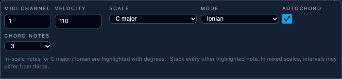
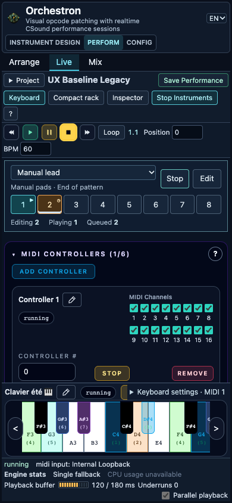
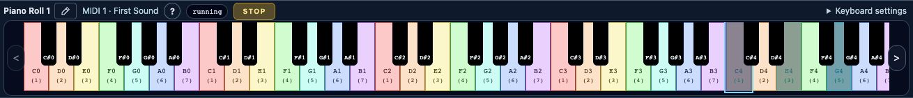
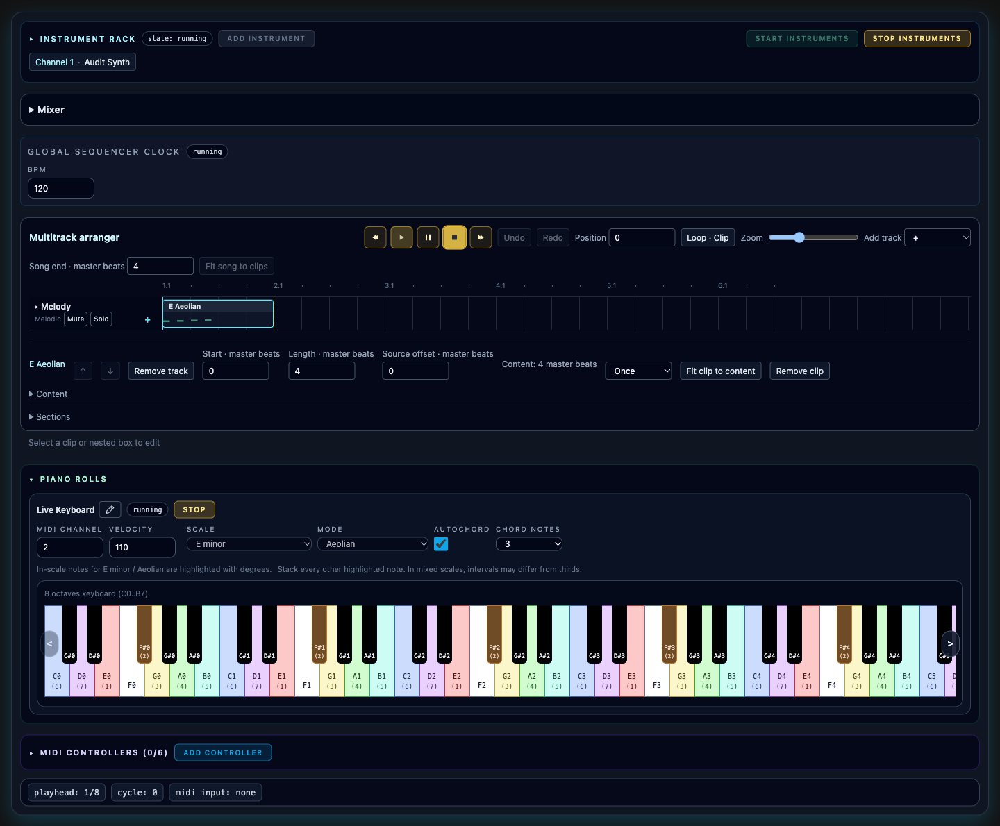

# Piano Rolls

**Navigation:** [Up](performance.md) | [Previous](../configuration/midi_setup_and_inputs.md) | [Next](midi_controllers.md)

Piano Rolls provide manual performance input with scale-aware keyboard highlighting.

Use the pen beside the device name to rename it. See [Device Names](performance.md#device-names) for editing controls, validation, and import/export behavior.

## Collapse the Panel

Open **Keyboard** in Arrange, Live or Mix. The keys sit above the status bar while you work in the song, launcher or mixer. Press **Keyboard** again to close it and release the notes you are holding.

## Purpose

Piano Rolls are for live/manual playing on an on-screen keyboard while the instrument engine is running.

They coexist with melodic sequencers and controller sequencers, which means you can jam manually on top of sequenced playback.

Starting a piano roll is independent from the multitrack arranger transport. If the instrument engine is stopped, `Start` brings up the engine so the keyboard can play without starting arrangement playback.

## Add / Remove / Enable

Each piano roll supports:

- `Add Piano Roll`
- `Remove`
- `Start` / `Stop` (enable/disable that piano roll)

A piano roll only sends notes when:

- that piano roll is enabled
- instruments are running

## Piano Roll Controls

Each piano roll has:

- `MIDI Channel` (`1..16`)
- `Velocity` (`0..127`)
- `Scale`
- `Mode`
- `Autochord` (off by default)
- `Chord notes` (`3`, `4`, or `5`, default `3`; available when Autochord is on)

Open **Keyboard settings** above the keys to change these values. The keyboard header shows the selected piano roll and its destination.

Each MIDI-driven rack instrument requires a unique MIDI channel. Set the piano roll to the channel of the instrument you want to play.

## Play alongside the Live launcher

In Perform, open **Live → Keyboard**. On a small screen the selected device’s pad launcher stays above the keys. Arrangement tracks show their saved patterns. In physical-pad mode the device has eight pads. The device selector there changes which pads you launch. Beside the piano roll’s name, read the MIDI channel and rack instrument the keys will play. Change the channel in **Keyboard settings**. Hold a key with Space or Enter while clicking pads, or use two fingers on a touch screen. Choose **Edit** to put the pad editor in the dock.

## Autochord

Enable **Autochord** to extend a highlighted key into an ascending chord. **Chord notes** counts the pressed note, so in C major pressing C4 plays:

| Chord notes | Sounding notes |
| --- | --- |
| 3 | C4–E4–G4 |
| 4 | C4–E4–G4–B4 |
| 5 | C4–E4–G4–B4–D5 |

The chord starts on the key you press and stacks every other highlighted note, continuing into higher octaves. It follows the same scale/mode as the keyboard. In **mixed** mode, it uses only notes common to the active scales; the resulting intervals may differ from thirds. For example, C major and G major share C, D, E, G, A, B, so pressing C4 with three notes plays C4–E4–A4. Sparse intersections can produce octave-spaced voicings. Keys outside the highlighted set still play single notes.

All chord notes use the keyboard’s MIDI channel and velocity. Sounding keys light up together. Notes shared with another chord stay on until their last held key releases. Scale, mode, chord size and Autochord changes take effect on the next press. Switching piano rolls or changing the keyboard’s MIDI channel releases held notes on their original channel. Upper voices can extend beyond the visible keys up to MIDI 127.

Each piano roll retains its own toggle and size through Save/Load, Clone, autosave, and native JSON/ZIP export/import. Turning Autochord off retains the chosen size. Older performances default to off/3. These controls apply to the on-screen keyboard; live gestures are not recorded into sequencers or offline CSD exports.

  

<em>With Autochord on, pressing C4 on the First Sound keyboard also sounds E4 and G4.</em>

## Scale/Mode Following Behavior During Live Playback

When the instrument engine is running and a piano roll is enabled, the piano roll follows the currently playing melodic and Score Sequencer patterns for harmonic guidance. Clip playback uses the pattern at the audible song position; Play edit uses the active audition pattern. Selecting or editing a different pattern, or queuing an audition, does not change the keyboard's guidance before it plays.

While following, Scale and Mode show the playing theory and are disabled. Key highlighting and Autochord use that same theory. The keyboard's own scale and mode remain saved separately. When no melodic source is playing—including stopped or paused tracks, clip gaps, rests between patterns and song end—the keyboard restores its own scale and mode and both selectors become editable. Starting the keyboard alone preserves these settings.

  

<em>The keyboard follows the playing E Aeolian clip; stopping melodic playback restores its own scale and mode.</em>

### Shared Scale/Mode Case

If running melodic sequencers agree on the same scale+mode:

- the piano roll shows that shared scale/mode
- keys are highlighted according to that theory

### Mixed Scale/Mode Case

If running melodic sequencers disagree:

- piano roll controls show `mixed`
- highlighting is computed from the intersection of the active theories
- only notes common to the active scales/modes are highlighted

This is especially helpful when multiple tracks create potentially conflicting harmonic contexts.

## Keyboard Range and Layout

The piano keyboard spans:

- `C0 .. B7` (96 notes)

UI behavior:

- Full-width horizontal keyboard section
- Scroll arrows appear when the keyboard overflows the viewport
- Smooth horizontal scrolling controls

## Key Highlighting and Degree Labels

Highlighted keys show:

- in-scale status
- scale degree labels (`1..7`)
- rainbow degree coloring for quick visual recognition

In mixed-theory situations, a key can show combined degree labels (for example `2/5`) when it belongs to multiple active track theories.

## Playing Notes (Pointer Interaction)

- Press/hold on a key sends `note_on`
- Release sends `note_off`
- Works for both white and black keys

The UI tracks held notes and releases them on pointer cancellation, lost capture, panel collapse, keyboard removal, or when the piano roll or instrument engine stops.

## Practical Use Cases

- Live melody or bass improvisation on top of sequencer patterns
- Testing an instrument patch in musical context without external MIDI hardware
- Performing harmonically guided lines while melodic sequencers define the key center

**Navigation:** [Up](performance.md) | [Previous](../configuration/midi_setup_and_inputs.md) | [Next](midi_controllers.md)
