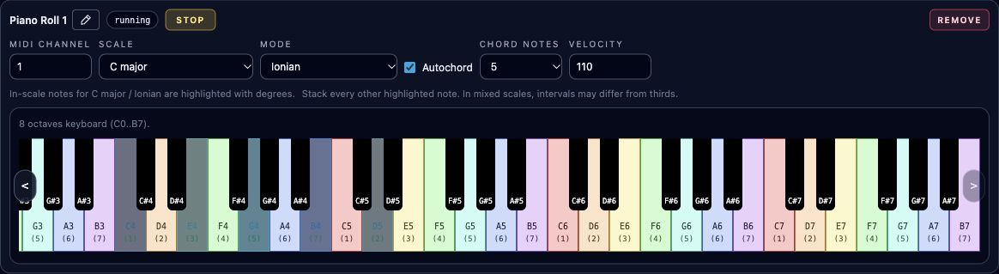
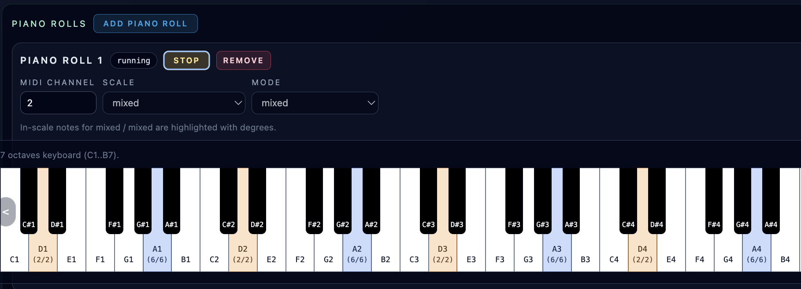

# Piano Rolls

**Navigation:** [Up](performance.md) | [Prev](arpeggiators.md) | [Next](midi_controllers.md)

Piano Rolls provide manual performance input with scale-aware keyboard highlighting.

Use the pen beside the device name to rename it. See [Device Names](performance.md#device-names) for editing controls, validation, and import/export behavior.

## Collapse the Panel

Collapse the Piano Rolls header to hide the keyboards and their settings. Add and help remain available; adding a keyboard expands the group. Panels start expanded and remember your choice across view switches until browser reload. Collapsing does not stop playback or discard edits.

## Purpose

Piano Rolls are for live/manual playing on an on-screen keyboard while the instrument engine is running.

They coexist with melodic sequencers and controller sequencers, which means you can jam manually on top of sequenced playback.

Starting a piano roll is independent from the multitrack arranger transport. If the instrument engine is stopped, `Start` brings up the engine so the keyboard can play without starting arrangement playback.

## Add / Remove / Enable

Each piano roll supports:

- `Add Piano Roll`
- `Remove`
- `Start` / `Stop` (enable/disable that piano roll)

A piano roll only sends notes when:

- that piano roll is enabled
- instruments are running

## Piano Roll Controls

Each piano roll has:

- `MIDI Channel` (`1..16`)
- `Velocity` (`0..127`)
- `Scale`
- `Mode`
- `Autochord` (off by default)
- `Chord notes` (`3`, `4`, or `5`, default `3`; available when Autochord is on)

MIDI Channel and Velocity are grouped together, with a small gap before Scale, Mode, Autochord, and Chord notes. All labels appear above their controls; the Autochord checkbox matches the height of the adjacent selectors.

Each MIDI-driven rack instrument requires a unique MIDI channel. Set the piano roll to the channel of the instrument you want to play.

## Autochord

Enable **Autochord** to extend a highlighted key into an ascending chord. **Chord notes** counts the pressed note, so in C major pressing C4 plays:

| Chord notes | Sounding notes |
| --- | --- |
| 3 | C4–E4–G4 |
| 4 | C4–E4–G4–B4 |
| 5 | C4–E4–G4–B4–D5 |

The chord starts on the key you press and stacks every other highlighted note, continuing into higher octaves. It follows the same scale/mode as the keyboard. In **mixed** mode, it uses only notes common to the active scales; the resulting intervals may differ from thirds. For example, C major and G major share C, D, E, G, A, B, so pressing C4 with three notes plays C4–E4–A4. Sparse intersections can produce octave-spaced voicings. Keys outside the highlighted set still play single notes.

All chord notes use the keyboard's MIDI channel and velocity, and visible sounding keys light up together. Release ends the chord; notes shared with another held chord stay on until their last held key releases. Changing scale, mode, channel, size, or the toggle affects the next press without altering held chords. Upper voices may extend beyond the visible keyboard, but notes above MIDI 127 are omitted.

Each piano roll retains its own toggle and size through Save/Load, Clone, autosave, and native JSON/ZIP export/import. Turning Autochord off retains the chosen size. Older performances default to off/3. These controls apply to the on-screen keyboard; live gestures are not recorded into sequencers or offline CSD exports.

## Scale/Mode Following Behavior During Live Playback

When the instrument engine is running and a piano roll is enabled, the piano roll can follow the currently running melodic sequencers for harmonic guidance.

### Shared Scale/Mode Case

If running melodic sequencers agree on the same scale+mode:

- the piano roll shows that shared scale/mode
- keys are highlighted according to that theory

### Mixed Scale/Mode Case

If running melodic sequencers disagree:

- piano roll controls show `mixed`
- highlighting is computed from the intersection of the active theories
- only notes common to the active scales/modes are highlighted

This is especially helpful when multiple tracks create potentially conflicting harmonic contexts.

## Keyboard Range and Layout

The piano keyboard spans:

- `C0 .. B7` (96 notes)

UI behavior:

- Full-width horizontal keyboard section
- Scroll arrows appear when the keyboard overflows the viewport
- Smooth horizontal scrolling controls

## Key Highlighting and Degree Labels

Highlighted keys show:

- in-scale status
- scale degree labels (`1..7`)
- rainbow degree coloring for quick visual recognition

In mixed-theory situations, a key can show combined degree labels (for example `2/5`) when it belongs to multiple active track theories.

## Playing Notes (Pointer Interaction)

- Press/hold on a key sends `note_on`
- Release sends `note_off`
- Works for both white and black keys

The UI tracks held notes and releases them on pointer cancellation, lost capture, panel collapse, keyboard removal, or when the piano roll or instrument engine stops.

## Practical Use Cases

- Live melody or bass improvisation on top of sequencer patterns
- Testing an instrument patch in musical context without external MIDI hardware
- Performing harmonically guided lines while melodic sequencers define the key center

## Screenshots

  

<em>Autochord with five notes selected and the generated chord highlighted.</em>

  

<em>Piano roll with scale-aware key highlighting and mixed-theory display behavior.</em>

**Navigation:** [Up](performance.md) | [Prev](arpeggiators.md) | [Next](midi_controllers.md)
